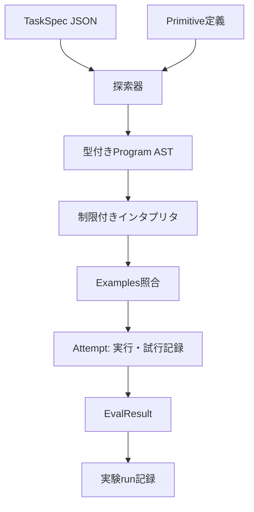
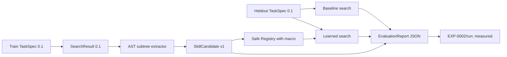

# ARCH-002 — Data contracts and flow

id: ARCH-002
status: proposed
updated: 2026-10-24
tags: contracts, schema, task, ast, evaluation

EXP-0001は**型付きの小さなDSL**を実装し、自由なPythonコードを生成・実行しない。以下のTaskSpec/ASTのJSON例は実装スキーマ `0.1` に対応する。

## 境界を越えるデータ

| オブジェクト | 意味 | 最低限のフィールド |
|---|---|---|
| TaskSpec v0 | 課題・制約 | task_id, domain, examples, limits |
| Primitive v0 | 許可された基本操作 | op_id, input_type, output_type, semantics_version |
| Program v0 | 型付きAST | node_kind, type, operands/children |
| Attempt v0 | 探索試行 | task_id, program_hash, evaluation, cost |
| SearchResult v0 | 判定と計算量 | task_id, status, solved, program, tested_candidates, max_nodes, max_candidates, elapsed_ms, trace_sha256 |
| SkillCandidate v1 | 将来の抽象技能 | skill_id, body_ast, dependencies, provenance, status |

## データフロー



### TaskSpec例（提案）
```json
{
  "schema_version": "0.1",
  "task_id": "str-trim-lower-01",
  "domain": "string_to_string",
  "examples": [
    {"input": "  RED ", "output": "red"},
    {"input": " Blue  ", "output": "blue"}
  ],
  "limits": {"max_ast_nodes": 4, "max_candidates": 5000}
}
```

### AST例（提案）
```json
{
  "node_kind": "call",
  "type": "String",
  "op_id": "lower",
  "children": [{
    "node_kind": "call",
    "type": "String",
    "op_id": "trim",
    "children": [{"node_kind": "input", "type": "String"}]
  }]
}
```

## 不変条件
1. 型に合致しないASTは実行前に拒否する。
2. 実行可能な操作はallowlistにある決定的な純粋関数だけ。
3. 同じTaskSpec・同じプリミティブ集合・同じ予算で探索順が再現する（タイムアウトによる変動を除く）。
4. 入出力例への適合と未知例への一般化は別々に測る。
5. runにはソースのcommit SHA、Python版、OS、探索制限、seed、データセット版を残す。
6. 検証器は探索アルゴリズムの外側に置き、解法を不正に誘導しない。

Related: [ARCH-001](system.md), [EXP-0001](../specs/EXP-0001.md)。

## EXP-0001の実装契約 (schema_version 0.1)

- `TaskSpec`: `domain=string_to_string`、`task_id`、`examples`（1〜256）、`limits.max_ast_nodes`（1〜32、既定4）、`limits.max_candidates`（1〜100000、既定5000）。文字列長は最大4096文字。
- `Program`: `input` または `call(op_id, child)` の一引数AST。`type=String` を型検査し、登録外操作/型不一致/ノード数超過は実行前に拒否。
- `Registry`: `trim`, `lower`, `upper` の順。実装はPython `str.strip/str.lower/str.upper`、追加依存なし。
- `Synthesis`: ノード数昇順、同じノード数では親候補の列挙順×レジストリ登録順。構造SHA-256重複除去。**意味的な重複除去はしない**。
- `Verification`: 全例の一致を要求。空の例集合は拒否。判定器は探索器と別モジュール。
- `SearchResult.status`: `solved`（全例一致）、`not_found`（指定ノード上限まで全列挙）、`budget_exhausted`（次候補を評価する前に候補予算に到達）。
- `tested_candidates` は評価したASTの個数、`trace_sha256` は評価順にAST構造ハッシュを改行連結したSHA-256。経過msは測定ノイズがあるため決定性の比較から除く。
- `--suite` の実験レポートはcommit SHA・Python・プラットフォーム・操作のsemantics_versionを同時に記録する。

**注:** `not_found` は**今回のDSLと探索上限で見つからなかった**ことを意味する。一般にその問題が解けないことの証明ではない。

実装: [protocol](../../packages/protocol/__init__.py) / [synthesis](../../packages/synthesis/__init__.py) / [runtime](../../packages/runtime/__init__.py) / [verification](../../packages/verification/__init__.py)。

## EXP-0002: SkillCandidate v1 / Macro evaluation data flow



### SkillCandidate v1（実装されたcontract）

| Field | Type | Rule |
|---|---|---|
| `schema_version` | String | `1.0` |
| `skill_id` | String | `skill_` + body_hash先頭16文字 |
| `body_ast` | Program 0.1 | 少なくとも2個のcall。既存primitiveのみを参照 |
| `body_hash` | SHA-256 | AST正規化JSONの構造hash。登録前に検証 |
| `dependencies` | sorted String[] | bodyに含まれる一意のprimitive ID |
| `provenance` | sorted String[] | 異なる成功訓練task_idが2個以上 |
| `occurrences` | Integer | distinct task_id数と一致 |
| `status` | String | 初期値 `candidate`。正式採用は自動化しない |

```json
{
  "schema_version": "1.0",
  "skill_id": "skill_<body-hash-prefix>",
  "body_ast": {
    "node_kind": "call", "type": "String", "op_id": "lower",
    "children": [{
      "node_kind": "call", "type": "String", "op_id": "trim",
      "children": [{"node_kind": "input", "type": "String"}]
    }]
  },
  "body_hash": "<SHA256 of canonical AST>",
  "dependencies": ["lower", "trim"],
  "provenance": ["train-01", "train-02"],
  "occurrences": 2,
  "status": "candidate"
}
```

### Data boundaries / 注意点
- `discover_skills(TRAIN)` への最終保留課題の入力は禁止。重複するtask_idはエラーにする。
- `registry_with_skill(candidate)` はbodyハッシュ、署名、来歴を検証し、許可済みの元primitiveを使った純粋なインタプリタに委譲する。任意Pythonソースは実行しない。
- `expanded_nodes` はmacroのInput位置へ引数ASTを置いた際の展開後ノード数を計算。探索上限 `max_ast_nodes` は**両armでこの物理ノード数に適用**。候補数上限も共通。
- `EvaluationReport` はソースcommit、Python、platform、原始演算版、train/dev/holdout task ID、候補・比較結果・判定・限界を保存。
- `status=functional_pass` は発見機構と例照合の成立のみ。`promotion_gate_metrics_pass` は独立レビューを要求する指標条件であり、自動採用ではない。
- EXP-0002はtrain/dev/finalの全入力を公開しているため、結果を用いた改良を行った後の独立評価は**新しい保留課題**が必要。

Related: [実験事前登録](../../experiments/EXP-0002/plan.md) / [仕様](../specs/EXP-0002.md) / [全体図](system.md)。

## EXP-0002 review hardening (PR #6)

- `validate_skill` explicitly rejects references to operations marked with `derived-` semantics when registering a new skill. **Nested macros remain prohibited** in this experiment; they cannot be used to undercount the AST expansion budget.
- `expanded_nodes` recursively expands skill metadata and rejects cyclic dependencies; `bounded_synthesize` rejects mismatch between derived operations in the registry and supplied skill metadata.
- New regression tests cover the formerly accepted `s(s(Input()))` macro (which expands to 5 physical AST nodes) and provenance-preserving rejection. This is a bug fix, **not** new evidence of generalization.

## EXP-0002 evaluator integrity hardening (second independent review finding)

The evaluator must verify each learned macro before any candidate search: `sha256(canonical(body_ast)) == body_hash`, `registry[skill_id].semantics_version == "derived-" + body_hash`, and that the body AST contains only approved primitives with compatible types. A matching skill ID is insufficient to protect expanded-cost accounting. This prevents swapping a shorter fake body into `learned` after a real macro has been registered. Regression tests cover mismatching body and forged internally consistent metadata.

## EXP-0002 第3回安全性検証: Registry trust boundary

- `Registry.primitives`は任意に生成可能なコンテナであり、`semantics_version`だけでは実装の真正性を保証しない。
- `bounded_synthesize`実行前に先頭3原始演算を`DEFAULT_REGISTRY`の**順序・ID・入出力型・版・callable同一性**と照合。許可外callback、旧macroを偽装した追加primitive、順序改変を拒否。
- 検証済み`SkillCandidate`からmacro実行callbackを**canonicalな原始演算のみで再構築**し、呼び出し元が渡したmacro callbackは利用しない。評価の決定性と展開後ノード上限の維持を目的とする。
- 生の`Registry`の型が安全性を保証するわけではない。上記はEXP-0002の探索評価エントリポイントでのfail-closed境界であり、`DEFAULT_REGISTRY`への自動昇格も新しい原始演算の登録も行わない。
- [P1再現条件・テスト・検査状況](../../experiments/EXP-0002/reviews/20261024-primitive-allowlist-hardening.md)を参照。事前登録計画・歴史的runは不変更。
