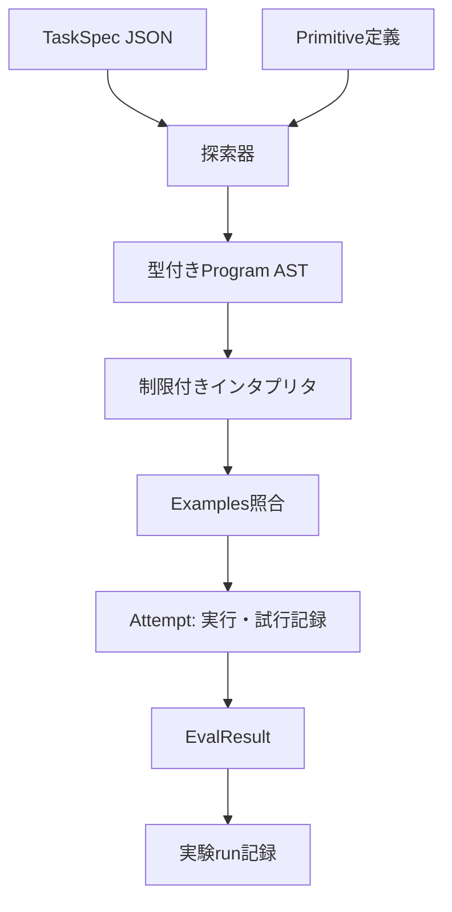

# ARCH-002 — Data contracts and flow

id: ARCH-002
status: proposed
updated: 2026-10-24
tags: contracts, schema, task, ast, evaluation

最初は**型を持つ小さなDSL**を用い、自由なPythonコードを生成・実行しない。JSON例は概念設計であり、Python実装の確定スキーマではない。

## 境界を越えるデータ

| オブジェクト | 意味 | 最低限のフィールド |
|---|---|---|
| TaskSpec v0 | 課題・制約 | task_id, domain, examples, limits |
| Primitive v0 | 許可された基本操作 | op_id, input_type, output_type, semantics_version |
| Program v0 | 型付きAST | node_kind, type, operands/children |
| Attempt v0 | 探索試行 | task_id, program_hash, evaluation, cost |
| EvalResult v0 | 判定と計算量 | solved, tested_candidates, elapsed_ms, failure_reason |
| SkillCandidate v1 | 将来の抽象技能 | skill_id, body_ast, dependencies, provenance, status |

## データフロー



### TaskSpec例（提案）
```json
{
  "schema_version": "0.1",
  "task_id": "str-trim-lower-01",
  "domain": "string_to_string",
  "examples": [
    {"input": "  RED ", "output": "red"},
    {"input": " Blue  ", "output": "blue"}
  ],
  "limits": {"max_ast_nodes": 4, "max_candidates": 5000}
}
```

### AST例（提案）
```json
{
  "node_kind": "call",
  "type": "String",
  "op_id": "lower",
  "children": [{
    "node_kind": "call",
    "type": "String",
    "op_id": "trim",
    "children": [{"node_kind": "input", "type": "String"}]
  }]
}
```

## 不変条件
1. 型に合致しないASTは実行前に拒否する。
2. 実行可能な操作はallowlistにある決定的な純粋関数だけ。
3. 同じTaskSpec・同じプリミティブ集合・同じ予算で探索順が再現する（タイムアウトによる変動を除く）。
4. 入出力例への適合と未知例への一般化は別々に測る。
5. runにはソースのcommit SHA、Python版、OS、探索制限、seed、データセット版を残す。
6. 検証器は探索アルゴリズムの外側に置き、解法を不正に誘導しない。

Related: [ARCH-001](system.md), [EXP-0001](../specs/EXP-0001.md)。
