# ARCH-002 — Data contracts and flow

id: ARCH-002
status: proposed
updated: 2026-10-28
tags: contracts, schema, task, ast, evaluation

EXP-0001は**型付きの小さなDSL**を実装し、自由なPythonコードを生成・実行しない。以下のTaskSpec/ASTのJSON例は実装スキーマ `0.1` に対応する。

## 境界を越えるデータ

| オブジェクト | 意味 | 最低限のフィールド |
|---|---|---|
| TaskSpec v0 | 課題・制約 | task_id, domain, examples, limits |
| Primitive v0 | 許可された基本操作 | op_id, input_type, output_type, semantics_version |
| Program v0 | 型付きAST | node_kind, type, operands/children |
| Attempt v0 | 探索試行 | task_id, program_hash, evaluation, cost |
| SearchResult v0 | 判定と計算量 | task_id, status, solved, program, tested_candidates, max_nodes, max_candidates, elapsed_ms, trace_sha256 |
| SkillCandidate v1 | 将来の抽象技能 | skill_id, body_ast, dependencies, provenance, status |

## データフロー

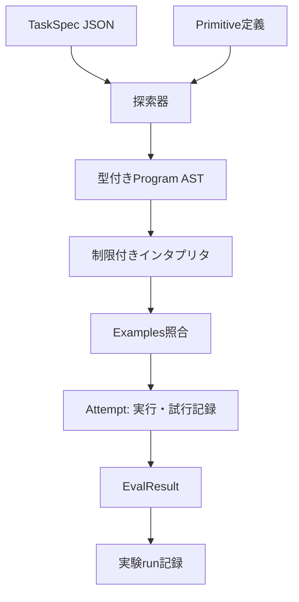

### TaskSpec例（提案）
```json
{
  "schema_version": "0.1",
  "task_id": "str-trim-lower-01",
  "domain": "string_to_string",
  "examples": [
    {"input": "  RED ", "output": "red"},
    {"input": " Blue  ", "output": "blue"}
  ],
  "limits": {"max_ast_nodes": 4, "max_candidates": 5000}
}
```

### AST例（提案）
```json
{
  "node_kind": "call",
  "type": "String",
  "op_id": "lower",
  "children": [{
    "node_kind": "call",
    "type": "String",
    "op_id": "trim",
    "children": [{"node_kind": "input", "type": "String"}]
  }]
}
```

## 不変条件
1. 型に合致しないASTは実行前に拒否する。
2. 実行可能な操作はallowlistにある決定的な純粋関数だけ。
3. 同じTaskSpec・同じプリミティブ集合・同じ予算で探索順が再現する（タイムアウトによる変動を除く）。
4. 入出力例への適合と未知例への一般化は別々に測る。
5. runにはソースのcommit SHA、Python版、OS、探索制限、seed、データセット版を残す。
6. 検証器は探索アルゴリズムの外側に置き、解法を不正に誘導しない。

Related: [ARCH-001](system.md), [EXP-0001](../specs/EXP-0001.md)。

## EXP-0001の実装契約 (schema_version 0.1)

- `TaskSpec`: `domain=string_to_string`、`task_id`、`examples`（1〜256）、`limits.max_ast_nodes`（1〜32、既定4）、`limits.max_candidates`（1〜100000、既定5000）。文字列長は最大4096文字。
- `Program`: `input` または `call(op_id, child)` の一引数AST。`type=String` を型検査し、登録外操作/型不一致/ノード数超過は実行前に拒否。
- `Registry`: `trim`, `lower`, `upper` の順。実装はPython `str.strip/str.lower/str.upper`、追加依存なし。
- `Synthesis`: ノード数昇順、同じノード数では親候補の列挙順×レジストリ登録順。構造SHA-256重複除去。**意味的な重複除去はしない**。
- `Verification`: 全例の一致を要求。空の例集合は拒否。判定器は探索器と別モジュール。
- `SearchResult.status`: `solved`（全例一致）、`not_found`（指定ノード上限まで全列挙）、`budget_exhausted`（次候補を評価する前に候補予算に到達）。
- `tested_candidates` は評価したASTの個数、`trace_sha256` は評価順にAST構造ハッシュを改行連結したSHA-256。経過msは測定ノイズがあるため決定性の比較から除く。
- `--suite` の実験レポートはcommit SHA・Python・プラットフォーム・操作のsemantics_versionを同時に記録する。

**注:** `not_found` は**今回のDSLと探索上限で見つからなかった**ことを意味する。一般にその問題が解けないことの証明ではない。

実装: [protocol](../../packages/protocol/__init__.py) / [synthesis](../../packages/synthesis/__init__.py) / [runtime](../../packages/runtime/__init__.py) / [verification](../../packages/verification/__init__.py)。

## EXP-0002: SkillCandidate v1 / Macro evaluation data flow

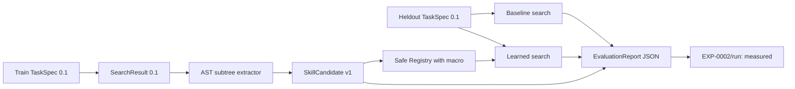

### SkillCandidate v1（実装されたcontract）

| Field | Type | Rule |
|---|---|---|
| `schema_version` | String | `1.0` |
| `skill_id` | String | `skill_` + body_hash先頭16文字 |
| `body_ast` | Program 0.1 | 少なくとも2個のcall。既存primitiveのみを参照 |
| `body_hash` | SHA-256 | AST正規化JSONの構造hash。登録前に検証 |
| `dependencies` | sorted String[] | bodyに含まれる一意のprimitive ID |
| `provenance` | sorted String[] | 異なる成功訓練task_idが2個以上 |
| `occurrences` | Integer | distinct task_id数と一致 |
| `status` | String | 初期値 `candidate`。正式採用は自動化しない |

```json
{
  "schema_version": "1.0",
  "skill_id": "skill_<body-hash-prefix>",
  "body_ast": {
    "node_kind": "call", "type": "String", "op_id": "lower",
    "children": [{
      "node_kind": "call", "type": "String", "op_id": "trim",
      "children": [{"node_kind": "input", "type": "String"}]
    }]
  },
  "body_hash": "<SHA256 of canonical AST>",
  "dependencies": ["lower", "trim"],
  "provenance": ["train-01", "train-02"],
  "occurrences": 2,
  "status": "candidate"
}
```

### Data boundaries / 注意点
- `discover_skills(TRAIN)` への最終保留課題の入力は禁止。重複するtask_idはエラーにする。
- `registry_with_skill(candidate)` はbodyハッシュ、署名、来歴を検証し、許可済みの元primitiveを使った純粋なインタプリタに委譲する。任意Pythonソースは実行しない。
- `expanded_nodes` はmacroのInput位置へ引数ASTを置いた際の展開後ノード数を計算。探索上限 `max_ast_nodes` は**両armでこの物理ノード数に適用**。候補数上限も共通。
- `EvaluationReport` はソースcommit、Python、platform、原始演算版、train/dev/holdout task ID、候補・比較結果・判定・限界を保存。
- `status=functional_pass` は発見機構と例照合の成立のみ。`promotion_gate_metrics_pass` は独立レビューを要求する指標条件であり、自動採用ではない。
- EXP-0002はtrain/dev/finalの全入力を公開しているため、結果を用いた改良を行った後の独立評価は**新しい保留課題**が必要。

Related: [実験事前登録](../../experiments/EXP-0002/plan.md) / [仕様](../specs/EXP-0002.md) / [全体図](system.md)。

## EXP-0002 review hardening (PR #6)

- `validate_skill` explicitly rejects references to operations marked with `derived-` semantics when registering a new skill. **Nested macros remain prohibited** in this experiment; they cannot be used to undercount the AST expansion budget.
- `expanded_nodes` recursively expands skill metadata and rejects cyclic dependencies; `bounded_synthesize` rejects mismatch between derived operations in the registry and supplied skill metadata.
- New regression tests cover the formerly accepted `s(s(Input()))` macro (which expands to 5 physical AST nodes) and provenance-preserving rejection. This is a bug fix, **not** new evidence of generalization.

## EXP-0002 evaluator integrity hardening (second independent review finding)

The evaluator must verify each learned macro before any candidate search: `sha256(canonical(body_ast)) == body_hash`, `registry[skill_id].semantics_version == "derived-" + body_hash`, and that the body AST contains only approved primitives with compatible types. A matching skill ID is insufficient to protect expanded-cost accounting. This prevents swapping a shorter fake body into `learned` after a real macro has been registered. Regression tests cover mismatching body and forged internally consistent metadata.

## EXP-0002 第3回安全性検証: Registry trust boundary

- `Registry.primitives`は任意に生成可能なコンテナであり、`semantics_version`だけでは実装の真正性を保証しない。
- `bounded_synthesize`実行前に先頭3原始演算を`DEFAULT_REGISTRY`の**順序・ID・入出力型・版・callable同一性**と照合。許可外callback、旧macroを偽装した追加primitive、順序改変を拒否。
- 検証済み`SkillCandidate`からmacro実行callbackを**canonicalな原始演算のみで再構築**し、呼び出し元が渡したmacro callbackは利用しない。評価の決定性と展開後ノード上限の維持を目的とする。
- 生の`Registry`の型が安全性を保証するわけではない。上記はEXP-0002の探索評価エントリポイントでのfail-closed境界であり、`DEFAULT_REGISTRY`への自動昇格も新しい原始演算の登録も行わない。
- [P1再現条件・テスト・検査状況](../../experiments/EXP-0002/reviews/20261024-primitive-allowlist-hardening.md)を参照。事前登録計画・歴史的runは不変更。

## SEC-004: 実行用データ契約・可変Registryとの境界

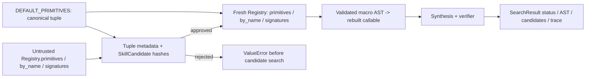

**Boundary invariant:** `_trusted_search_registry`は固定の`DEFAULT_PRIMITIVES`のID、順序、型、意味版、実装オブジェクトと、呼出元`Registry.primitives`を照合する。実行用`Registry`は`Registry(DEFAULT_PRIMITIVES)`から新規生成し、公開`DEFAULT_REGISTRY`も呼出元の`by_name`/`signatures`も実行に流用しない。学習済みmacroは検査済み`SkillCandidate`からのみ生成する。

**Contract:** callerが提供した検索表・署名表は実行権限ではない。登録済みmacroの照合は`primitives`の宣言値とbody hashを使用する。未承認primitive/偽装macro/不正ASTは探索前に拒否し、正常系は既存の探索状態、AST、候補数、順序hashを保存する。実CPU時間の一致は保証しない。Pythonプロセス全体を悪意あるコードから隔離する仕組みではない。

この変更は安全性回帰の修正のみで、研究計画v1の事前登録条件、過去の実験run、EXP-0002Bの保留課題には変更を加えない。[監査記録](../../experiments/EXP-0002/reviews/20261025-registry-snapshot-boundary.md)。

## MEASURE-0001: PrimitiveCallMeter observation contract

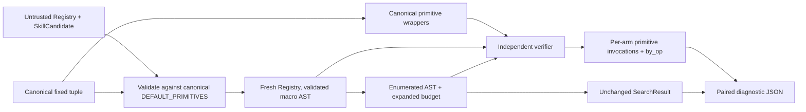

- `PrimitiveCallMeter`: mutable `total: int`, `by_op: dict[str,int]`; `to_dict() -> {primitive_invocations, by_op}`. Each arm creates a fresh instance.
- `bounded_synthesize(..., *, meter: PrimitiveCallMeter | None)` returns the unchanged `SearchResult`. Optional meter counts **only canonical primitive invocation within verifier examples**, including macro expansions. It does not count synthesis or total compute.
- `run_experiment` adds optional diagnostic `primitive_measurement_version="runtime-canonical-v1"` and `comparisons[].primitive_measurements.off/on`. Historical EXP-0002 RUN-001/002 remain unchanged.
- Untrusted executable Registry lookups are never consumed as execution authority: prior to wrapping, `_trusted_search_registry` checks primitive identity, version, order and typed macro metadata, then reconstructs a fresh execution registry; rejecting inputs produces no meter calls.
- No learned Kernel or fresh policy FINAL evaluation here; public EXP-0002 holdout results are diagnostic and cannot confirm EXP-0002B generalization.
- [Full measurement boundary](measurement.md) / [engineering audit](../../experiments/EXP-0002B/metering-log.md) / [SEC-004](../../experiments/EXP-0002/reviews/20261025-registry-snapshot-boundary.md).

## EXP-0002B — 研究計画v2を現行mainへ整合（方法は不変更）

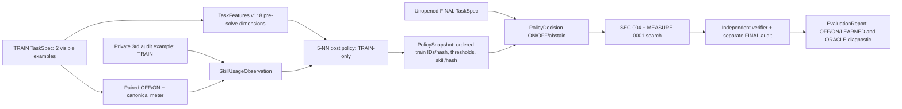

- **予定された型:** `TaskFeatures v1`（公開2例からの8次元）、`SkillUsageObservation`（TRAINのpaired OFF/ONと第3例audit）、`PolicyDecision`（ON/OFF、理由、5近傍の支持度）、`PolicySnapshot`（TRAIN ID/hash・方策/特徴版・技能body hash・定数）、`EvaluationReport`（全112問の正解、探索候補、primitive invocations、p90、OOD、回帰と欠損を記録）。
- **権限境界:** Kernel入力にgeneratorのfamily/split/seed、audit例、正解変換の識別子、FINAL結果を入れない。独立Verifier/予算/registry意味論は不変更。ORACLEは評価後だけの非実用診断。
- **計測は実装済み・学習は未実装:** [計測契約](measurement.md) / [事前登録v2](../../experiments/EXP-0002B/plan-v2.md) / [改訂履歴](../../experiments/EXP-0002B/preregistration-v2-log.md)。

## EXP-0002B TRAIN-only API契約（実装候補）

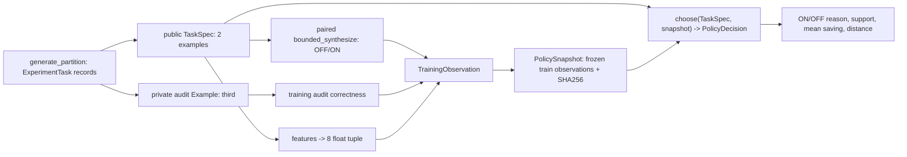

- `ExperimentTask`: generator専用レコード `(task, audit, family, partition, seeds)`。`TaskSpec`には公開2例と既存DSL limitsのみを含める。auditやfamilyを`choose`へ渡さない。
- `features(TaskSpec)`: 事前登録どおり8個のfloat；順序・正規化はplan-v2に固定、2例以外は拒否。`task_id`やaudit、探索結果は特徴に使わない。
- `TrainingObservation`: TRAIN task ID、8特徴値、正解監査・候補数・原始演算呼出数のOFF/ON比較と選好。Kernel推論は近傍の特徴と観測費用だけを使う。
- `PolicySnapshot`: v2定数（k=5、distance<=0.18、close>=3、ON支持>=4、mean_calls_delta>=2）、訓練観測/ID、datasetとgenerator SHA、技能body SHA、方式版、内容SHA。読み戻し時のhash不一致を拒否。
- `PolicyDecision`: `action` ON/OFF、`reason`、近傍task ID、支持件数、平均呼出節約、推論wall ms。成功確率や学習費用償却を根拠なく宣言しない。
- `preflight()`と`train_report()`はFINAL評価の結果を生成しない。データセットhashの生成は将来のFINAL成績の閲覧を意味しない。
- [事前登録](../../experiments/EXP-0002B/plan-v2.md) / [実装監査](../../experiments/EXP-0002B/reviews/20261025-train-only-kernel.md)。

## TRAIN evidence integrity: Codex review findings addressed
- 技能候補の`discover_skills`も独立の`Registry(DEFAULT_PRIMITIVES)`で動かす。`DEFAULT_REGISTRY`の公開可変lookupはcanonicalな実行権限ではない。
- 保存`PolicySnapshot`の受信時は`policy_sha256`を除いた**受信payload全体**を検証した後、`training_ids`と`training_observations_sha256`の整合を確認する。変更部分を黙って再計算しない。
- `training_trial_evidence`はTRAIN各task×OFF/ONの`SearchResult.to_dict()`、監査正誤、原始演算計数を記録する。学習snapshotの入力フィールドには監査例・familyは追加しない。[監査](../../experiments/EXP-0002B/reviews/20261025-train-only-kernel.md)。

## EXP-0002B 統合時のfreeze契約

- `experiments/EXP-0002B/freeze-v2.json`は実験方法、生成器source SHA、dataset/partition SHA、訓練観測SHA、PolicySnapshot SHA、固定技能body SHA、main source commitとCI証拠の識別子を持つ。
- スナップショットの生成結果は実行ノイズを除き決定的で、`snapshot.to_dict().policy_sha256`が凍結値と一致しなければDEV/FINALへ進めない。各armのelapsed_msは変動するため、trial-evidence SHAは等値を要求しない。
- FINALの評価・正解出力・性能はfreezeには記録しない。[凍結の説明](../../experiments/EXP-0002B/freeze-v2.md) / [機械用情報](../../experiments/EXP-0002B/freeze-v2.json)。

## EXP-0002B 実行意味論の固定（DEV/FINALを開く前）
- `freeze-v2.json.frozen_execution_source_git_blob_sha1`で基準コミット`2cd159a`の原始演算、DSL、探索、runtime、Verifier、bounded evaluator/meter、learning、Kernelソースを個別固定する。
- 後続評価器はファイル内容のGit blob hash（`SHA1("blob <size>\\0" + bytes)`）を再計算し、全項目を一致検査してからDEV/FINALへ進む。評価器自体は別の独立レビュー対象。
- これは方策の再学習や方法変更ではなく、評価前の保全要件。[source manifest](../../experiments/EXP-0002B/freeze-v2.json)。

## EXP-0002B 評価データ契約（DEV/FINALゲート）
- `run_evaluation(phase in {dev,final},freeze_path)`: まず`freeze-v2.json`とTRAINだけで再生成した方策hash、生成器source hash、全dataset hashを検証。不一致なら評価前に拒否。
- `evaluate_record`: **判断→OFF/ON/LEARNEDの独立探索→監査**。返値は3条件の`SearchResult.to_dict`、`audit_correct`、`audit_invalid_solved`、`primitive_invocations`、`expanded_ast_nodes`、`PolicyDecision`、事後`oracle_source_action`、監査例hash。
- `summarize`: 全task/7familyのstatusとcorrectness/cost、OOD誤ON、nearest-rank p90、最大悪化、勝敗数、family-cluster paired bootstrap1000、学習費用と推論wall時間、horizon 1/32/128のprimitive限定償却、v2の固定採否ゲート。
- `numeric_status`は数値条件を満たすかのみを示し、標準Skill/Kernel自動昇格を許可しない。ORACLEは実用方策ではない。
- `pull_request`CIではDEV/FINALを呼ばず、通常のmain pushではDEVのみを実行。FINAL専用トリガーは後述の独立PR #28で条件付き追加。[評価監査](../../experiments/EXP-0002B/reviews/20261025-evaluator-gate.md)。

## DEV/FINAL gate の実行ソース不変条件とCPU計測
- 評価器は[凍結された9ファイルのGit blob SHA](../../experiments/EXP-0002B/freeze-v2.json)を比較し、pythonのruntime、synthesis、verification、canonical meter、library、Kernel等が変更されていれば**TASK評価前に拒否**。
- 3armそれぞれ`trial_cpu_ms_including_audit` / `trial_wall_ms_including_audit`、推論`policy_inference_cpu_ms`、評価全体`run_total_cpu_ms_excluding_train`を記録。原始演算呼出数は総CPU量を表さない。

## EXP-0002B DEV Evidence v1（実測・科学的採用未判定）
- `run_evaluation("dev")` は `phase="DEV"`、`final_has_been_scored=false`、`source_commit`、`policy_sha256`、`dataset_sha256`、`run_total_cpu_ms_excluding_train`、`tasks[]`、`report` を出力する。
- `tasks[]` は公開2例に基づく `policy_decision` と3arm別の `search` / `primitive_invocations` / `audit_correct` / `trial_cpu_ms_including_audit` を保存。監査用第3例はKernel選択の引数にしない。
- 同じ意思決定のLEARNED独立再試行が元armと`trace_sha256`・呼出数で一致することを検査する。時間の完全一致は要求しない。
- DEVの6familyとFINALの7familyは混同しない。`numeric_acceptance_gates={}`、`numeric_status="not_applicable_dev_smoke"` を保つ。FINALの採否は未算出。
- 実測証拠: [EXP-0002B-DEV-20261025](../../experiments/EXP-0002B/runs/20261025-dev-smoke.md)。

## EXP-0002B FINAL112 activation contract（PR #28：実行前）
- FINAL実行条件: `github.event_name == 'push'`、`github.ref == 'refs/heads/main'`、`github.run_attempt == 1`、`startsWith(github.event.head_commit.message, 'EXP-0002B FINAL112 activation [20261025-APPROVED]')` の論理積。レビュー済PRの指定subjectでのsquash-merge以外では起動しない。
- `pull_request`および通常のmain push、同じworkflow runの再試行はFINALステップと証拠アップロードをスキップする。候補・監査・評価の計算はしない。
- 凍結した9ソースGit blob、`freeze-v2.json`のdataset/policy/generator hash、TRAIN再計算snapshotと観測数を検証し、一致しなければFINAL taskを評価しない。
- 成果物: `EXP-0002B-FINAL112` というActions Artifactの `EXP-0002B-FINAL112.json`。全112問の独立3arm、監査、family別、OOD16、policy decisions、5数値ゲート、bootstrap、CPUとprimitiveを分離して収録。採用は自動化しない。
- 一度限りの運用はcommit subject + 初回attempt + 結果後のゲート削除で成立する。堅牢な一度限りの外部ロックではない点も監査記録に残す。[activation gate](../../experiments/EXP-0002B/reviews/20261025-final-activation.md)。

## EXP-0002B FINAL Evidence v1（2026-10-25採点済み・ゲート退役）
- JSON `experiment_id="EXP-0002B"`, `phase="FINAL"`, `final_has_been_scored=true`, `source_commit="37b30752..."`, `source_train_code_commit="2cd159af..."`, `policy_sha256`、`dataset_sha256`、`tasks[]`（112要素）、`report`を保持。CI artifact ID `12592665362`、ZIPとJSONの元バイト列SHAは[FINAL実測run](../../experiments/EXP-0002B/runs/20261025-final112.md)を参照。
- 各 `task`: `task_id`（全件重複なし）、`family_for_evaluator_only`、`audit_example_sha256`、`policy_decision`、独立 `off/on/learned`（検索status/AST/trace/candidate、primitive呼出数・by_op、監査正誤、CPU/wall）。選択済trialは選択元armとの不変結果一致が必要。
- `report.numeric_acceptance_gates`: correctness, vs_off, vs_on, ood_false_on, p90_tail。FINALで全trueだが `numeric_status="metrics_pass_not_promoted"`・`policy_adoption="pending_independent_review"`のまま。既定Registryへの自動昇格を禁止する。
- 反実仮想 `ORACLE`、クラスタ7種類bootstrap1000、学習費用、推論CPU、全実験CPUを原始演算とは別計測とする。独立再集計はArtifact JSONを一件ずつ再計算した算術・整合性監査で、完全に独立した合成器実行を意味しない。
- 採点済みholdoutで方法を調整せず、今後の改訂には別計画と未使用の保留課題が必要。上記FINAL起動経路は結果記録後にCIから除去する。

## EXP-0003A: versioned experience, dream and evidence contracts (TRAIN PR2 implementation; later phases planned)
この項は**実装予定の論理契約**。既存`TaskSpec v0.1`・`SkillCandidate v1.0`・`PolicySnapshot`の改変を要求しない。PR1では新APIや永続DBは未実装。各schemaは`schema_version`、不変の論理ID、provenance/sha256、source_commit、状態を持つ。照合用hashはcanonical JSON (sorted keys / UTF-8 / NaN禁止)から算出する。

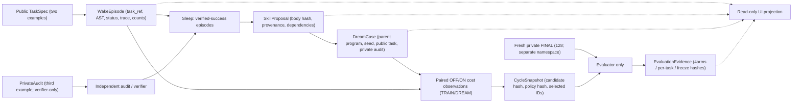

| Schema v1 / owner | Minimum typed fields | 禁止される流入・書換 |
|---|---|---|
| `WakeEpisode` / `memory` | `episode_id: str`, `public_task_ref: str`, `status: enum`, `program_ast: Program|null`, `trace_sha256: str`, `tested_candidates: int`, `primitive_invocations: int`, `audit_evidence_ref: str`, `partition: TRAIN` | `family`/hidden answerを学習器に同梱しない。結果上書き禁止 |
| `SkillProposal` / `learning` | `proposal_id`, `candidate: SkillCandidate`, `source_episode_ids: sorted[str]`, `candidate_body_sha256`, `status: candidate|withheld|rejected` | 実行コード文字列、PR1中のaccepted状態、任意callback禁止 |
| `DreamCase` / `dream` | `dream_case_id`, `pool_id`, `public_task_ref`, `generator_program_hash`, `seed`, `strategy: random|counterfactual`, `private_audit_ref`, `selected: bool` | generator正解・familyは学習選択APIへ渡さない。私的auditの参照は監査権限のみ |
| `CycleSnapshot` / `learning` | `cycle_id`, `candidate_hash`, `wake_episode_ids`, `dream_case_ids`, `ordered_selected_pool_ids`, `ordered_selected_task_ids`, `pool_public_input_sha256`, `id_protocol_version: ID-v1`, `arm: B1|B2|B3`, `policy_snapshot_sha256`, `source_manifest_sha256`, `status: frozen|planned` | FINALやDEVで再学習しない。旧B2B snapshotを書換えない |
| `EvaluationEvidence` / `evaluation` | `evaluation_id`, `phase: DEV|FINAL`, `source_commit`, `dataset_sha256`, `policy_hashes`, `task_results[B0,B1,B2,B3]`, `audit_correct`, `metrics`, `numeric_gates`, `review_ref`, `artifact_sha256` | FINAL outcome→Sleep/Dream/Kernelへ逆流しない。UIによる採用判定禁止 |

### ID-v1: manifest-facing identifiers vs learner-facing opaque task IDs
- [EXP-0003A plan ID-v1](../../experiments/EXP-0003A/plan.md#deterministic-id-and-tie-break-protocol-exp-0003a-id-v1-before-any-generated-dataset)が正本。private manifestの`source_record_id = <split>-fNN-iNNN`、`pool_id = dream-fNN-iNNN`、`dream_case_id = b2:pool_id|b3:pool_id` は、`TaskSpec.task_id = t-<full-lowercase-SHA256-of-ordered-public-task>`と混同しない。
- `TrainingObservation.task_id`は公開TaskSpec hash IDを継承し、family/split/seed/auditおよびprovenance IDを入力として生成してはならない。複数armは独立snapshotで同一task_idを使う。異なる公開TaskSpecでIDが衝突した場合は評価前にfail closed。
- `CycleSnapshot`のmanifest項目は`id_protocol_version="ID-v1"`, `ordered_selected_pool_ids`, `ordered_selected_task_ids`, `pool_public_input_sha256`, `source_manifest_sha256`, `policy_snapshot_sha256`を含む。各selected IDからprivate manifestを経由してpublic hashを照合し、Kernelには非公開元情報を渡さない。
- 5NNは`(binary64 mean-L1 distance, opaque task_id)`、B3のpool選択は`(min distance to positive TRAIN features, pool_id)`、B2はfixed-seed shuffle後の順序で決定する。単なるunordered setや処理順への暗黙依存を禁止。ID順序とhashは運用・研究の再現性契約であって、新しい学習特徴ではない。

### PR3 TRAIN/DREAM paired search, selection and policy contracts
- PR3 `PairedObservation`はpublic task ID/8D featuresと実際に行ったOFF/ON検索・第三例auditの教師結果のみ。`paired_trial`はSEC-004真正Registry/MEASURE-0001 meterをOFF/ON独立に使用。監査は検索の後の独立第三例で、結果による追加探索を禁止。
- evaluatorのみがfamilyで8×64候補プールを層化しB2/B3それぞれ8×12=96を選択。B2固定seedシャッフルの生成順を保持。B3は正しいONかつ厳密primitive節約のTRAIN正例8D近傍距離/opaque pool ID同点処理。公開2例の事前特徴のみを選別に使う。DREAMの答え・audit・正解変換IDを特徴や選別距離へ流入させない。
- `ArmSnapshot`はB1=160, B2=B3=256の観測、同一WAKE top skill body SHA、source/private manifest SHA、共通512 pool public input SHA、選別済みpool IDとpublic task IDの**順序付き**列、固定方策version/threshold、自己内容hashを持つ。`from_dict`は意味的フィールド照合後に再生成hashを検証。160件のWAKE観測と各`wake_episode_id`の対応は維持し、public `task_id`のASCII昇順へ正規化してから`training_ids`/`observations`/`observations_sha256`/`policy_snapshot_sha256`を計算する。B2/B3の追加Dream96件は**明示的な選別順序を保持**する。WAKE入力行をシャッフルしても5NN決定・意味的SHAは一致し、Dream選別順序や来歴の偽装は拒否する。
- `choose(task,snapshot)`は公開2例の既存8D特徴と教師コストのみで（mean L1距離、opaque public task ID）順の上位5件を使い、距離0.18/近接3/ON支持4/平均削減2/監査リスクvetoの不変閾値でON/OFFを決定。新しい技能生成、Registry昇格、FINALへの直接アクセスはしない。
- PR3はTRAIN/DREAMの公開runと評価器専用の実際の第三audit・512 pool・全paired raw trialを別ファイルに隔離して証拠hashを保持する（公開repoのArtifactに対外秘匿性はない）。generator、WAKE/SLEEP、paired trial、選別、snapshot/CPU-wall、primitive実行数を分離報告。旧EXP-0002B方策・snapshotを変更しない。

### PR2 TRAIN records and evidence
- `packages/exp0003a`の`TrainCase`と`private_train_manifest`はgenerator/evaluator専用。`TaskSpec`は公開2例とopaque task IDのみ。`wake(task, private_audit)`で唯一の独立監査を行い、`WakeEpisode.to_dict()`には監査の生入力/出力・family/seedを格納しない。
- `WakeReceipt`は監査器がWAKE完了直後に発行する独立の原本照合証拠。`task_id`、`episode_sha256`（時刻以外の全フィールド）、`program_sha256`、`trace_sha256`、`audit_evidence_ref`、監査判定を束ねる。SLEEPは監査器保管のoriginal receiptsとの厳密一致を必須にする。`frozen`や自己申告のSHAだけを署名・認証と誤認しない。原本照合は再合成でも非公開監査を学習に渡す行為でもない。
- `WakeEpisode`は`public_search_status`, `status`, `program_ast`, `trace_sha256`, `tested_candidates`, `primitive_invocations`, `audit_correct`, `audit_evidence_ref`, `audit_primitive_invocations`、検索/監査CPU・wallを分離。監査合格したASTだけが`sleep()`の技能候補根拠。
- `SkillProposal`は既存`SkillCandidate`の検証済み本文hash/型/依存/出典（2課題以上）と`proposal_id`, `source_episode_ids`の候補記録。ランキング先頭1件のproposal statusのみ`candidate`、他は`withheld`。正式Registry採用もDream由来方策もPR2では作らない。
- `train_report()`はTRAIN160件のエピソードのcanonical hash、ソースblob hash、出典manifest hash、候補とrankingを持つ工学的証拠。生成器、WAKEの公開探索/独立監査、SLEEPの各CPU/wall時間を別フィールドで報告し、primitive callsと混同しない。`*_ms`の実測値は再生の厳密一致hashから除外しCPU/wall別報告。CIでArtifactにアップロードするがFINAL判定には流用しない。
- PR2 CLIはrun全体のJSON、1行1WakeEpisodeのJSONLに加え、実際に消費した全TRAINの公開TaskSpec・private第三例・family/seed/source ID、原本のWakeReceiptを**評価器専用別ファイル**として出力する。学習向けrun JSONはprivate行のSHAだけを持つ。リポジトリ公開のためActions Artifactの外部秘匿は保証せず、`private`は学習器からのアクセス隔離を意味する。出力時に新規ファイル専用`xb`で出力し、既存証拠を上書きしない。各ファイルのSHA256をログ出力しCI Artifactで保全。永続DB・Web UIが完成したという主張は禁止。

- 実保存はまずappend-only JSONL + manifest（canonical hash、run ID、partition、schema、read-model参照）。SQLiteや外部サービスは導入不要。大きな証拠ArtifactはGitHub Actionsの期限/元SHAを持つ。各レコードには`producer_version`と`source_commit`を保存し、過去データをin-place migrationしない。
- `wake()`は探索で公開TaskSpecのみを見て、Verifierのauditを別経路から受け取る。成功エピソードのASTだけをSLEEP候補の証拠とし、偶然2公開例を満たしても非公開audit不正解なら除外。
- `select_dream_cases()`は明示の乱数seedかTRAINで得た8D特徴だけを比較する。B2/B3の各8 family×12という層化はgenerator/evaluatorだけの配分情報。学習観測にfamily、seed、正解programが混入していないことを負試験で確認する。
- `EvaluationEvidence`は選択決定**前**に得たTaskSpec以外をKernelへ渡さない。B0/B1/B2/B3はそれぞれ新しいmeterと独立探索・audit。総CPU(学習/生成/選別/推論)とprimitive callsを別列として保存する。
- `Research Console`のパネル別責務と投影元は[ARCH-UI-001](ui-panels.md)を正本とし、UIに新しい科学的方法を実装しない。
- スキーマ変更・責務の追加時は[ARCH-001](system.md)、[spec](../specs/EXP-0003A.md)、[run目録](../../experiments/EXP-0003A/runs/README.md)も同一PRで更新。

Related: [experiment plan](../../experiments/EXP-0003A/plan.md) / [UI responsibility map](ui-panels.md).

## EXP-0003A PR4 — source/data/policy immutable pre-DEV freeze (Issue #36)
- `packages/exp0003a/freeze.py`はplan-v1の同一生成条件と8 familyでTRAIN160/DREAM512/DEV64/FINAL128を**採点せず**生成・hash照合する。第三audit出力はdataのhash計算にのみ使用し、DEV/FINALの探索・方策選択・Verifier評価を起動しない。TRAIN/DREAMはPR2/PR3生成器とのfull record一致が必須。4 partitionのseed/公開TaskSpec ID/出典ID衝突は全体FAIL（調整や再抽選なし）。各split内重複input数は診断用集計のみ。
- `freeze-v1.json`はPR4ソースを変更し終えてから、PR CI preflightが生成するCPython3.12固定manifestを別commitでピン留め。plan-v1・generator/DSL/meter/learning/policy/verification/preflightソースのGit blob SHA1とraw SHA256、全4splitのcanonical private row hash（第三例自体はレポートへ出さない）、top skill body hash、B1/B2/B3 semantic snapshot hash、B2/B3 ordered Dream ID/selection SHAを保存。
- `--mode check-freeze`は凍結値を同一ソースとTRAIN/DREAMで再計算して完全比較する。SOURCE違い、スプリット変更、policy hashのずれ、JSON書換えは拒否。**Git commit SHAはsquashで変わるため研究的source lockにはGit blob SHAを正本とする**。PR4のCIでDEV/FINAL評価は実行しない。別のDEV工程はfreezeレビュー成功後にのみ起動可、FINALはさらに別の人間承認付き起動PRを必要とする。

### PR4 source-guard validation order (P1 review remediation)
- `check-freeze`は評価者のtraining/生成処理に到達する前に、**保存済みJSONの自己hash、schema/plan/runtime、固定14ソースのGit blob SHA1/raw SHA256**を不活性なbyte readだけで照合し、不一致なら即失敗。これらの合格後のみ`preflight_record`がTRAIN/DREAMの再生成・学習を行ってsplit/skill/policy hashと照合する。Pythonの悪意あるimport-time codeをsandboxする設計ではないので、実行環境自体の隔離も別責務である。初回凍結値はP1修正で再固定し、source identityが同一な限り保存データSHAとpolicy SHAは変わらない。

## METRO-0001 — EvidenceEnvelope / measurement / claim data flow (proposal)

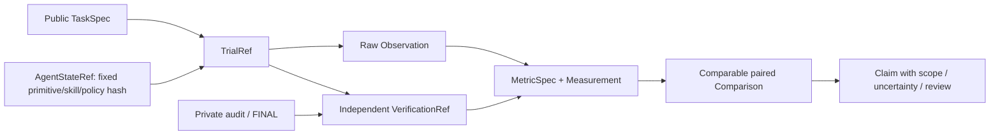

- 記録の正本は既存のraw JSON/JSONLとハッシュ。METRO EvidenceEnvelopeはread-only参照。原始計測値、metric version、欠測・分母を必須にして結果と解釈を区別する。
- paired比較の一致キーは同じ公開task_id・課題入力・探索予算・primitive意味版・独立検証基準・環境/費用scopeとする。**armは一致キーに含めず**、事前登録したcontrol/interventionの組（例: OFF対ON）を明示的に検査する。同一task/arm内の重複観測は原則invalid。比較不成立はnon_comparableとし効果量を計算しない。raw証拠不一致・偽造hash・禁止学習経路はinvalidとして拒否。
- private出典識別子/監査生行/FINALデータはEvaluator以外へ渡さない。現在のEXP-0003Aの凍結済みschemaやplan-v1は一切変更しない。
- 正式契約（提案）: [METRO Evidence v0.1](../metrology/evidence-model.md) / [MetricSpec](../metrology/metrics.md) / [妥当性](../metrology/validity.md) / [CAL-01 plan](../../experiments/METRO-0001/plan.md)。

## METRO-0001 PR2 — 実装した限定契約
- `packages.metrology` accepts schema=`metro-evidence/0.1`, experiment=`METRO-0001`, run=`CAL-01`, role=`fixture_calibration` **only**。任意のEXP-0003A生データは拒否し、raw元証拠や評価器を書き換えない。
- SHA-256はJSONのsort_keys=True/UTF-8/compact-separator/allow_nan=Falseで計算したraw record本体のsealであり、鍵付き署名や改ざん不可能な外部認証ではない。
- paired joinは(public_task_id, role)を中心に行い、armはOFFとONの別条件として検査。片方がmetric/unit/予算非互換なら`non_comparable`として差分を出さず、raw不正/欠測/重複/学習機密混入なら`EvidenceError`。
- summary hashは既定plan-v1の固定summary JSONに対して計算し、raw record順序に依存しない。固定条件以外の学習・領域横断評価は未実装。
Related: [evidence spec](../metrology/evidence-model.md) / [gold fixture](../../experiments/METRO-0001/plan.md).

## METRO-0001 CAL-01の実装済み証拠契約: scoped acceptance
- `metro-evidence/0.1` **人工 `METRO-0001/CAL-01` roleだけ** のcanonical JSON seal/検査・F01–F08固定summary・元fixture明細hashの保存を[PR #41](https://github.com/ryonakayama234/DekaSugi/pull/41)としてmain統合済み。
- 元Artifact ZIP/JSON/fixtureを独立取得してSHAを検査し、[校正決定](../../experiments/METRO-0001/reviews/20261027-cal01-adoption.md)に記録。観測のraw bytesのdigestと正規化summary digestを混同しない。
- invalid recordと合法だがnon_comparableなarmの差を維持。既存TaskSpec/EvaluationEvidence/Private auditの任意入出力を受け取る一般化Adapterは **未実装**。EXP-0003Aの凍結評価やLearnerへのprivateデータ導線は追加しない。


## EXP-0003A PR5 — Independent DEV64 evidence flow and data contract

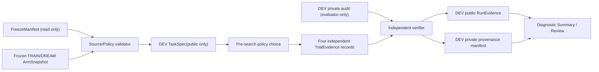

Immutable authority: `freeze-v1.json`, original 14 Git blobs, 
`experiments/EXP-0003A/plan.md`. New evaluator reads, never changes them.

- **FrozenAssets** (in memory): verified frozen manifest, B1/B2/B3
  `ArmSnapshot` and semantic SHA, one TRAIN-derived `SkillCandidate`,
  training rebuild cost. FAIL if any hash or status mismatches.
- **TrialEvidence** (per `task_id` × `arm`): action/reason, neighbors (public
  opaque IDs only), policy SHA, `SearchResult`, audit SHA reference, independently
  checked audit correctness and false-solved, tested candidates, canonical
  primitive meter, search/audit CPU+wall, selected typed AST.
- **DEV public RunEvidence**: exact source commit, freeze/split/snapshot SHA,
  per-task arm evidence, paired aggregates, regressions and uncertainty
  labelled engineering only. Does not include raw audit input/output or
  evaluator-only family/seed/source IDs.
- **DEV private provenance manifest**: full generator-only source/audit
  records, original public trial digest. Separate write-once artifact;
  must never be passed to Kernel/learner.
- **Validation order**: inert freeze schema/source bytes -> deterministic
  TRAIN/DREAM replay/policy -> DEV full manifest -> choice -> search -> audit.
  Any precondition failure exits without scoring.

Read [PR5 spec](../specs/EXP-0003A-DEV-EVALUATOR.md). DEV cannot replace
future independent FINAL128 evidence and cannot use CAL-01 synthetic
calibration as a claim of measured intelligence growth.

### PR5 additive timing evidence fields (reviewed contract)
`FrozenAssets.asset_load_cost_ms` contains `freeze_verify_cpu/wall`,
`second_train_dream_replay_cpu/wall`, `snapshot_validation_cpu/wall`,
`asset_load_total_cpu/wall`. The freeze verification contains the **first**
replayed TRAIN/DREAM policy; the later explicit replay is the **second**. Nested
`train_dream_second_replay_internal_cost_ms` is **not** an additive cost.
`TrialEvidence` adds `policy_inference_cpu_ms` and
`policy_inference_wall_ms` per arm; B0=0, B1/B2/B3 are measured before
search. `summary.arm_totals` sums the fields by arm. Overall four-arm elapsed
and CPU costs already include these trials and must not be double counted.

## EXP-0003A DEV64 one-shot evidence and trust contract (Issue #46)
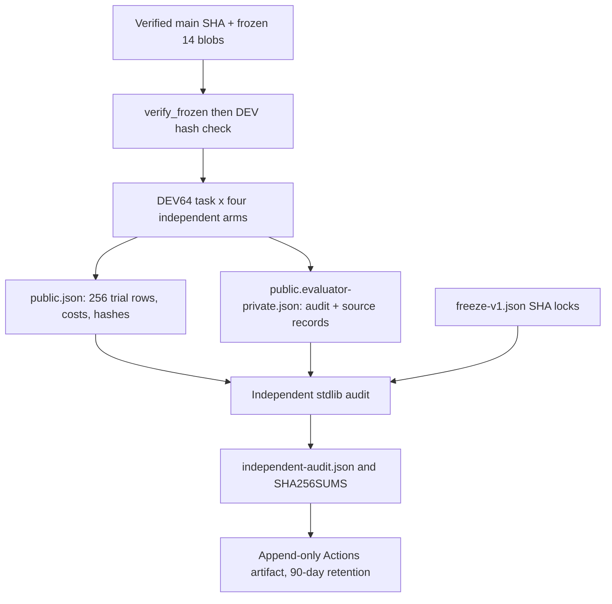
The standalone evidence auditor does **not** import source scorer or generate
DEV/FINAL; it checks canonical raw split digest, opaque TaskSpec IDs, third-audit
references, all 256 arm meters/trials, paired B2−B3 calls/candidates/cluster
bootstrap, OOD activation counts, family and arm totals, and cost inclusion.
Four raw files have separate original-byte SHA256; failed attempts retain
`attempt.json` and logs. Artifact expires; permanent SHA/run/metrics record
requires a subsequent reviewed evidence archival update. Never silently
double-count phase totals or equate DEV with FINAL confirmation.

### Independent Codex P2 review hardening (2026-10-27)
- Each primitive meter's `by_op` canonical positive counters must sum to
  `primitive_invocations` (not just agree with copied top-level total).
- Check search status/solved/program/selected AST against audited_correct and
  false_solved, including consistent unsolved/null-program outcomes.
- Verify BOTH evidence source_commit values match the externally supplied
  40-character runner `GITHUB_SHA`; attempt must match main/first run/SHA.
- A finalization step with `always()` hashes **all extant** original JSON
  into SHA256SUMS even if scoring, preflight or independent audit fails.
- New negative and positive synthetic evidence tests run in PR CI. No DEV/FINAL
  generation/scoring may be performed before reviewed main activation.

## EXP-0003A DEV64 immutable original vs audited derived report (Issue #48)
- Original source SHA `26eaf3b4c4717968d68eb7f383b126b23b2062c8`;
  public JSON SHA256 `2fa48c841e99a69275c8bd3a5bd78eb2e01d4a3fcc226a6358958bf5cc053134`;
  evaluator-private raw SHA256 `490fbb3da156cc70e3525d6c67307b4b4e06bb725703e0b39543546275b87653`.
- Original scorer's `sum(...)` float accumulator differs from independent
  `+=` at binary64 roundoff. CPU/wall-only totals compare with
  `math.isclose(rtol=1e-12, atol=1e-10 ms)`, reject larger drift. Integer,
  outcome, per-op meter, AST/program, TaskSpec, private audit refs and SHA
  remain strict equality. Derived audit states max accepted difference.
- Audit-only CI validates original bytes before inspecting records. The public
  research ledger preserves hashes, source, metrics and provenance; **private
  manifest raw records must not enter the public Git repository**. Raw
  Artifact retention is 90 days; retaining its SHA does not preserve its bytes.


## POLICY-DIAG-001 — 診断用データ契約（設計案・未実装）
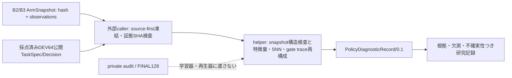
想定レコード：`schema_version, task_id, source_refs{freeze,snapshot,dev_public_sha}, policy_reconstruction{B2,B3}, comparison{neighbor_overlap, action_disagrees, archived_primitive_difference}, classification{mechanism_labels,status,alternatives,evidence_refs}`。全フィールドに観測/再構成/探索的解釈・欠測区分を与え、privateデータは公開リポジトリに書かない。判定再生は`choose`の近傍距離昇順・公開task_id同点処理・5近傍全体の支持票と費用・順次veto/閾値を厳密に維持する。診断は新規採点を実行しない。[Issue #52](https://github.com/ryonakayama234/DekaSugi/issues/52)。

## POLICY-DIAG-001 implementation contract (not a new Evaluator)
`packages/policy_diagnostics` implements `snapshot_profile(snapshot)`, `dream_overlap(B2,B3)`, `replay(public_task,snapshot)`, and `compare_public_tasks(archived_public_tasks,B2,B3,optional_archived_rows)`. `replay` asserts exact `choose()` parity, with the ordered five neighbors, exact gate precedence and no synthesis. Data is labeled `not_observed` for absent archived costs. Caller must perform an independent pinned-source/freeze and archived-evidence integrity check before treating its outputs as authenticated research evidence; the module alone is not a complete raw-artifact provenance gateway.


## POLICY-DIAG-001 — archived-public analyzed record contract v0.1
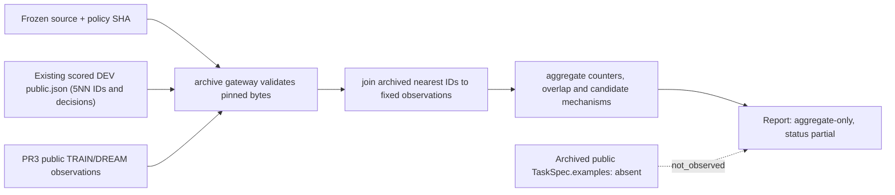
Only original `public.json` and PR3 public snapshot member are read; ZIP evaluator-private members are not parsed. `archive-policy-diag/0.1` input is a pair of byte-checksummed immutable public JSON payloads, plus source-blob-checked `freeze-v1.json`. Output has original-public evidence SHA, frozen snapshot SHA, denominators and descriptive aggregates, without task IDs, private examples, source rows, evaluation execution or query features. Since archived TaskSpecs are absent, exact 8D query features, neighbor distances and `close_support` are `not_observed`; replay of the 5NN *membership* from precomputed archived IDs is not an independent KNN search. [Report](../../experiments/POLICY-DIAG-001/runs/20261028-archive-public-diagnosis.md).

## OPPORTUNITY-001 — prospective paired-trial contract (design-only, no production adapter)

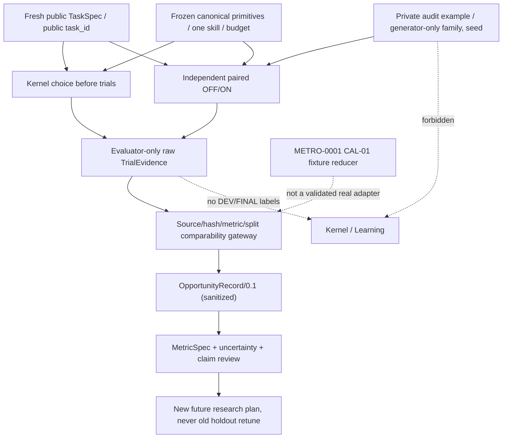

**Proposed schema** (`opportunity-record/0.1`, see [spec](../specs/OPPORTUNITY-001.md)):
- Identity: `schema_version`, `phase`, `task_id`, `run_id`, `source_refs{dataset_sha256,primitive_blob_sha,skill_hash,policy_sha,verifier_version,meter_version,budget_id}`. All identity/metric-version fields must be present before comparison.
- `policy{chosen_before_trials,decision_hash}`, `paired{OFF,ON}` with separate independent audit correctness, false-solved, candidate count, canonical primitive calls, trace and CPU/wall phase scope.
- `classification` is one of `both_correct_on_cheaper`, `both_correct_off_cheaper`, `both_correct_tie`, `on_only_correct`, `off_only_correct`, `neither_correct`, `not_observed`, `invalid`, `non_comparable`. Classification requires verified comparison keys, and missingness is not a numeric zero.
- `policy_excess_calls` may be non-null only if **both arms audited correct**. `missed_success`/`lost_success` are separate accuracy events. `best_of_two` is a retrospective restricted choice, never a learner-facing oracle.
- `expressibility_evidence`: `formal_invariant_proof` with reviewed proof reference and domain assumptions, `exhaustive_within_budget` with exact enumerator/budget and visible+audit example scope, `found_verified_program`, or `unknown_or_censored`. Failed search alone does not establish unrepresentability.
- `quality{comparison_status,missing_reason,provenance_ref}` plus MetricSpec name/version/unit/denominator and declared task/family analysis level.

**Trust / lifecycle**: TRAIN-only allowable paired teachers may be presented to learner only by explicit training interface; DEV/FINAL raw private outcomes remain evaluator-only. A public sanitized aggregate must not contain private third examples, family/seed/source IDs, or reuse old holdout labels to tune. Original raw records are write-once with SHA; read-only Gateway rejects mismatched SHA/schema/duplicate/split/primitive/metric/budget before analysis. `packages/metrology` currently accepts CAL-01 fixture only; new adapter requires separate calibration and design approval.

**No unapproved execution**: PR1 is purely documents. New sample generation, training, experiments and especially EXP-0003A FINAL128 are not authorized. Linked [spec](../specs/OPPORTUNITY-001.md), [plan proposal](../../experiments/OPPORTUNITY-001/plan.md), [run ledger](../../experiments/OPPORTUNITY-001/runs/README.md).

## OPPORTUNITY-001 PR2 implemented fixture contract
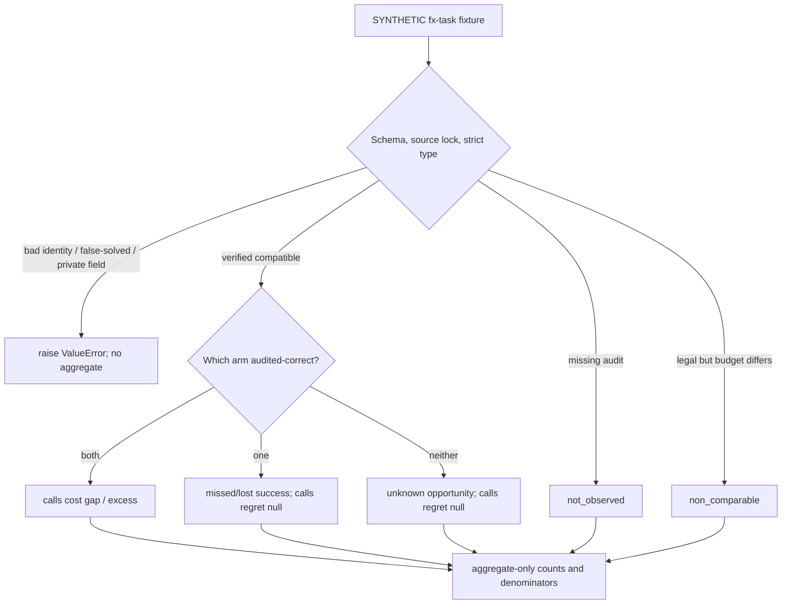
- Version `opportunity-fixture-v1`, phase `SYNTHETIC`, task `fx-...`. Exact row keys: `schema_version,phase,task_id,source_lock,policy_choice,policy_decision_before_trials,trials`. Lock: dataset/skill/policy/primitive SHA256, source_commit SHA-40, meter_version, budget_id. Each OFF/ON: audit_status, audited_correct, search_status, primitive_calls, tested_candidates, false_solved, budget_id.
- Caller-pinned lock equality **does not independently verify the original bytes**; pretrial flag is not independent proof of chronology. Real `opportunity-record/0.1` remains unimplemented.
- Summary is aggregate-only: class counts, denominators, policy errors, one-correct missed/lost success, both-correct excess calls, input content hash, no raw evidence/TaskSpec or scientific uncertainty. Synthetic calibration never authorizes holdouts.
- [Implementation](../../packages/evaluation/opportunity.py) / [tests](../../tests/test_opportunity_fixture.py) / [spec](../specs/OPPORTUNITY-001.md).

## OPPORTUNITY-001-PILOT-V1 prospective trust contract
- A future generator must yield exactly 64 new TRAIN TaskSpecs (8 fixed families x 8), two public examples and a distinct third evaluator-only audit. Seed formula/alphabet/rejection/transforms/task ID and budget are fully enumerated in [pilot-v1](../../experiments/OPPORTUNITY-001/pilot-v1.md).
- A reviewer must source-first pin implementation blobs and full public-dataset canonical hash, all 3 legacy B1/B2/B3 snapshot hashes and the exact frozen candidate skill before **any** search. Source + split metadata remain evaluator-only except anonymous public task IDs.
- Separate sealed pretrial decisions for B1/B2/B3 must exist BEFORE paired ON/OFF trial; no access from Kernel to source family, private audit, seed or measured outcomes. Independently verify decision and audit chronology, not merely Boolean flags.
- Real evidence MUST use a distinct future adapter/schema; `opportunity-fixture-v1` rejects it. Missing original bytes, false-solved, source mismatch or privacy leak is a stop/failure record, not a newly valid zero-cost observation.
- Method is **frozen proposal for exploratory TRAIN only**; source/manifest lock and run activation pending. No DEV/FINAL, no regression claim. [Issue #60](https://github.com/ryonakayama234/DekaSugi/issues/60).

## OPPORTUNITY-001 PR4 public-only source generator contract
- `generate_train_pilot()->tuple[TrainCase,...]` provides 64 TRAIN-only evaluator-side wrappers with `task` (exactly 2 public examples), `private_audit` (third), `family`, `seeds`, `source_record_id`. These wrappers must **never** cross into Kernel or public reports.
- `public_manifest(cases)` exports only 64 `{task_id, schema_version, domain, limits, examples[2]}` dicts. `canonical_public_digest` computes SHA256 of `json.dumps(rows, sort_keys=True, separators=(',', ':'), ensure_ascii=False, allow_nan=False).encode('utf-8')`. No other private fields or raw audits.
- `public_preflight()`/CLI `--mode hash-only` reports method, version, count, public SHA256 and explicit `paired_trials_executed=0`, `dev_or_final_evaluated=false`. It does NOT check source blobs or audit independence by itself.
- **No code path here runs paired searches, policy choice or any old DEV/FINAL**. The future source-first lock/real adapter must bind method, task manifest, frozen skill/policy hashes, source commits and chronological pretrial decision. Code-only source hash output is not an audit of scientific performance. [Method](../../experiments/OPPORTUNITY-001/pilot-v1.md) / [tests](../../tests/test_opportunity_pilot.py).

## OPPORTUNITY-001 PR5 independent source-only commitment contract
- Standalone `scripts/audit_opportunity_pilot_public.py` duplicates the exact frozen generation protocol with Python stdlib and NO imports of `packages.*`; `verify_public()` rejects any public manifest SHA different from the previously observed `bc950ef3187fc34851eef5cff6df194ce27186b3a03b5399f2209e9905f04a85`.
- Hash-only output: `method, schema_version, public_count=64, public_manifest_sha256, third_audit_commitments_sha256, private_audit_bytes_published=false, paired_trials_executed=0, dev_or_final_evaluated=false, independent_from_project_generator_imports=true`. Private commitment canonicalizes per-task public ID plus SHA of third example; never raw third bytes or source IDs.
- A digest is **not custody**, confidentiality or a temporal pretrial seal; full live evaluator and independent evidence recount remain future trust boundaries. CI may run this source-only verifier on PR; new paired scoring is forbidden. [Method](../../experiments/OPPORTUNITY-001/pilot-v1.md).

## OPPORTUNITY-001 PR6 — immutable generator source-lock contract
- Strict `OPPORTUNITY-PILOT-GENERATOR-LOCK-V1` record pins `source_main_commit`, 9 exact Git blob SHA-1 sources (including local verifier self-file), Python 3.12.15, original EXP-0003A frozen payload + top candidate skill + snapshots B1/B2/B3, public 64-case SHA256, third-audit source commitment SHA256 and reviewed CI origin.
- `validate_source_blobs()` checks exact keys/fields and byte-for-byte `sha1(b"blob "+len+NUL+bytes)` locally BEFORE source generator import. `verify_generator_lock()` then validates historic freeze fields, both independent manifest derivations, same private third-audit commitment, counts and `paired_trials_executed=0`.
- **No scoring authority**: `new_train_pilot_scoring_permitted=false`, `old_dev_or_final_scoring_permitted=false`. No false boolean can be coerced. Actual-evidence adapter must use a distinct schema, independently seal each B1/B2/B3 choice BEFORE any candidate/search result and preserve restricted original evidence. Source lock alone is not external custody.
- [Lock](../../experiments/OPPORTUNITY-001/pilot-generator-lock-v1.json) / [source verifier](../../scripts/verify_opportunity_generator_lock.py) / [tamper tests](../../tests/test_opportunity_generator_lock.py).

## OPPORTUNITY-001 PR7 pretrial public decision evidence contract
- `opportunity-pretrial-public-decisions-v1`: `{schema_version,method,phase,source_manifest_sha256,skill_body_sha256,policy_snapshot_sha256,decisions[64],paired_trials_executed=0,dev_or_final_evaluated=false}`. Each decision row is `{task_id,choices:{B1:{action,reason},B2:{action,reason},B3:{action,reason}}}`.
- All 3 actions are created from exactly one TaskSpec only after verifying source/freeze and rebuilding frozen TRAIN/DREAM policy snapshots. No audit inputs, task family/seed/source ID or ON/OFF trial result enters the chooser. `digest(payload)` is canonical JSON SHA256. Costs from policy inference in independent `inference_cost_ms` (not part of source-stable digest).
- Public read-only GitHub Actions artifacts and before-trial source commit evidence are engineering gate only; a later immutable pin of decision digest and independent chronology review MUST precede solver invocation. Existing source-lock permission `new_train_pilot_scoring_permitted=false` unchanged.

## OPPORTUNITY-001 PR7 P1 trust-boundary remediation
Before `verify_generator_lock` or ANY `packages.*` import, `verify_opportunity_legacy_sources.verify_legacy_source_bytes` checks the exact reviewed historic EXP-0003A manifest and all 14 blob+raw source checksums with stdlib only. `load_frozen_assets()` was found to regenerate old DEV/FINAL references via legacy `freeze.verify_frozen`; this API is now forbidden in the opportunity pretrial. A new TRAIN/DREAM-only reconstruction uses `run_train_dream`, validates original snapshot/candidate identity and selection lists without calling legacy freeze preflight. Review finding: [PR #65](https://github.com/ryonakayama234/DekaSugi/pull/65). Historical PR7 head results are retained as diagnostic, not method-valid until rerun.

## OPPORTUNITY-001 PR9 — public pretrial origin/identity/retention data contract (design-only)
**Boundary**: `evaluation / provenance`は「公開64 TaskSpecに対し、B1/B2/B3が採点前に選んだ192 action+reasonを保持・検証する」責務を負う。これはscorerや学習器ではなく、既存の`opportunity-pretrial-public-decisions-v1` payloadを新規のartifact custody envelopeで包む**提案**である。設計正本：[choice lock spec](../specs/OPPORTUNITY-001-CHOICE-LOCK-DESIGN.md)。

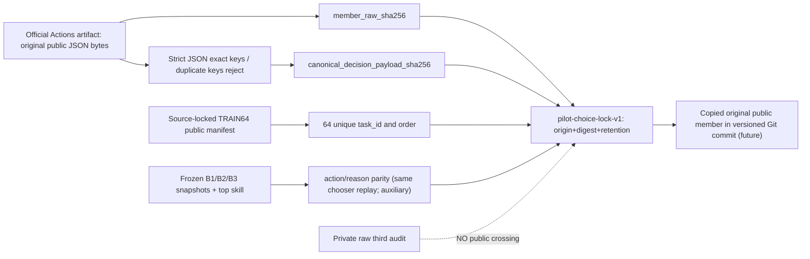

**Input exact payload** (already produced by PR7, not a proposed redesign): `{schema_version,method,phase,source_manifest_sha256,skill_body_sha256,policy_snapshot_sha256,decisions[64],paired_trials_executed,dev_or_final_evaluated}`。各`decision` = `{task_id,choices:{B1:{action,reason},B2:{action,reason},B3:{action,reason}}}`、`phase=FRESH_TRAIN_ONLY`、`paired_trials_executed`はboolでない整数0、`dev_or_final_evaluated=false`。Task IDは`t-`+64 lowercase hex、3方策のchoicesは`OFF/ON`のみ。欠落/追加key、重複、private audit/family/seed/source ID/outcome混入はhard stop。決定行の順序も論理digestの一部。

**Hashes must not alias each other**:
- ZIP raw SHA256は補助的出典証拠。単一の指定JSON memberのraw SHA256と、後日Gitにコピーされたmemberのraw SHA256はbyte-for-byte一致すること。
- Canonical payload SHA256は`json.dumps(obj,sort_keys=True,separators=(',', ':'),ensure_ascii=False,allow_nan=False)`のUTF-8で計算する。raw JSON formatting変更はpayload digestを保持しても、元byte custodyを保持したことにならない。
- public TaskSpec manifest hashは新TRAIN課題分布の同一性、policy snapshot hashesは方策同一性、skill body hashは候補技能同一性。decision hashと混同しない。
- Lockにはofficial main commit、Actions run/job/artifact ID、取得時期と取得経路、original/copied member digest、認証結果と保持先、レビューheadを置く（詳細schemaは実装前にversion freeze）。Payload digestへlock自身を含めない。

**State / tri-state quality**: `planned → origin_retrieved → byte_verified → semantic_verified → retained_public → sealed_pretrial_only`、いずれもfailや必要な`not_observed`では`blocked`。`sealed_pretrial_only`は`scoring_permitted=false`を保持。元pretrialの初期禁止経路runは同じdigestでもoriginが違うため不可。replayは同じchooser実装による補助結果であって、原本の代替・独立したプログラム実装の検証ではない。

**Trust & latency**: source lock/legacy source bytesをプロジェクトimport以前に照合。元原本のZIP archiveは期間限定なので元memberを**取得・検証してから**保管する。後続scorerとのchronologyはActions/commitの観測とimmutableなGit参照の前後関係で別検証（時計表示だけでは不十分）。private第三audit元bytesのoff-repoアクセス制限付き保管はIssue #66、実験結果と旧DEV/FINALはここでは取得・採点しない。

**Status**: schema/保存先/検証器は計画であって実装済みではない。原本member raw digest、保存copy digest、actual paired outcomesは`not_observed`。negative casesとC01–C09は[engineering preregistration](../../experiments/OPPORTUNITY-001/choice-custody-preregistration.md)参照。

## OPPORTUNITY-001 PR9 — implemented public original-custody contract
**Owner**: `evaluation / provenance`の独立stdlib source `scripts/verify_opportunity_choice_lock.py`、synthetic negative `tests/test_opportunity_choice_lock.py`。公表するデータ正本は[original JSON](../../experiments/OPPORTUNITY-001/evidence/pilot-choices-public-v1.json)と[lock](../../experiments/OPPORTUNITY-001/pilot-choice-lock-v1.json)の2ファイル。元原本を再演算で置き換えず、元memberのUTF-8 JSON**27360 bytesをそのまま保全**。

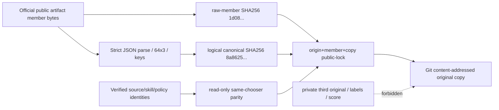

- exact payload：`opportunity-pretrial-public-decisions-v1`、`64` rows / `192` decisions、`{task_id,choices:{B1:{action,reason},B2:{action,reason},B3:{action,reason}}}`。action ∈ `{ON,OFF}`、reasonは固定5択で`cost_supported⇔ON`。余分・重複・非公開字段は禁止。`paired_trials_executed=0` (boolを拒否)、`dev_or_final_evaluated=false`。
- raw SHA256：`1d08e6c1518d6730e75bfaf3033a00884f7517a7d91c98a5dfff75192aabc433`。canonical JSON digest：`8a8625ed86e66b27bef8d09a023172d2adbc9ad0d42c155ab7f137097e2dccb2`。この区別が同一内容の再formatによるoriginal byte差替えを検出する。
- Lockはsource main SHA、run/job/artifact ID、GitHub観測timestamps、raw digestとlogical digest、TaskSpec/snapshot/skill identities、copy pathname、全scoring flags falseを正確に持つ。**ユーザー入力のprovenance claimだけを根拠にしない**：公式APIから取ったrun/job/artifactを元のcapture run中に検証。後からのロック検査では固定ID・構造・digest・bytesを検査し、元APIが不変であると仮定しない。
- 本moduleはstdlibだけで構成。old 14-source・new 9-sourceをproject import前に検証した後、元凍結TRAIN/DREAMのみを用いる固定chooserの再演算と**元原本を比較**。これは独立実装による選択アルゴリズム監査ではない。
- [run ledger](../../experiments/OPPORTUNITY-001/runs/20261028-pr9-public-choice-custody.md)には独立の観測と非主張を記録。現時点の公開pretrial origin engineering gateは成立しても、private raw audit off-repo archival・独立actual scorer・once-only activationが未成立なのでscoring許可なし。古いDEV/FINALへの干渉なし。

## OPPORTUNITY-001 PR8: real tuple-shape contract (not proof of source authenticity)
```mermaid
flowchart LR
  A["Canonical two _audited_trial nine-tuples"] --> V["Strict status/solved/program/trace/meter/task/budget gate"]
  C["Already-sealed B1/B2/B3 choices"] --> R["Correctness-first fixed two-arm classification"]
  V --> R
  R --> P["Public opportunity-paired-evidence-v1 redacted record"]
  H["Private original third audit"] -.->| "never serialized" | P
```
- `normalize_audited_trial`: canonical `SearchResult.to_dict()` without elapsed_ms; exact search keys; fixed 4 AST nodes / 100 candidates, public `t-` plus 64 lowercase hex task ID, 64 lowercase SHA256 trace; search `solved/status/program` must equal `selected_ast` and audit outcome.
- `meter.by_op`: only canonical `trim/lower/upper`, positive integer counters summing exactly to `primitive_invocations` (zero = empty map), no bool-as-int. CPU/wall finite and nonnegative, no unknown or private fields.
- `classify_pair`: identical public task ID/budget; regret counts only when both correct; one-arm success counts separately; neither-correct unknown, not regret zero. Redacted output has no private example data. This does not verify scorer provenance, audit authenticity, decision chronology or off-public original retention. [PR8 contract](../specs/OPPORTUNITY-001-REAL-ADAPTER.md).

- PR8 final AST shape gate: exactly `Input(String)` or unary `Call(String, op_id, child)` in canonical JSON; OFF primitive only, ON primitive or source-locked single skill `skill_8fe1361cb5014f85`. The frozen skill expands to two primitive calls `lower(trim(Input))`, and the total expanded AST including Input must be at most **4**. Unknown operator, private field, malformed AST, or over-budget expansion fails before publication of AST hash. The static shape check is **not** evidence provenance authentication.

## EXP-0003A DEV64 local ZIP custody data boundary — 2026-10-28
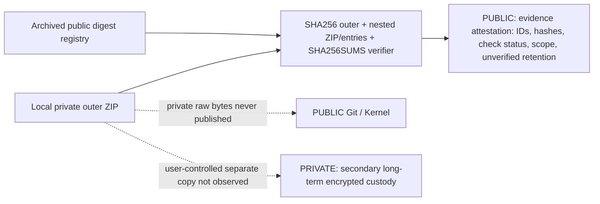
**Public attestation contract**: historical study ID; original scoring run/artifact IDs; audit-only run/artifact IDs; outer ZIP byte size and raw digest; nested ZIP SHA256; original JSON digests; exact SHA256SUMS pass counts; limitation flags `provided_copy_integrity_verified`, `second_private_copy_not_verified`, `fresh_train64_custody_not_satisfied`, `scoring_not_run`. It contains **zero private example bytes, source seeds, third examples, or extracted private JSON**. Public Git is not the store for the original. No key/password is stored in Git. See [attestation](../../experiments/EXP-0003A/runs/20261028-local-zip-integrity.md).


## OPPORTUNITY-001 actual real-pair engine input/output, activation denied (2026-10-29)
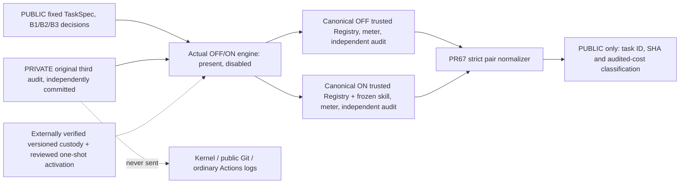
- Implemented `assemble_audited_pair`: refuses mutable skill mismatch, untrusted audit hash, wrong 3 policy actions and changed budgets; **rebuilds a distinct canonical Registry for each arm**. OFF false_solved triggers stop **before any ON scoring**.
- Implemented `validate_private_archive`: exact immutable raw SHA, 64 matching task IDs and aggregate independent audit commitments; only structural/original-byte provenance, **not external custody**. `source_first_preflight` demands old14/new9 frozen source and official original 192 choices first.
- Real-scorer call entry remains `SCORING_ACTIVATED=False`, no live one-shot invocation. [Spec](../specs/OPPORTUNITY-001-REAL-PAIR-ENGINE.md) / [Issue #76](https://github.com/ryonakayama234/DekaSugi/issues/76).


## OPPORTUNITY-001 fresh TRAIN64 private original vs public SHA receipt (2026-10-28)
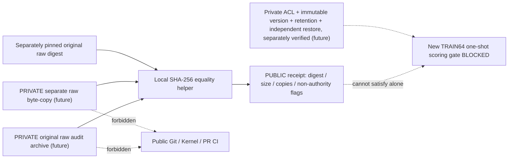
- Implemented read-only `opportunity-private-copy-byte-check-v1` emits exactly `schema_version,status,raw_sha256,raw_size_bytes,copy_count,different_filesystems_observed,independent_private_raw_custody_verified,acl_encryption_retention_restore_verified,scoring_authorized,private_bytes_disclosed`. Public receipt has **no original bytes, audit examples, secrets, local file paths or evaluator-only labels**. Always false: custody verified, storage controls/restore verified, scoring authorized, private bytes disclosed.
- Caller-supplied original digest **must be separately independently grounded**: two matching copies and a caller-provided digest by themselves do **not** attest original provenance. The script rejects unsafe public-repo destinations, symlinked or same-inode files, missing/empty/oversized raw artifacts, hash/length drift.
- **Unimplemented separate authority contract:** source-first genuine fresh TRAIN64 64-original capture before search; independently reviewed immutable private store with object version, ACL, encryption/retention and readback; independent true audit; one-shot real paired scorer. [Spec](../specs/OPPORTUNITY-001-PRIVATE-CUSTODY.md) / [Issue #66](https://github.com/ryonakayama234/DekaSugi/issues/66).


## OPPORTUNITY-001 fresh TRAIN64 private-original capture data contract — 2026-10-28
```mermaid
flowchart LR
  H["Old14/New9 frozen byte locks"] --> G["Source-first manual capture"]
  P["Official public 64x3 original B1/B2/B3 decisions"] --> G
  G --> I["PRIVATE: 64 rows task_id / third_audit / family / source_record_id / seeds"]
  I --> A["Private 0600 file A on volume A"]
  A --> V["SHA-256 raw readback"]
  V --> B["Private 0600 file B on distinct volume B"]
  B --> V2["SHA-256 raw readback"]
  V2 --> R["PUBLIC: raw checksum + size + 64 + no-scoring flags ONLY"]
  I -.->|"FORBIDDEN"| X["Public Git / Kernel / Actions raw artifact"]
  R -.->|"not sufficient"| C["Actual paired scorer gate closed"]
```
- Private schema `opportunity-private-audit-original-v1` is **never public** and binds original public choice raw SHA `1d08e6…`, canonical decisions `8a8625…`, new public task manifest `bc950e…`, independent third audit commitments `fd4a1a…` and 64 full evaluator-only audit records in original order.
- Public receipt `opportunity-private-capture-receipt-v1` contains `raw_sha256,raw_size_bytes,private_record_count=64,different_filesystems_observed,public_choice_raw_sha256,audit_commitments_sha256,scored_trials=0,independent_private_raw_custody_verified=false,acl_version_retention_independent_restore_verified=false,scoring_authorized=false,private_examples_disclosed=false` plus version/status. **No private examples, path, family or seed may be logged.**
- Source-first historic 14 blobs + fresh 9 blobs and preserved official original are checked before generating any new TRAIN tasks. No policy-inference or paired scorer call in this module. Two local readbacks do not prove access control, independent provider, object version/retention or global capture chronology; separate later audit must establish these. [Spec](../specs/OPPORTUNITY-001-PRIVATE-CAPTURE.md) / [Issue #74](https://github.com/ryonakayama234/DekaSugi/issues/74) / [Issue #66](https://github.com/ryonakayama234/DekaSugi/issues/66).


## OPPORTUNITY-001 2026-10-29 — real one-shot evaluation and irreversible evidence contracts (HARD OFF)
This is a later integration contract, updating the older design-only descriptions above without rewriting their historical provenance. **Implemented in PR #78 but NOT activated:** `scripts/opportunity_one_shot_runner.py`; both `ONE_SHOT_ACTIVATED=False` and actual-pair `SCORING_ACTIVATED=False` are independent fail-closed gates. Only synthetic tests can drive their pure helpers in CI.

```mermaid
flowchart LR
  S["Old14/new9 and original 192 decisions preflight"] --> P["Private original: 64 locked task IDs + 64 committed third examples"]
  P --> F["Frozen skill + B1/B2/B3 snapshots, original SHA verified"]
  F --> G["STARTED.json (exclusive, 0600, fsync)"]
  G --> AO["ARM_STARTED-i-OFF (before OFF scoring)"]
  AO --> RO["trial-i-OFF original canonical tuple (PRIVATE 0600)"]
  RO --> AN["ARM_STARTED-i-ON (only if OFF passes)"]
  AN --> RN["trial-i-ON original canonical tuple (PRIVATE 0600)"]
  RN --> RP["pair-i redacted normalized summary (PRIVATE 0600)"]
  RP --> C["COMPLETED after exactly 64 valid pairs"]
  RO -.-> X["False_solved or runtime failure: STOPPED, no replay"]
  RN -.-> X
```

**Run record schemas:** `opportunity-once-only-start-v1` contains approved source commit, preexisting original SHA, expected 64, irreversible no-retry flag; `opportunity-once-only-arm-start-v1` contains public task ID, index and OFF/ON arm; `opportunity-private-raw-trial-v1` contains task ID, arm and the exact original 9-element canonical `_audited_trial` tuple (private only); each `opportunity-paired-evidence-v1` includes public task ID/third-audit commitment, normalized OFF/ON outcomes, frozen policy choices and cost classifications, **no private third-audit example**. `opportunity-once-only-stop-v1` stores completed count/no-retry, not exception details; `opportunity-once-only-completion-v1` records exactly 64 completed pairs. All records reside outside public repo under owner-only private 0700 directory, exclusive 0600 files; no GitHub Actions scorer.

The paired engine itself executes OFF before ON with a fresh Registry per arm and stops on OFF false_solved. Replaying an already started arm is prohibited even if its evaluation failed. A separate main-only exact-head reviewed activation is still necessary; private Drive `keepForever` alone is not deletion-proof WORM retention. See [one-shot source and contract](../specs/OPPORTUNITY-001-ONE-SHOT-RUNNER.md), [frozen method](../../experiments/OPPORTUNITY-001/pilot-v1.md) and [Issue #79](https://github.com/ryonakayama234/DekaSugi/issues/79). **Real scored new TRAIN64: 0.**


## OPPORTUNITY-001 2026-10-29 — scoped owner-activation authorization contract (NO scored results)
```mermaid
flowchart TD
  U["Owner explicit one-shot invocation, private WSL2"] --> A["custody_confirmed=True and never_retry_confirmed=True"]
  A --> B["clean HEAD == canonical origin/main == reviewed approved commit; Python 3.12.15"]
  B --> C["Scoped flag pair TRUE only inside active call"]
  C --> D["Private runner checks source/choices/original SHA and reserves STARTED"]
  D --> E["Each ARM_STARTED before canonical scoring; private raw tuple then redacted pair"]
  E --> F["Always restore both default flags FALSE; no restart"]
  A -.->|"No"| X["STOP: never score"]
  B -.->|"No"| X
```
Public CLI arguments use the pre-captured raw SHA, exact approved main Git SHA and absolute private directory **locally**, not in GitHub CI logs. The owner supplies --execute-fresh-train64-once, --confirm-offsite-custody, --confirm-never-retry, --private-dir, --original-sha256 and --approved-main-commit. Missing/invalid confirmation fails before any real scorer runs. Existing immutable PILOT-V1, 64×3 choices, source locks, original third-audit hash, registry and meter contracts unchanged. This wrapper alone cannot prove WORM deletion protection, independent external custody or scientific result. [Review contract](../specs/OPPORTUNITY-001-ACTIVATION.md) / [Issue #79](https://github.com/ryonakayama234/DekaSugi/issues/79).


## OPPORTUNITY-001 owner WSL2 READ-ONLY pretrial verification receipt (2026-10-29)
```mermaid
flowchart TD
  S["Frozen source/choices verification"] --> P["Existing owner-only original: validate 64 third audits and fixed raw SHA"]
  P --> L["Check prior one-shot STARTED directory ABSENT, without creating one"]
  L --> T["Trusted deterministic source equality and frozen old TRAIN/DREAM skill"]
  T --> R["Redacted receipt: hashes/counts, no-score=True, ledger_created=False"]
  R -.->|"NOT an activation"| X["Distinct owner-only one-shot scoring approval"]
```
The schema `opportunity-live-readonly-preflight-v1` exposes only source main commit, original SHA/64-count, 192 choices, frozen skill hash and audit commitment aggregate, plus explicit `irreversible_run_ledger_created=false`, `new_train64_scored_trials=0`, `scoring_authorized=false`, `private_original_disclosed=false`. It refuses any pre-existing ledger and does not modify original.bin. A preflight failure prints a generic STOP without private path, third-audit, seed or family. This contract is independent of PR #80 activation and cannot assert deletion-proof retention. [Spec](../specs/OPPORTUNITY-001-LIVE-READONLY-PREFLIGHT.md).


## OPPORTUNITY-001 actual 2026-10-29 postrun evidence contract — owner original 64/64 recount PASS
This **later observation** supersedes earlier not-run/zero-score state only; it does not alter original PILOT-V1 METHOD or earlier signed source and policy commitments. Owner reported `completed_private_local / paired_count=64 / scoring_authorized_again=false`, then separate approved read-only original nine-element tuple recount `COMPLETE_64_PAIRED_RECOUNT_VERIFIED` of **2 run markers +128 per-arm STARTED +128 private original tuples +64 redacted paired summaries**. No scorer was called by recount and no official per-task mapping/raw audit/example left private custody.

```mermaid
flowchart TD
 O["Existing private 64 audit originals and 192 fixed public decisions"] --> S["One true owner WSL2 scoring STARTED; 64 OFF then ON"]
 S --> L["Saved private 322-file ledger and encrypted Drive backup"]
 L --> R["Owner readonly independent 128-original-tuple / 64-pair recount"]
 R --> A["Aggregate 48/64 both correct; 16 neither; 0 unique accuracy gain"]
 A --> U["B1/B2/B3 each 0/16 eligible error; 0/48 regret; frozen UNDERIDENTIFIED"]
```

Original ON/OFF physical calls 4256/3616; all 640 ON excess occur in 16 mutually-unsolved OOD. Search/audit timers separately reported; fixed-policy inference cost explicitly **not metered**. No scientific pvalue, WORM guarantees or historic DEV/FINAL verification is inferred. [Public aggregate](../../experiments/OPPORTUNITY-001/runs/20261029-train64-real-paired-recount.md). Main-merge/publication conflict from inherited old DEV workflow and source byte-lock remains open; never unfreeze historical checks to fix it.

## ARCH-002 CI-SAFE-V2 — source-byte, command allowlist and remote control-plane separation
Three *independent* gates: (1) [source verifier](../../scripts/check_research_ci_v2.py) validates the exact new YAML against a reviewed byte template and **two distinct historical source locks** (9 PILOT-V1 and 14 EXP-0003A); (2) [synthetic test runner](../../scripts/run_research_ci_v2_tests.py) permits only named in-memory tests, not global discovery/historical score or DEV/FINAL generation; (3) the GitHub owner **externally** proves old workflow state `disabled_manually` before any main merge. The first two cannot satisfy the third.

```mermaid
flowchart LR
  F["Frozen original 9/14-source manifests"] --> G["Static SHA/Git blob verification"]
  W["v2 exact-whitelisted YAML"] --> G
  G --> U["No authority synthetic CI receipt"]
  A["GitHub Actions owner disablement"] --> Q["External independently checked state"]
  U --> P{"v2 PR CI + independent review"}
  Q --> M{"main merge gate"}
  P --> M
  M -.->|both pass| O["New safe main CI"]
  M -.->|missing| S["STOP"]
```
The CI JSON receipt always includes `scoring_authorized=false`, `legacy_workflow_disabled_verified=false`, `successor_main_merge_authorized=false`. These are honest provenance and *not* flags to flip in tests. The owner state evidence is a separate, time-stamped reviewed operational record, never a new source hash or altered method. [Specification](../specs/CI-SAFE-V2.md) / [run ledger](../process/ci-safe-v2-ledger.md).

## ARCH-002 OPPORTUNITY-002 — proposed analysis data contracts and trust flow (2026-10-29)
**Status:** conceptual v1 design, **not implemented or executable**. See [spec](../specs/OPPORTUNITY-002.md) / [new plan](../../experiments/OPPORTUNITY-002/plan.md) / [runs](../../experiments/OPPORTUNITY-002/runs/README.md).

### ContrastSpec v1 (proposed, strictly nonauthorizing)
| Field | Type / invariant |
|---|---|
| `schema_version` / `contrast_id` | `"opportunity2-contrast/1"` and unique stable ID |
| `construct` | one of `representability/search_accessibility/generalization/policy_choice/information_identifiability/plasticity/transfer`; measured scope explicitly stated |
| `control` / `treatment` | fixed, named intervention arms with versioned source/policy hashes |
| `frozen_conditions` | registry/skill/generator/verifier/meter/version hashes, expanded node/candidate budgets, Python/semantics versions |
| `admissible_observation` | precise public-only policy information; separate evaluator-only audit commitment, never private value |
| `estimand` | metric, paired unit, task population, aggregation, eligibility denominator and difference sign |
| `uncertainty` | hypothesis-dependent interval/test with cluster/discordance/multiplicity and missingness plan, or `not_specified` in PR1 |
| `status` | `planned/calibrated/identifiable/structurally_unidentifiable/inconclusive/invalid`; report evidence and reviewer, no implicit approval to score |
| `evidence_reference` | immutable hash + original byte provenance only once genuine evidence exists; null for PR1 |

Optional `BoundaryCertificate`: `dsl_version`, `primitive_semantics`, `macro_body_sha`, `domain_premises`, `statement`, `proof_method`, `independent_review`, `status`. A finite enumeration proves only a bounded syntactic expression-set claim; an invariant proof of impossibility requires a declared input domain.

Paired analysis still reuses canonical `TaskSpec`, trusted `SkillCandidate`, existing `MetricSpec` and `EvidenceEnvelope` contracts. Never change EXP-0003A frozen schemas or historical source locks. A derived `ContrastSpec` is not a new evaluation authority, not a policy training input, and not an original audit artifact.

### Data flow / strict information boundary
~~~mermaid
flowchart TD
  P["Public TaskSpec + frozen hash/semantics"] --> X["Proposed ContrastSpec & synthetic-only boundary analysis"]
  P --> K["Frozen public-only Kernel choice"]
  K --> D["Pretrial choice commitment BEFORE any real outcome"]
  A["Evaluator-only new independent audit: future, private"] -.-> V["Future independently approved one-shot verifier"]
  D -.-> V
  V -.-> E["Verified redacted paired result; immutable original outside Git"]
  X --> C["Proof/certificate, scope, expected contrast"]
  C --> M["METRO measurement/validity constraints"]
  E -.-> M
  M --> R["Estimate and scientific decision"]
  A -.-|NO private data| K
  A -.-|NO private data| X
~~~

### C-G2 prospective outcome adapter — NOT the legacy normalizer

OPPORTUNITY-001 `normalize_audited_trial()` interprets `audit_invalid_solved/false_solved` as a strict safety stop and **must remain unchanged**. OPPORTUNITY-002 C-G2 requires a separate *future versioned* evaluator-only outcome type before any live trial: `public_found_audit_correct` / `public_found_audit_incorrect` (both publicly verified with independent third-audit result), `public_not_found` (valid search failure), `integrity_invalid` (contradictory public verification, selected AST, source, raw-label audit or source-first provenance; hard-stop), and `not_observed` (missing/incomplete; excluded). `public_found_audit_incorrect` is **valid generalization failure**, not legacy `false_solved`; `public_not_found` is **not** evidence of a failed public-solution's generalization.

Proposed new evidence fields are `public_solution_status`, `independent_third_audit_correct`, `integrity_state`, `source_lock_version` and evaluator-only raw third-audit commitment; these are deliberately **not** added to old PILOT-V1 immutable schemas. Independent replay-free validation must verify all gates before aggregation, and emit `n_both_public_found`, `n_third_audit_discordant_given_both_public_found`, `n_paired_valid`, `n_integrity_invalid`, `n_not_observed`. No new adapter exists in PR1/PR2. [Research contract](../specs/OPPORTUNITY-002.md) / [future experiment plan](../../experiments/OPPORTUNITY-002/plan.md).

Private original third-example bytes, family/seed/source mapping, cloud credential/storage IDs and task-level outcome leaks cannot enter public Git, learner/Kernel, read-only synthetic diagnostics or Actions artifacts. Store exact raw/canonical hashes separately; hash alone is not origin, privacy, durability, independent auditing or chronological preregistration. Reject false_solved / non_comparable / invalid signatures before paired aggregation. Keep absence and no eligible support `not_estimable`, not imputed zero.

The current main-push historical `EXP-0002B DEV smoke` + source-lock conflict blocks merging new PRs until separately reviewed remediation; no new DEV/FINAL activation or old original re-scoring is allowed.

## ARCH-002 OPPORTUNITY-002 PR2 — synthetic receipt, not EvidenceEnvelope
[独立スクリプト](../../scripts/opportunity2_boundary.py)が返す`opportunity2-synthetic-boundary/1`は、`off_eligible_syntax`, `on_eligible_syntax`, `on_expansion_equals_off_syntax`, `independent_product_oracle_equal`, `budget_5`/`budget_100`, `restricted_ascii_reverse_negative`, `historical_skill_source_authenticated=false`, `independent_review_completed=false`, `new_real_scored_tasks=0`, `scoring_authorized=false`を含む。これを真の第三例監査原本や正式`EvidenceEnvelope`と混同しない。

実装の評価対象は人工public examplesのみで、private元データ、TRAIN64のtask_id、family/seed、旧DEV/FINAL、policy choice、raw scorer rowを読み込まない。未知の演算子や不正予算を拒否する。独立Product oracleは**構文集合**、明示されたBFS候補位置は**探索順**の検査であり、実験結果の信頼性やAI技能習得を証明しない。[tests](../../tests/test_opportunity2_boundary.py) / [plan](../../experiments/OPPORTUNITY-002/plan.md)。


## ARCH-002 OPPORTUNITY-002 PR3 — executable synthetic data contract (2026-10-30)
**Status:** engineering implementation proposed on [Issue #91](https://github.com/ryonakayama234/DekaSugi/issues/91); no real trial/evaluator activation. [Adapter](../../packages/opportunity2_audit/__init__.py) / [negative tests](../../tests/test_opportunity2_audit.py).

- `schema_version=opportunity2-audit-normalizer/1`, `evidence_class=SYNTHETIC_INVENTED_ONLY`, restricted synthetic `fx-` ID, `source_lock=synthetic-opportunity2-cg2/1`, exactly two public pairs, nullable synthetic third pair, budget cap4 and candidates 1..100; exact fields, no unknown/private fields.
- Caller supplies a **separately pinned** SHA256 of the full canonical JSON record (`sort_keys=True`, UTF-8, compact separators, `allow_nan=False`). Hash self-consistency is not original custody or authentic chronology. Synthetic `choice_decided_at` and `observed_at` enforce only declared structural order; `choice_pretrial_sealed` is not an independent timestamped commitment.
- Each arm records `status, program, selected_ast, tested_candidates, public_verifier_passed, audit_correct_claim, audit_output_claim, trace_sha256, primitive_calls, by_op, observed_at, budget_id`. The adapter independently replays fixed synthetic candidate order with FIRST public match, selects the exact AST, evaluates all public pairs and the independent synthetic third pair, reconstructs full trace and canonical verifier primitive meter (two public examples per tested candidate). The claimed verifier result and audit label have **no authority**.
- Three orthogonal axes: Integrity `VALID/INVALID/MISSING`, Search `FOUND/NOT_FOUND/UNKNOWN`, third audit `PASS/FAIL/NA/UNKNOWN`. Derived arm outcomes: `public_found_audit_correct`, `public_found_audit_incorrect`, `public_not_found`; missing => `not_observed`. Invalid evidence => pair `integrity_invalid` hard stop; coherent but differently labelled budget IDs => `non_comparable`, not a fifth false observation. Both-found third-audit discordance differs from all-task paired accuracy.
- **Aggregator stop rule:** if one row has an invalid digest/schema/source/AST/replay/chronology/label, or a duplicate/unpinned ID occurs, return `invalid_stopped`, `estimates=null` and diagnostic invalid count; never mix valid data into a reported estimand. Otherwise report `n_paired_valid, n_both_public_found, n_third_audit_discordant_given_both_public_found, n_public_not_found_arms/pairs, n_not_observed, n_non_comparable, n_integrity_invalid`; all-task accuracy difference, both-found discordance and accuracy-first then canonical verifier-call policy error use their own denominators. Denominator zero => `not_estimable`.
- Comparison profiles `current_v1` (PR2 fixed 3 primitive operators + invented lower(trim(Input)) macro, 4 expanded nodes) and `toy_bias_v1` (deliberately different first-solution ordering for a reachable contract-calibration witness) have **distinct scientific interpretations**. `finite_reachability_probe` yields `IDENTIFIABLE` for a constructed finite witness or `INCONCLUSIVE` when one is not seen, NEVER `STRUCTURALLY_UNIDENTIFIABLE` from enumeration alone.

~~~mermaid
flowchart LR
  X["Separately pinned synthetic fixture digest"] --> V["Exact schema / pinned source lock"]
  F["Invented public + synthetic audit pairs"] --> V
  V --> R["First-match replay and counter/AST/trace verification"]
  R --> S{"Result"}
  S -->|"coherent solved"| G["Third audit correct or incorrect"]
  S -->|"coherent no-find"| N["Public not found"]
  S -->|"missing"| M["Not observed"]
  S -->|"incomparable contract"| C["Non comparable"]
  S -->|"contradiction"| I["Integrity invalid: STOP"]
  G --> A["Paired metric denominator"]
  N --> A
  M --> A
  C --> A
  I -.-|"NO estimates"| A
~~~

This code does **not** import historical scorer/learner/kernel packages; it holds invented third examples in test-only public GitHub, never genuine evaluator-only bytes. There is no new official third-audit custody, cryptographic timestamping, independent authentication, power analysis or empirical learned-effect result. The historical `normalize_audited_trial()` retains its strict `false_solved` contract unchanged.

- Explicitly absent arm or **strictly incomplete known-key** synthetic arm/audit records become `not_observed` and are excluded. Unknown extra keys or contradictory complete records remain `integrity_invalid`. Truncation may be informative and must not be silently imputed or interpreted as trustworthy trial completion.

- **PR3 review correction (P1):** the replay MUST evaluate *all* public examples for every tested candidate (evaluate outcomes before applying `all`), because the meter records both public invocations. Short-circuit `all(generator)` without changing the meter misstates observed primitive calls. Independent fixture generator instruments actual primitive operations. Regression witness: current-like public trim/lower case budget100 must have OFF=14 and ON=10 explicitly metered calls under this **full-evaluation synthetic contract**, not the 9/7 calls of a short-circuit runner. This does not assert the historical production meter has identical semantics.

- **PR3 Codex P1 missingness correction:** missing or known-key incomplete synthetic third-audit source invalidates pair-level observability **regardless of whether OFF/ON found a public solution**. Retain full arm replay/integrity validation, but place such a pair in `not_observed`, never in `n_paired_valid`; no invented all-task accuracy 0.0 where there was no third-audit evidence. Regression: both `not_found` with `audit_missing=True` => zero valid pairs, one missing pair, `not_estimable`.

## ARCH-002 ACTIVE-001 — hypothesis/answer/evaluation trust separation (PR1 proposed)
**Status: proposed; no runtime contract implemented.** [Spec](../specs/ACTIVE-001.md) / [plan](../../experiments/ACTIVE-001/plan.md) / [run ledger](../../experiments/ACTIVE-001/runs/README.md).

| New record | Producer | Consumer / allowed fields | Never passed into learner |
|---|---|---|---|
| `HypothesisSet` | fixed grammar + public examples | learner: semantic-class IDs/representatives, count, public-observation digest | target ID, evaluator labels, source-family/seed |
| `QueryProposal` | learner **before answer** | oracle: query ID, unlabelled input ID, provenance/chronology; predictor partition counts | future answers/private correctness |
| `QueryAnswer` | evaluator-only Oracle | learner: answer for selected valid input, proposal commitment, observation order | hidden target identity or third-party audit |
| `BeliefUpdate` | learner | learner and sanitized `InquiryEpisode`: prior/post commitments/counts/status | evaluator-only labels |
| `InquiryEpisode` | learner logger | future TRAIN-only eligible input **after review** | unknown eval labels/source trace IDs |
| `EvaluationReport` | independent evaluator | researcher: target-only audit verdict, paired per-task costs/metadata, invalid/missingness | no direct learner edge |

```mermaid
flowchart LR
  PUBLIC["Public TaskSpec / 28-input candidate pool"] --> L["Active learner"]
  Q["64 unlabeled query IDs"] --> L
  L --> P["QueryProposal"]
  SECRET["Target function + 64 heldout labels, evaluator private"] --> O["Oracle / Evaluator"]
  P --> O
  O -->|"answer selected question only"| L
  L --> EP["Sanitized InquiryEpisode"]
  L --> SOL["SolutionProposal"]
  SOL --> EVAL["Separate independent auditor"]
  SECRET --> EVAL
  EVAL --> REP["EvaluationReport; no feedback to learner"]
```

The finite input alphabet has exactly 156 input strings including empty string: 28 public candidate + 64 unlabelled query + 64 heldout evaluator, disjoint. The candidate class key is the entire 156-input output vector; this is finite-domain semantic equivalence, not proof of universal equivalence. All comparison arms use same fixed primitive semantics and class weighting, stable query tie-break, maximum two **distinct** questions, and matched evaluation labels. A genuine new evaluator must separately version `model_inconsistent` (valid answer falsifies version space), `query_unidentifiable`, `budget_exhausted`, `not_observed` and `integrity_invalid` (hard-stop). Never mutate or reuse old `normalize_audited_trial` for this research. SHA-256 proves content identity only, not authenticity or private original custody.

## ARCH-002 ACTIVE-001 PR2 — implemented versus prospective records
**Engineering-only implementations:** `Catalog`, `SemanticClass`, `InputSplit` in `packages/inquiry_world`; `QuerySession`, `QueryProposal`, `QueryAnswer` and `start`, `propose_disagreement`, `propose_random`, `partitions`, `update`, `final_program` in `packages/active_learning`. `make_answer()` creates **synthetic local evidence**, not an independent authentic Oracle receipt. Session digests only commit to supplied values; they do not prove caller provenance or reject all possible forged reconstructed session objects. `InquiryEpisode` archival contract, independent `EvaluationReport`, source-first verification and sealed output comparison are **unimplemented**. [Local receipt](../../experiments/ACTIVE-001/runs/20261030-pr2-local-synthetic.md) / [spec](../specs/ACTIVE-001.md).

## ARCH-002 ACTIVE-001 PR2 — query-state and provenance invariants (2026-10-30)
```mermaid
flowchart LR
  PUBLIC["2 public examples"] --> START["start()"]
  SPLIT["InputSplit 28/64/64 + digest"] --> GATE["validate_split()"] --> START
  START --> STATE["QuerySession: public pool, query pool, classes, history, budget"]
  STATE --> CHECK["_assert_world(): reconstruct classes + verify budget/status"]
  CHECK --> CHOOSE["B2 Gini argmax / B1 seeded random"]
  CHOOSE --> PROP["QueryProposal: chosen ID, seed, state digest"]
  PROP --> UPDATE["update(): independent selection replay"]
  ANSWER["Synthetic QueryAnswer only"] --> UPDATE
  UPDATE --> STATE
  UPDATE -->|"contradiction"| STOP["ValueError / stop"]
  SECRET["Evaluator-only target and heldout"] -.->|"No edge"| STATE
```
The `InputSplit` requires exactly 28/64/64 sorted unique integer (not boolean) input IDs spanning 0..155, pairwise disjoint and matching its schema digest. `QuerySession` stores exactly two distinct public observations, validated public/question pool IDs and linked pool commitment, ordered unique answer IDs, bounded (0..2) budget, coherent terminal state, and the **exact** semantic class set reconstructed from public plus answered observations. `QueryProposal.random_seed` is null for B2, nonnegative uint63 for B1. Acceptance replays true B2 maximum disagreement/tie or B1 deterministic seed choice, not only hash equality. Local checksum and pool linkage do **not** establish third-party oracle authenticity or seed custody; the future independent evaluator owns those trust boundaries. [Run](../../experiments/ACTIVE-001/runs/20261030-pr2-integrity-repair.md).

## ARCH-002 ACTIVE-001 — active-query/2 split and answer-trace contract (2026-10-30)
~~~mermaid
flowchart LR
  PUB["28 public IDs + 2 observed outputs"] --> GATE["Validate canonical inquiry-world/1 split"]
  Q["64 question IDs"] --> GATE
  GATE --> S["QuerySession + full ordered trace"]
  S --> R["Rebuild public-only initial hypothesis set"]
  R --> P["Replay each B2 argmax / B1 fixed-seed query"]
  P --> A["Verify each synthetic answer receipt"]
  A --> T{"Prefix terminal state reached?"}
  T -->|"No"| R
  T -->|"Yes"| STOP["Reject additional questions"]
  AUDIT["64 evaluator-only labels"] -.->|"Forbidden"| S
~~~
Session input-pool contract: sorted, unique, integer 28 public and 64 query IDs; evaluator pool reconstructed as their 64-ID complement; recompute the canonical inquiry-world/1 input-split digest and compare it with the stored split commitment at every public entry. QuerySession.trace stores a tuple of (QueryProposal, QueryAnswer), with exact local replay of the choice, local receipt and stop condition per prefix. QuerySession.answers must equal the trace's compact projection. active-query/2 is not serialized-compatible with synthetic active-query/1; B1 seed-to-input values can change due to the new session digest. No hash here is independent evaluator authority or a scientifically precommitted source, seed or Oracle; these require separate future evaluation safeguards. [Run](../../experiments/ACTIVE-001/runs/20261030-pr2-history-boundary-integration.md).

## ARCH-002 ACTIVE-001 PR2 — Catalog trust boundary and data flow (2026-10-30)
~~~mermaid
flowchart LR
  GRAMMAR["Trusted 8-op DSL / finite 156 inputs"] --> CANON["_canonical_catalog: cached complete reference"]
  CALLER["Reconstructed/untrusted Catalog"] --> ASSERT["_assert_catalog"]
  CANON --> ASSERT
  ASSERT -->|"equal canonical contents"| START["start / _assert_world"]
  ASSERT -->|"mismatch"| ERROR["ValueError"]
  START --> SESSION["QuerySession + full ordered trace"]
  SESSION --> POLICY["B1 seeded / B2 max-Gini"]
  POLICY --> ANSWER["Synthetic local answer receipt"]
  ANSWER --> REPLAY["Replay canonical classes + split + all prefixes"]
  REPLAY --> SESSION
  HIDDEN["Evaluator-only truth"] -.->|"No learner data flow"| SESSION
~~~
Exact Catalog structural contract: `type(catalog) is Catalog`, `classes` is a tuple, `by_id` uses a read-only `MappingProxyType`, and dataclass equality against a lazily cached deterministic `build_catalog()` reference covers the full ordered class list, every output_signature and representative program, lookup keys and values, universe_digest and syntax_count. Both `start()` and session replay entry checks enforce it. The immutable canonical cache is internal process state; local integrity does NOT authenticate an independently custodied evaluator, hidden labels, or the source itself. [Run](../../experiments/ACTIVE-001/runs/20261030-pr2-catalog-integrity.md).

## ARCH-002 ACTIVE-001 PR2 — caller catalog validation vs canonical calculation (2026-10-30)
~~~mermaid
flowchart LR
  UNTRUST["Caller Catalog with untrusted lookup behavior"] --> GUARD["_assert_catalog: structural equality"]
  MODEL["Internal deterministic build_catalog()"] --> CACHE["Cached canonical reference"]
  CACHE --> GUARD
  GUARD -->|"Valid"| SNAPSHOT["Use internal reference, not caller mapping"]
  GUARD -->|"Invalid"| ERROR["ValueError"]
  SNAPSHOT --> PRED["Semantic-class output signatures + programs"]
  PRED --> PICK["Gini/seeded question + posterior"]
  PICK --> HIST["Replay each history prefix"]
  HIST --> PRED
  EVAL["Evaluator-only labels"] -.->|"No read path"| PRED
~~~
**Caller input:** `Catalog` may be reconstructed, including `MappingProxyType(dict_subclass)`; proxy equality cannot establish the behavior of `__getitem__`. **Trusted computation:** `_assert_catalog` returns a private cached canonical reference. Both `start()` and `_assert_world()` bind this reference; every `by_id` prediction and final-program lookup uses the internal reference. A deceptive but equality-preserving external lookup may be admitted, but **must not change the output or permit false `query_unidentifiable`**. Mutation of a caller mapping must likewise have no influence. Existing active-query/2 trace, split integrity and B1/B2 policy gates remain intact. An independent evaluator and real scored evidence remain separate obligations. [Run](../../experiments/ACTIVE-001/runs/20261030-pr2-lookup-canonicalization.md).

## ARCH-002 ACTIVE-001 PR2 — exact primitive types for replay (2026-10-30)
~~~mermaid
flowchart LR
  IN["Untrusted QuerySession, QueryProposal, QueryAnswer"] --> GATE["Exact built-in field types"]
  GATE -->|"class_ids tuple subclass / str subclass / bool-as-int"| STOP["ValueError"]
  GATE -->|"valid"| RECON["Reconstruct semantic classes from observations"]
  WORLD["Internal canonical Catalog"] --> RECON
  RECON --> TRACE["Replay every proposal-answer prefix"]
  TRACE --> CHOOSE["B2 true max disagreement / B1 fixed seed"]
  CHOOSE --> RESULT["Validated hypothesis set / next question"]
  HOLDOUT["Evaluator-only answers"] -.->|"Never exposed"| RECON
~~~
**Canonical storage contract:** `QuerySession.class_ids` is exactly `tuple` whose entries are exactly `str`, never a tuple or string subclass, because equality can differ from iteration. The compact `answers` tuple contains exact 3-tuples of (int ID, str output, str local receipt). The `trace` container is exactly tuple; each ordered entry is an exact tuple of typed `QueryProposal` and `QueryAnswer`. Session status, pool/world/split digest fields, and proposal and answer primitive fields must have exact builtin types; bool is rejected when int is required. Exact types are checked at the public boundary **before** Gini, random policy, history revalidation, or final-program selection. Per-prefix policy/receipt semantics and the active-query/2 schema remain unchanged. Hashes remain local consistency checks, NOT independent Oracle authentication. [Run](../../experiments/ACTIVE-001/runs/20261030-pr2-container-types.md).


## EXP-COEV-001 PR1 — ARCH-002 concept experiment dataflow contract (2026-10-31; proposed, no scoring)
New versioned frames (design-only): `concept-learning/1.0` PublicTaskView = opaque_session_id, grammar_commit, two_public_pairs, allowed_query_ids, 2_query_cap; QueryRequest/QueryAnswer include exact sequence and commitment (answer authenticated by external custodian, schema is NOT authentication); InquiryEpisode = only public and individually returned answer observations, final_program_digest, cost receipt; ConceptCandidate = typed_template_AST, bounded_op_parameters, support_train_task_ids, expanded_primitive_cost, body_digest; PolicySnapshot = training source/split/code/library/policy digests; EvaluationReport = independent auditor-only retained label accuracy and provenance. No target ID, family, audit IDs, evaluator source seed or audit labels cross into learner. Reject unknown/malformed fields and stale/forged history; fail closed. Detailed spec [EXP-COEV-001](../specs/EXP-COEV-001.md).


## ARCH-002 COEV-001 prospective source/seed freeze contract v0.2
`PreTrainFreeze` MUST include method version/hash, exact G1 semantics, semantic-class partition and sampling weights, input split hash, target/task identifier law, fresh TRAIN/DEV/FINAL private seed commitments, independent TRAIN Oracle implementation/identity, evaluator custody, effect metric/CI/precision plan, N/power validation, budget/CPU/RSS policy, source commit/blob hashes, reviewed source-lock verifier and signed/independently attested acceptance. Freeze is **before** any actual registered TRAIN observation. `EngineeringEpisode` from publicly seeded PR3 has separate provenance and cannot convert to `FormalTrainEpisode` by relabeling; the latter needs authenticated TRAIN answers and independent verifier receipts. `PostTrainSnapshot` then freezes learned concepts/policy before DEV. No pretraining source freeze or independent Oracle exists as of this PR.

## ARCH-002 EXP-COEV-001 PR2 — actual G1 contracts
`Program(predicate_id: str|None, then_ops: tuple[str,...], else_ops: tuple[str,...])` enforces a fixed 6-op unary chain length 0..2; a non-nested conditional uses fixed predicate `contains_a|is_empty`. `InputSplit(public_ids[28],query_ids[64],audit_ids[64],commitment)` is a local *synthetic structure* only; future external custodian must own audit truth and prevent learner-facing leakage. `SemanticCatalog(representatives,class_signatures,class_sizes,world_digest)` is a finite-domain meaning partition, NOT a certified full-domain proof. `query_disagreement` uses the exact integer Gini numerator `n*n-sum(count_y^2)`; `query_argmax` ties by minimum input index and denies invalid/repeated IDs. The learner does not exist in PR2; no official labels or scoring authorized.


## ARCH-002 F0-A synthetic preview contract
`PoolPreview(schema, world_digest, train_class_ids, dev_class_ids, final_class_ids, commitment)` is a **fully public synthetic structural fixture**, not an evaluator-secret. `synthetic_pool_preview` accepts only the constant published preview salt, uses canonical G1 state and class-conditional strata, with deterministic hash sorting and 40/20/remainder integer allocation. `validate_preview` compares the entire canonical preview and forbids same-digest forged pool membership. `preflight_metrics` reports counts, per-stratum composition, hypothetical IID repeated class draws and bounded-Hoeffding task-level half-width; it NEVER reports an actual correctness metric or opens private outputs. A future `FormalClassAllocation` MUST be a separate independent custodian-controlled, secret-seed/commitment artifact after Gate F0 approval, not this API.


## ARCH-002 F0-A P2 strict tuple subtype denial
A `PoolPreview` class ID container MUST be the exact built-in `tuple` containing exact built-in `int` values. Subclasses with overridden iteration are forbidden even if underlying tuple compares equal and commitment is unchanged. `_validated_preview` also checks schema/world/digest/content equality against a canonical reconstruction and **returns the canonical object**; `preflight_metrics` must never iterate caller-owned containers after verification. One new synthetic negative test reproduces the same-digest subclass exploit.


## ARCH-002 F0-B toy-only IPC wire contract
`coev-e0-toy-query/1`: exact JSON-object frames `{"op":"open"}`, `{"op":"query","input_id":int}`, `{"op":"close"}`. Public response includes exact 2 selected pairs and query cap 2; queried response contains only selected input ID and answer; close returns consumed count; all invalid actions emit constant `{"error":"REJECTED"}`. Max input frame 1024 bytes, no arbitrary unknown keys, duplicate/replayed IDs, bool IDs, audit pool IDs, extra queries or score operations. The toy fixed target and seeds are PUBLIC; this wire provides no external authenticity and is a test double, never the formal Oracle/evaluator. The independent evaluator requires a separate issuer, protected seeds, authenticated response/evidence and reviewed source commitments before real TRAIN.


## ARCH-002 F0-B P2 JSON object member uniqueness
Each input JSON object MUST have unique keys, recursively checked at decode time with `json.loads(..., object_pairs_hook=_reject_duplicate_object_keys)` before any schema/state/ID authorization. `{"op":"score","op":"open"}` and `{"op":"query","input_id":AUDIT,"input_id":QUERY}` must be denied, without consuming quota; test uses literal raw JSONL because Python dictionaries cannot represent duplicates. This remains a toy E0 contract, not trusted evaluator authentication.


### F0-D nonblocking descriptor validation
The ciphertext verifier must apply `O_NONBLOCK` before `fstat` to avoid unbounded wait on an attacker-controlled writerless FIFO; `O_NOFOLLOW`/`O_CLOEXEC` used where supported. Inspect and verify must both reject FIFO paths within a bounded subprocess test without accessing their contents. Local owner GnuPG version check does not prove trusted independent custody.


### F0-D receipt path input constraints
`--receipt` JSON must be a nonempty regular file <=65536 bytes opened with `O_NONBLOCK`, `O_NOFOLLOW`/`O_CLOEXEC` if provided by Linux, and checked with `fstat` before parsing. Reject writerless FIFOs, symlinks, oversized files and duplicate JSON keys; never let a malicious path hang an operation. Owner's chmod 700 confirms only directory permissions, not separation or formal source freeze.


## ARCH-002 F0-D disposable GPG test boundary
Only unprivileged Linux user runs `public_gpg_rehearsal`. Use per-run 0700 tempfile/GNUPGHOME and 0600 ephemeral symmetric passphrase file, GPG subprocess argv (no shell) with timeouts. Public known dummy plaintext, AES256 symmetric encryption and exact decryption comparison, wrong passphrase rejection, no secret or filesystem paths in output. All ephemeral files deleted. Test is NOT production key management or a registered Oracle/source.
