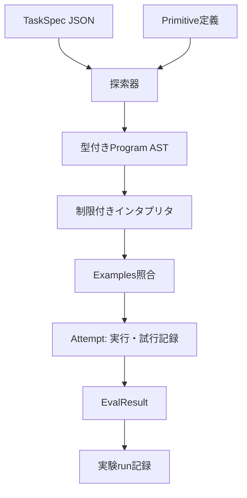

# ARCH-002 — Data contracts and flow

id: ARCH-002
status: proposed
updated: 2026-10-24
tags: contracts, schema, task, ast, evaluation

EXP-0001は**型付きの小さなDSL**を実装し、自由なPythonコードを生成・実行しない。以下のTaskSpec/ASTのJSON例は実装スキーマ `0.1` に対応する。

## 境界を越えるデータ

| オブジェクト | 意味 | 最低限のフィールド |
|---|---|---|
| TaskSpec v0 | 課題・制約 | task_id, domain, examples, limits |
| Primitive v0 | 許可された基本操作 | op_id, input_type, output_type, semantics_version |
| Program v0 | 型付きAST | node_kind, type, operands/children |
| Attempt v0 | 探索試行 | task_id, program_hash, evaluation, cost |
| SearchResult v0 | 判定と計算量 | task_id, status, solved, program, tested_candidates, max_nodes, max_candidates, elapsed_ms, trace_sha256 |
| SkillCandidate v1 | 将来の抽象技能 | skill_id, body_ast, dependencies, provenance, status |

## データフロー



### TaskSpec例（提案）
```json
{
  "schema_version": "0.1",
  "task_id": "str-trim-lower-01",
  "domain": "string_to_string",
  "examples": [
    {"input": "  RED ", "output": "red"},
    {"input": " Blue  ", "output": "blue"}
  ],
  "limits": {"max_ast_nodes": 4, "max_candidates": 5000}
}
```

### AST例（提案）
```json
{
  "node_kind": "call",
  "type": "String",
  "op_id": "lower",
  "children": [{
    "node_kind": "call",
    "type": "String",
    "op_id": "trim",
    "children": [{"node_kind": "input", "type": "String"}]
  }]
}
```

## 不変条件
1. 型に合致しないASTは実行前に拒否する。
2. 実行可能な操作はallowlistにある決定的な純粋関数だけ。
3. 同じTaskSpec・同じプリミティブ集合・同じ予算で探索順が再現する（タイムアウトによる変動を除く）。
4. 入出力例への適合と未知例への一般化は別々に測る。
5. runにはソースのcommit SHA、Python版、OS、探索制限、seed、データセット版を残す。
6. 検証器は探索アルゴリズムの外側に置き、解法を不正に誘導しない。

Related: [ARCH-001](system.md), [EXP-0001](../specs/EXP-0001.md)。

## EXP-0001の実装契約 (schema_version 0.1)

- `TaskSpec`: `domain=string_to_string`、`task_id`、`examples`（1〜256）、`limits.max_ast_nodes`（1〜32、既定4）、`limits.max_candidates`（1〜100000、既定5000）。文字列長は最大4096文字。
- `Program`: `input` または `call(op_id, child)` の一引数AST。`type=String` を型検査し、登録外操作/型不一致/ノード数超過は実行前に拒否。
- `Registry`: `trim`, `lower`, `upper` の順。実装はPython `str.strip/str.lower/str.upper`、追加依存なし。
- `Synthesis`: ノード数昇順、同じノード数では親候補の列挙順×レジストリ登録順。構造SHA-256重複除去。**意味的な重複除去はしない**。
- `Verification`: 全例の一致を要求。空の例集合は拒否。判定器は探索器と別モジュール。
- `SearchResult.status`: `solved`（全例一致）、`not_found`（指定ノード上限まで全列挙）、`budget_exhausted`（次候補を評価する前に候補予算に到達）。
- `tested_candidates` は評価したASTの個数、`trace_sha256` は評価順にAST構造ハッシュを改行連結したSHA-256。経過msは測定ノイズがあるため決定性の比較から除く。
- `--suite` の実験レポートはcommit SHA・Python・プラットフォーム・操作のsemantics_versionを同時に記録する。

**注:** `not_found` は**今回のDSLと探索上限で見つからなかった**ことを意味する。一般にその問題が解けないことの証明ではない。

実装: [protocol](../../packages/protocol/__init__.py) / [synthesis](../../packages/synthesis/__init__.py) / [runtime](../../packages/runtime/__init__.py) / [verification](../../packages/verification/__init__.py)。
