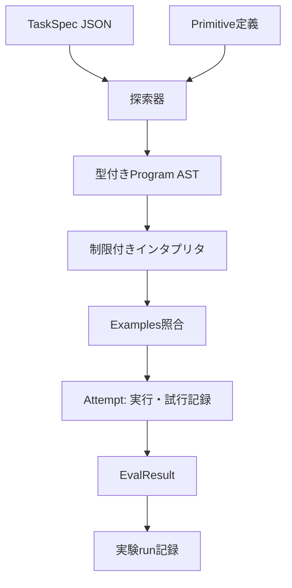
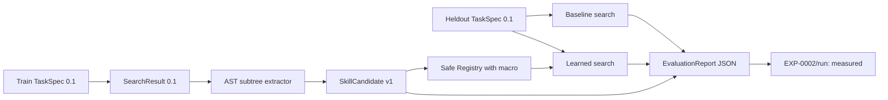
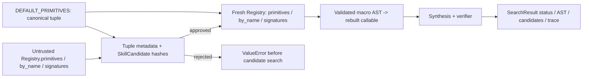
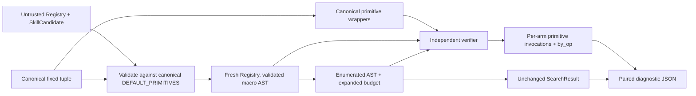
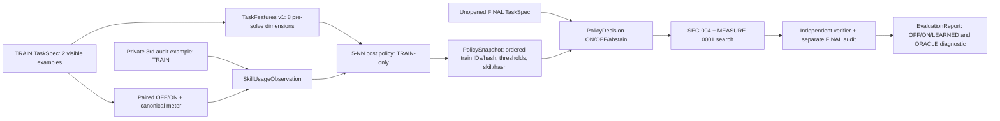
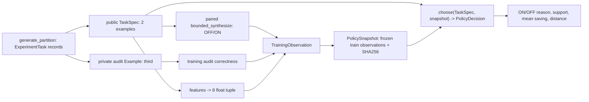

# ARCH-002 — Data contracts and flow

id: ARCH-002
status: proposed
updated: 2026-10-24
tags: contracts, schema, task, ast, evaluation

EXP-0001は**型付きの小さなDSL**を実装し、自由なPythonコードを生成・実行しない。以下のTaskSpec/ASTのJSON例は実装スキーマ `0.1` に対応する。

## 境界を越えるデータ

| オブジェクト | 意味 | 最低限のフィールド |
|---|---|---|
| TaskSpec v0 | 課題・制約 | task_id, domain, examples, limits |
| Primitive v0 | 許可された基本操作 | op_id, input_type, output_type, semantics_version |
| Program v0 | 型付きAST | node_kind, type, operands/children |
| Attempt v0 | 探索試行 | task_id, program_hash, evaluation, cost |
| SearchResult v0 | 判定と計算量 | task_id, status, solved, program, tested_candidates, max_nodes, max_candidates, elapsed_ms, trace_sha256 |
| SkillCandidate v1 | 将来の抽象技能 | skill_id, body_ast, dependencies, provenance, status |

## データフロー



### TaskSpec例（提案）
```json
{
  "schema_version": "0.1",
  "task_id": "str-trim-lower-01",
  "domain": "string_to_string",
  "examples": [
    {"input": "  RED ", "output": "red"},
    {"input": " Blue  ", "output": "blue"}
  ],
  "limits": {"max_ast_nodes": 4, "max_candidates": 5000}
}
```

### AST例（提案）
```json
{
  "node_kind": "call",
  "type": "String",
  "op_id": "lower",
  "children": [{
    "node_kind": "call",
    "type": "String",
    "op_id": "trim",
    "children": [{"node_kind": "input", "type": "String"}]
  }]
}
```

## 不変条件
1. 型に合致しないASTは実行前に拒否する。
2. 実行可能な操作はallowlistにある決定的な純粋関数だけ。
3. 同じTaskSpec・同じプリミティブ集合・同じ予算で探索順が再現する（タイムアウトによる変動を除く）。
4. 入出力例への適合と未知例への一般化は別々に測る。
5. runにはソースのcommit SHA、Python版、OS、探索制限、seed、データセット版を残す。
6. 検証器は探索アルゴリズムの外側に置き、解法を不正に誘導しない。

Related: [ARCH-001](system.md), [EXP-0001](../specs/EXP-0001.md)。

## EXP-0001の実装契約 (schema_version 0.1)

- `TaskSpec`: `domain=string_to_string`、`task_id`、`examples`（1〜256）、`limits.max_ast_nodes`（1〜32、既定4）、`limits.max_candidates`（1〜100000、既定5000）。文字列長は最大4096文字。
- `Program`: `input` または `call(op_id, child)` の一引数AST。`type=String` を型検査し、登録外操作/型不一致/ノード数超過は実行前に拒否。
- `Registry`: `trim`, `lower`, `upper` の順。実装はPython `str.strip/str.lower/str.upper`、追加依存なし。
- `Synthesis`: ノード数昇順、同じノード数では親候補の列挙順×レジストリ登録順。構造SHA-256重複除去。**意味的な重複除去はしない**。
- `Verification`: 全例の一致を要求。空の例集合は拒否。判定器は探索器と別モジュール。
- `SearchResult.status`: `solved`（全例一致）、`not_found`（指定ノード上限まで全列挙）、`budget_exhausted`（次候補を評価する前に候補予算に到達）。
- `tested_candidates` は評価したASTの個数、`trace_sha256` は評価順にAST構造ハッシュを改行連結したSHA-256。経過msは測定ノイズがあるため決定性の比較から除く。
- `--suite` の実験レポートはcommit SHA・Python・プラットフォーム・操作のsemantics_versionを同時に記録する。

**注:** `not_found` は**今回のDSLと探索上限で見つからなかった**ことを意味する。一般にその問題が解けないことの証明ではない。

実装: [protocol](../../packages/protocol/__init__.py) / [synthesis](../../packages/synthesis/__init__.py) / [runtime](../../packages/runtime/__init__.py) / [verification](../../packages/verification/__init__.py)。

## EXP-0002: SkillCandidate v1 / Macro evaluation data flow



### SkillCandidate v1（実装されたcontract）

| Field | Type | Rule |
|---|---|---|
| `schema_version` | String | `1.0` |
| `skill_id` | String | `skill_` + body_hash先頭16文字 |
| `body_ast` | Program 0.1 | 少なくとも2個のcall。既存primitiveのみを参照 |
| `body_hash` | SHA-256 | AST正規化JSONの構造hash。登録前に検証 |
| `dependencies` | sorted String[] | bodyに含まれる一意のprimitive ID |
| `provenance` | sorted String[] | 異なる成功訓練task_idが2個以上 |
| `occurrences` | Integer | distinct task_id数と一致 |
| `status` | String | 初期値 `candidate`。正式採用は自動化しない |

```json
{
  "schema_version": "1.0",
  "skill_id": "skill_<body-hash-prefix>",
  "body_ast": {
    "node_kind": "call", "type": "String", "op_id": "lower",
    "children": [{
      "node_kind": "call", "type": "String", "op_id": "trim",
      "children": [{"node_kind": "input", "type": "String"}]
    }]
  },
  "body_hash": "<SHA256 of canonical AST>",
  "dependencies": ["lower", "trim"],
  "provenance": ["train-01", "train-02"],
  "occurrences": 2,
  "status": "candidate"
}
```

### Data boundaries / 注意点
- `discover_skills(TRAIN)` への最終保留課題の入力は禁止。重複するtask_idはエラーにする。
- `registry_with_skill(candidate)` はbodyハッシュ、署名、来歴を検証し、許可済みの元primitiveを使った純粋なインタプリタに委譲する。任意Pythonソースは実行しない。
- `expanded_nodes` はmacroのInput位置へ引数ASTを置いた際の展開後ノード数を計算。探索上限 `max_ast_nodes` は**両armでこの物理ノード数に適用**。候補数上限も共通。
- `EvaluationReport` はソースcommit、Python、platform、原始演算版、train/dev/holdout task ID、候補・比較結果・判定・限界を保存。
- `status=functional_pass` は発見機構と例照合の成立のみ。`promotion_gate_metrics_pass` は独立レビューを要求する指標条件であり、自動採用ではない。
- EXP-0002はtrain/dev/finalの全入力を公開しているため、結果を用いた改良を行った後の独立評価は**新しい保留課題**が必要。

Related: [実験事前登録](../../experiments/EXP-0002/plan.md) / [仕様](../specs/EXP-0002.md) / [全体図](system.md)。

## EXP-0002 review hardening (PR #6)

- `validate_skill` explicitly rejects references to operations marked with `derived-` semantics when registering a new skill. **Nested macros remain prohibited** in this experiment; they cannot be used to undercount the AST expansion budget.
- `expanded_nodes` recursively expands skill metadata and rejects cyclic dependencies; `bounded_synthesize` rejects mismatch between derived operations in the registry and supplied skill metadata.
- New regression tests cover the formerly accepted `s(s(Input()))` macro (which expands to 5 physical AST nodes) and provenance-preserving rejection. This is a bug fix, **not** new evidence of generalization.

## EXP-0002 evaluator integrity hardening (second independent review finding)

The evaluator must verify each learned macro before any candidate search: `sha256(canonical(body_ast)) == body_hash`, `registry[skill_id].semantics_version == "derived-" + body_hash`, and that the body AST contains only approved primitives with compatible types. A matching skill ID is insufficient to protect expanded-cost accounting. This prevents swapping a shorter fake body into `learned` after a real macro has been registered. Regression tests cover mismatching body and forged internally consistent metadata.

## EXP-0002 第3回安全性検証: Registry trust boundary

- `Registry.primitives`は任意に生成可能なコンテナであり、`semantics_version`だけでは実装の真正性を保証しない。
- `bounded_synthesize`実行前に先頭3原始演算を`DEFAULT_REGISTRY`の**順序・ID・入出力型・版・callable同一性**と照合。許可外callback、旧macroを偽装した追加primitive、順序改変を拒否。
- 検証済み`SkillCandidate`からmacro実行callbackを**canonicalな原始演算のみで再構築**し、呼び出し元が渡したmacro callbackは利用しない。評価の決定性と展開後ノード上限の維持を目的とする。
- 生の`Registry`の型が安全性を保証するわけではない。上記はEXP-0002の探索評価エントリポイントでのfail-closed境界であり、`DEFAULT_REGISTRY`への自動昇格も新しい原始演算の登録も行わない。
- [P1再現条件・テスト・検査状況](../../experiments/EXP-0002/reviews/20261024-primitive-allowlist-hardening.md)を参照。事前登録計画・歴史的runは不変更。

## SEC-004: 実行用データ契約・可変Registryとの境界



**Boundary invariant:** `_trusted_search_registry`は固定の`DEFAULT_PRIMITIVES`のID、順序、型、意味版、実装オブジェクトと、呼出元`Registry.primitives`を照合する。実行用`Registry`は`Registry(DEFAULT_PRIMITIVES)`から新規生成し、公開`DEFAULT_REGISTRY`も呼出元の`by_name`/`signatures`も実行に流用しない。学習済みmacroは検査済み`SkillCandidate`からのみ生成する。

**Contract:** callerが提供した検索表・署名表は実行権限ではない。登録済みmacroの照合は`primitives`の宣言値とbody hashを使用する。未承認primitive/偽装macro/不正ASTは探索前に拒否し、正常系は既存の探索状態、AST、候補数、順序hashを保存する。実CPU時間の一致は保証しない。Pythonプロセス全体を悪意あるコードから隔離する仕組みではない。

この変更は安全性回帰の修正のみで、研究計画v1の事前登録条件、過去の実験run、EXP-0002Bの保留課題には変更を加えない。[監査記録](../../experiments/EXP-0002/reviews/20261025-registry-snapshot-boundary.md)。

## MEASURE-0001: PrimitiveCallMeter observation contract



- `PrimitiveCallMeter`: mutable `total: int`, `by_op: dict[str,int]`; `to_dict() -> {primitive_invocations, by_op}`. Each arm creates a fresh instance.
- `bounded_synthesize(..., *, meter: PrimitiveCallMeter | None)` returns the unchanged `SearchResult`. Optional meter counts **only canonical primitive invocation within verifier examples**, including macro expansions. It does not count synthesis or total compute.
- `run_experiment` adds optional diagnostic `primitive_measurement_version="runtime-canonical-v1"` and `comparisons[].primitive_measurements.off/on`. Historical EXP-0002 RUN-001/002 remain unchanged.
- Untrusted executable Registry lookups are never consumed as execution authority: prior to wrapping, `_trusted_search_registry` checks primitive identity, version, order and typed macro metadata, then reconstructs a fresh execution registry; rejecting inputs produces no meter calls.
- No learned Kernel or fresh policy FINAL evaluation here; public EXP-0002 holdout results are diagnostic and cannot confirm EXP-0002B generalization.
- [Full measurement boundary](measurement.md) / [engineering audit](../../experiments/EXP-0002B/metering-log.md) / [SEC-004](../../experiments/EXP-0002/reviews/20261025-registry-snapshot-boundary.md).

## EXP-0002B — 研究計画v2を現行mainへ整合（方法は不変更）



- **予定された型:** `TaskFeatures v1`（公開2例からの8次元）、`SkillUsageObservation`（TRAINのpaired OFF/ONと第3例audit）、`PolicyDecision`（ON/OFF、理由、5近傍の支持度）、`PolicySnapshot`（TRAIN ID/hash・方策/特徴版・技能body hash・定数）、`EvaluationReport`（全112問の正解、探索候補、primitive invocations、p90、OOD、回帰と欠損を記録）。
- **権限境界:** Kernel入力にgeneratorのfamily/split/seed、audit例、正解変換の識別子、FINAL結果を入れない。独立Verifier/予算/registry意味論は不変更。ORACLEは評価後だけの非実用診断。
- **計測は実装済み・学習は未実装:** [計測契約](measurement.md) / [事前登録v2](../../experiments/EXP-0002B/plan-v2.md) / [改訂履歴](../../experiments/EXP-0002B/preregistration-v2-log.md)。

## EXP-0002B TRAIN-only API契約（実装候補）



- `ExperimentTask`: generator専用レコード `(task, audit, family, partition, seeds)`。`TaskSpec`には公開2例と既存DSL limitsのみを含める。auditやfamilyを`choose`へ渡さない。
- `features(TaskSpec)`: 事前登録どおり8個のfloat；順序・正規化はplan-v2に固定、2例以外は拒否。`task_id`やaudit、探索結果は特徴に使わない。
- `TrainingObservation`: TRAIN task ID、8特徴値、正解監査・候補数・原始演算呼出数のOFF/ON比較と選好。Kernel推論は近傍の特徴と観測費用だけを使う。
- `PolicySnapshot`: v2定数（k=5、distance<=0.18、close>=3、ON支持>=4、mean_calls_delta>=2）、訓練観測/ID、datasetとgenerator SHA、技能body SHA、方式版、内容SHA。読み戻し時のhash不一致を拒否。
- `PolicyDecision`: `action` ON/OFF、`reason`、近傍task ID、支持件数、平均呼出節約、推論wall ms。成功確率や学習費用償却を根拠なく宣言しない。
- `preflight()`と`train_report()`はFINAL評価の結果を生成しない。データセットhashの生成は将来のFINAL成績の閲覧を意味しない。
- [事前登録](../../experiments/EXP-0002B/plan-v2.md) / [実装監査](../../experiments/EXP-0002B/reviews/20261025-train-only-kernel.md)。

## TRAIN evidence integrity: Codex review findings addressed
- 技能候補の`discover_skills`も独立の`Registry(DEFAULT_PRIMITIVES)`で動かす。`DEFAULT_REGISTRY`の公開可変lookupはcanonicalな実行権限ではない。
- 保存`PolicySnapshot`の受信時は`policy_sha256`を除いた**受信payload全体**を検証した後、`training_ids`と`training_observations_sha256`の整合を確認する。変更部分を黙って再計算しない。
- `training_trial_evidence`はTRAIN各task×OFF/ONの`SearchResult.to_dict()`、監査正誤、原始演算計数を記録する。学習snapshotの入力フィールドには監査例・familyは追加しない。[監査](../../experiments/EXP-0002B/reviews/20261025-train-only-kernel.md)。

## EXP-0002B 統合時のfreeze契約

- `experiments/EXP-0002B/freeze-v2.json`は実験方法、生成器source SHA、dataset/partition SHA、訓練観測SHA、PolicySnapshot SHA、固定技能body SHA、main source commitとCI証拠の識別子を持つ。
- スナップショットの生成結果は実行ノイズを除き決定的で、`snapshot.to_dict().policy_sha256`が凍結値と一致しなければDEV/FINALへ進めない。各armのelapsed_msは変動するため、trial-evidence SHAは等値を要求しない。
- FINALの評価・正解出力・性能はfreezeには記録しない。[凍結の説明](../../experiments/EXP-0002B/freeze-v2.md) / [機械用情報](../../experiments/EXP-0002B/freeze-v2.json)。

## EXP-0002B 評価データ契約（DEV/FINALゲート）
- `run_evaluation(phase in {dev,final},freeze_path)`: まず`freeze-v2.json`とTRAINだけで再生成した方策hash、生成器source hash、全dataset hashを検証。不一致なら評価前に拒否。
- `evaluate_record`: **判断→OFF/ON/LEARNEDの独立探索→監査**。返値は3条件の`SearchResult.to_dict`、`audit_correct`、`audit_invalid_solved`、`primitive_invocations`、`expanded_ast_nodes`、`PolicyDecision`、事後`oracle_source_action`、監査例hash。
- `summarize`: 全task/7familyのstatusとcorrectness/cost、OOD誤ON、nearest-rank p90、最大悪化、勝敗数、family-cluster paired bootstrap1000、学習費用と推論wall時間、horizon 1/32/128のprimitive限定償却、v2の固定採否ゲート。
- `numeric_status`は数値条件を満たすかのみを示し、標準Skill/Kernel自動昇格を許可しない。ORACLEは実用方策ではない。
- `pull_request`CIではDEV/FINALを呼ばず、main pushでDEVだけを実行。FINALは別PRでレビュー後に起動。[評価監査](../../experiments/EXP-0002B/reviews/20261025-evaluator-gate.md)。

## DEV/FINAL gate の実行ソース不変条件とCPU計測
- 評価器は[凍結された9ファイルのGit blob SHA](../../experiments/EXP-0002B/freeze-v2.json)を比較し、pythonのruntime、synthesis、verification、canonical meter、library、Kernel等が変更されていれば**TASK評価前に拒否**。
- 3armそれぞれ`trial_cpu_ms_including_audit` / `trial_wall_ms_including_audit`、推論`policy_inference_cpu_ms`、評価全体`run_total_cpu_ms_excluding_train`を記録。原始演算呼出数は総CPU量を表さない。
