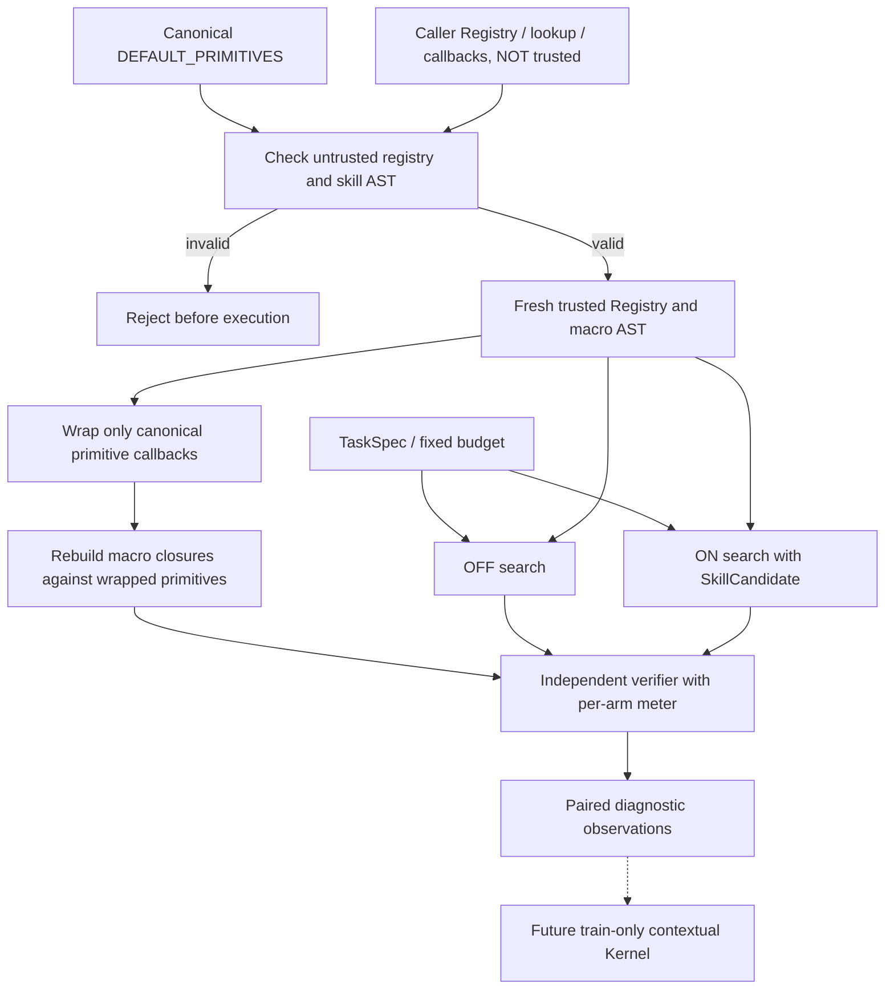
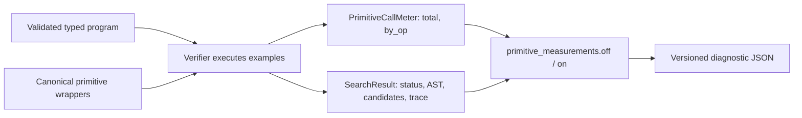

# MEASURE-0001 — Canonical primitive invocation meter

id: MEASURE-0001
status: implemented in integration PR; CI/review pending
updated: 2026-10-25
tags: architecture, instrumentation, cost-accounting, security, exp0002b

> This is **measurement infrastructure**, not a new learning result. Issue [#17](https://github.com/ryonakayama234/DekaSugi/issues/17) records acceptance. The older [PR #9](https://github.com/ryonakayama234/DekaSugi/pull/9) is stale and must not be merged as-is.

## Single-task system



## Data flow and accounting



### Contract: `runtime-canonical-v1`

For each same-task paired comparison, two **fresh** `PrimitiveCallMeter` objects are passed to `bounded_synthesize` (optional keyword-only `meter`). Each returns a `SearchResult` unchanged in schema. The diagnostics add:

```json
{
  "primitive_measurement_version": "runtime-canonical-v1",
  "primitive_measurements": {
    "off": {"primitive_invocations": 14, "by_op": {"lower": 4, "trim": 6, "upper": 4}},
    "on": {"primitive_invocations": 10, "by_op": {"lower": 4, "trim": 4, "upper": 2}}
  }
}
```

The example illustrates the format; totals alone are the experimental assertions. For precise `by_op` observations, use machine-readable CI artifacts rather than treating the illustrative breakdown as measured evidence.

- Primitive calls count **actual invocations during verifier example checks**, including `trim/lower` inside macros. The increment precedes the canonical primitive call. Identity can use zero primitives.
- This does **not** count AST construction/type checks, candidate hashing, macro reconstruction, task features, Kernel selection/training, memory, Python execution overhead or total CPU time. `elapsed_ms` includes metering overhead; do not interpret measured vs unmeasured elapsed time as a speedup.
- No callback from the original caller Registry is executed, regardless of whether the optional meter is supplied. The registry and SkillCandidate are validated before any search; the program enumerator reads the fresh trusted registry. Metering rebuilds all macro closures from validated declarative ASTs against wrappers of `DEFAULT_PRIMITIVES`, never caller implementations.
- Allowed operation order, semantic versions, AST expansion and candidate budget are identical between both arms. Tests require identical `status`, `program`, `tested_candidates`, `trace_sha256` in instrumented/uninstrumented modes, plus exact wrapper counts.
- This protects the bounded EXP-0002 evaluation entrypoint, **not** arbitrary Python execution in a hostile process.

## Scientific integrity

Older EXP-0002 RUN-001/002 files and scores are immutable. Its publicly inspected holdout may only be used to check backward compatibility and diagnose accounting. The EXP-0002B policy, fresh data generator, FINAL and acceptance conditions in [plan v2](https://github.com/ryonakayama234/DekaSugi/blob/exp/0002b-preregistration-v2/experiments/EXP-0002B/plan-v2.md) are **not** implemented here and must be independently reviewed before evaluation.

## Reproduce

```bash
python -m unittest discover -s tests -v
python scripts/check_docs.py
python -m packages.evaluation --output .run/EXP-0002-diagnostic.json
```

Evidence and exact SHA: [metering integration record](../../experiments/EXP-0002B/metering-log.md), [ARCH-001](system.md), [ARCH-002](contracts.md), [SEC-004](../../experiments/EXP-0002/reviews/20261025-registry-snapshot-boundary.md).
