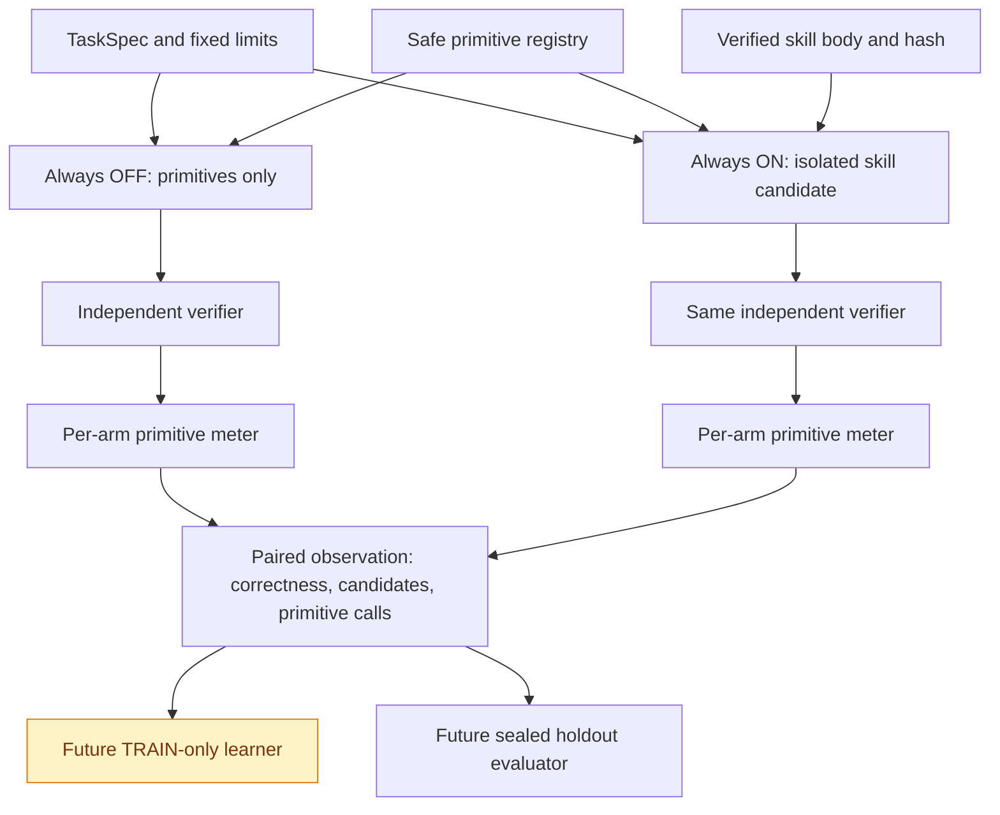
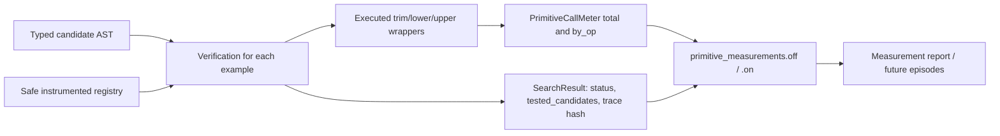

# MEASURE-0001 — Counterfactual Skill Lab: primitive execution meter

id: MEASURE-0001
status: implemented in experimental branch; independent review and CI confirmation pending
updated: 2026-10-24
tags: architecture, observability, policy-learning, cost-accounting, exp0002b

> This is the metering substrate for [Issue #7](https://github.com/ryonakayama234/DekaSugi/issues/7), not evidence that EXP-0002B learned a policy. It is stacked on the unmerged EXP-0002 implementation in PR #6.

## System — single-task paired trial



**Actual implementation boundary:** `packages/evaluation` runs a `bounded_synthesize` trial with an optional fresh `PrimitiveCallMeter`. Before a measured run, the derived macro is validated and reconstructed using instrumented allowlisted primitives. This avoids the incorrect shortcut of counting an entire macro as a single primitive call. The original registry is not modified.

## Data flow — observable versus inferred costs



### Observation contract (`runtime-wrapped-v1`)

```json
{
  "primitive_measurement_version": "runtime-wrapped-v1",
  "task_id": "example-task",
  "primitive_measurements": {
    "off": {"primitive_invocations": 4, "by_op": {"trim": 2, "lower": 2}},
    "on": {"primitive_invocations": 10, "by_op": {"trim": 4, "lower": 4, "upper": 2}}
  }
}
```

These values illustrate the schema using **different example trials**; they are not a scientific EXP-0002B comparison. Each arm always uses a new meter. In a future episode, both results must refer to the *same* TaskSpec and limits, include a validated skill ID/body hash, dataset split, source SHA, and task-family group.

### Invariants and coverage

1. Increment the meter inside each **actual primitive implementation wrapper**, after an AST reaches the verifier. A macro body is interpreted through these same wrappers, so its primitive operations are counted individually.
2. Both measured/unmeasured runs must preserve success, tested candidate count, structural program and deterministic trace hash. Primitive names/order and semantic versions must match exactly.
3. Report `primitive_invocations` separately from `tested_candidates` and expanded AST node limit. A zero-call identity result is valid.
4. This metric covers calls during candidate-example verification. It **excludes** parsing, hashing, type checks, macro validation/rebuilding, feature extraction, policy inference/training, Python interpreter cost, memory and elapsed time. Total system compute is not yet known.
5. The historical EXP-0002 run files remain immutable. Newly added diagnostics must not be retrospectively described as preregistered EXP-0002 endpoints.
6. EXP-0002's published holdout is **not eligible** as a confirmatory EXP-0002B result. A distinct preregistered dataset and policy snapshot are still required.

## Reproduction (after dependency is available)

```bash
python -m unittest discover -s tests -v
python scripts/check_docs.py
python -m packages.evaluation --output .run/EXP-0002-remeasured.json
```

Outcome on this branch is subject to GitHub Actions and independent code review. See [measurement development record](../../experiments/EXP-0002B/metering-log.md) and [system diagram](system.md).
