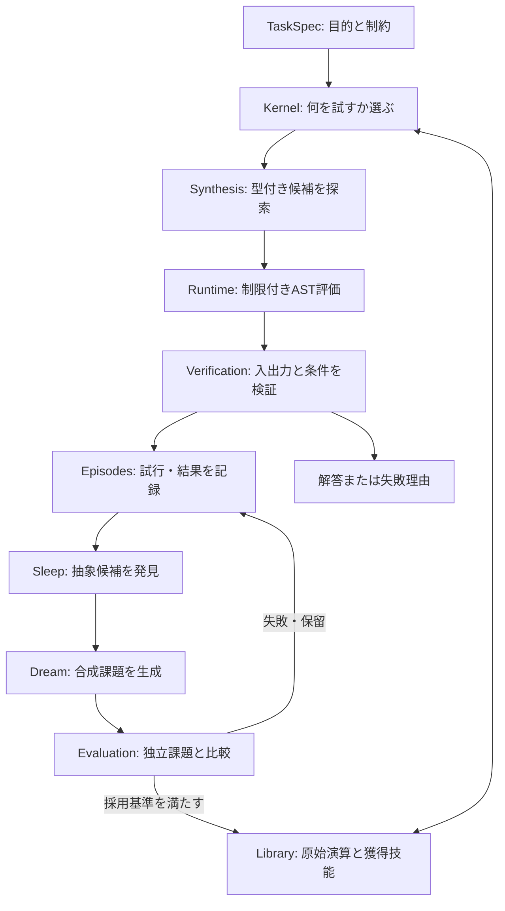
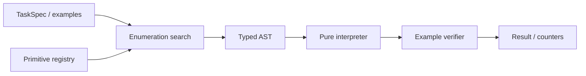
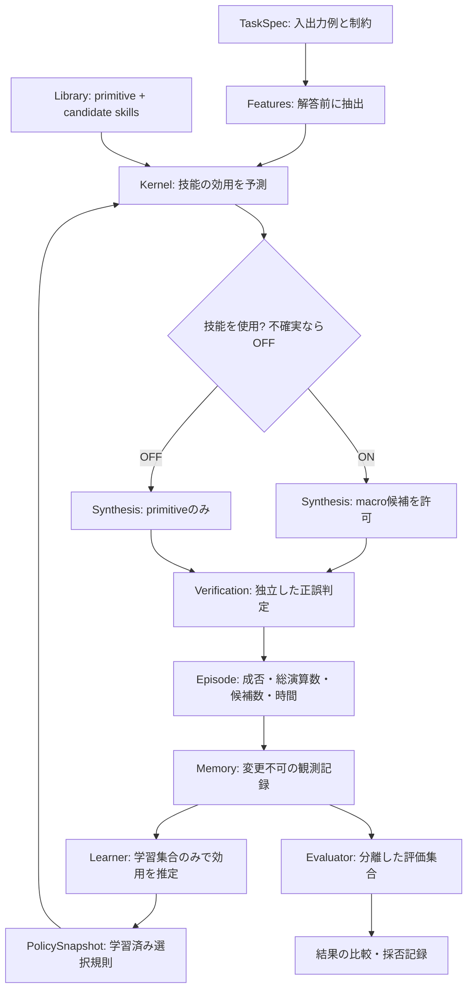
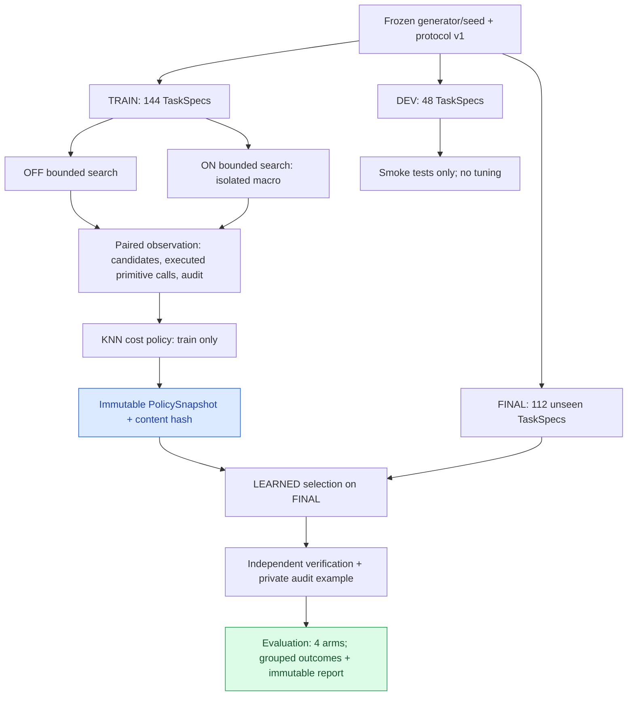

# ARCH-001 — System architecture

id: ARCH-001
status: proposed
updated: 2026-10-24
tags: diagram, architecture, components, wake-sleep

> 目標全体図は**提案**。EXP-0001に限定した型付き探索・実行・検証は実装済み（採否は実験runを参照）。各モジュールは [packages目録](../../packages/README.md) で管理。

## 目標アーキテクチャ

## 最初の実装境界 (EXP-0001)

EXP-0001は **学習・Wake-Sleep・外部Webアクセスを実装しない**。型付き表現・探索・検証・測定のみを実装する。依存は `protocol → library/runtime/verification/synthesis → cli`。実験結果は [run目録](../../experiments/EXP-0001/runs/README.md) に分離。

## レイヤの責任と依存方向
- `protocol`: 共通の不変データ形式とバージョン。外部依存なし。
- `synthesis`: protocol + primitive情報から候補を探索。任意コード実行は禁止。
- `runtime`: 型付きASTの純粋なインタプリタ。許可された演算のみ。
- `verification`: 正解/不正解と評価指標を記録。探索器の都合で採点基準を変更しない。
- `library`: 原始演算/採用技能のメタデータと履歴。
- `memory`: 観測・試行ログ。結果と解釈を分離。
- `learning`: 後続フェーズで抽象化・Wake-Sleep・練習課題生成。
- `kernel`: 後続フェーズで課題と技能から行動を選択する。

新しくコードを追加するときは、この図の実装範囲を塗り分ける代わりに各要素の実装/未実装を明記し、[データ契約](contracts.md)を同期する。

## EXP-0002B — 学習型の道具選択（**提案・未実装**）

元の夢である「経験→抽象化→予行演習→次の経験」のうち、**技能の使い分け**を測定可能な最小機構として挿入する。EXP-0002の技能候補の存在が前提だが、mainにはPR #6未統合。

- **新たに学習するもの:** 新しい関数の本体ではなく、課題特徴と候補技能を結びつける *policy / meta-skill*。
- **現行資産:** EXP-0001の探索器・検証器、EXP-0002の技能候補（PR #6）。ランタイム演算、検証ルール、原始演算セットは固定。
- **今回作らないもの:** 自律的Web探索、外部コード実行、モデル重みの大規模訓練、Wake–Sleep全自動化。次段階EXP-0003の構想は維持。
- [データ契約](contracts.md) / [仕様](../specs/EXP-0002B.md) / [計画案](../../experiments/EXP-0002B/plan.md) / [Issue #7](https://github.com/ryonakayama234/DekaSugi/issues/7)。

## EXP-0002B: preregistered trial architecture（実装前、v1）

この図は**事前登録で固定した目標フロー**であり実装図ではない。特に、訓練データで両方の技能使用条件を試す方式は、厳密にはBandit-feedbackではなくfull-information contextual cost-sensitive learning。過去のEXP-0002公開holdoutは新しい最終試験に使わない。[確定方法・分割・採用ゲート](../../experiments/EXP-0002B/plan.md) / [データ契約](contracts.md)。
