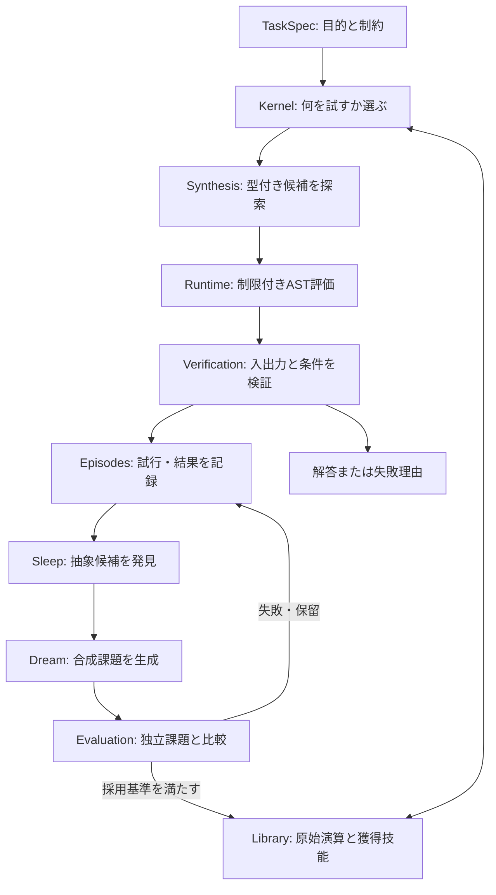
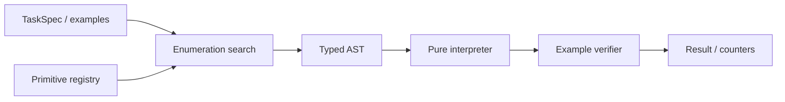
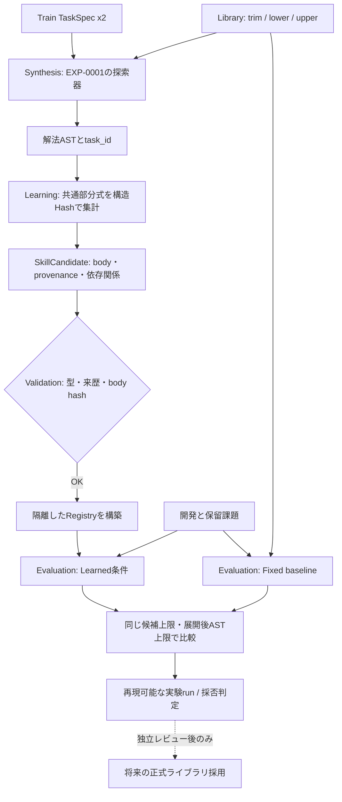
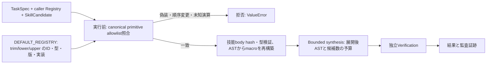
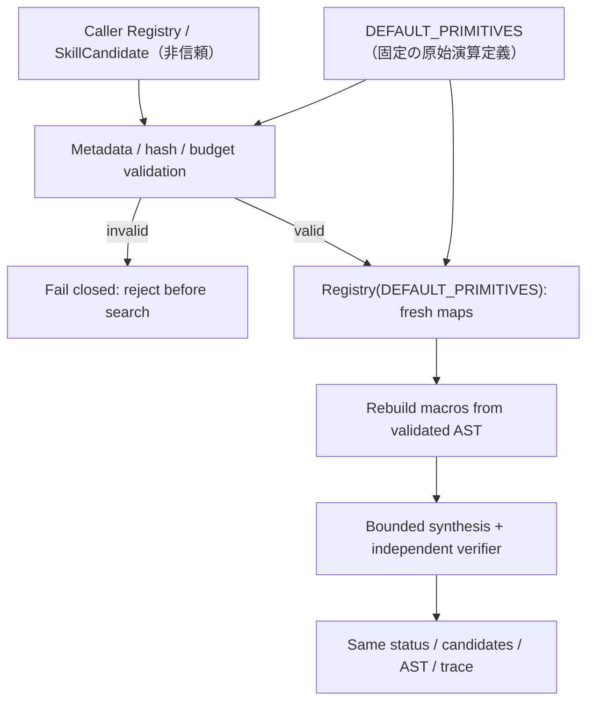
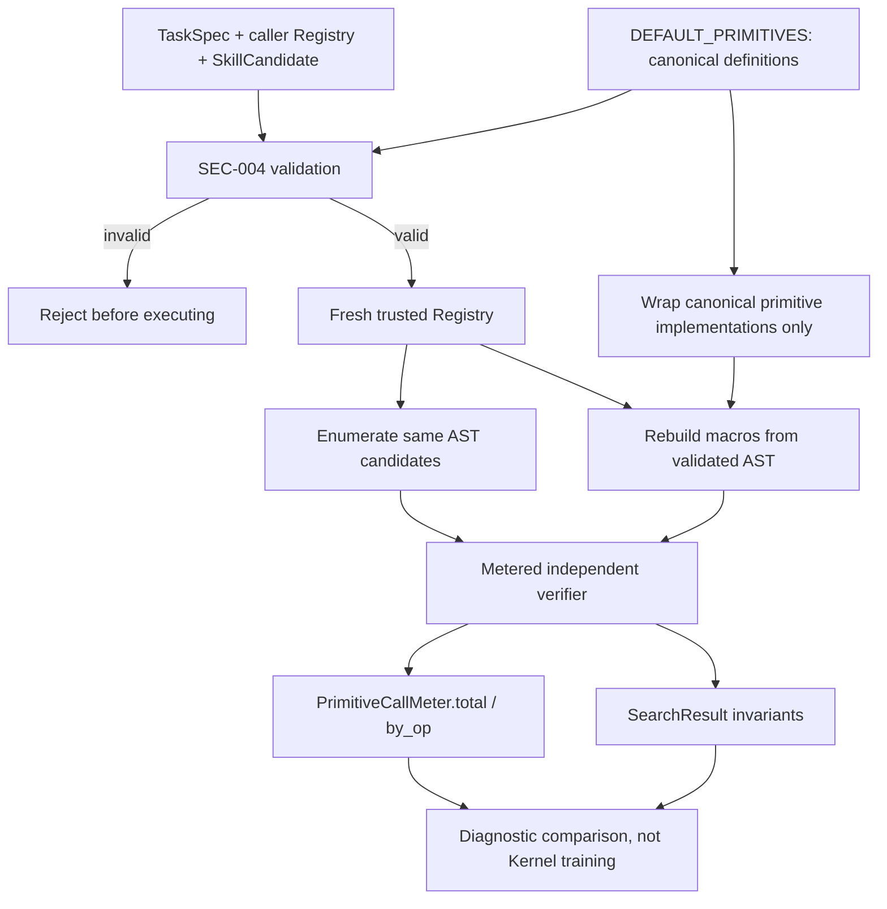
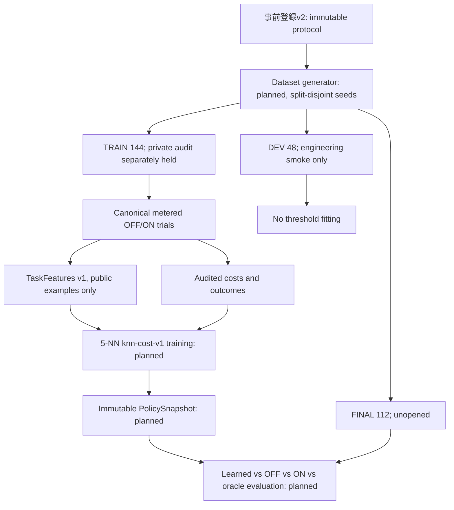
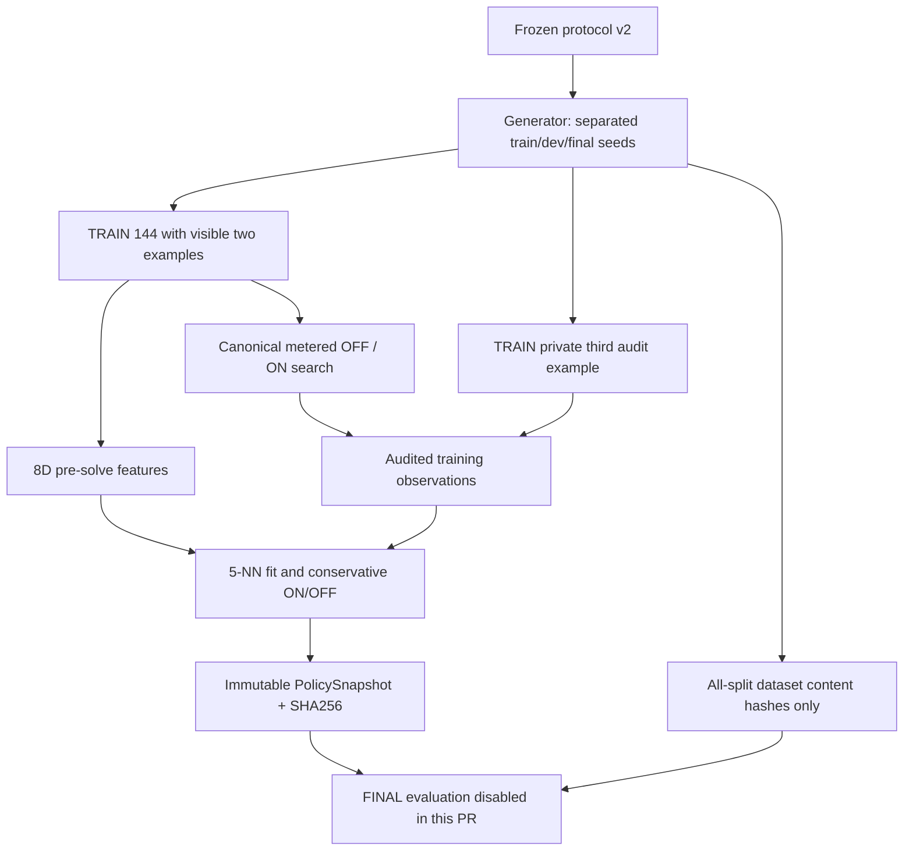

# ARCH-001 — System architecture

id: ARCH-001
status: proposed
updated: 2026-10-24
tags: diagram, architecture, components, wake-sleep

> 目標全体図は**提案**。EXP-0001に限定した型付き探索・実行・検証は実装済み（採否は実験runを参照）。各モジュールは [packages目録](../../packages/README.md) で管理。

## 目標アーキテクチャ

## 最初の実装境界 (EXP-0001)

EXP-0001は **学習・Wake-Sleep・外部Webアクセスを実装しない**。型付き表現・探索・検証・測定のみを実装する。依存は `protocol → library/runtime/verification/synthesis → cli`。実験結果は [run目録](../../experiments/EXP-0001/runs/README.md) に分離。

## レイヤの責任と依存方向
- `protocol`: 共通の不変データ形式とバージョン。外部依存なし。
- `synthesis`: protocol + primitive情報から候補を探索。任意コード実行は禁止。
- `runtime`: 型付きASTの純粋なインタプリタ。許可された演算のみ。
- `verification`: 正解/不正解と評価指標を記録。探索器の都合で採点基準を変更しない。
- `library`: 原始演算/採用技能のメタデータと履歴。
- `memory`: 観測・試行ログ。結果と解釈を分離。
- `learning`: 後続フェーズで抽象化・Wake-Sleep・練習課題生成。
- `kernel`: 後続フェーズで課題と技能から行動を選択する。

新しくコードを追加するときは、この図の実装範囲を塗り分ける代わりに各要素の実装/未実装を明記し、[データ契約](contracts.md)を同期する。

## EXP-0002 の実装境界（技能の自動発見）

- **実装済み:** `packages/learning` の共通部分式抽出と安全なmacro登録、`packages/evaluation` の比較CLI、学習候補の独立test。
- **未実装:** Sleep/Dream全体ループ、永続Episodes DB、学習された検索方針、Kernelによる自律タスク選択。
- **決定的な境界:** `learning` は訓練課題からのみ候補を作る。`evaluation` は候補を触らず開発/最終評価を計測。生成したmacroは `DEFAULT_REGISTRY` を変更しない。
- 探索条件とデータの対応は [ARCH-002](contracts.md)、研究ゲートは [EXP-0002](../specs/EXP-0002.md)、実測は [runs](../../experiments/EXP-0002/runs/README.md) を参照。

## EXP-0002 security boundary — 第3回独立レビュー指摘への対応

- 呼び出し元から提供されたRegistry内の実装callbackは、原始演算もmacroも実行権限の根拠にしない。primitiveは`DEFAULT_REGISTRY`の実装同一性で検査し、macroは型付きASTから再構築する。
- PR #6の第3回P1を含む安全修正はSEC-004とあわせてmainへ統合済み。コード品質の検査根拠は[独立監査の記録](../../experiments/EXP-0002/reviews/20261024-primitive-allowlist-hardening.md)と[SEC-004追跡](../../experiments/EXP-0002/reviews/20261025-registry-snapshot-boundary.md)。科学的な技能昇格は別判断。

## SEC-004: 実行用Registryの独立スナップショット（mainへ統合済み）

- `DEFAULT_REGISTRY`の`primitives`、`by_name`、`signatures`は公開属性で、可変な実行権限の根拠にしない。原始演算の正本は`DEFAULT_PRIMITIVES`、実行に使う検索表と署名表は毎回新しい`Registry`で生成する。
- 呼出元の`Registry.by_name`を参照してmacroを認証しない。登録情報は`primitives`タプルと`SkillCandidate`のbody hashで検査し、macro callableも検証済みASTから再構築する。
- この境界はEXP-0002の`bounded_synthesize`に限定される。任意のPythonコードや同一プロセスの攻撃者からの完全な隔離を意味しない。新Kernelの実装やFINAL評価には進んでいない。
- [SEC-004の回帰・監査記録](../../experiments/EXP-0002/reviews/20261025-registry-snapshot-boundary.md)と[Issue #14](https://github.com/ryonakayama234/DekaSugi/issues/14)を参照。

## MEASURE-0001: 実行時primitive計測（PR #18、まだKernel学習なし）

- `packages/evaluation`: optional per-arm counter for verifier-time canonical primitive calls. The DSL/AST/limits/enumerator are unchanged.
- **Not implemented:** EXP-0002B feature extraction, training, contextual policy, future sealed FINAL. An original public EXP-0002 holdout rerun is diagnostic only.
- [計測仕様](measurement.md) / [データフロー](contracts.md) / [監査記録](../../experiments/EXP-0002B/metering-log.md)。

## EXP-0002B — 研究計画v2を現行mainへ整合（方法は不変更）

- **統合済み基盤:** SEC-004の正本RegistryとMEASURE-0001（[PR #18](https://github.com/ryonakayama234/DekaSugi/pull/18)）。古い計測[PR #9](https://github.com/ryonakayama234/DekaSugi/pull/9)は安全性問題により未マージ・クローズ済み。
- **今回の作業は方法と図のみ:** v1原本を歴史資料として追加し、[v2現行正本](../../experiments/EXP-0002B/plan-v2.md)を一文字も変更せず載せる。新規Generator・Kernel・学習済Policy・FINAL結果は依然として未実装。
- [v2改訂理由](../../experiments/EXP-0002B/preregistration-v2-log.md) / [仕様](../specs/EXP-0002B.md) / [データフロー](contracts.md) / [Issue #19](https://github.com/ryonakayama234/DekaSugi/issues/19)。

## EXP-0002B TRAIN-only Kernel（実装候補、FINALは未実行）

- `packages/kernel`: v2仕様に固定したsplit生成器、8次元特徴、TRAIN 144問のfull-information paired search、監査付き教師ラベル、5近傍の選択、PolicySnapshot hash。
- `packages/evaluation`の安全な `bounded_synthesize(..., meter=...)` を再利用し、原始演算・独立Verifier・候補予算を変更しない。
- FINALについては**データセットの内容hashだけ**計算可能とする。最終課題での技能選択・探索・正誤評価を行うコード経路は本PRに追加しない。
- [実装監査](../../experiments/EXP-0002B/reviews/20261025-train-only-kernel.md) / [方法正本](../../experiments/EXP-0002B/plan-v2.md)。
