# ARCH-001 — System architecture

id: ARCH-001
status: proposed
updated: 2026-10-28
tags: diagram, architecture, components, wake-sleep

> 目標全体図は**提案**。EXP-0001に限定した型付き探索・実行・検証は実装済み（採否は実験runを参照）。各モジュールは [packages目録](../../packages/README.md) で管理。

## 目標アーキテクチャ

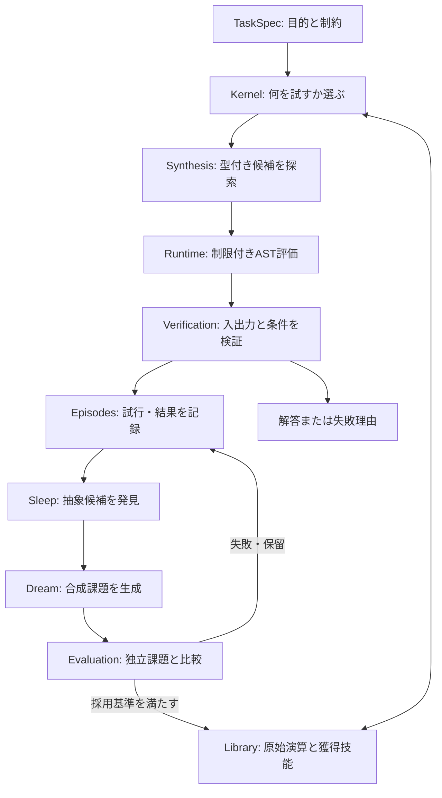

## 最初の実装境界 (EXP-0001)

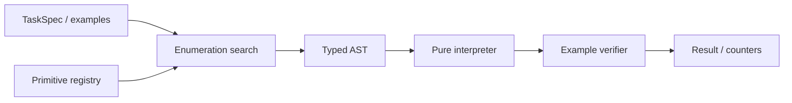

EXP-0001は **学習・Wake-Sleep・外部Webアクセスを実装しない**。型付き表現・探索・検証・測定のみを実装する。依存は `protocol → library/runtime/verification/synthesis → cli`。実験結果は [run目録](../../experiments/EXP-0001/runs/README.md) に分離。

## レイヤの責任と依存方向
- `protocol`: 共通の不変データ形式とバージョン。外部依存なし。
- `synthesis`: protocol + primitive情報から候補を探索。任意コード実行は禁止。
- `runtime`: 型付きASTの純粋なインタプリタ。許可された演算のみ。
- `verification`: 正解/不正解と評価指標を記録。探索器の都合で採点基準を変更しない。
- `library`: 原始演算/採用技能のメタデータと履歴。
- `memory`: 観測・試行ログ。結果と解釈を分離。
- `learning`: 後続フェーズで抽象化・Wake-Sleep・練習課題生成。
- `kernel`: 後続フェーズで課題と技能から行動を選択する。

新しくコードを追加するときは、この図の実装範囲を塗り分ける代わりに各要素の実装/未実装を明記し、[データ契約](contracts.md)を同期する。

## EXP-0002 の実装境界（技能の自動発見）

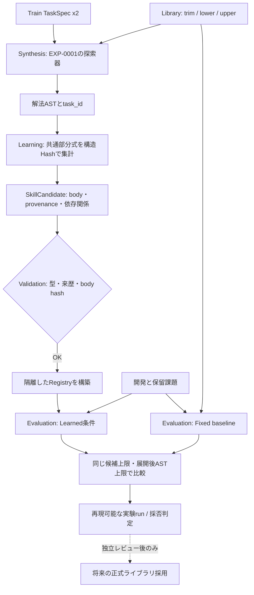

- **実装済み:** `packages/learning` の共通部分式抽出と安全なmacro登録、`packages/evaluation` の比較CLI、学習候補の独立test。
- **未実装:** Sleep/Dream全体ループ、永続Episodes DB、学習された検索方針、Kernelによる自律タスク選択。
- **決定的な境界:** `learning` は訓練課題からのみ候補を作る。`evaluation` は候補を触らず開発/最終評価を計測。生成したmacroは `DEFAULT_REGISTRY` を変更しない。
- 探索条件とデータの対応は [ARCH-002](contracts.md)、研究ゲートは [EXP-0002](../specs/EXP-0002.md)、実測は [runs](../../experiments/EXP-0002/runs/README.md) を参照。

## EXP-0002 security boundary — 第3回独立レビュー指摘への対応

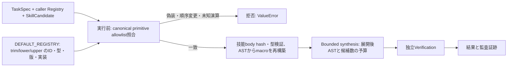

- 呼び出し元から提供されたRegistry内の実装callbackは、原始演算もmacroも実行権限の根拠にしない。primitiveは`DEFAULT_REGISTRY`の実装同一性で検査し、macroは型付きASTから再構築する。
- PR #6の第3回P1を含む安全修正はSEC-004とあわせてmainへ統合済み。コード品質の検査根拠は[独立監査の記録](../../experiments/EXP-0002/reviews/20261024-primitive-allowlist-hardening.md)と[SEC-004追跡](../../experiments/EXP-0002/reviews/20261025-registry-snapshot-boundary.md)。科学的な技能昇格は別判断。

## SEC-004: 実行用Registryの独立スナップショット（mainへ統合済み）

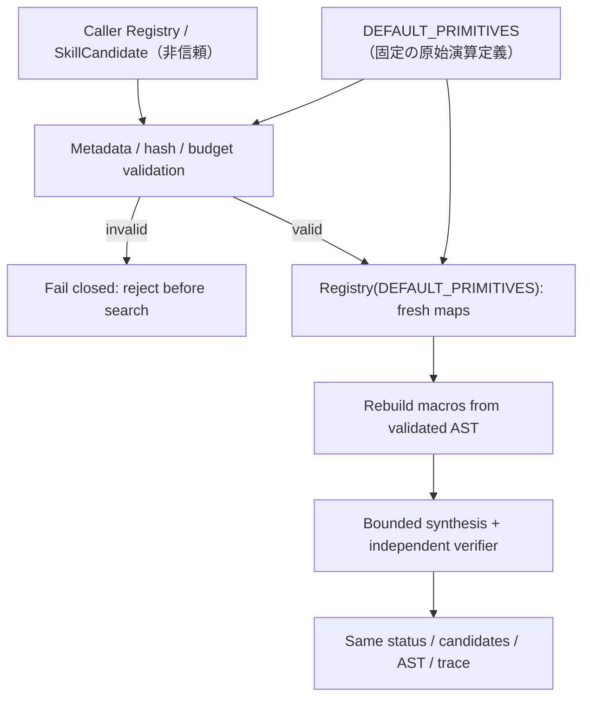

- `DEFAULT_REGISTRY`の`primitives`、`by_name`、`signatures`は公開属性で、可変な実行権限の根拠にしない。原始演算の正本は`DEFAULT_PRIMITIVES`、実行に使う検索表と署名表は毎回新しい`Registry`で生成する。
- 呼出元の`Registry.by_name`を参照してmacroを認証しない。登録情報は`primitives`タプルと`SkillCandidate`のbody hashで検査し、macro callableも検証済みASTから再構築する。
- この境界はEXP-0002の`bounded_synthesize`に限定される。任意のPythonコードや同一プロセスの攻撃者からの完全な隔離を意味しない。新Kernelの実装やFINAL評価には進んでいない。
- [SEC-004の回帰・監査記録](../../experiments/EXP-0002/reviews/20261025-registry-snapshot-boundary.md)と[Issue #14](https://github.com/ryonakayama234/DekaSugi/issues/14)を参照。

## MEASURE-0001: 実行時primitive計測（PR #18、まだKernel学習なし）

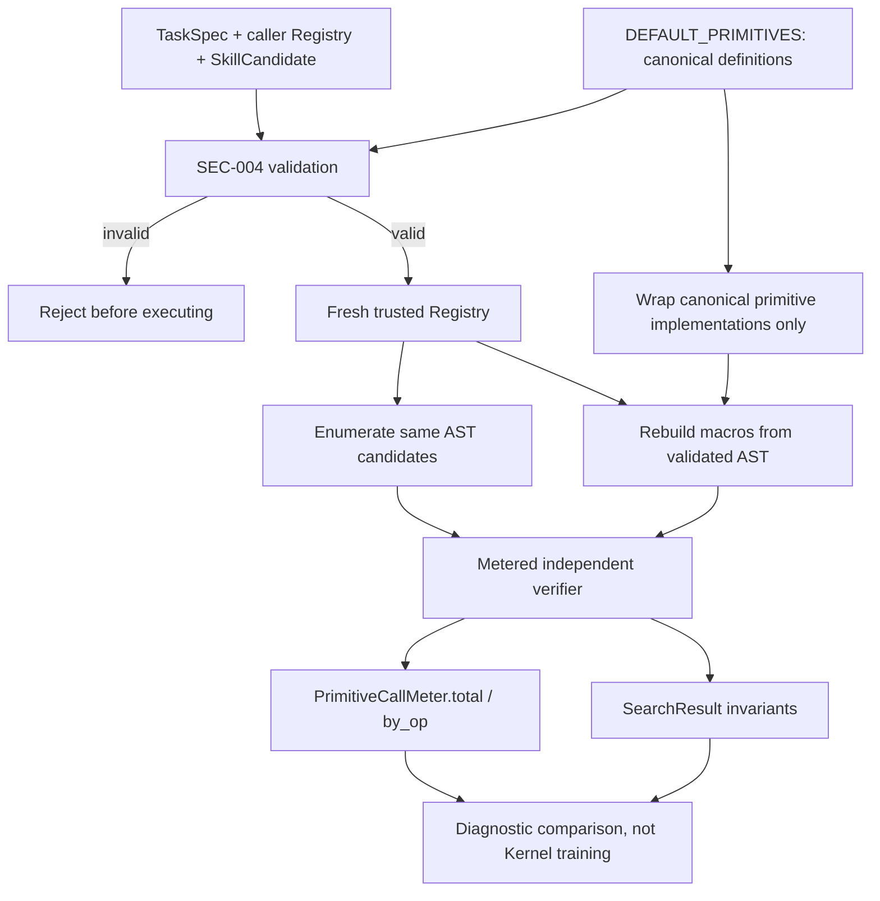

- `packages/evaluation`: optional per-arm counter for verifier-time canonical primitive calls. The DSL/AST/limits/enumerator are unchanged.
- **Not implemented:** EXP-0002B feature extraction, training, contextual policy, future sealed FINAL. An original public EXP-0002 holdout rerun is diagnostic only.
- [計測仕様](measurement.md) / [データフロー](contracts.md) / [監査記録](../../experiments/EXP-0002B/metering-log.md)。

## EXP-0002B — 研究計画v2を現行mainへ整合（方法は不変更）

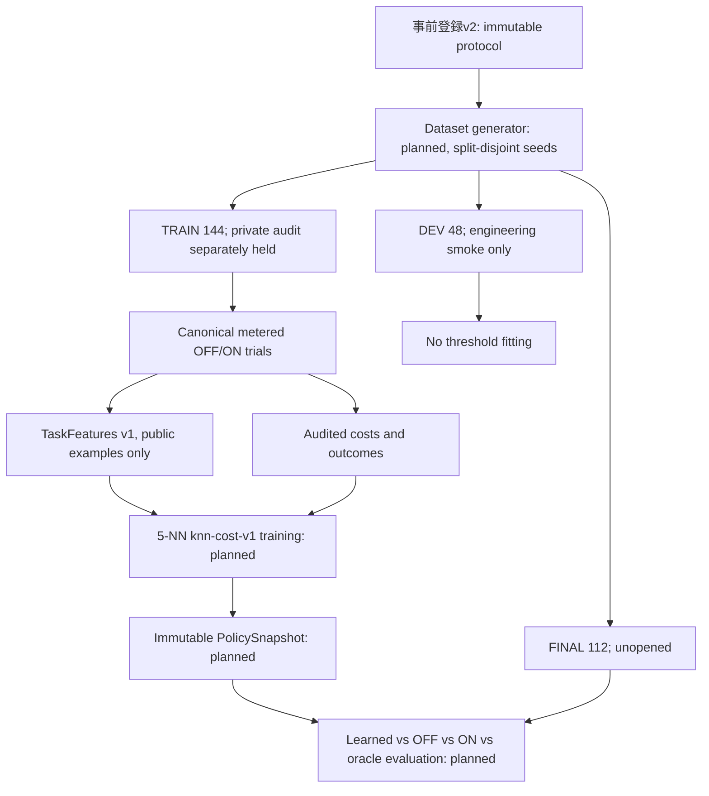

- **統合済み基盤:** SEC-004の正本RegistryとMEASURE-0001（[PR #18](https://github.com/ryonakayama234/DekaSugi/pull/18)）。古い計測[PR #9](https://github.com/ryonakayama234/DekaSugi/pull/9)は安全性問題により未マージ・クローズ済み。
- **今回の作業は方法と図のみ:** v1原本を歴史資料として追加し、[v2現行正本](../../experiments/EXP-0002B/plan-v2.md)を一文字も変更せず載せる。新規Generator・Kernel・学習済Policy・FINAL結果は依然として未実装。
- [v2改訂理由](../../experiments/EXP-0002B/preregistration-v2-log.md) / [仕様](../specs/EXP-0002B.md) / [データフロー](contracts.md) / [Issue #19](https://github.com/ryonakayama234/DekaSugi/issues/19)。

## EXP-0002B TRAIN-only Kernel（実装候補、FINALは未実行）

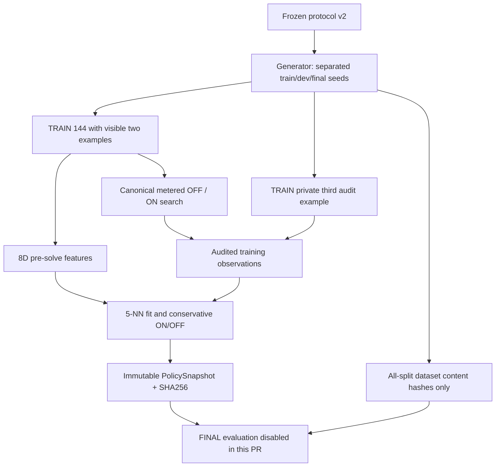

- `packages/kernel`: v2仕様に固定したsplit生成器、8次元特徴、TRAIN 144問のfull-information paired search、監査付き教師ラベル、5近傍の選択、PolicySnapshot hash。
- `packages/evaluation`の安全な `bounded_synthesize(..., meter=...)` を再利用し、原始演算・独立Verifier・候補予算を変更しない。
- FINALについては**データセットの内容hashだけ**計算可能とする。最終課題での技能選択・探索・正誤評価を行うコード経路は本PRに追加しない。
- [実装監査](../../experiments/EXP-0002B/reviews/20261025-train-only-kernel.md) / [方法正本](../../experiments/EXP-0002B/plan-v2.md)。

## EXP-0002B 再現可能な学習方策の固定点（DEV/FINALより前）

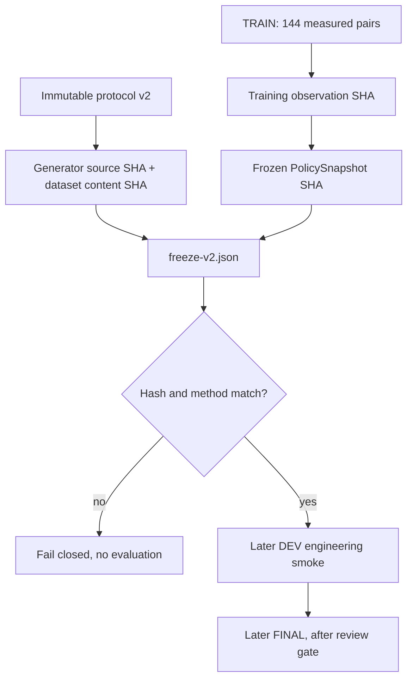

学習済みPolicySnapshotはTRAIN-only CIで再現一致を確認。後続評価では新しい課題を見て再学習せず、[凍結記録](../../experiments/EXP-0002B/freeze-v2.md)に固定したhashを照合する。

## EXP-0002B 評価器の境界（PRではDEV/FINAL未実行）

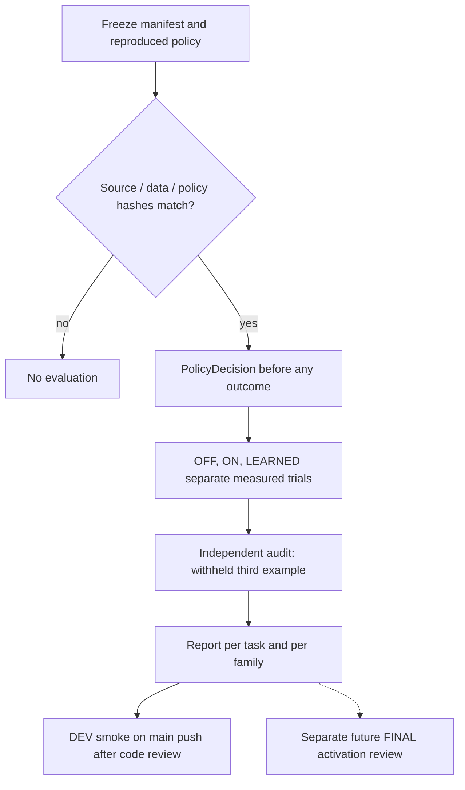

- [評価実装](../../packages/kernel/evaluation.py)は[凍結点](../../experiments/EXP-0002B/freeze-v2.md)に一致する学習方策のみ受け入れる。
- PRのCIで実DEV/FINALの成果を開かない。現PRのmain pushはDEV engineering smokeのみ、FINALは別PRの品質ゲートが必要。[詳細](../../experiments/EXP-0002B/reviews/20261025-evaluator-gate.md)。

## EXP-0002B 現在地：DEV48実測・FINAL封印 (2026-10-25)

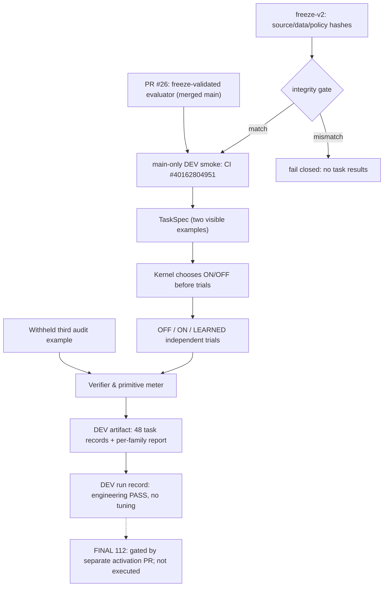

[DEV実測run](../../experiments/EXP-0002B/runs/20261025-dev-smoke.md)はmainコミット・CI Artifact・JSON SHA-256を保存。実装済みの境界は凍結照合、独立した3arm、監査、DEVのレポートまで。当時のFINALへのCI実行経路は未開放であった。最新の起動承認条件は下記「FINAL112限定起動ゲート」に記録する。

## EXP-0002B FINAL112限定起動ゲート（PR #28：レビュー待ち、結果未取得）

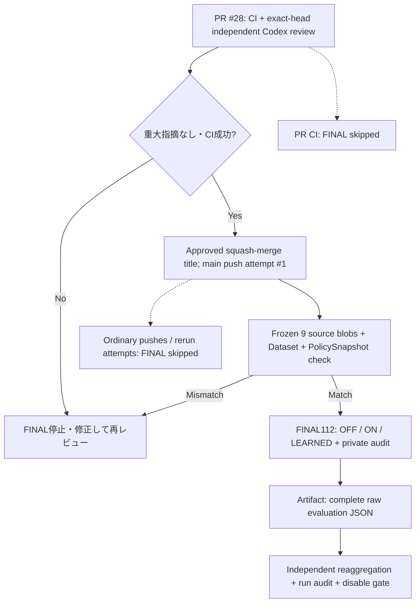

- 上記承認subjectは `EXP-0002B FINAL112 activation [20261025-APPROVED]`。有効なのは `push(main)` かつ `github.run_attempt == 1` の場合のみで、通常のPR CIおよびmain pushでは評価しない。フリーズした方策・評価実装は変更しない。
- 自動的な「永久に一度」の排他的ロックではないため、結果確保後に起動ステップを削除し、当該subjectを意図的に再利用しない。科学的ゲート通過と標準Registry昇格は別判定。
- [起動ゲート監査](../../experiments/EXP-0002B/reviews/20261025-final-activation.md) / [既存DEV run](../../experiments/EXP-0002B/runs/20261025-dev-smoke.md)。

## EXP-0002B FINAL112実測完了：数値ゲートPASS、トリガー退役 (2026-10-25)

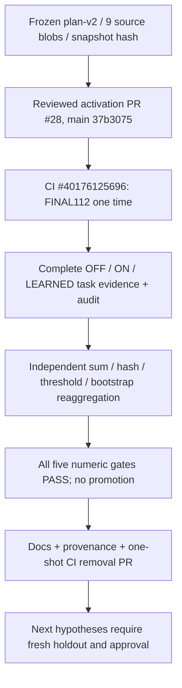

- 過去の設計・工程図に残る「未開放」「未実装」「結果未取得」はその時点の履歴を表す。現行状態は[FINAL run](../../experiments/EXP-0002B/runs/20261025-final112.md)が正本。独立再集計で112件、7 family各16件、OOD誤ON0、LEARNED80/112、五つの数値ゲートを確認した。
- 一度限りのFINAL起動ステップはこの文書同期PRで削除。予め凍結したKernel、評価器、実行ソースは変更しない。今後の通常CIはDEV工程まで。総CPU高速化は未実証で、技能の正式採用もしない。

## EXP-0003A: WAKE–SLEEP / Counterfactual DREAM design (PR3 TRAIN/DREAM base; holdouts gated)
本図は目標システムを示す。PR2のTRAIN WAKE/SLEEPに加え、PR3で512 DREAM pool/各96ケース選別、独立監査付きTRAIN/DREAM paired観測、保守的5NN/B1-B3 PolicySnapshotの構築を実装。独立DEV/FINAL、UI、技能の正式昇格はまだ目標設計のみ。既存EXP-0002B Kernelの凍結方法は変更しない。

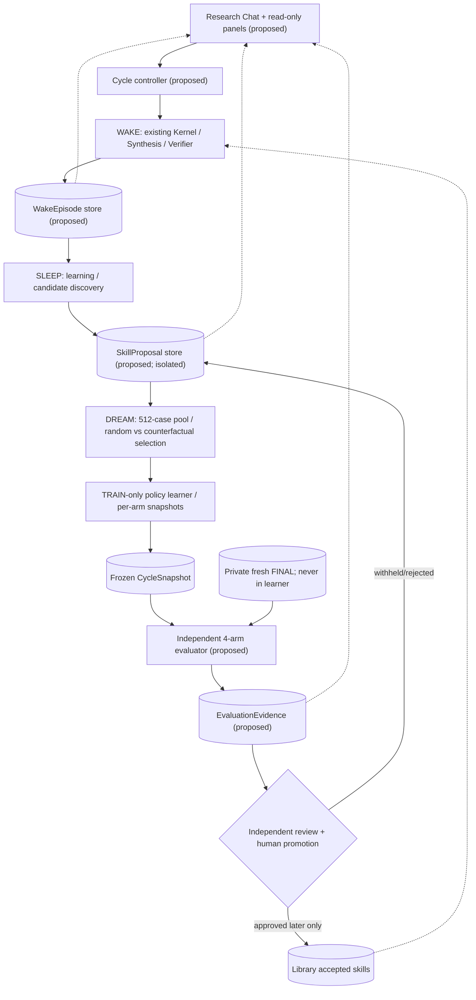

- **PR2 evidence trust boundary**: 評価器がWAKE直後に原本`WakeReceipt`を作り、SLEEPは原本との整合性チェックを行ってから監査済みASTのみを学習。private TRAIN元データと原本receiptは、学習器と分離したActions Artifact内別ファイルに保存（第三者非公開を意味しない）。生成器/WAKE/SLEEPのCPU/wallを別々に計測。
- **PR2 implementation (TRAIN-only)**: `packages/exp0003a.generate_train` → 公開`TaskSpec` + generator-private`TrainCase` → `wake` (SEC-004 public search + isolated private audit) → `WakeEpisode` → `sleep` (audited-success AST only) → `SkillProposal`。PR2当時の実装範囲はTRAIN160のみだった。現在は後述のPR3工程でDream選別とB1/B2/B3 PolicySnapshotも実装。DEV/FINAL/Registry昇格は未実装のまま。
- **Existing**: typed TaskSpec, constrained Synthesis, pure interpreter, Verification, EXP-0002 SkillCandidate extraction, canonical Registry SEC-004, primitive meter MEASURE-0001, EXP-0002B Kernel (その凍結方法は変更禁止)。
- **Proposed only**: cycle orchestration、append-only Episodes/Proposal/Dream/CycleSnapshot/Evidence、versioned Dream generator and selection、4arm Evaluatorとread-only UI投影。中央のboxesは論理保存領域であって新DB製品の採用を意味しない。
- **Trust boundary**: ID-v1では`TaskSpec.task_id`は公開2例だけをhash化した不透明な識別子で、family/split/seedを含むgenerator/evaluator専用の`source_record_id`/`pool_id`は別管理（[契約](contracts.md)）。Dreamの合成正解やpublic examplesをFINALの代わりにしない。private audit・family・seed・splitはlearner APIへ流さない。未承認技能は隔離されたRegistryのみに載せ、標準Libraryへ自動昇格しない。
- **PR3 new implementation**: `packages/exp0003a.pr3`で同一候補をOFF/ON比較し、8×64のDream poolからB2 fixed-seed random96/B3 positive近傍96を選択。B1/B2/B3同じ公共8D/5NN閾値で方策snapshotを固定。評価者専用原データ・監査証拠と学習器入力を分けて保存。CIはTRAIN/DREAMのみ。DEV/FINALは別freeze・レビュー・人間承認まで停止。
- **Research scope**: 1周期、原始演算はtrim/lower/upper固定。未知のprimitive意味論・異領域転移は未実証。詳細は[pre-registration](../../experiments/EXP-0003A/plan.md)、[spec](../specs/EXP-0003A.md)、[ARCH-002](contracts.md)、[UI map](ui-panels.md)。

## EXP-0003A PR4 — splitハッシュ凍結準備
- TRAIN160 + DREAM512を既存ソースと独立生成で全件一致確認し、DEV64 + FINAL128は第三例を参照正解として生成してソース・全4 splitのhashを**一切採点せず**固定する。`packages/exp0003a.freeze`が正式なpreflight read-modelで、凍結ファイル本体の検証は専用`freeze_cli --mode check-freeze`のみ。UI/evaluatorがデータを捏造して凍結を越える経路はない。
- PR4 freezeを先にレビュー・統合し、DEV工学診断は別承認・別工程、FINAL128の1回限り採点は別途人間承認まで封印。PR3のKernel/閾値と旧EXP-0002Bの完成済み学習器には変更を加えない。

## METRO-0001 — 独立した知能測定系 (design-only; not implemented)

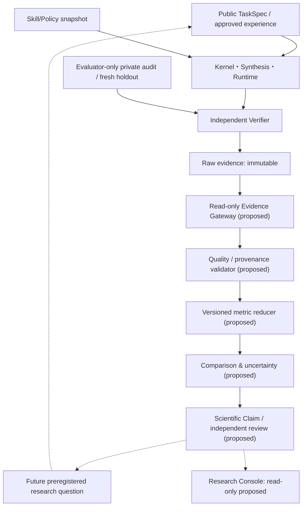

- **実装済み**: canonical execution/meter、TaskSpec、WakeEpisode/SkillProposalとEXP-0003A TRAIN/DREAM、凍結済みsource/data/PolicySnapshotの証拠。**提案のみ**: Gateway以降のMETROレイヤとClaim Registry。
- 本図は新しいデータ流出路を許可しない。PRIVATEからKernel/Learnerへの逆流なし。取得済みFINALの結果による方法変更は新しい未使用holdoutと事前登録が必要。
- カウントとCPUを別単位にし、測定器追加が探索・政策判断へ影響しないよう統合ポイントはraw evidenceの **後段** のみとする。正式採用/FINAL起動権限をMETROに与えない。

Related: [METRO ontology](../metrology/ontology.md) / [decision](decisions/ADR-0002-metrology-boundary.md) / [contract](contracts.md) / [CAL-01](../../experiments/METRO-0001/plan.md).

## METRO-0001 PR2 — synthetic fixture calibration implementation
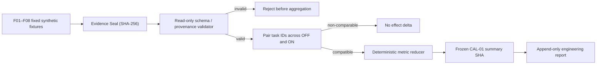
- [packages/metrology](../../packages/metrology/__init__.py) は既存Agentからの呼び出し依存を持たず、calibration fixtureのみを受け取る。private audit/FINALや実モデルへは接続しない。
- 校正のM3は[unit regression](../../tests/test_metro0001_calibration.py)から既存bounded_synthesize+meterを人工公開TaskSpecで比較する。将来の別領域Adapterは未実装。

## METRO-0001 工学的校正の統合後状態 (2026-10-27)
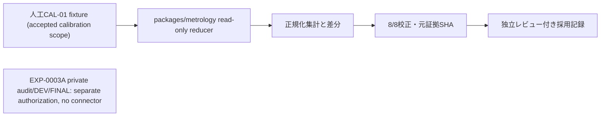
- 前節のPR2提案機構のうち **人工fixture-only校正器** は[PR #41](https://github.com/ryonakayama234/DekaSugi/pull/41)としてmain統合済み。より汎用的な実験証拠Gateway、異領域Adapter、Claim Registry、Research Consoleは引き続きproposed-only。
- [CAL-01採用判断](../../experiments/METRO-0001/reviews/20261027-cal01-adoption.md)のscopeはsyntheticのみ。[ARCH-002](contracts.md)と[run](../../experiments/METRO-0001/runs/20261027-cal01-provenance-verified.md)と整合する。計測器の状態は知能能力の状態ではない。


## EXP-0003A PR5 — Independent DEV evaluator (new code; not yet scored)
Frozen 14 source files and the original `freeze-v1.json` are unchanged.
Blue conceptual zone is independent `packages/exp0003a_dev`, not a new
`packages/metrology` production scorer. DEV smoke requires a separate
reviewed main-only activation; FINAL is disconnected.

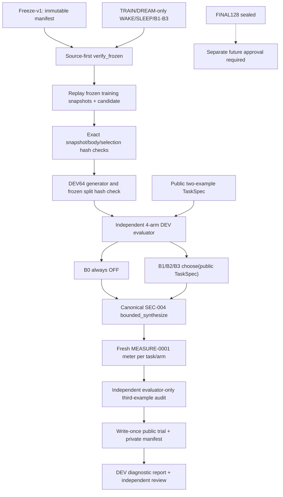

No private audit, family or split metadata may enter the policy. Existing
`packages/metrology` remains synthetic-calibrated only. [PR5 spec](../specs/EXP-0003A-DEV-EVALUATOR.md).

## EXP-0003A DEV64 one-shot main-only experimental boundary
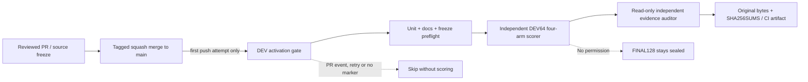
Activation is restricted to `main` push with review marker and first run
attempt. Auditor independently recounts 64 task IDs × B0–B3 using only the
public/private output and frozen manifest, not the scoring code. This does not
authorize FINAL128.

## EXP-0003A DEV64 post-run original evidence audit (Issue #48)
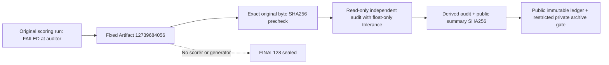
Original failure stays provenance. A new reviewed main workflow is
**audit-only** and must not rerun DEV or import the frozen scorer. No raw
evaluator-private records in public Git.


## POLICY-DIAG-001 — 独立した方策診断の設計案（未実装）
```mermaid
flowchart TD
  S["凍結済み B2/B3 PolicySnapshot"] --> G["外部caller: source-first freeze/hash guard"]
  P["既存DEV64公開記録（採点済み）"] --> G
  G --> F["独立helper: features(TaskSpec) + 5NN read-only replay"]
  F --> T["5NN支持・veto・閾値のtrace"]
  T --> M["差異と識別可能性の診断"]
  M --> R["研究記録（observed / reconstructed / interpretation）"]
  X["非公開監査例・封印済みFINAL128"] -.->|"接続禁止"| F
  R -.->|"学習器を変更しない"| S
```
本計画は既存の方策の変更、新規DEV/FINAL採点、技能昇格を含まない。主要観測対象は`packages/exp0003a/pr3.py`の`choose`。診断の実装は今後の別PRのみ。詳細：[Issue #52](https://github.com/ryonakayama234/DekaSugi/issues/52)。

## POLICY-DIAG-001 implementation boundary (no holdout scoring)
`packages/policy_diagnostics` accepts validated `ArmSnapshot` and already archived *public* TaskSpec records, reproduces 8D/5NN/gates against the frozen `choose()`, and outputs read-only explanation. It never imports a DEV/FINAL generator or invokes a verifier/synthesizer. Missing public task-level records mean diagnostics are `not_observed`, not reconstructed. [Code](../../packages/policy_diagnostics/__init__.py) / [plan](../../experiments/POLICY-DIAG-001/plan.md).


## POLICY-DIAG-001 — archive public-only evidence boundary (implemented 2026-10-28)
```mermaid
flowchart TD
  F["Immutable freeze-v1 JSON: pinned Git blob"] --> G["Archive source-first gateway / hashes"]
  D["Original scored-once DEV64 public.json member"] --> G
  P["PR3 TRAIN/DREAM public snapshot member"] --> G
  G --> N["Trusted archived neighbor IDs x immutable observations"]
  N --> M["5NN membership, vote, mean saving and veto descriptors"]
  M --> R["Sanitized aggregate JSON + scoped scientific run"]
  X["Original evaluator-private member / private audit examples"] -. "NO read/publish" .-> G
  Y["Fresh DEV generator / FINAL128"] -. "NO scoring" .-> G
```
The archive gateway is implemented at `scripts/analyze_policy_diag_archives.py` and verifies original member SHA, frozen policy snapshots and immutable data references **before** retrospective analysis. Original DEV `public.json` lacks public query TaskSpecs; the gateway does **not** recreate query features or 5NN ranking. The separate helper `packages/policy_diagnostics` can replay `choose()` only when authenticated permitted public TaskSpec bytes exist. [Run and uncertainty](../../experiments/POLICY-DIAG-001/runs/20261028-archive-public-diagnosis.md).

## OPPORTUNITY-001 — 学習機会・能力上限の診断（設計のみ、未実装）

```mermaid
flowchart TD
  N["New preregistered TaskSpec"] --> F["Source-first freeze gate"]
  F --> P["Kernel chooses BEFORE paired outcomes"]
  F --> B["Independent OFF/ON trial evaluator"]
  R["Fixed primitive, candidate skill, budget"] --> P
  R --> B
  H["Private third audit, evaluator only"] --> B
  P --> E["Immutable outcome and decision refs"]
  B --> E
  E --> G["Read-only evidence validation / adapter"]
  G --> O["Opportunity Analyzer (PROPOSED)"]
  O --> C["Task-level opportunity / regret / missingness"]
  C --> D{"Research decision, separately reviewed"}
  D -->|"valid missed opportunity"| A["Future Active Learning or policy study"]
  D -->|"no useful difference / capacity limit"| S["Future skill invention / DSL study"]
  D -->|"underidentified"| U["New identification study"]
  H -.->|"never learner input"| X["Learner trust boundary"]
  C -.->|"no retroactive tuning"| P
```

- **Primary module**: `evaluation`; proposed submodule `packages/evaluation/opportunity.py` is NOT present. Existing `packages/evaluation` owns bounded synthesis, `packages/exp0003a_dev` owns historic DEV. They are not modified by this PR.
- `kernel`: choose on public task before outcomes; `learning`: future TRAIN-only skill candidate; `metrology`: evidence ontology and comparability contracts, CAL-01 synthetic reducer does **not** accept research data yet. Proposed adapter must be separately calibrated/reviewed.
- Different arm outcomes constitute only a **fixed two-arm opportunity**; new primitive meaning or cross-domain transfer is a separate intervention. An attempted search failure is not a formal proof of missing expressive power.
- Details: [spec](../specs/OPPORTUNITY-001.md), [proposed plan](../../experiments/OPPORTUNITY-001/plan.md), [ARCH-002](contracts.md), [runs](../../experiments/OPPORTUNITY-001/runs/README.md).

## OPPORTUNITY-001 PR2 synthetic fixture-only module (implemented)
```mermaid
flowchart LR
  F["SYNTHETIC fixture only"] --> G["Strict schema / caller-pinned source lock"]
  G --> C["evaluation.opportunity classify_fixture"]
  C --> A["Aggregate-only summarize_fixtures"]
  A --> R["Engineering calibration, not science"]
  X["Real TRAIN/DEV/FINAL, private fields"] -.->|"reject"| G
```
Calibration-only: neither generates tasks nor executes search. The future actual-evidence adapter requires separately reviewed source-first independent audit. [Module](../../packages/evaluation/opportunity.py).

## OPPORTUNITY-001-PILOT-V1 (method frozen; no code/measurement)
```mermaid
flowchart LR
  M["PR3 deterministic TRAIN64 method"] --> F["Future reviewed source/manifest freeze"]
  F --> G["Future fresh TRAIN generator"]
  G --> K["Frozen B1/B2/B3 choices before scoring"]
  G --> P["Independent OFF/ON paired search + audit"]
  H["Frozen top skill / canonical registry / 4 nodes 100 candidates"] --> K
  H --> P
  A["Third evaluator-only example"] --> P
  K --> E["Immutable pretrial decision seal"]
  P --> R["Audited evidence"]
  E --> V["Future real-only validated adapter"]
  R --> V
  V --> O["Opportunity analysis (after independently reviewed activation)"]
  A -.->|"not learner-visible"| X["Kernel and Learner"]
```
This is a **future architecture** only; no new real adapter, fresh generator or trial has run. [Method](../../experiments/OPPORTUNITY-001/pilot-v1.md) / [run ledger](../../experiments/OPPORTUNITY-001/runs/README.md).

## OPPORTUNITY-001 PILOT-V1 hash-only generator implemented
```mermaid
flowchart LR
  M["Immutable PILOT-V1 method"] --> G["evaluation.opportunity_pilot generate_train_pilot"]
  G --> P["public_manifest: TaskSpec x 64 only"]
  P --> H["canonical_public_digest + CLI hash-only"]
  G --> S["Evaluator-only third-audit cases (in memory)"]
  H --> R["Future reviewed source/manifest freeze"]
  R --> F["Future independent real adapter / one-shot trial"]
  S -.->|"never public / learner input"| L["Kernel / learning"]
```
The implementation in [opportunity_pilot.py](../../packages/evaluation/opportunity_pilot.py) has **no search, chooser or scorer**. It is a generator/preflight for a future separately authorized/reviewed pilot, not measured improvement.

## OPPORTUNITY-001 PR5 independent identity verification (source-only)
```mermaid
flowchart LR
  M["Immutable PILOT-V1 method"] --> G["Project generator (64 public IDs)"]
  M --> I["Standalone stdlib-only regeneration"]
  G --> S["Public SHA from CI hash-only"]
  I --> T["Public SHA + third-audit hash commitments"]
  S --> C{"Identical public SHA?"}
  T --> C
  C -->|"NO"| X["Fail closed; no score"]
  C -->|"YES"| F["Future source/manifest lock, NOT trial activation"]
```
The independent script outputs **hashes only**, no raw third examples, policy inference or paired trial. Source-only equality cannot establish an outcome audit or secure storage. [Script](../../scripts/audit_opportunity_pilot_public.py).

## OPPORTUNITY-001 PR6 — implemented source-first lock, still pre-execution
```mermaid
flowchart LR
  S["Frozen METHOD and source SHA x9"] --> B["Read-only byte verifier"]
  B -->|"all sources match"| P["Frozen skill/B1/B2/B3 snapshot identity"]
  P --> D["Two independent TRAIN64 source hash derivations"]
  D -->|"public/audit commitments match"| A["source_identity_verified_not_scoring_authorized"]
  B -->|"any drift"| X["Hard stop / no trials"]
  P -->|"any drift"| X
  D -->|"any drift"| X
  A -.->|"requires new separately reviewed gate"| F["Future real evidence and one-shot activation"]
```
Original source bytes are compared before importing project generator. The freeze is not original experimental outcome evidence and has NO scored-activation permission. [Lock](../../experiments/OPPORTUNITY-001/pilot-generator-lock-v1.json).

## OPPORTUNITY-001 PR7 implemented policy-before-search stage
```mermaid
flowchart LR
  L["Verified generator/source lock"] --> P["Fresh TRAIN64 public TaskSpec"]
  F["Historic frozen B1/B2/B3 snapshots"] --> C["pretrial choose: public TaskSpec only"]
  P --> C
  C --> S["PUBLIC 64×3 chosen actions/reasons"]
  S --> H["Deterministic payload SHA + read-only CI artifact"]
  H -.->|"separate reviewed SHA pin required"| G["Future trial gate (not implemented)"]
  E["Audit third examples / source family"] -.->|"NEVER provided"| C
```
No solver or scorer in the pretrial CLI. CPU/wall timings are separate, not part of SHA. [script](../../scripts/prepare_opportunity_decisions.py).

## PR7 corrected no-old-DEV/FINAL-generation dependency graph
```mermaid
flowchart LR
  F["stdlib-only old freeze/14-source byte gate"] --> G["new 9-source generator/manifest lock gate"]
  G --> R["Old TRAIN/DREAM ONLY replay, no legacy freeze.verify_frozen"]
  R --> H["Compare top skill and B1/B2/B3 snapshots/selections with immutable freeze"]
  H --> D["Choose public fresh TRAIN64 ×3"]
  D --> A["Public-only decision artifact; no scored paired trial"]
  X["Old dev/final generator, legacy verify_frozen"] -.->|"forbidden"| R
```
The first PR7 implementation wrongly used legacy `load_frozen_assets`, triggering old withheld generation before paired scoring. New design avoids it and records the initial CI SHA as non-authoritative pending review. [Issue #60](https://github.com/ryonakayama234/DekaSugi/issues/60).

## OPPORTUNITY-001 PR9 — pretrial Evidence Capsule（設計案、未実装）
```mermaid
flowchart TD
    O["Official main pretrial run 40659741488"] --> M["Origin verifier: commit/run/job/artifact"]
    M --> Z["Original public-only ZIP member bytes"]
    Z --> B["Raw byte SHA256 + strict JSON parser"]
    B --> C["Canonical decision payload SHA256"]
    S["9-source + 14-source byte-first lock"] --> R["TRAIN/DREAM-only B1/B2/B3 choice replay (auxiliary)"]
    C --> K{"Identity + origin + 64x3 + reason parity?"}
    R --> K
    K -->|"fail / not_observed"| X["STOP: scoring remains forbidden"]
    K -->|pass| G["Public original bytes stored on Git in later PR"]
    G --> I["Choice lock + CI + independent review"]
    I --> F["sealed_pretrial_only (not scoring authorization)"]
    P["Evaluator-only third audit RAW"] --> Q["Separate restricted off-public archive: Issue 66"]
    F -.->|"not sufficient alone"| A["Future independently approved ON/OFF actual scorer"]
    Q -.->|"separate mandatory gate"| A
    H["Historic DEV/FINAL generator"] -.->|"never called"| R
```

主対象は`evaluation / provenance`。今回のPRは**この図を含む設計文書のみ**。source-first読み取り側と実際の学習・採点側を分離する。元Actionsのpublic member raw SHA256と正規化されたpayload digestは**別の測定値**であり、一方だけでは原本性を証明しない。replayは同じchooserの結果一致を検査するだけで、独立発明された方策の独立監査とは主張しない。

`sealed_pretrial_only`が意味するのは**事前判断の監査可能な保持**であって、AIの能力が改善した、実データ正規化器が完成した、private audit元bytesのoff-repo保全が完了した、あるいはscoringを許可したことではない。

詳細：[設計契約](../specs/OPPORTUNITY-001-CHOICE-LOCK-DESIGN.md) / [品質試験計画](../../experiments/OPPORTUNITY-001/choice-custody-preregistration.md) / [ARCH-002](contracts.md)。元のEXP-0003A・PILOT-V1方法・source lockは変更禁止。

## OPPORTUNITY-001 PR9 — 実装済み公開事前判断の保全（paired scoringなし）
```mermaid
flowchart TD
  O["Official merged-main pretrial Actions artifact ID 12803053107"] --> D["download-artifact: public-only member"]
  M["Official run/job/artifact API metadata"] --> V["stdlib-only verify_opportunity_choice_lock"]
  D --> V
  F["Legacy14/new9 frozen source byte-first gates"] --> R["TRAIN/DREAM only fixed chooser replay"]
  R --> C["Compare 64 tasks x B1/B2/B3 action+reason"]
  V --> C
  C -->|pass| P["Public original member committed in Git"]
  P --> L["pilot-choice-lock-v1 raw SHA + logical SHA + provenance"]
  L --> G["Independent review/CI gate"]
  G -.->|"No score authorization"| Q["Future actual evaluator / Issue 66"]
  X["Private third audit original"] -.->|"never public / no ingestion"| V
  X --> Y["Separate restricted off-public custody not yet verified"]
  Y -.-> Q
```

**Implementation scope**: [source](../../scripts/verify_opportunity_choice_lock.py), [tests](../../tests/test_opportunity_choice_lock.py), [original member](../../experiments/OPPORTUNITY-001/evidence/pilot-choices-public-v1.json), [lock](../../experiments/OPPORTUNITY-001/pilot-choice-lock-v1.json), [run](../../experiments/OPPORTUNITY-001/runs/20261028-pr9-public-choice-custody.md)。現行ソースを再実行して原本を生成したのではなく、元公式Actions Artifactから**原本をコピー**している。元のbyte hash、canonical JSON hash、固定source / policyは異なる検証レイヤ。

一度限りの取得workflowはPR branchで実行成功（[run #40668908541](https://github.com/ryonakayama234/DekaSugi/actions/runs/40668908541)、source `db3f70b`）。安全性のため、write-enabled branch-onlyのworkflowは取得後にmainの最終treeから退役させ、Git履歴・runへ出典を残す。公開原本の保存と未来の原本性/時系列の検証は、学習性能、非公開原本のcustody、実採点の信頼性を証明しない。新TRAIN64実採点0件。ARCH-002とpreregのC01–C09を参照。

## OPPORTUNITY-001 PR8 — audited tuple normalization vs unimplemented authority gates
```mermaid
flowchart TD
  T["Fresh public TaskSpec + frozen 4/100 budget"] --> F["Separate source/choice chronology gate (future)"]
  C["PR7 frozen B1/B2/B3 choices"] --> F
  F -.-> S["Independent OFF/ON trial and private audit (future, NOT activated)"]
  P["Restricted original private audit custody (NOT verified)"] -.-> S
  S -.-> N["PR8 pure audited tuple normalizer (synthetic tests only)"]
  N --> R["Redacted classifications + correct-first regret"]
  R -.-> I["Separate immutable evidence/recount and exploratory report"]
  P -.->| "never expose" | L["Kernel or public raw artifact"]
```
The PR8 module validates *internal data shape*, not actual source authenticity, decision timestamp, independent audit correctness or original private evidence custody. It does not import/execute a solver. New experiment outcome count is zero. [Real adapter spec](../specs/OPPORTUNITY-001-REAL-ADAPTER.md).

## EXP-0003A DEV64 historical local-backup validation (2026-10-28; no scorer)
```mermaid
flowchart TD
    L["User-provided local DEV64 backup ZIP (PRIVATE)"] --> I["Offline read-only ZIP/CRC/SHA verifier"]
    H["Historic public DEV64 evidence ledger: expected SHA256"] --> I
    I -->|all digests match| P["Public hashes-only provenance attestation"]
    I -.->|raw third audits must not pass| G["Public repository / learner"]
    L -.->|distinct encrypted storage + restore check still NOT VERIFIED| B["Second restricted long-term copy"]
    P --> R["Research status unchanged: DEV64 engineering, FINAL sealed"]
    B -.-> C["Historical long-term custody gate (only when independently verified)"]
    C -.->|not transferable| O["OPPORTUNITY-001 fresh TRAIN64 private custody gate"]
```
No historical DEV64/FINAL scoring, source changes, or old task generation. Upload integrity is verified; a separate durable private backup is **not yet attested**. The future OPPORTUNITY-001 TRAIN64 requires **different** private audit originals and authority. See [sanitized run record](../../experiments/EXP-0003A/runs/20261028-local-zip-integrity.md).


## OPPORTUNITY-001 Issue #76 — actual real pair engine, non-activated
```mermaid
flowchart TD
  P["Old14/new9 locks + official 64x3 original decisions"] --> A["Private raw original capture + external durable custody: UNVERIFIED"]
  A -.->|"gate closed"| R["One-shot actual scorer authorization: FALSE"]
  R -.-> S["OFF: fresh Registry + canonical bounded search"]
  S -.-> V["Independent third audit; false_solved STOP"]
  V -.-> T["ON: fresh Registry + exact frozen skill"]
  T -.-> W["Independent third audit; false_solved STOP"]
  W -.-> O["Pure PR67 normalizer: redacted pair outcomes"]
```
The OFF/ON function is coded but **never invoked on real new TRAIN64 by CI or main**. [Engine](../../scripts/opportunity_real_pair_engine.py) / [review/spec](../specs/OPPORTUNITY-001-REAL-PAIR-ENGINE.md) / [Issue #76](https://github.com/ryonakayama234/DekaSugi/issues/76).


## OPPORTUNITY-001 fresh TRAIN64 custody-preparation implementation (2026-10-28; NO scoring)
```mermaid
flowchart TD
  A["Official original public TRAIN64 decisions: 64x3, locked"] --> B["Future separate source-first private third-audit capture"]
  B --> C["Restricted original archive (future; NOT VERIFIED)"]
  C -.-> D["Second independently retained restricted original (future)"]
  C --> E["Read-only two-copy raw SHA checker (synthetic-tested)"]
  D --> E
  E --> F["Redacted digest/size only; original equality is NOT custody"]
  X["Independent remote ACL/version/retention/restore verification (future)"] -.-> Y["Real one-shot scorer gate: BLOCKED"]
  F -.-> Y
  C -.->|"never publish"| G["Public repository / ordinary public Actions / Kernel"]
```
Only the **read-only byte-equality helper** is implemented here. It never makes or accesses a real new TRAIN64 audit original in CI and cannot close the storage authorization gate. Old DEV64 ZIP is a different historical source. [Data contract](contracts.md) / [custody readiness spec](../specs/OPPORTUNITY-001-PRIVATE-CUSTODY.md) / [Issue #72](https://github.com/ryonakayama234/DekaSugi/issues/72).


## OPPORTUNITY-001 Issue #74 — source-first private original capture system (synthetic-tested, NOT run)
```mermaid
flowchart TD
  O["Historic 14-source byte lock"] --> N["New 9-source PILOT lock"]
  N --> P["Original official 192 pretrial decisions: raw and logical SHA"]
  P --> G["Fresh TRAIN64 generator only; old DEV/FINAL forbidden"]
  G --> A["64 distinct evaluator-only third audits + commitment check"]
  A --> B["Off-public owner-private file A: exclusive create/fsync"]
  B --> C["SHA readback A"]
  C --> D["Off-public separate-volume file B: exclusive create/fsync"]
  D --> E["SHA readback B"]
  E --> R["PUBLIC redacted hashes-only receipt: NOT custody authority"]
  R -.->|"does not authorize"| S["Actual one-shot ON/OFF scoring: BLOCKED"]
  V["External ACL, object-version/retention, independent restore proof"] -.-> S
  T["Independent actual scorer and reviewed one-shot execution"] -.-> S
```
**Implemented:** only [manual source-first capture CLI](../../scripts/capture_opportunity_private_original.py) and invented-fixture tests; no live capture invoked in PR CI or public Github Actions and no genuine new TRAIN64 original yet observed. **Not implemented/verified:** independently trusted durable private store, actual score runner, one-shot chronology/authorization. [Contract](contracts.md) / [scope](../specs/OPPORTUNITY-001-PRIVATE-CAPTURE.md).


## OPPORTUNITY-001 2026-10-29 — one-shot private-host scorer is IMPLEMENTED HARD-OFF (PR #78)
This later engineering checkpoint supersedes the earlier historical "actual score runner not implemented" status **only as to code existence**. The owner reported genuine 64-row pre-scoring capture; separately, local GPG plaintext restoration and byte identity with the encrypted Drive object were checked, while full account-loss/deletion durability is not guaranteed. **New actual OFF/ON scored pairs remain 0.**

```mermaid
flowchart TD
  A["Old 14 + new 9 source bytes first; official ORIGINAL 64x3 decisions"] --> B["Private original 0600 read by pinned dir_fd + raw SHA"]
  B --> C["Validate 64 archived third audits and exact public/source IDs"]
  C --> D["Rebuild/verify frozen top SkillCandidate from old TRAIN/DREAM only"]
  D --> E{"Two activation flags and independently reviewed main-only custody/run approval?"}
  E -->|"NO: current PR"| STOP["NO SCORING: hard OFF"]
  E -.->|"Future separate reviewed activation"| F["Exclusive private STARTED ledger + fsync"]
  F --> G["Each OFF arm: ARM_STARTED before actual scorer"]
  G --> H["Save original OFF audited tuple privately before normalizing"]
  H --> I{"OFF false_solved?"}
  I -->|"YES"| ABORT["STOPPED + no rerun, retain original evidence"]
  I -->|"NO"| J["Each ON arm: ARM_STARTED before actual scorer"]
  J --> K["Save original ON tuple privately + redact paired result"]
  K --> L{"More of 64?"}
  L -->|"YES"| G
  L -->|"NO"| DONE["COMPLETED; independent recount; no rerun"]
```

The exact run-level and arm-level STARTED markers live **outside public Git**, on the owner's private host, and are fsynced before score. Existing local directories cannot prove global no-retry after an administrator deletes them; external chronological custody must retain a durable record. Never export original audit values, raw scorer tuples, secret paths/passwords or seeds to GitHub/Actions. [One-shot contract](../specs/OPPORTUNITY-001-ONE-SHOT-RUNNER.md) / [Private runner](../../scripts/opportunity_one_shot_runner.py) / [activation issue](https://github.com/ryonakayama234/DekaSugi/issues/79).


## OPPORTUNITY-001 2026-10-29 — separate owner-private activation wrapper (PR stage, NOT EXECUTED)
```mermaid
flowchart LR
  A["Owner private WSL2 / frozen original archive"] --> B["Explicit --execute-fresh-train64-once + custody/no-retry confirmations"]
  B --> C["Exact clean approved origin/main and Python 3.12.15"]
  C --> D["Temporary scoped runner + engine activation; default FALSE"]
  D --> E["Already-reviewed source-first one-shot runner"]
  E --> F["Private STARTED then per-arm STARTED before scored actions"]
  F --> G["Private original canonical tuples + redacted pairs / STOP on failure"]
  G --> H["Restore both engine and runner flags to FALSE"]
  C -.->|"Mismatch"| X["STOP before scoring"]
```
**This is a separately reviewed activation proposal, not evidence of a live experiment.** No public Actions trigger; no private raw original, encrypted file, third audit, family, seed or passphrase in GitHub. Existing source-first method and PR78 engine remain unchanged. [Activation contract](../specs/OPPORTUNITY-001-ACTIVATION.md) / [Issue #79](https://github.com/ryonakayama234/DekaSugi/issues/79).


## OPPORTUNITY-001 final source-first read-only preflight (2026-10-29; NO scoring)
```mermaid
flowchart LR
  A["Exact main + Python 3.12.15, activation flags FALSE"] --> B["Verify old14/new9 source locks + original 192 decisions"]
  B --> C["Pinned private dir_fd: reject existing STARTED"]
  C --> D["Read-only original 64 third audits, raw SHA, all source bindings"]
  D --> E["Rebuild frozen historical TRAIN/DREAM skill and snapshots"]
  E --> F["Second raw SHA readback, redacted PASS/STOP receipt"]
  F -.->|"No implicit authorization"| G["Separate approved one-shot main-only activation"]
```
No irreversible marker, new TRAIN64 OFF/ON scorer call or public raw audit occurs in this preflight. Frozen historical TRAIN/DREAM reconstruction is limited to already approved TRAIN/DREAM, **never** old DEV/FINAL. The preflight closes an implementation/readiness verification gap, not an external cloud retention certification. [Details](../specs/OPPORTUNITY-001-LIVE-READONLY-PREFLIGHT.md) / [Issue #79](https://github.com/ryonakayama234/DekaSugi/issues/79).


## OPPORTUNITY-001 observed research status — 2026-10-29 true TRAIN64 one-shot COMPLETE, recounted (later checkpoint)
This **post-outcome** checkpoint supersedes only earlier *engineering historical* "0 true scored" statements; frozen METHOD, generator/skill/policy locks, old historical DEV/FINAL and original raw records are unchanged. Owner WSL2 true run reported 64/64 and forbids rerun, followed by reviewed private readonly original tuple recount reporting `COMPLETE_64_PAIRED_RECOUNT_VERIFIED`. OFF and ON each audited correct 48/64; 8 ON cheaper, 8 OFF cheaper, 32 both-correct ties, 16 both-unsolved. B1/B2/B3 0/16 uniquely-better eligible decision errors; source-locked branch otherwise `UNDERIDENTIFIED`.

```mermaid
flowchart LR
 A["Frozen source / 192 original choices and existing original"] --> B["Owner private exactly-once OFF+ON: 64/64"]
 B --> C["STARTED/128 ARM_STARTED/128 raw scorer tuples/64 pairs/COMPLETED"]
 C --> D["Private GPG+external ciphertext SHA and tar restore match"]
 D --> E["Independent READ-ONLY owner recount, no rescoring"]
 E --> F["Redacted 64-pair aggregate: UNDERIDENTIFIED"]
 F -.-> G["New separately registered distribution only; never repeat original 64"]
```

GitHub has *not* read owner-private raw score tuples; report is based on owner CLI receipt verified by independent scorer-normalization code. [Redacted outcome](../../experiments/OPPORTUNITY-001/runs/20261029-train64-real-paired-recount.md), [research audit #82](https://github.com/ryonakayama234/DekaSugi/issues/82), [new study #86](https://github.com/ryonakayama234/DekaSugi/issues/86). Main is intentionally not advanced while inherited historical DEV main-push smoke conflicts with the frozen source lock; do not quietly change that lock to publish results.

## ARCH-001 CI-SAFE-V2 — immutable historic workflow and staged safe successor
```mermaid
flowchart TD
  O["Old Research verification / docs-check.yml (source-locked bytes)"] --> H["Historic PILOT-V1 source integrity; immutable"]
  O -.->|Main push if enabled| X["UNSAFE: historic EXP-0002B DEV smoke"]
  V["NEW Research verification v2"] --> S["Static source bytes + exact YAML allowlist"]
  S --> T["Docs + selected synthetic-only unittests"]
  S --> L["Old14 and PILOT-V1 9 source-only checks"]
  C["Owner GitHub Actions control plane"] --> D{"Original workflow disabled_manually verified?"}
  D -->|No| B["STOP main merge"]
  D -->|Yes + reviewed successor PR| M["Merge v2; observe main v2 CI only"]
  M --> N["Then PR #87/#89; no scoring authority"]
```
The new [workflow](../../.github/workflows/research-verification-v2.yml) and [source checker](../../scripts/check_research_ci_v2.py) cannot change the immutable old file or attest the remote disable state. The main-push risk is external to pure Git source diff. [Full migration contract](../specs/CI-SAFE-V2.md) / [run ledger](../process/ci-safe-v2-ledger.md).

## ARCH-001 OPPORTUNITY-002 — proposed bounded capability/identification study (PR1 docs-only)
**Status:** proposed only; no code, synthetic run or new scored trial. Main owner `packages/evaluation`; preserve learner/kernel/registry freeze. [Spec](../specs/OPPORTUNITY-002.md) / [plan](../../experiments/OPPORTUNITY-002/plan.md).

~~~mermaid
flowchart TB
  subgraph Cognitive["Existing frozen-capability path"]
    T["Public TaskSpec"] --> K["Existing frozen Kernel / choice"]
    L["Primitive and frozen SkillCandidate"] --> S["Synthesis + trusted Runtime"]
    K --> S
    S --> V["Independent Verification"]
  end
  subgraph Identification["PROPOSED: evaluation; PR1 contract, PR2 synthetic only"]
    C["ContrastSpec: intervention, controls, estimand"] --> B["Independent boundary checker"]
    B --> I["Identifiability assessment"]
  end
  subgraph Measurement["Existing metrology boundary"]
    M["MetricSpec: units, population, missingness"] --> E["EvidenceEnvelope with trust provenance"]
    E --> D["Estimate / scope-limited claim"]
  end
  L -.-> B
  S -.-> B
  V -.-> E
  I -.-> M
~~~

The checker observes type-safe primitive/macro semantics and budgeted candidate sets, **not** original frozen private audit data. Kernel receives public-only information before choices; evaluator-only audit stays isolated. Macro expansion can preserve the semantic program set while changing search order/selected programs. Calibration proof/fixture PASS does not prove learning or transfer. No implicit arrows from diagnostic results back into a learner or previously frozen original source.

The separately reviewed actual scorer, new evaluator-only source and private custody/one-shot gates are **future designs only**. Existing EXP-0003A old DEV/FINAL and OPPORTUNITY-001 original 64 are never replayed. [ARCH-002](contracts.md) includes precise data flow and versioning.

## ARCH-001 OPPORTUNITY-002 PR2 — isolated synthetic checker (implementation)
~~~mermaid
flowchart LR
  A["Invented examples + fixed synthetic operators"] --> B["scripts/opportunity2_boundary.py"]
  B --> C["Independent BFS and Cartesian-product oracle"]
  C --> D["40/47, expanded closure, budget-5 witness"]
  D --> E["Read-only synthetic summary / unittest"]
  E -.->|NO import / NO data flow| L["Existing scorer / Kernel / learner / old sources"]
  E -.->|NO authority| G["Future real evaluation"]
~~~
`scripts/opportunity2_boundary.py`は本番用`packages.evaluation`のimport初期化を回避する独立検査器。第三例、実験generator、凍結方策、オリジナル証拠に接続しない。[source](../../scripts/opportunity2_boundary.py) / [tests](../../tests/test_opportunity2_boundary.py) / [run](../../experiments/OPPORTUNITY-002/runs/README.md)。PR2は人工校正のみで、mainは別途安全ゲート。


## ARCH-001 OPPORTUNITY-002 PR3 — independent C-G2 synthetic adapter (2026-10-30)
~~~mermaid
flowchart TB
  subgraph Historic["Historic frozen source: NO IMPORT / NO WRITE"]
    H["Original opportunity_actual normalizer"]
    K["Kernel / Synthesizer / Learner / Old scorers"]
  end
  subgraph Synthetic["New isolated packages/opportunity2_audit (stdlib only)"]
    F["Invented public + synthetic third audit fixture"] --> I["External pin and exact schema / integrity gate"]
    P["Independently supplied expected fixture digest"] --> I
    I --> R["Independent first-solution candidate replay"]
    R --> V["Canonical selected AST, public verifier, trace and meter checks"]
    V --> A["Third-example raw execution vs claimed output/label"]
    A --> O["Separate integrity / search / audit state axes"]
    O --> M["Paired eligible-denominator aggregation"]
    R --> Q["Finite reachability probe: witness or INCONCLUSIVE"]
  end
  M --> E["Synthetic engineering receipt, not scientific ability claim"]
  Q --> E
  Historic -.-|"NO runtime or data edge"| Synthetic
~~~
This is a **synthetic-only** standalone code path. The `toy_bias_v1` order is an explicitly invented adversarial calibration, not the frozen DekaSugi policy. `current_v1` independently mirrors PR2's 40/47 synthetic grammar; finite negative results never prove a universal impossibility. An independent reviewer and separate owner authorization are required for any future real C-G2 evaluator, not merely a change of `phase`.

## ARCH-001 ACTIVE-001 — 自ら問いを選ぶ能力（提案・未実装）
**Status: proposed; PR1 design only; no scored study authorization.** [Spec](../specs/ACTIVE-001.md) / [ADR](decisions/ADR-0005-active-inquiry.md) / [plan](../../experiments/ACTIVE-001/plan.md).
Legacy `packages/protocol`, `packages/synthesis`, `packages/learning`, historic scorers and source locks remain immutable; a new isolated `packages/inquiry_world` supplies a fixed typed finite program semantics, `packages/active_learning` selects queries/updates a semantic-version space, and a future independent `packages/active_evaluation` owns oracle answers and withheld labels.

```mermaid
flowchart TB
  P["Public 2 examples + allowed unlabeled input IDs"] --> H["Active learner: semantic HypothesisSet"]
  F["Fixed independent InquiryWorld grammar, 8 trusted ops"] --> H
  H --> Q["Question proposer: max disagreement"]
  Q --> O["Evaluator-owned Oracle, one answer"]
  T["Hidden target function and holdout labels: evaluator only"] --> O
  O -->|"selected query answer only"| U["BeliefUpdate: filter hypothesis classes"]
  U --> S["Final solution representative"]
  S --> V["Independent heldout auditor"]
  T --> V
  Q --> E["InquiryEpisode: sanitized train-compatible trace"]
  U --> E
  V --> R["EvaluationReport: separate authority, no train input"]
```
World A legacy read-only grammar is compatibility calibration; World B isolated new fixed 8-operation InquiryWorld is the prospective measurement universe, not newly invented learned semantics. B0 no queries / B1 uniform random questions / B2 max semantic disagreement; same task, grammar, questions and two-query ceiling. Stage II/SLEEP and Stage III/transfer are future gated work, not current ability results. A query-selection mechanism must never access future oracle answers, target/seed/family/hidden audit or the historic source/scorer. The original workflow external owner-disable gate and independently reviewed source-first freeze precede any new scored experiment/main merge.

## ARCH-001 ACTIVE-001 PR2 — synthetic engineering code status
**Implemented in stacked PR2:** `packages/inquiry_world` enumerates trusted eight-op finite-domain typed String programs, splits 156 artificial inputs and groups semantic-equivalent candidates (878 classes in local fixture). `packages/active_learning` implements bounded `QuerySession`, integer Gini disagreement, random baseline query, synthetically-constructed `QueryAnswer`, update/stop conditions and deterministic final program. `packages/active_evaluation` and independent Oracle **do not exist yet**; `make_answer` is test-only and cannot establish authenticated external observations. No scoring, learned question-policy improvement, source freeze or workflow safety gate is asserted. [Local receipt](../../experiments/ACTIVE-001/runs/20261030-pr2-local-synthetic.md).

## ARCH-001 ACTIVE-001 PR2 — deterministic query integrity gate (2026-10-30)
```mermaid
flowchart TB
  P["2 public observations / 28 available public IDs"] --> CHECK["Validate input split: 28/64/64 and digest"]
  CHECK --> S["QuerySession: semantic version space"]
  S --> B["B0 none / B1 seed-random / B2 maximum disagreement"]
  B --> Q["QueryProposal + prior-state commitment"]
  Q --> A["Synthetic QueryAnswer (not authenticated Oracle)"]
  A --> R["Reconstruct classes from ordered observations"]
  R --> V{"Recheck budget/status, pool and chosen policy"}
  V -->|valid| S
  V -->|invalid| STOP["Fail closed"]
  H["Evaluator-only target and withheld labels"] -.->|"No learner input"| S
  O["Old locked scorers and evaluated records"] -.->|"No import, no replay"| S
```
The new guards check local consistency, not truth or authenticated external Oracle ownership. Stage I within-task updates are the only implemented research mechanism; Stage II learned question policies and Stage III transfer remain planned. The explicit synthetic CI allowlist does not unlock scored trials or change historical code. [Data contract](contracts.md) / [engineering run](../../experiments/ACTIVE-001/runs/20261030-pr2-integrity-repair.md).

## ARCH-001 ACTIVE-001 PR2 — complete local history verification (2026-10-30)
~~~mermaid
flowchart TD
  PUBLIC["Two public examples / 28 public IDs"] --> SPLIT["Canonical 28/64/64 split commitment"]
  SPLIT --> SESSION["Active learner: active-query/2 state"]
  SESSION --> SELECT["B2 exact max-Gini / B1 seeded random"]
  SELECT --> PROP["Selected proposal + synthetic answer"]
  PROP --> TRACE["Append full proposal-answer trace"]
  TRACE --> REPLAY["Replay every history prefix from public state"]
  REPLAY --> VALID{"Canonical split, policy, receipt, budget and stop invariant?"}
  VALID -->|"Valid"| SESSION
  VALID -->|"Invalid"| REJECT["Fail closed"]
  SECRET["Withheld evaluator labels"] -.->|"No learner edge"| SESSION
  HISTORIC["Frozen scorers and scored history"] -.->|"No runtime edge"| SESSION
~~~
This is local synthetic engineering only: a digest is a consistency check, not an external Oracle signature or proof of useful transfer. The query policy cannot continue after a terminal state. [ARCH-002](contracts.md) and [run ledger](../../experiments/ACTIVE-001/runs/20261030-pr2-history-boundary-integration.md).

## ARCH-001 ACTIVE-001 PR2 — trusted canonical candidate catalogue (2026-10-30)
~~~mermaid
flowchart TB
  WORLD["Fixed 8-operation inquiry world / 156 inputs"] --> BUILD["Deterministic canonical catalogue 4,681 syntactic programs"]
  BUILD --> CANON["Cached immutable 878 semantic classes + by_id lookup"]
  EXT["Caller-supplied Catalog"] --> VALID{"Complete equality: classes, signatures, AST, by_id, syntax_count, digest?"}
  CANON --> VALID
  VALID -->|"valid"| SESSION["Active learner: QuerySession, B1/B2"]
  VALID -->|"invalid"| REJECT["Reject / ValueError"]
  SESSION --> TRACE["Full ordered proposal-answer trace"]
  TRACE --> REPLAY["Verify every history prefix and canonical split"]
  REPLAY --> SESSION
  PRIVATE["Evaluator-only target and labels"] -.->|"No access"| SESSION
  OLD["Frozen original scorers and evidence"] -.->|"No runtime edge"| SESSION
~~~
This is a consistency check against a fixed **experimenter-authored** synthetic world, not a learned representation, independently signed source, real measured generalization or trusted Oracle. The canonical reference is generated once per process, not enumerated on every question; equality still checks all semantic contents. [ARCH-002](contracts.md), [run](../../experiments/ACTIVE-001/runs/20261030-pr2-catalog-integrity.md).

## ARCH-001 ACTIVE-001 PR2 — internal canonical computation (2026-10-30)
~~~mermaid
flowchart TB
  EX["Caller Catalog / MappingProxyType / custom dict.__getitem__"] --> CHECK["Catalog validation: reject ordinary mismatch"]
  WORLD["Fixed eight-op, 156-input DSL"] --> CACHE["Cached internally built canonical Catalog"]
  CACHE --> CHECK
  CHECK -->|"Local consistency valid"| BOUNDARY["Replace caller reference with trusted internal Catalog"]
  CHECK -->|"Mismatch"| REJECT["Fail closed"]
  BOUNDARY --> QUERY["B1 seeded / B2 max-Gini question choice"]
  CACHE --> LOOKUP["Canonical prediction/representative-program lookup only"]
  LOOKUP --> QUERY
  QUERY --> TRACE["Ordered question/answer trace"]
  TRACE --> REPLAY["History prefix and terminal-state replay"]
  LOOKUP --> REPLAY
  REPLAY --> QUERY
  AUDIT["Withheld evaluator labels"] -.->|"No learner input"| QUERY
~~~
A proxy is a read-only **view**, not a deep-frozen snapshot; dict subclass equality can disagree with indexing. Therefore external `by_id` is **never consulted for prediction**, even when structural equality passes. This is local synthetic integrity, not independent Oracle/source authority, learned skill, or scientific performance. [Data flow](contracts.md), [run](../../experiments/ACTIVE-001/runs/20261030-pr2-lookup-canonicalization.md).

## ARCH-001 ACTIVE-001 PR2 — strict state-boundary validation (2026-10-30)
~~~mermaid
flowchart TB
  CALLER["Caller-reconstructed QuerySession / proposal / answer"] --> TYPE["Exact built-in tuple, str, int field checks"]
  TYPE -->|"mismatch / subclass"| REJECT["Fail closed with ValueError"]
  TYPE -->|"valid exact primitive storage"| REPLAY["Canonical full-history and split replay"]
  WORLD["Trusted cached canonical Catalog"] --> REPLAY
  REPLAY --> PICK["B1 seeded random / B2 exact max-Gini"]
  PICK --> UPDATE["Answer receipt and posterior update"]
  UPDATE --> REPLAY
  SECRET["Evaluator-only labels"] -.->|"No learner input"| PICK
  OLD["Historically frozen scoring data"] -.->|"No import / rescore"| PICK
~~~
`tuple` equality can be correct even when a subclass's `__iter__` fabricates additional class votes. The gateway checks **exact** types of classes and individual fields before using state as an authority; policy/receipt/history replay and internal catalogue trust still apply. This is synthetic engineering evidence, not an improvement in observed learning ability. [ARCH-002](contracts.md), [run](../../experiments/ACTIVE-001/runs/20261030-pr2-container-types.md).


## EXP-COEV-001 PR1 — ARCH-001 proposal for isolated new L3 research (2026-10-31; proposed, no scoring)
```mermaid
flowchart TB
  P[PublicTaskView 2 examples and allowed query IDs] --> W[ConceptWorld G1 typed programs]
  W --> K[ConceptSearch bounded candidate search]
  K --> Q[Inquiry question selector]
  Q -->|allowlisted query request| O[Custodian Oracle separate process future]
  O -->|authenticated selected answer only| E[Wake TRAIN episodes]
  E --> S[Sleep typed anti-unification and compression]
  S --> L[Concept Library and contextual policy snapshot]
  L --> K
  K -->|frozen final candidate| H[Custodian private 64-input audit future]
  H --> R[Read-only measured evidence]
```
Existing `packages/inquiry_world`, `packages/active_learning` and historical scorers remain untouched. New `packages/concept_world`, `concept_learning`, `concept_search`, `concept_custody`, `concept_metrology` are **proposed**; no independent evaluator or learning implementation exists at PR1. [Experiment spec](../specs/EXP-COEV-001.md).


## ARCH-001 COEV-001 pretraining freeze security gate v0.2
```mermaid
flowchart TD
  E[Invented engineering fixtures; visible seed] --> F[Independent method + class pool + secret seed + source/custodian freeze]
  F -->|after independent approval| T[Fresh formal TRAIN via independent Oracle]
  T --> S[Freeze actual learned concept library + policy]
  S --> D[Separate verified DEV]
  D -->|distinct activation and unchanged method| H[New one-shot FINAL evaluation]
  H --> A[Independent recount + immutable evidence]
```
PR3 invented TRAIN run precedes F only because it is explicitly **an unscored engineering calibration**, never the registered TRAIN dataset. Outcome-dependent population selection after F prohibited. See [v0.2 plan](../../experiments/EXP-COEV-001/plan.md).

## ARCH-001 EXP-COEV-001 PR2 — implemented module boundary (non-scoring)
```mermaid
flowchart LR
  Grammar["Approved G1 operations + predicates"] --> Enumerate["packages/concept_world enumerate_programs"]
  Enumerate --> Execute["Pure typed execute over 156 synthetic inputs"]
  Execute --> Catalog["895 equivalence-class representatives"]
  Catalog --> Selection["Integer Gini / stable argmax"]
  Selection -.-> Future["Future concept_learning and separate-process custodian NOT implemented"]
```
InputSplit can calculate a canonical 28/64/64 structural partition but is **not** a learner-facing authority or guarantee of sealed evaluator labels. The old source and scientific runs remain untouched. [Local engineering receipt](../../experiments/EXP-COEV-001/runs/20261031-pr2-g1-local-calibration.md).
