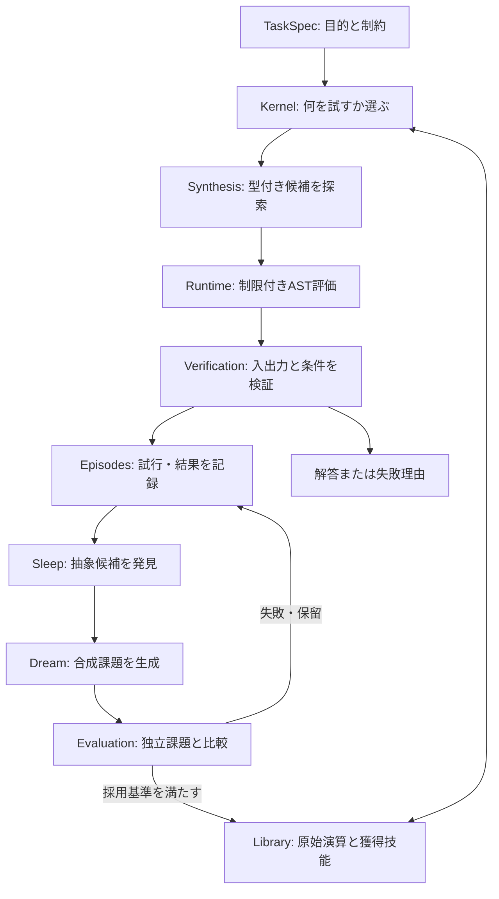
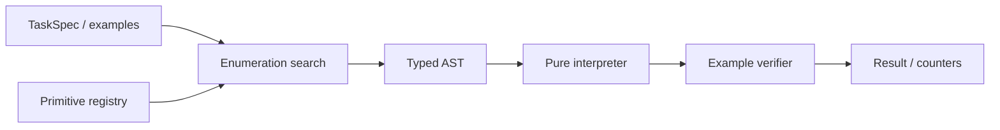
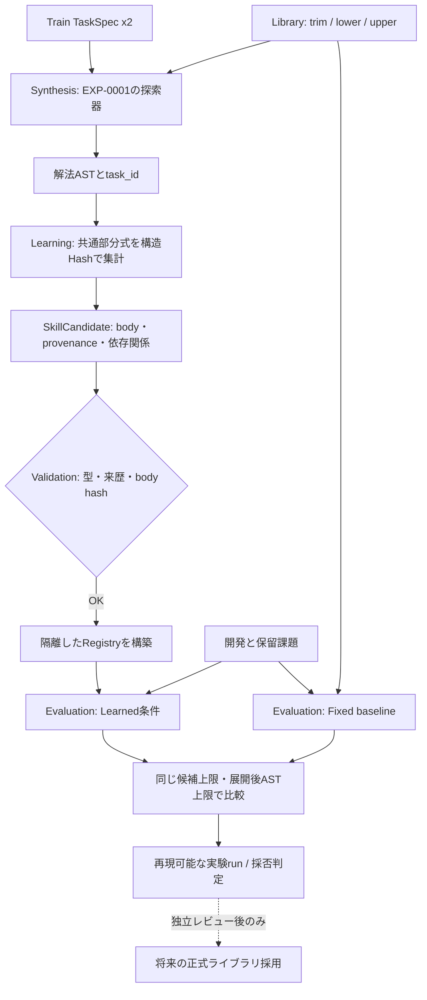

# ARCH-001 — System architecture

id: ARCH-001
status: proposed
updated: 2026-10-24
tags: diagram, architecture, components, wake-sleep

> 目標全体図は**提案**。EXP-0001に限定した型付き探索・実行・検証は実装済み（採否は実験runを参照）。各モジュールは [packages目録](../../packages/README.md) で管理。

## 目標アーキテクチャ

## 最初の実装境界 (EXP-0001)

EXP-0001は **学習・Wake-Sleep・外部Webアクセスを実装しない**。型付き表現・探索・検証・測定のみを実装する。依存は `protocol → library/runtime/verification/synthesis → cli`。実験結果は [run目録](../../experiments/EXP-0001/runs/README.md) に分離。

## レイヤの責任と依存方向
- `protocol`: 共通の不変データ形式とバージョン。外部依存なし。
- `synthesis`: protocol + primitive情報から候補を探索。任意コード実行は禁止。
- `runtime`: 型付きASTの純粋なインタプリタ。許可された演算のみ。
- `verification`: 正解/不正解と評価指標を記録。探索器の都合で採点基準を変更しない。
- `library`: 原始演算/採用技能のメタデータと履歴。
- `memory`: 観測・試行ログ。結果と解釈を分離。
- `learning`: 後続フェーズで抽象化・Wake-Sleep・練習課題生成。
- `kernel`: 後続フェーズで課題と技能から行動を選択する。

新しくコードを追加するときは、この図の実装範囲を塗り分ける代わりに各要素の実装/未実装を明記し、[データ契約](contracts.md)を同期する。

## EXP-0002 の実装境界（技能の自動発見）

- **実装済み:** `packages/learning` の共通部分式抽出と安全なmacro登録、`packages/evaluation` の比較CLI、学習候補の独立test。
- **未実装:** Sleep/Dream全体ループ、永続Episodes DB、学習された検索方針、Kernelによる自律タスク選択。
- **決定的な境界:** `learning` は訓練課題からのみ候補を作る。`evaluation` は候補を触らず開発/最終評価を計測。生成したmacroは `DEFAULT_REGISTRY` を変更しない。
- 探索条件とデータの対応は [ARCH-002](contracts.md)、研究ゲートは [EXP-0002](../specs/EXP-0002.md)、実測は [runs](../../experiments/EXP-0002/runs/README.md) を参照。
