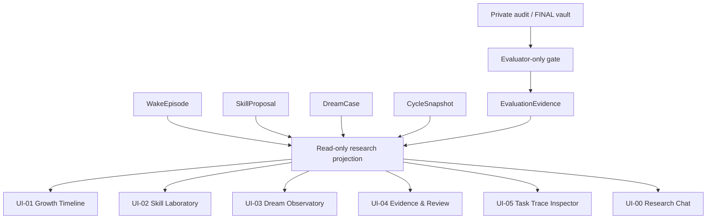

# ARCH-UI-001 — Research Console panel responsibility map

id: ARCH-UI-001
status: interface_contract_only; PR3 TRAIN/DREAM source models implemented, UI unimplemented
updated: 2026-10-26
tags: ui, research-console, architecture, contracts, provenance

> **将来のUI設計モックの責務契約。UIコードは未実装。** Chatを意思疎通の入口とし、実験・技能・監査を永続的な観測パネルとして示す。CLI/Web/desktopなどの表示技術は固定しない。正本は実験記録であり、UI独自の採点DBは持たない。

## パネルと単一責務（stable IDs）
| Panel ID / 名称 | 読み取り元モジュール | 単一の表示正本 | 表示すること / 表示しないこと |
|---|---|---|---|
| UI-01 Growth Timeline | Cycle Controller / `learning` | `CycleSnapshot` | サイクル/候補/評価状態の時系列。未実行を実績として表示しない |
| UI-02 Skill Laboratory | `learning` + `library` | `SkillProposal` と検証済みSkillCandidate | body, type, dependencies, provenance, status。candidateを正式技能と表現しない |
| UI-03 Dream Observatory | `dream` | `DreamCase` | rehearsal / counterfactual生成根拠、件数、選択方式。Dreamの自己採点をFINAL証拠としない |
| UI-04 Evidence & Review | `evaluation` | `EvaluationEvidence` | 4arm・監査・費用・信頼区間・独立レビュー・採否。CPUとprimitiveを混同しない |
| UI-05 Task Trace Inspector | `synthesis` + `verification` + `memory` | `WakeEpisode` | 各taskのtrace/失敗/メータ/監査参照。private auditの生答は学習入力として公開しない |
| UI-00 Research Chat | 権限付きcommand router（未実装） | 上記読み取りモデルへの参照 | 問い合わせ・提案・承認要求。独断で学習/評価/Library採用を起動しない |

## 参照関係と読み取り境界

- read-modelはIDs、参照hash、権限、run状態を投影するのみ。原始結果の数値をUI上で勝手に独立計算しない。
- `cycle_id` / `episode_id` / `proposal_id` / `dream_case_id` / `evaluation_id` の相互参照で、パネル横断ドリルダウンを支える。`dream_case_id`/`pool_id`/非公開`source_record_id`と公開TaskSpec由来の不透明な`task_id`は[ID-v1](../../experiments/EXP-0003A/plan.md)で区別する。家系・split・seedをUI閲覧用に投影できても、Kernelの入力には混ぜない。削除されたPR/実験ではリンク切れ・欠測を表示する。
- 状態は`planned -> implemented -> evaluated -> accepted/rejected/withheld`を混同せず、同じ`status`と`evidence_ref`に従う。FINAL非公開の間はhash/件数等のメタデータを表示可、正答・結果は不可。
- PR2の監査元データ・`WakeReceipt`原本は評価器用の証拠ファイルの責務。UI-05は公開可能な監査hash・検証状態のみを投影し、第三例の生入力/出力を学習器の入力へ取り込まない。
- PR3 `ArmSnapshot.to_dict()`・選択済みB2/B3 ordered pool IDs・paired trial raw audit・`choose()`理由がUI-03/04の読み取り専用出典となる。UI表示から方策学習やhidden第三例への参照が生じないよう境界を維持。UI本体は未実装。
- PR2で`WakeEpisode.to_dict()`と`SkillProposal.to_dict()`のTRAIN側投影元が実装済み。UI-05とUI-02の出典として参照可能だが、画面・read-model API・永続DBはまだ未実装。UI-01/03/04は引き続き計画のみ。read-only projectionは生private auditを出さない。
- 実装がUI未対応でも、モジュール追加ごとに本対応表を更新。新パネル追加の条件は独立責務と参照データの定義があること。

Related: [ARCH-001](system.md) / [ARCH-002](contracts.md) / [experiment spec](../specs/EXP-0003A.md) / [run index](../../experiments/EXP-0003A/runs/README.md).

## EXP-0003A PR4 read-only freeze panel projection (planned UI)
- `UI-05`のsource provenance投影元として`freeze-v1.json`とPR4 hash-only preflight/check記録を採用。表示可能なのは8family/4splitの件数・opaque public ID群のSHA・Git blob SHA・snapshot/selection SHA・欠測・検証状態のみ。third audit raw rowsやholdout family/seedをKernel/UIから呼び出さない。
- PR4でも画面/永続DBは未実装、合否/採用の独立決定主体はUIではなく凍結検査・独立Evaluator・レビュー担当。DEV/FINALの起動ボタンは未提供。

## METRO-0001 — UI-06 Metrology & Claims (future, not implemented)
- **唯一の正本**: METRO Measurement/Comparison/ScientificClaim read-only projection。数字の由来、MetricSpec版、評価課題分布、母数、代替説明、CI/独立レビュー状態とreplay用raw hashを表示する。
- UI-04 Evidence & Reviewを置換せず、UI-06は能力の成長/測定妥当性という問いを横断検索する将来のビューとする。数値の再採点、Skill昇格、DEV/FINAL起動、学習器へのprivate evidence返却は禁止。
- 画面実装は今回対象外。リンク元は[ontology](../metrology/ontology.md)、[metrics](../metrology/metrics.md)、[evidence](../metrology/evidence-model.md)、[CAL-01 plan](../../experiments/METRO-0001/plan.md)。

## METRO-0001 PR2: UIは依然未実装
- 合成fixtureのcalibration reportを、将来UI-06の出典としてread-onlyで参照する方針のみ。CLIはreport(JSON)を出力するが画面、API、データベースは持たない。
- real intelligence scores / final holdout dataは提供しない。[run index](../../experiments/METRO-0001/runs/README.md)。

## METRO-0001 integrated CAL-01 evidence status (2026-10-27)
- [adoption decision](../../experiments/METRO-0001/reviews/20261027-cal01-adoption.md)がUI-06将来用のread-only provenance投影元となる（artifact hash・校正判定・実験の対象範囲）。**UIそのものは未実装**。
- CAL-01で受理したのは人工fixtureのみ。UIはデータ品質の監査結果を「能力・学習改善」を意味する数値へ変換しない。
