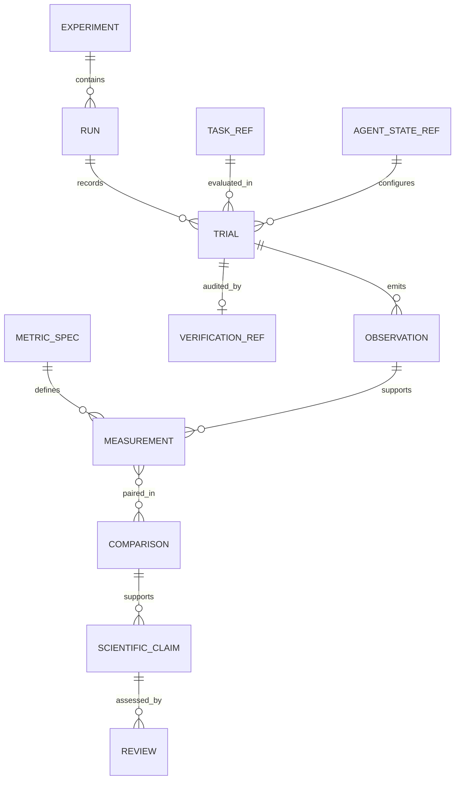
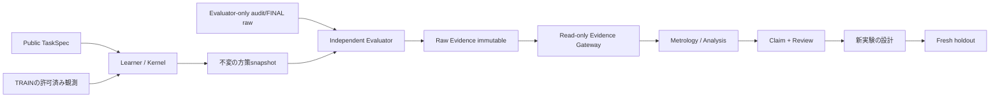

# METRO-EVIDENCE — 証拠エンベロープのデータ契約 v0.1

id: METRO-EVIDENCE
status: proposed; no code or persistent DB
updated: 2026-10-27
tags: metrology, schema, provenance, privacy, architecture

## 設計目的
既存のTaskSpec / WakeEpisode / WakeReceipt / SkillProposal / ArmSnapshot / PolicySnapshot / EvaluationEvidenceを置換せず、参照と検査を付加する。append-onlyな元証拠を上書きせず、正規化は分析用のread-only projectionに限定する。



## EvidenceEnvelope (proposed, conceptual)
```yaml
schema_version: "metro-evidence/0.1"
experiment_id: "METRO-0001"
run_id: "cal-example-only"
record_id: "unique-within-run"
record_role: "train_engineering"
source:
  immutable_raw_sha256: "<hash>"
  source_commit: "<sha>"
  source_blob_sha256: "<hash-or-null>"
task_ref:
  public_task_id: "<opaque-id>"
  domain: "string_to_string"
  public_task_sha256: "<hash>"
agent_state_ref:
  primitive_semantics_version: "<version>"
  policy_snapshot_sha256: null
  skill_body_sha256: null
trial_ref:
  arm: "fixture_off"
  outcome_record_sha256: "<hash>"
  independent_verification_ref: "<restricted-reference>"
observation:
  metric_id: "primitive_invocations"
  metric_version: "runtime-canonical-v1"
  value: null
  unit: "calls"
audit:
  evidence_access_class: "evaluator_only"
  status: "not_run"
```
上はフィールドの形状例であり、runや測定結果ではない。新スキーマは既存experimentのjsonを自動的に同一形式と仮定せず、adapter_version + source contractを要する。

## 信頼境界


学習器に渡すpublic task_idはEXP-0003A ID-v1に従う。source_record_id, family, seed, split, private audit例はevaluator-onlyであり、Learnerに提供しない。GitHub Actions Artifactのprivateとは **学習器との論理的な分離** であり公開リポジトリで外部秘匿を保証しない。

## 不変条件・失敗
- record_idはrun内一意。task_id×arm×phaseの重複は計画にない限り拒否。
- 元レコードが存在しなければunknown/missingとして報告、値を0やfalseに補完しない。
- 引用対象はraw evidence hash、schema、source blob、snapshot hashとMetricSpec版が揃うこと。
- read-only projectionは評価/訓練の実行権限、FINAL開封、正式技能採用の能力を持たない。
- ScientificClaimはobservation/estimate/interpretation区分、scope、alternative_explanations、uncertainty、review_status、evidence_refsが必要。
- error: invalid_hash, missing_evidence, duplicate_record, schema_mismatch, partition_leak, incomparable_metrics。非比較とデータ不正は別状態として保存。

## 将来のストレージ
初回はJSON/JSONL + SHA-256 + stdlib想定。DB/UI移行は必要になった時に検討。signed proof/秘密保持/悪意のある同一ホスト実行からの完全保護は保証しない。

Related: [architecture](../architecture/system.md) / [contracts](../architecture/contracts.md) / [metrics](metrics.md) / [plan](../../experiments/METRO-0001/plan.md).
