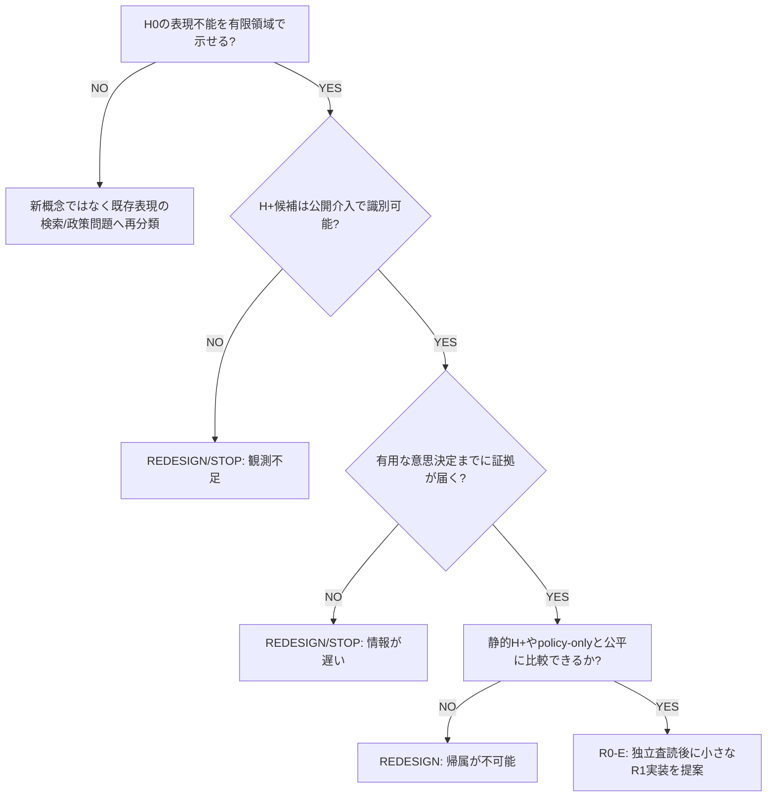

# GATE-R0-ROADMAP — 研究再起動の統制と条件付きロードマップ

id: GATE-R0-ROADMAP
status: proposed_docs_only / no_experiment_run / awaiting_review
updated: 2026-11-04
tags: research-management, roadmap, representation-repair, stop-gates

## 最初に読む（現時点の正本）

- [研究目的](../vision/mission.md): 限られた実行機構が経験から再利用可能な抽象技能を得て、未知課題で探索を改善できるか。
- [管理司令塔 #146](https://github.com/ryonakayama234/DekaSugi/issues/146): 唯一の優先順位・WIP・STOP/HOLD管理窓口。
- [現在の唯一の研究課題 #168](https://github.com/ryonakayama234/DekaSugi/issues/168): GATE-R0、まず**設計・証明・原因切り分けのみ**。
- [結果保存 #166](https://github.com/ryonakayama234/DekaSugi/issues/166) / [Draft #167](https://github.com/ryonakayama234/DekaSugi/pull/167): public adaptive gain = 0 の研究STOP。再解釈・再調整・本線統合はしない。
- [既存研究設計候補 #142](https://github.com/ryonakayama234/DekaSugi/issues/142) / [#162](https://github.com/ryonakayama234/DekaSugi/issues/162): HOLD。新しい承認までは次工程へ進めない。

この文書は作業順序と判断契約を定める**提案**である。研究方法の事前登録・実験成功・主ブランチへの採用を意味しない。過去の実験計画・証拠には手を加えない。

## 本当の問題と現時点の確かな制約

このプロジェクトが狙う「自律的な概念/技能獲得」の科学的主張には、単なる既存DSLの組合せ、事前に与えたマクロの選択、頻度・ランキング学習、学習なしでも最適な問い合わせと区別できる証拠が必要。

| 既存証拠 | 残った識別不能性・障害 | やってはいけない解釈 |
|---|---|---|
| [#126](https://github.com/ryonakayama234/DekaSugi/issues/126): R3 8/8 に rank-only R2P 8/8 が一致 | 概念本体の寄与と順位/事前分布が分離されない | 新概念の効果を実証済みとする |
| [#139](https://github.com/ryonakayama234/DekaSugi/issues/139): role 修正後 H-ACT 切替 0、STATIC-MACRO 同等 | 学習済み本体が有償行動を変えたか | 保存されたSnapshotを使っただけで有効とする |
| [#160](https://github.com/ryonakayama234/DekaSugi/issues/160): 9 valid panel は適応利得 0、3 invalid | 天井・観測同値・情報到着の遅さ | 実験環境の広さを独立因果familyとみなす |
| [#166](https://github.com/ryonakayama234/DekaSugi/issues/166): EXT448 public adaptive=fixed=1040/5376、world-aware positive 25/448 | 未知world事前分布では適応問い合わせの増分価値がない | world-aware Oracle の正を学習可能な機会とする |

現時点で反証されたのは特定の実験設定・学習効果の帰属であり、ミッション全体の数学的不可能性ではない。逆に、正の機会を探して世界生成器を結果依存で調整することはしない。

## 管理ルール（WIPを制限する）

1. **ACTIVEは科学的判断1件だけ: #168。** 実装用の複数Issue、先行PR、学習器、データ生成器を先に建てない。
2. **現在作るPRはこの文書だけ**。R0がGOになるまでは新しいコードPRを作らない。既存研究PRは保全・HOLD。
3. 1 Issue は一つの研究判断、1 PR はレビュー可能な単位。R0後に初めて直近の1工程を小さなIssue/PRに切る。将来PRを何本も事前発行しない。
4. 新しい結果を得たら #146 に「観測事実／未確定／判断／次の一手／人間承認が必要な点」を短く更新する。歴史的NULL/STOPは書き換えない。
5. CI、コードレビュー、研究方法査読、独立評価は別の証拠。いずれも単独で科学的成功を保証しない。
6. 対象ソース・手法・指標・停止条件の変更は、結果を参照して同一実験を最適化するのでなく、別バージョン・新しい評価として扱う。
7. 新しい研究の正式実験、予算増大、保護データの解放、mainへのmerge、ミッション変更は必ず所有者判断に戻す。日々の実装方法・文書整備・テスト設計の局所判断は担当者に委ね、監査点のみ固定する。

## 条件付きロードマップ — 次の工程を先行実装しない

| 段階 | 最小の成果物 | 進行条件 / STOP |
|---|---|---|
| **R0: 診断（ACTIVE）** | 表現不足・可観測性・行動可能性・学習への帰属を切り分けた紙上の比較仕様と GO/REDESIGN/STOP 決定 | 証明可能な比較問題がないなら **REDESIGN/STOP**。実装禁止 |
| **R1: 最小工学プローブ（条件付き）** | 公開の有限世界3種、H0/H+判定器、同一予算の静的/学習比較器。外部秘匿実験なし | R0を独立の方法レビューでGOにし、別Issueで範囲・テストを固定した時のみ実装 |
| **R2: 学習機構の動作検証（条件付き）** | 公開経験→反例→型付き候補の自動生成→Snapshot→新しい公開問題で実際に利用したtrace | 概念本体OFF/順位のみ/同等静的H+との切り分け不能、合法行動不変ならSTOP |
| **R3: 独立転移・総費用比較（条件付き）** | 機構単位で異なる新world、事前指定分布、対照・訓練費用償却・汎化の評価設計 | 同系の名前換えのみ、結果依存抽出、不公平な計算予算ならSTOP |
| **R4: 別の独立採否判断（条件付き）** | 実測・不確実性・レビューとともに技術採用/研究棄却を明示 | 正式FINALはさらに別承認。改善不成立でもNULLとして保存 |

※ R1以降は**提案上の分岐**であり、承認済みタスク・実装予定日・結果の約束ではない。

## R0の実作業 — #168のR0-A〜Eだけ

- [ ] **R0-A / 能力と証拠の棚卸し**：mainとDraftを分け、#126/#136/#139/#142/#160/#162/#166について「何が実行済みか」「何が動いたか」「最強の対照」「どの結論が未検証か」を1枚の表にする。GitHubの既存 #146 を台帳とし、新しい証拠を捏造しない。
- [ ] **R0-B / 数学的識別可能性**：有限入力領域で初期言語 H0 が目的関係を表現できないことを示し、拡張メタ言語 H+ の表現可能性を示す。さらに公開観測から候補が区別可能で、有用な意思決定の前にその情報が得られるかを別々に証明/反証する。反例を同時に記録。
- [ ] **R0-C / 3つの紙上テスト**：N=真のNULL/情報なし、S=H0で十分、R=H0不足だがH+で表現可能という候補。介入、公開観測、報酬、操作予算、事前分布を**結果を見る前に**書く。Rを人工的成功例と呼ぶ場合は一般分布での出現率を主張しない。
- [ ] **R0-D / 公正な比較**：同等のH+表現空間と計算・有償操作の予算をもつ静的探索、policy-only、episodic retrieval、fixed macro、concept-body OFF、情報を持つOracleを区別する。無制限Oracleは上限であって公平な有限予算baselineではない。学習+使用の全費用、変化した合法行動、独立予測性能を分離して測る。
- [ ] **R0-E / 1ページの決定**：どの証拠が(a)世界の設計欠陥、(b)表現不足、(c)学習器の欠陥、(d)評価/帰属の問題を区別するか列挙。GOなら「1つの次Issue、1つの最小PR」の受入条件を宣言。解けない場合はREDESIGNかSTOP。独立方法レビューの未完はGOと書かない。

### R0の論理ゲート

注意: 上図のH0非表現性は**新たな表現構築が必要である条件**の一つであり、自動獲得成功の証拠ではない。また「観測で分かる」だけでは「学習器が分かった」とは言えない。

## 次の判断の責任分界

| 役割 | 担当 | エスカレーション条件 |
|---|---|---|
| **Research Lead / Planner（AIとの対話）** | 毎回 #146/#168 の現況確認、論点整理、R0の合否提案、直近Issue/PRの仕様・監査観点、WIP制御 | 実験目的/正式採否に関わる変更は所有者へ |
| **Implementer** | 目的・制約・テスト・停止条件を守り、局所のアルゴリズム/構造は自律的に選択。現時点では作業しない | 科学的定義・比較予算・情報境界の変更 |
| **Independent reviewer** | 別の立場から方法論、情報漏洩、証拠、コード/セキュリティをレビュー | P0/P1や根拠不足ならSTOP |
| **Owner（人間）** | 研究目的の大きな選択、重要な資源投入、主ブランチ統合、正式評価の解放 | 普段は個々の実装行まで判断しない |

AIは会話の中でGitHubを読み書きし、要請された作業を統括できるが、依頼のない時間に自律的に監視・継続実行するものではない。新しい作業セッションでは必ず最新のIssue/PRを読み直してから進む。

## R0完了の定義と次回の出力

- R0-A〜Eの文書が揃い、最強対照と観測可能性の論理に未回答のP0がない。
- 分かることと分からないことが区別され、GO/REDESIGN/STOPのいずれかに理由がある。
- **次の一手は1つ**。GO以外ではコードPRはゼロ、GOでも人間と独立レビューのゲートを越えるまで実装しない。
- この文書のDraft PRは、設計の可読性・リンク・合意を評価するだけで実験能力の採用判定をしない。

次の作業依頼の入口: [#146](https://github.com/ryonakayama234/DekaSugi/issues/146) から [#168](https://github.com/ryonakayama234/DekaSugi/issues/168) の **R0-A と R0-B** を先に進める。実験用PRを作るのはR0-Eの判断後。
