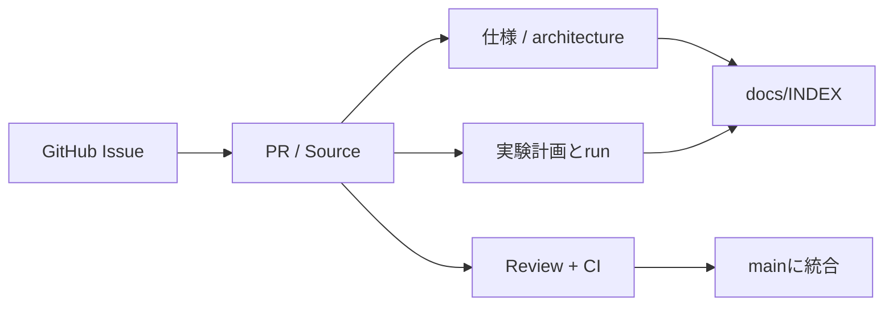

# PROC-002 — GitHub management

id: PROC-002
status: active
updated: 2026-10-24
tags: github, issue, pull-request, workflow

## 原則
AI側がGitブランチ、Issue、PR、履歴を管理し、ユーザーは研究の方向と重要判断に集中できるようにする。
`main` は正式記録。通常は直接pushせず、変更を見比べられるPR経由にする。自動的にmergeしてよいという意味ではない。

## 作業カード
- Issueタイトル例: `EXP-0001: 型付きDSL探索のベースラインを実装`
- ブランチ例: `exp/0001-enumerator-baseline`
- コミット例: `feat(synthesis): add deterministic typed enumeration`
- PR: 課題→仮説→変更→検証→図/契約→リスク→採否を示し、Issueとリンクする。
- Issueは `Backlog → In Progress → Review → Done / Rejected` の状態を本文やコメントで記録する。ラベルは利用可能であれば補助的に使う。

## レビュー
提案者とは独立の観点で、型・安全・データ漏洩・比較条件・再現性をチェックする。
自動CIは補助であり、独立した科学的査読の代用にはしない。
重要なAPI変更・ベンチマーク変更・自動生成コードの実行許可は特に慎重に扱う。

## 同期対象

## 誰でも読み直せる記録
変更PRには「なぜその判断をしたのか」「何を確かめたのか」「どこが未確認か」を残す。
実装をやめた理由もIssue/実験ログに保存する。実験出力など大容量ファイルを無秩序にGitへ入れない。
