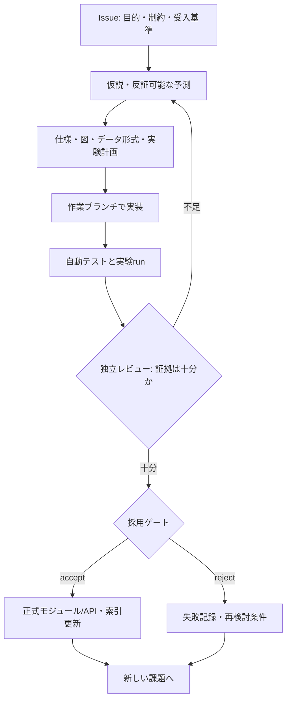

# PROC-001 — Research and adoption workflow

id: PROC-001
status: active
updated: 2026-10-24
tags: process, hypothesis, experiments, acceptance

## 基本サイクル

## 各成果物の役割
- **Issue**: 何を解決するか。目的、制約、検収要件、対象外、未知を先に定義。
- **Spec**: 期待動作、インターフェース、境界、反例。テンプレート: [spec](../templates/spec.md)。
- **Architecture**: 依存・状態・データフローをMermaidで図示し、実装状態を明記。
- **Experiment plan**: 実験前に仮説、対照条件、予算、データ分割、成功/失敗基準を固定。
- **Experiment run**: 実測値、実行コマンド、コミットID、環境、原データへの参照、異常を記録。テンプレート: [experiment](../templates/experiment.md)。
- **Decision**: 採用/保留/棄却と根拠を記録。将来取り消せる。

## 科学的な制約
- 結果が出てから評価指標を変更するときは **探索的分析** と明記し、次の事前登録runで再確認。
- 訓練/開発/最終評価は分離。構造やテンプレートの漏洩も検討する。
- 成績比較は同じ原始演算・同じ候補評価予算・同じデータ・同じ環境を基本とする。
- 速度改善だけなのか、成功率改善なのか、表現力の増加なのかを分けて報告する。
- 改善がなければその結果も保存する。失敗を隠さない。

## 最低限の完了定義（Definition of Done）
1. Issueの検収要件に対し証拠がある。
2. モジュール変更時は仕様・インターフェース・図・データ契約が同じPRで更新される。
3. 実行コマンドと自動テスト結果が追跡できる（未実行は明記）。
4. 実験はrunごとの不変記録を残し、計画と実測を混同しない。
5. レビューで採否/保留理由を示す。PR説明から資料・Issueへ辿れる。
6. 変更後の資料索引が最新である。

Related: [GitHub運用](github.md), [AGENTS](../../AGENTS.md)。
