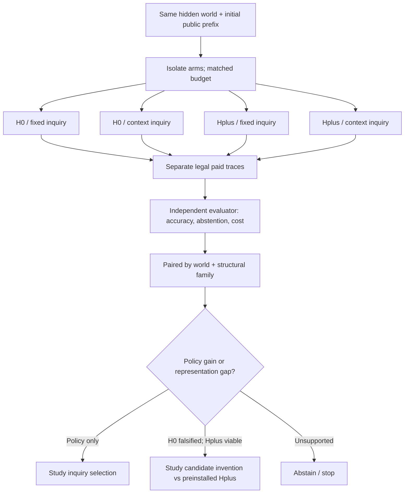

# EXP-REP-005 G0 — Identification and counterfactual inquiry audit

id: EXP-REP-005-G0-IDENTIFICATION-AUDIT
status: proposed_method_review_not_frozen_not_run
updated: 2026-11-02
tags: research, active-learning, representation, counterfactual, diagnostic
issue: https://github.com/ryonakayama234/DekaSugi/issues/142
parent_pr: https://github.com/ryonakayama234/DekaSugi/pull/143

## One scoped finding (design correction, not implementation)

The G0 2x2 design proposes four cells H0/Hplus x P0/Pctx. A requirement to compare *identical paid questions* would disable the adaptive component of Pctx. A fixed shared public prefix may be replayed for an **offline inference/representation** ablation; it cannot stand in for a prospective **inquiry-policy** comparison.

For causal comparisons of inquiry policies, pair the **same hidden world instance** under the same initial public information, legality constraints, charged-action horizon, and predeclared computational budget. Let each policy pick its OWN subsequent paid actions, and score each only through observations legally acquired on that arm. **Natural path coincidence is a legitimate measured outcome:** retain such worlds in the paired analysis, without selective filtering or artificially forcing policy divergence. Independent paired runs may reset to the same instance via the evaluation harness, but that reset is NOT a free learner action and must not reveal hidden truth. Keep evaluation-run data out of training. No off-policy score can be inferred from a different policy's trace unless coverage assumptions and a separately preregistered estimator justify it.

## Required experimental split

1. **Mechanism diagnostic (shared-prefix):** supply the same legitimate, predeclared public prefix to H0 and Hplus, compute version spaces, and verify an independently executable counterexample. Do not call this policy-value evidence.
2. **Policy utility (paired-on-world):** compare H0/P0, H0/Pctx, Hplus/P0, Hplus/Pctx on matched worlds, same charged-action limits and compute ledger, but distinct permissible action trajectories. Randomize/rotate execution order; do not transfer answers between arms.
3. **Learning attribution (within Hplus capacity):** compare learned Hplus repair against preinstalled equal-capacity Hplus, Hplus policy-only, episodic memory, body-off, and equal-compute/search-budget controls. Count all training interventions and amortize against future independent-world utility.
4. **Transfer and failure controls:** split by distinct structural/causal families, not just renamed IDs; include H0-sufficient, Hplus-needed, unidentifiable-within-budget, noisy or invalid, and outside-Hplus mechanisms. Enforce abstention instead of forced invention.

Predeclare family-level paired effect estimands (e.g. difference in exact prediction accuracy, difference in paid actions, difference in abstention error), compute budget and coverage; do not substitute candidate-count or an action-switch event for predictive utility. Factor interaction = whether inquiry benefit depends on representation. A changed question is a **mechanism witness**, not a scientific success by itself.

## Temporal-aliasing witness — epistemic scope

The proposed four-paid-action trace creates two pulse events with equal (visible state, action) and unequal next visible states. This contradicts ANY deterministic memoryless transition function for that interface; it does **not** prove a universally novel causal law or automatically discovered primitive. A stochastic/latent-state account, longer action memory and alternative public-state augmentation must be examined as separate hypotheses. The Hplus previous-action feature is human-specified as a diagnostic upper bound, not automatically invented by DekaSugi.

Machine-check the legal four-action trace including all 24 object renamings, canonical event typing, exact charged cost, and public-only accessible fields. Proof of H0 expressibility limits may use an exhaustive finite semantic catalogue **or** a checked contradiction with an explicitly wider deterministic-memoryless superclass; label the precise proof domain. No G1/G2 status is upgraded by this document.

## Decision diagram (proposed)

## Proposed data/interface amendments

- `PolicyArmSpec`: grammar_id, grammar_digest, policy_id, training_exposure_digest, maximum_paid_actions, maximum_interpreter_dispatch, CPU/RSS if instrumented, deterministic tie-break seed (source-private); no target labels.
- `PairedWorldKey` (EVALUATOR-ONLY): opaque world match key and structural-family key, hidden truth reference. These keys must never appear in learner-visible event or snapshot.
- `PublicInquiryTrace`: arm-local chronological paid action/observation events, step costs, legality, public-history digest, predictor commit before audit, trace digest. Cannot contain peer-arm answers.
- `DiagnosticReceipt`: method_id, source_sha, same-prefix vs independently-adaptive comparison mode, H0/Hplus consistency, witness outcome and verifier digest. Keep verification separate from utility scoring.
- `EvaluationReport`: paired-world family effects, coverage/abstention, actual paid actions, physical interpreter calls, wall/CPU/RSS if available, training and storage amortization, missingness/status.

## Review and stop rules

- G0 **OPEN** until an independent reviewer checks semantics, split, budget, predeclared effect estimands, and leakage control. This audit is a critique, not an independent approval.
- G1/G2 synthetic-only engineering execution requires separately authorized implementation; no learning or scored experiment is authorized by this document.
- STOP if a policy arm receives observations from another arm, learner reads world/family/seed truth, the witness depends on uncharged interventions, or a different-capacity control is portrayed as learned novelty.
- Maintain original #141 NULL / NOT_RUN evidence; do not overwrite or merge to main automatically.

## Local-model / epoch note

For future CPU-only training, independently vary distinct public training-world exposures (e.g. proposed 0/3/8/16/32/64) and, **only when a gradient learner exists**, SGD epochs/updates on an already fixed dataset. Log both axes, effective distinct structural families, total paid actions, learning compute, Snapshot hash, and fresh-process USE. A successful unit test or repeated deterministic trace is neither an epoch of new world information nor evidence of intelligence improvement.

## Status

2026-11-02: proposed methodological correction and contract only; no code, fixture run, training, scores, model freeze, or scientific claim.
