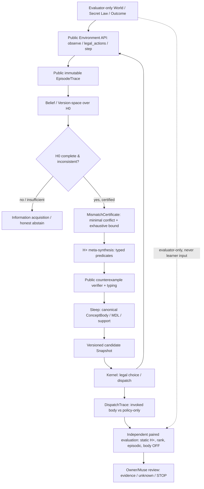

# GATE-R0 — 表現修復・公開識別可能性・学習因果帰属の精密設計（討議案）

id: GATE-R0-DESIGN-PRECISION-20261104
status: proposed_for_muse_critique / paper_only / no_go / no_score
updated: 2026-11-04
tags: gate-r0, representation-repair, identifiability, architecture, causal-attribution, study-design

**位置づけ:** [Issue #168](https://github.com/ryonakayama234/DekaSugi/issues/168) の R0-B〜R0-E に対する**紙上研究提案**。[Muse 質問票 #170](https://github.com/ryonakayama234/DekaSugi/pull/170)への[正式回答](R-20261104-01-response.md)に続く技術ドシエ。Ownerの採用、Museの賛同、方法凍結、R1着手、性能実証を意味しない。**実装・実験・TRAIN/DEV/FINAL・採点・マージは行っていない**。古い [#166](https://github.com/ryonakayama234/DekaSugi/issues/166) のゼロは不変。

## 1. 戦略要約 — 目標は「当てるAI」から「表現不足を見つけ、操作言語を修復できるAI」へ

[mainのVISION-001](https://github.com/ryonakayama234/DekaSugi/blob/main/docs/vision/mission.md)の主目的「経験から再利用可能な技能を作り未知課題への探索を改善する」を保持する。ただし概念獲得の識別条件は五つに分ける：

1. **L0 / Expressivity:** 初期H0（Kernel/履歴/方策を含む実効表現空間）では対象関係が表せず、汎用構築機構H+なら表せる。
2. **L1 / Epistemic access:** 学習者が得られる**公開**観測・介入だけで候補間を識別できる。単なるworld-aware Oracleの区別では不足。
3. **L2 / Temporal actionability:** 決定に間に合う時点で証拠が到着する。異なる行動が合法で終端効用に差をもたらすかを別途測る。
4. **L3 / Mechanistic acquisition:** 人間が対象関係の本体をハードコードせず、反例に基づき型付きbodyを生成、検証、永続化し、fresh USEで実際に評価器が呼ぶ。
5. **L4 / Bounded utility & transfer:** 同じ公開情報、同じH+表現能力と総予算を使う強い対照に対し、**概念bodyによる説明可能な改善、または反復課題での償却利益**がある。別の機構familyに対する移植はさらに別の主張。

**研究の第一目標:** L0〜L3が「可能か」をまず紙上で区別。L4の成功条件・母集団を先に固定し、学習器を作ってから世界を都合よく選び直さない。**有用な表現修復と、適応的な質問選択は独立の仮説である。**

## 2. 数学的な重要修正：理想のSTATIC-H+に勝つことを必須条件にしてはいけない

**命題（同一情報の最適比較器）:** 公開観測、候補空間H+、合法行動、訓練・推論資源の制約が等しく、ある静的H+計画器がその制約内の全方策を厳密最適化するなら、いかなる学習方策Lもその評価目的でこれを**厳密に超えられない**。

```text
V*(H+, public_information, resource_budget) >= V(L)
```

これは「固定プログラムで全く更新しない」ことと、「固定された汎用メタアルゴリズムが観測に従って適応する」ことを区別した命題。十分に表現力のある静的プログラムは、原理上、Wake/Sleepを含む学習アルゴリズムを模倣することさえ可能である。

したがって、**成功を二つに分離する**：

- **M（機構）:** 公開反例による新たなbody構築・検証・保存・実使用と、そのbodyを選択方策とは独立に介入したときの予測/意思決定の差。これ単独では静的最適計画器を超えるとは主張しない。
- **U（実用・効率）:** **計算資源で限定された、同じH+を使える強い静的・episodic・rank-only対照**より、獲得した概念の再利用で総費用対効果が改善するか。無制限の最適STATIC-H+やOracleは**上限参照**であり、その上限に勝つことを合格条件にしない。

もしH+内で候補を学習しても、最適固定アルゴリズムが同じ証拠から等価な予測を得られるなら、**新しい意味論を超自然的に創造したのではなく、有限資源で有利な内部表現を獲得した**と結論するのが妥当である。これは研究目的を矮小化するのでなく反証可能にする条件である。

## 3. 三つの紙上のペア診断：N / S / R

**共通前提:** 完全に公開された有限形式世界、入力 `(x,z) in {0,1}²`、決定的ラベル `y=f(x,z)`。目標は終端での関係の予測。全4入力の表現力は評価側のみが完全列挙し、学習者は合法に公開された入出力対しか見ない。入力ビットの名前の変更は別の科学的機構familyとはみなさない。以下は実施データでもpositive率の母集団推定でもない。

**固定H0（仮の限定条件）:** 一つの事前固定された述語 `0, 1, x, !x, z, !z` のどれかを選び、その述語単体で全入力の予測をする。**入力に応じて異なる述語を選ぶ外部Kernel、無制限lookup/memory、暗黙のifをH0に含めない。** この条件を事前に宣言しなければ証明不能。

**H+（実験者が許した汎用構築機構）:** 変数 `x,z`、Boolean `AND/OR/NOT` から深さ・ノード数上限内の型付きASTを構成できる。**XOR/ORという対象関係body自体を初期Libraryに登録しない。** ただしAND/OR/NOTは人間が与えた基礎意味論であり、「新しい物理的primitiveの自律創造」とは呼ばない。

### Rの意味論真理値表（表現差の有限証明）

| x | z | XOR target | OR target | 単項H0で両方の真理値表を完全再現? |
|---:|---:|---:|---:|---|
| 0 | 0 | 0 | 0 |  |
| 0 | 1 | 1 | 1 |  |
| 1 | 0 | 1 | 1 |  |
| 1 | 1 | 0 | 1 |  |
| **H0最小誤り（全4入力）** | | **2/4** | **1/4** | **どちらも不可** |

証明: H0の全6真理値列を網羅すると、XORとの差は最低2、ORとの差は最低1である。一方H+で `OR(x,z)` と `OR(AND(x,NOT(z)),AND(NOT(x),z))` はそれぞれ誤り0。したがって**この定義のH0に限って** `error_H0>0` と `error_H+=0` を構成的に証明できる。これは学習の成功証明ではない。

### N: 情報がない・修復不能（NULL / negative control）

- ペア法則: `fA(x,z)=x`, `fB(x,z)=x AND NOT(z)`、同じ事前確率1/2。
- 合法な公開クエリは `(0,0),(0,1),(1,0)` のみ。いかなる質問履歴でも両世界の返答は `(0,0,1)` と完全同一。
- 終端の対象入力は `(1,1)`、答えはfA=1、fB=0。質問予算はB=1だが決定に必要な唯一の入力は問い合わせ**不可能**。
- **証明できる判定:** 公開履歴分布が同じなので、その履歴からはどの方策も両世界を識別できず、等事前の終端0-1予測の最適正答率は1/2。H+を増やしても観測不足は直らない。**学習器失敗と呼ばない。**

### S: 既存H0で十分（fixed-H0-sufficient control）

- ペア法則: `fA(x,z)=x`, `fB(x,z)=NOT(x)`、等事前。
- 合法公開クエリ `(0,0)` を一回行えばAの返答0、Bの返答1で完全識別。B=1、終端前に回答が到着。
- **証明できる判定:** 二つともH0に含まれる。H+やlearned bodyは必要ない。正例のような学習改善を主張したら帰属失敗。

### R: 事前表現が不足しているが、公開反例で修復可能な候補

- ペア法則: `fA=XOR(x,z)`, `fB=OR(x,z)`、等事前。
- まず受動公開例 `P={(0,0)->0,(0,1)->1,(1,0)->1}` を与える。H0の全6候補はこの3観測を**同時に満たせず**、有限列挙完了なら `MODEL_CLASS_MISMATCH` の証人となる（単なる探索予算不足ではない）。
- H+ではXORとORの二候補がこの時点ではともに生き残る。B=1の有償公開照会 `Q(1,1)` は合法で、A=0/B=1を**終端の意思決定前**に識別する。正しいH+bodyを構成・照合できる。
- **重要:** B=1で固定クエリ(1,1)が既に最適なので、この候補には適応的質問のfixed超え利得は**0**であり得る。しかし**表現修復の必要性**は消えない。これにより `representation opportunity` と `adaptive inquiry opportunity` を混同しない。
- 評価先は別IDの同一関係に対する未見入力予測等に分離する。ただし2-bit全表の再利用やrole renameは**独立機構family転移の科学的証拠ではない**。正しいSTATIC-H+やepisodic lookupもこのミニケースを解く可能性があるため、ここでは*機構配線の工学診断に限定*する。

### 反対例：H0の「外側」にifがあるだけで表現不能の主張は崩れる

Kernelが `if z=0 then x else NOT(x)` を実行できるなら、形式的なH0関数辞書が単項でも**実効的にはXORを構成できる**。同様に4入力の記憶表を無制限に使えるなら、有限2bitのいかなる関係も模倣できる。よって、**L0証明はDSLのみならずKernel/episodic lookup/policy switch/保存表現を含む閉包に対して行う**。この点が現在のR0-B最大のP0である。

## 4. 形式的に分ける三つの「機会」

- **表現差** `G_expr = min_{h∈H0} L(h) - min_{h∈H+} L(h)`：同じ対象関数と分布に対する有限意味表現の差。**学習可能性は含まない**。
- **公開識別可能性**：ある合法公開履歴hで、競合するH+候補の予測差を、**有用な決定に間に合う**状態で解消できるか。到達可能性・時間・観測同値類の証明が必要。
- **適応問い合わせ利得** `G_inq = V*(adaptive, public prior, B) - V*(best legal open-loop, public prior, B)`：同一終端効用・同じ合法性の比較。 `G_inq=0` でも `G_expr>0` と概念修復機会は成立し得る。逆にG_inqが正でも学習者が実現できるとは限らない。

**研究の標的を明示する:** 初期R0→R2は `G_expr>0`・公開証人・body使用を対象とし、`G_inq>0` は能動質問を科学的主張に含める場合だけ追加要件にする。旧 [#166](https://github.com/ryonakayama234/DekaSugi/issues/166) は指定G0Bの `G_inq=0` の正本として保持する。

## 5. 提案アーキテクチャ：世界モデル・概念形成・技能活動を、観測可能なプロセスとして扱う



**現在のmainに追加済みだとは主張しない。** 技術選定は将来の候補として次の責務に分ける：

| 機構候補 | 入力→出力の契約 | 必要性・除外する近道 |
|---|---|---|
| `PublicEnvironment` | typed public state、合法行動、費用、次観測、終了 | 世界Law/seed/採点probeを返さない。N/S/Rを同一接口で扱える |
| `EpistemicState` | 公開trace→有効候補集合/信頼できる棄権 | 「予測が外れた」だけで新概念と断定せず、noise・budget・evidence invalidを分離 |
| `MismatchCertificate` | H0版・有限domain・公開反例・探索完全性→クラス矛盾の証明 | 候補検索中断や単なる失敗を表現不足と誤分類しない |
| `TypedMetaSynth` | 許可されたAND/OR/NOT等＋公開反例→候補AST | 新しい意味論は実験者のメタ言語に有界。任意Python生成・実行不可 |
| `ConceptRegistry` | `intent/spec`と`executable_body`、preconditions/effects/invariants、依存・provenance・version | 目的と実装を分離。名称や支持頻度だけを概念としない |
| `Kernel/Dispatcher` | belief・action budget・許可済みbody→選択/起動ログ | 選択方策は表現本体とは別に操作し、ON/OFF/利用可能/実行済/終了を別記録 |
| `Evaluator` | source-firstな独立世界・対照・trace・費用→決定的な判定 | Oracle/秘匿真理を学習側に渡さない。CI=科学実証としない |

**技術方針:** 最小CPU/stdlib/型付きAST/有限列挙を継承。SQLiteの多機能記憶、NN/Transformer、GPU、RLフレームワーク、実アプリ接続をR0〜R1へ増設しない。初期の「汎用性」は機能を盛ることでなく、**同一プロトコルで互いに異なる世界を扱えること**で定義する。

## 6. 動的知能の証拠モデル：固定対象は「ルール」、学習するのは「過程」

- `EpisodeEvent`: `time, world_alias, public_context, pre_prediction, legal_actions, chosen_action, observed_answer, cost, hypothesis_digest, snapshot_digest`。予測を結果の前に記録し、事後修正を別イベントとする。
- `DiagnosisEvent`: `MODEL_CLASS_MISMATCH / UNDERIDENTIFIED / SEARCH_EXHAUSTED / EVIDENCE_INVALID / STOCHASTIC_UNMODELED / ABSTAIN`。各判定に有限証明または未認証理由を添える。
- `ConceptCandidate`: `typed_body, intent, preconditions, effects, invariants, source_event_ids, counterexamples, AST_cost, support_world_ids`。意味同値だけでなく**取得来歴**を保持。
- `ConceptSnapshot`: 版・公開学習receipt・候補body・選択方策を**別フィールド**へ格納。保存/復元後の動作を追う。
- `DispatchEvent`: `available / selected / executed / finished` を分離し、実際のbody実行と効果を記録。0/1活動は自己教師の副次情報として記録できるが、模倣した活動列だけで概念学習としない。
- `EvidenceLedger`: 評価器が保持するソース版/sha、本人が見たpublic入力、独立auditorの評価結果を混ぜずに保存。旧sealed FINALには触れない。

評価は **prequential loss（更新前予測）・新しいbodyの独立介入効果・公開質問のconditional value・新family学習曲線・全期間コスト**。同じログを何回replayしても新しい独立学習経験とは数えない。プロセスの動きと比較の厳密さを両立する。

## 7. 強い比較と「本体効果」の因果識別

**前提:** 同じ法則・同じ公開イベント列（分岐比較は共有prefixまで）・同じH+意味的候補容量・同じ推論/質問/訓練上限・同じsource family。先行学習を許す場合、対照にも同じ学習データアクセスを与える。

| Arm | 学習したbody | rank/方策 | 固定して検証するもの |
|---|---|---|---|
| F00 | OFF | 固定 | 非学習の強いSTATIC-H+列挙、同予算 |
| F01 | OFF | 学習 | policy-only/rank-only。概念本体なしでも同じ予測か |
| F10 | ON | 固定 | **bodyだけ**のcontrolled direct effect |
| F11 | ON | 学習 | 本体+方策の結合効果、交互作用 |
| E | episode retrieval | 同じ公開記憶 | 正確な記憶・類推・固定マクロで説明可能か |
| O | evaluator-only理想Oracle | 上限参照 | **公平な実用比較には含めない** |

**静的H+にも同じメタ言語と探索最適化の可能性を許す**。`body OFF`で別の無能なH0へ落としてはならない。因果差 `F10-F00` の解釈はbodyの**計算上のショートカット**である可能性を含むため、同じ真理値関数が静的macroに既に存在する場合、意味的新発明とは認めない。`F11-F01` は方策を固定したbody介入にはならないので、別に扱う。

**必要なtrace:** `body_eval_count>0`、差分が生じた入力・候補・合法行動と独立heldout予測、実使用コスト、誤り。もし**bodyを起動しても予測/行動/費用が同一**なら、新規表現の便益は **NULL**。同等の静的表現が完全再現するなら「独自の意味内容」とは識別できない。

**生涯償却:** `C_life(N)=C_train+C_sleep+C_store+sum(C_use_i)`。各USEの静的対照との平均費用差を `d=C_static_use-C_learned_use` とすると、`d>0` の場合に限り、最小償却課題数の目安は `ceil((C_train+C_sleep+C_store)/d)`。 `d<=0` なら費用だけの観点で償却不能。厳密評価では成功率・棄権・対話コストのtrade-offと一緒にPareto境界を報告する。

**mainの具体的な教訓:** [EXP-0002B FINAL112](https://github.com/ryonakayama234/DekaSugi/blob/main/experiments/EXP-0002B/runs/20261025-final112.md) は5数値基準PASSでも、3armとも80/112正解、LEARNEDのprimitive呼出6880 vs OFF6944、**推論CPUを足した総CPU改善は立証していない**。この経験は「検索費用」と「学習を含む経済的利益」を分ける理由になる。

## 8. 次に実施する科学的方法の決定（現時点で実装禁止）

| ステップ | 紙上の決定物 | 失敗時の判断 |
|---|---|---|
| **R0-A** | main/Draft明示、証拠のSHA/出典・NULL/STOPの版、最強対照 | 未照合=未完と書く |
| **R0-B** | H0の**実効閉包**、H+メタ言語、4点等の証明、公開履歴・判断時刻 | 説明不能/識別不能ならREDESIGN |
| **R0-C** | 上記N/S/Rペアと負例、ソース/合法性/終端効用/費用/証拠到着時刻 | 後知恵でpositive選別したらINVALID |
| **R0-D** | STATIC-H+、F00–F11、episode/fixed macro、Oracleの区別と総費用 | 対照容量が不公平ならREDESIGN |
| **R0-E** | Muse反論・Owner判断を伴うGO / REDESIGN / STOP | 独立方法査読前は**NO GO** |

**推奨:** R0では N/S/R の**証明と不可能性境界**だけで十分。最初のコードはR0-Eで必要と正式承認された場合のみ、公開有限意味論の検証器1件に限定。先に新しいカーネル、世界生成器、Wake–Sleep群を立ち上げない。

## 9. 発展方向（GATE-R0外・優先順位保留）

- **表現修復から学習方法の学習へ:** `予測誤差 → データ不足か表現不足かを診断 → どの概念が欠けるか推定 → 反証可能な質問を自ら選択`という**学び方の再利用**。環境や意味体系の定義を人手で変更した場合は学習の寄与から控除する。
- **行為の共通化:** gameの遷移、表の更新、プログラムの修正を「対象」「目的」「前提」「効果」「不変条件」「検証」で接続し、Adaptersは**同一概念を前もって教えない**。別世界の類推は転移指標で検証し、UI操作や自由文章生成はまだ対象にしない。
- **技能活動の自己組織化:** ON/OFF時系列はKernelの次の行動・技能競合を学ぶ補助信号となり得る。だが行動の共起は因果でも新しい意味でもない。介入で反証できるまでは主研究に混ぜない。
- **新しい概念を作る前に「まだ知らない」を判断する:** 表現不足、観測不能、探索資源不足、ノイズ、分布外、予測器バグを区別する**epistemic diagnosis**を、個々の演算発明より先の研究能力として位置づける。

これらは DekaSugi の長期構想と整合するが、**現行のR0の成功条件や着手範囲を拡大する許可ではない**。

## 10. Museに独立査読を依頼したいP0論点

[逆質問票](Q-20261104-02-to-Muse.md) に、(MQ1)「理想静的H+に勝つ」という不可能な閾値の除去と成功定義の二階層化、(MQ2) H0実効閉包、(MQ3) 表現修復の機会と適応問い合わせ機会の分離、(MQ4) R0診断用の単一toy vs 本研究の独立family、(MQ5) プロセスの実証と監督合意の境界を整理する。独立したMuseの回答が到着するまでは**未合意**と明記する。

## 関連研究（論理上の支え、DekaSugiの実験証拠とは区別）

- [Ellis et al., DreamCoder, PLDI 2021](https://doi.org/10.1145/3453483.3454080)：wake–sleep、ライブラリ抽象化と探索方策の共学習。**元の意味論の組合せと真の新primitive獲得は区別が必要**。
- [Angluin, Learning Regular Sets from Queries and Counterexamples, 1987](https://doi.org/10.1016/0890540187900526)：membership/equivalence query と反例駆動同定。DekaSugiの公開Oracleは**equivalence教師を当然には提供しない**ので、保証をそのまま移植できない。
- [Schölkopf et al., Towards Causal Representation Learning, 2021](https://arxiv.org/abs/2102.11107)：低水準観測から高水準因果変数を獲得する研究課題。
- [Locatello et al., Challenging Common Assumptions in the Unsupervised Learning of Disentangled Representations, ICML 2019](https://proceedings.mlr.press/v97/locatello19a.html)：帰納バイアスを明記せず観測データだけから唯一の意味表現を識別することの限界。今回のMeta-grammarと観測境界の明文化を支持する。

### 最終提案（採用前）

**REDESIGNを維持。** 当面は有限な数学的な診断を固め、未知概念の自律構築・実行・保存という**過程の機構証拠**と、計算制約下の**未知機構への経済的な転移利益**を別の科学的仮説に分ける。結果を「陽性」にするために世界を後から書き換えず、出なければSTOPする。
