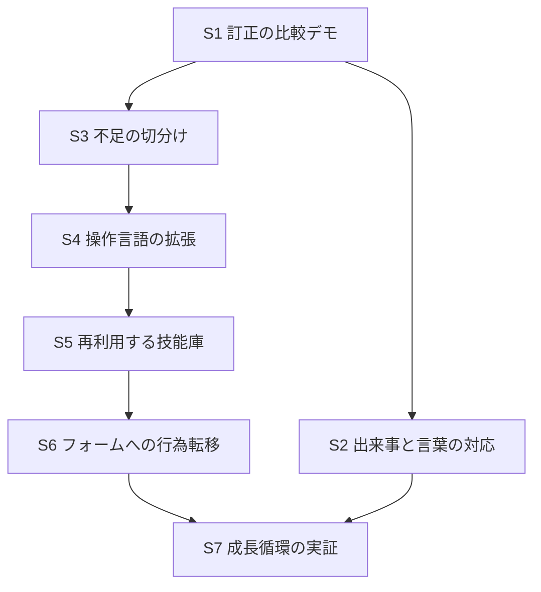

# R-20261115-03 — DekaSugi の大目標・マイルストーン・サブ目標

id: R-20261115-03
status: PROPOSED / DOCS_ONLY / OWNER_DECISION_PENDING / NO_IMPLEMENTATION / NO_EXPERIMENT
updated: 2026-11-15
tags: roadmap, goals, milestones, rule-revision, language-growth, lead-response

回答先: [Q-20261115-03（PR #218、質問票固定head）](https://github.com/ryonakayama234/DekaSugi/blob/5978e598ce663975e70722a11bba237a3c2a31dc/docs/research/Q-20261115-03-roadmap-goals-subgoals.md)。追跡: [Issue #217](https://github.com/ryonakayama234/DekaSugi/issues/217)。Research Lead 提案。監督者の照合・Owner の採否は未了。本書は目標階層の設計回答1件であり、実験カードの改訂、Goalsへの登録、実装・学習・本番予測・採点・マージを行わない。

## 0. 提案の中心と参照した現在地

**大目標は「経験で操作言語を育て、その構造を別世界で使い直せる小さな中枢を、Ownerが追体験できる形にする」と置く。** 文訂正は最初の「直る」証拠、言語成長は「区別と操作の組み方が増える」証拠、転移は「別の対象でもその構造が働く」証拠である。この三つを、一つの小実験に詰め込まず同じ地図へ戻す。

計画の背骨は、訂正の比較デモ → 不足の切分け → 操作言語の拡張 → 再利用する技能庫 → フォームへの転移 → 成長循環。文章と出来事の対応学習は、この背骨に接続する独立の能力軸とする。達成率を工程数で水増しせず、「見せられる成果物」と「実証された能力」を別々に表示する。

| 根拠 | 引き継ぐ内容と留保 |
|---|---|
| [Mission](../vision/mission.md)、[ARCH-001](../architecture/system.md)、[ARCH-002](../architecture/contracts.md) | 小さな中枢、経験、再利用、有限の型付き実行。これらは歴史的な提案と工程記録を含み、図にあるモジュールすべての完成を意味しない。 |
| [採用・凍結された WORLD 回答](WORLD-R-20261110-01-lead-response.md)（main `ae44f126`） | エディタ→フォーム、L-Skill／L-Concept／L-Schema、供給メタ機構と獲得物の区別、強い対照。旧数値ゲートを今回の新しい実験の閾値として再利用しない。 |
| [実験Aの閉鎖記録](https://github.com/ryonakayama234/DekaSugi/issues/146#issuecomment-6754631517)、[LEAN結果解釈](https://github.com/ryonakayama234/DekaSugi/issues/195#issuecomment-6871158474)、[合意記録](https://github.com/ryonakayama234/DekaSugi/issues/195#issuecomment-6871350287) | Aは閉鎖、LEANはSTOP_DIAGNOSTIC。FULL約0.912／OFF約0.906／STATIC-RANK約0.905は候補認定ではない。当該固定標本で+0.10へ届かない算術的制約と、経験追加価値が小さかった所見を維持。追加難化・再実行で救済しない。生データの独立再集計は本ラウンドでは未実施。 |
| [文訂正カードv1（固定head）](https://github.com/ryonakayama234/DekaSugi/blob/ceffc07213949eda7fc232e121e26f9b5d3f358e/docs/research/SENTENCE-REVISION-CARD-20261114-01.md)、[設計採用](https://github.com/ryonakayama234/DekaSugi/issues/195#issuecomment-6871567416)、[実装＋例準備GO](https://github.com/ryonakayama234/DekaSugi/issues/195#issuecomment-6880874031) | 4ケース・24例、条件改訂のみ、4方式、準備と本番の権限分離。状態対が機械可読な教師情報で、自由な訂正文の意味解析は対象外。 |
| [実装・準備の手順](https://github.com/ryonakayama234/DekaSugi/pull/213#issuecomment-6871629451)、[A受入](https://github.com/ryonakayama234/DekaSugi/pull/214#issuecomment-6881127124)、[B受入](https://github.com/ryonakayama234/DekaSugi/pull/215#issuecomment-6889951868)、[C最新提出記録](https://github.com/ryonakayama234/DekaSugi/pull/216#issuecomment-6890248007) | A/Bは監督者受入済み。CはPR #216 head `864f2040`へ提出・修正され、監督者受入は本回答の確認時点で未確認。質問票の「次はC」を「C提出済み・受入待ち」まで更新する。本番状態表、Owner入力、本番予測・採点の実施を意味しない。 |

以降の S1〜S7 は**新しい計画上の到達点**であり、既存実験の段階A/B/Cや認定名を改名しない。数字は順番の目安で、日付の約束ではない。

## 1. QB1 — 大目標の候補と推奨

| 案 | 大目標の1文 | 達成したときOwnerが見て触れる具体物 | 得るもの／失うもの |
|---|---|---|---|
| A：訂正で育つ編集助手 | 小さな編集世界で、例と訂正から実行規則を学び直し、新しい状態でも意図した編集ができる助手を作る。 | 誤予測→訂正→条件の差分→別状態での実行を見比べる編集机。 | 最も早く体験へ届く。ただし固定文法内の条件選択で終わり得るため、原点全体の大目標には狭い。S1〜S2の近い達成像、または縮小時の着地点に適する。 |
| **B：操作言語を育てる中枢（推奨）** | **小さな中枢が、エディタ世界の使用と訂正から再利用できる述語・技能・条件構造を獲得し、不足に応じて操作言語を拡張して、フォーム世界の未見課題で使い直せることを、触れる研究机として示す。** | 同じ経験を読む比較方式を切り替え、獲得物の来歴・適用条件・失敗・採否を確認し、編集とフォームで同じ行為構造が働く過程を再生できる一式。 | 原点の「行為の共通化」と評価可能性を両立する。言語成長・費用・転移の証拠を分ける必要があり、単一の正答率では終了判定できない。最初はローカルの結果票と再生でよく、専用Webサービスは要件にしない。 |
| C：複数世界で自律成長する作業者 | 小さな中枢が、複数の操作世界で不足を見つけて学習課題を作り、外部技能を増やしながら未知の仕事へ適応し続ける。 | 編集・フォーム・描画などを往来し、自分で練習と技能の採否を行う作業環境。 | 長期像として強いが、世界追加・知覚・課題生成のどれが効いたか分かりにくく、現在は判定可能な大目標に広すぎる。Maccho／3Dとの統合を含む遠方の仮説として保持する。 |

Bの「言語を獲得」は、新しい名前を付けた数では判定しない。**人が供給した原子操作・メタ文法、経験から形成した候補、候補を使った行動、未見での効用**を並べて追跡できることが必要である。有限のメタ機構を供給する以上、計算可能性そのものが増えるという無限定な主張にはしない。記号的な構造獲得を主軸とし、将来パラメータ学習を加える場合も寄与を別に測る。

最終的な触れる形は、①経験の再生、②言葉と出来事の対応、③規則・技能の前後差、④別世界での再束縛、⑤採用／棄却／保留の一覧、を一つの成果物からたどれるものとする。「操作可能」は実行記録とその根拠を選んで追体験できる意味で、Ownerが未見正解を見ながら本番の学習者を調整する意味ではない。

## 2. QB2 — 逆算したマイルストーン

### 2.1 到達点の表

大目標Bから逆算すると、別世界での再利用には可搬な獲得物、その獲得には不足を判別して拡張する経路、その観測には使用・訂正・実行がつながる足場が必要になる。以下はその順へ並べ直したもの。

| ID／短いタイトル | 達成したと言える見える形 | 条件・主張の上限 | 依存する下位到達点 | その時点の出口 |
|---|---|---|---|---|
| **S1 訂正の比較デモ** | 4ケースすべてについて、訂正前予測、期待状態、規則・残存仮説の差分、未見実行、4方式の成績・費用が同じ結果票で読める。 | 現カードの探索目安を維持：改訂対象3ケース中2以上で未見正答+1以上、初期正答保持、訂正整合、残る対象と確認ケースで悪化なし。結果票の完成と、この目安の達成は別状態。FRESH同等なら固有の効率優位なし。 | 採用済みカード、A/B、C受入、source固定、24例・8短文・分割の予測前固定、別途の本番GO。 | Ownerが初めて「何が直り、何が直らなかったか」を全件で追体験できる。陰性・停止も示せる。共有する場合は評価終了とOwnerの公開判断後。 |
| **S2 出来事と言葉の対応** | 短い表現のどの部分が編集前提・操作・結果と対応するかを示し、未見の言い換え・組合せを編集前後へ結び付ける小さな再生デモ。 | 文そのものを使う経路と、不透明ID／状態対だけの経路を区別。文を変えても判断が同じなら言語経路の寄与は未実証。正解parser・完成済み対応辞書を供給しない。新しい探索カードで条件を固定する。 | S1の状態／経験／来歴の足場。S1陽性を文章理解の証拠へ転用しない。 | 「文は名札か、出来事の関係を表しているか」を見比べられる。言語世界単独へ移らず、エディタに接地した教材・デモになる。 |
| **S3 不足の切分け** | 学習者が失敗したとき、情報不足・探索打切り・既存文法内の未学習・表現不足を、根拠と不明を含む1枚の診断表示へ返す。 | 固定した有限H0での証人と、予算内未発見を区別。H0で解ける負例に拡張を要求しない。全数認証器を一般目的で作ることは要求せず、小さく閉じる範囲かUNKNOWNを許す。 | S1の失敗・仮説集合・費用記録。診断分類の紙上整理は先行可能。 | 課題を難しくする前に「何を増やすべきか」をOwnerが理解できる。誤点火と不明の事例も共有物になる。 |
| **S4 操作言語の拡張** | 公開の経験から、現在のライブラリにはない述語・引数化した技能・条件構造の候補が生まれ、別の合法な部品へ束縛して動く。 | 供給メタ機構と獲得bodyを表示。新規性の種類をL-Skill／L-Concept／L-Schemaで記載し、該当しない層は未達。候補生成→保存→実使用への来歴、候補OFFでの差、未見組合せの効果を示す。固定Ifの呼出しや78条件内の再選択だけでは完了しない。 | S3で識別できる不足と拡張候補の必要性。S2を待たず状態・行為の経験で進められるが、文章起因の獲得とは呼ばない。 | 初めて「操作言語のどこが育ったか」を実行物として見せられる。候補が役立たない場合も獲得と有益性を分離して説明できる。 |
| **S5 再利用する技能庫** | 来歴・適用域・版を持つ獲得物を保存し、別プロセスで復元して新課題へ使い、棄却・撤回もできる小さな技能棚。 | candidateと採用済みを分離。同じ全履歴を読む再合成・同容量の検索／キャッシュ・固定H+と情報と予算をそろえる。品質、構築・更新・保存・復元・探索・原始実行を含む費用を比較する。利用だけで便益を認定せず、費用回収がなければ効率軸は未達と記録。 | S4の可搬な候補。保存・表示の工学資産は並行準備可だが、新しい基盤作りを先行させない。 | 再取得・再生できる最初の研究パッケージ。効率優位がない場合でも、採否と適用域を検証できる道具として境界付きで返せる。 |
| **S6 フォームへの行為転移** | エディタで育った「前提→操作→結果」の構造を、観測項や下位操作が異なる最小フォームへ束縛し直し、未見状態で使う比較デモ。 | source経験あり／なし、再利用する構造のみOFF、適切な関係破壊対照、強い固定方式とtarget追加経験を同条件にする。成功率・追加経験・負の転移を表示。改名だけ、手製の正解対応Adapter、target解答の注入では未達。 | S4の再束縛可能な構造、S5の保存・独立使用と採否。S5のCPU優位は前提にしない。 | 原点の「行為の共通化」を最初に別世界で示せる。編集とフォームを横に並べた共有可能なデモ候補。 |
| **S7 成長循環の実証** | 使用→不足診断→候補提案→圧縮・予測・転移での検証→採否→次の使用までがつながり、異なる不足に対して再び一巡する研究机。 | 成功1回の台本から区別するため、少なくとも異なる不足の2循環を示す案。2回は統計認定の標本数ではない。各循環の未見評価を隔離し、棄却／撤回できる負例も含める。最終能力主張の分割・比較・閾値は将来の認定設計で固定。 | S2〜S6。大目標Bの限定領域での完成点。 | Ownerが「成長のプロセス」を追体験できる成果物。次にMaccho等へ接続するか、ここで研究を一区切りにするかを選べる。 |

S2以降の「未見」や比較は能力を識別するための**要件案**であり、例数・実行手順・成功閾値の新規事前登録ではない。既存WORLDの+0.15等をそのまま持ち込まない。各段で選ぶ一問に必要な最小対照へ落とし、全対照を常時走らせる巨大な評価器を前提にしない。

S4でL-Skillだけが得られた場合、成果物は返せるが、S6が必要とする再束縛可能な構造の証拠は未充足のままである。S4を一度通ったという工程履歴でこの依存を満たした扱いにしない。S2にも、短文IDの暗記と語句・関係の対応づけを分ける独立の証拠が必要になる。

### 2.2 主張の階段を飛ばさない

S1で示せるのは、供給された条件文法内の記号的改訂である。S2は文章の対応づけ、S3は不足の判断、S4は操作言語の実用上の拡張、S5は持続的な再利用、S6は別世界への転移、S7は循環の継続をそれぞれ追加する。圧縮だけ良い／実行予測だけ良い／転移だけ良い、という結果を分ける。全項目が同時に改善することを先に約束しない。

「成果物完了」は、陰性・停止でも適切に閉じた結果を持つこと。「能力達成」は、対応する反証条件を通った証拠があること。この2列をGoalsの進捗にも併記する。下位能力が未達なら、成果物の数が増えても上位の到達を宣言しない。

## 3. QB3 — 主幹・分岐・既存資産の扱い

### 3.1 依存地図

矢印は能力証拠の依存であり、実装の開始許可ではない。S1が陰性でもS3の診断には進めるが、S4以降の能力達成を保証しない。S2はS3〜S5と論理的に並行できる。資源上は新規の実行を伴う本線を同時に1件とし、並行はまず既存資料からの設計・対応表に限る。

| 資産・論点 | 配置と扱い | 根拠／再開するために必要な証拠 |
|---|---|---|
| 文訂正カード、A/B/C | **主幹・継続：S1** | 採用済みの範囲で最初の可視成果を返す足場。新目標のための文法拡張・ケース追加・方式追加を持ち込まない。 |
| 文の経験メモ | **並行設計、実行は後段：S2** | 文をエディタの出来事へ接地する。現カードの短文は意図記録であり、意味の学習実績ではない。語句と前提・効果の対応を何で識別するかが次の一問。 |
| 不足検出→提案→検証→採用 | **主幹：S3→S4→S5→S7** | 研究対象の中枢。表現を増やす前に、追加観測・再探索で解ける失敗を分ける。自動採用だけにせず拒否・撤回を含む。 |
| エディタ→フォーム（世界1.5） | **後段の主幹：S6** | 世界の選択は固定。移すのは行為の関係で、イベント名の一致ではない。Adapterは公開観測・原子操作の接続だけを担当し、学ぶべき対応を完成形で渡さない。 |
| 道具化／外部化 | **S5、S4の候補ができた後** | 中枢の外に再利用物を持てることと総CPU利益は別。旧LEANのCALLが使われた事実を便益にせず、基本探索を省ける使用経路と準備費を確認する。既存保存・復元の工学資産を選別して借りる。 |
| Wake-Sleep | **後段：S4〜S5の候補形成手段** | 起きて得た経験をまとめ直す仕組みであり、Sleepジョブの完走自体を目標にしない。圧縮後に実行・転移が保たれる証拠を必要とし、巨大なDream生成器は先に作らない。 |
| Active Learning | **S3の後に選択できる分岐、S7へ接続** | 残る仮説を区別する合法な質問がある場合に限る。過去の質問価値ゼロのSTOP資産は負例として有用。固定質問選択は「能動的問い合わせ」、経験で選び方自体が変わる場合だけ「質問方策学習」と呼ぶ。 |
| Self-Play（Issue #146の預かり） | **後段：S3/S7、原典検討だけは並行可** | 借りる候補は「不足に合う経験を作る」観点。自己生成の問題・正解で循環を閉じるだけでは外部の有益性を確認できない。小さな世界で到達可能な情報獲得が必要になった時に検討する。 |
| FLEX | **並行する設計上の参照：S2/S3、方式導入は後段** | [既存同定記録](https://github.com/ryonakayama234/DekaSugi/issues/195#issuecomment-6871350287)の言語による表現編集のポインタを保持する。同名の別FLEXと混同しない。適用域・不要条件の修正を考える材料であって、現カードへ自由文parserやLLMを追加する根拠にしない。 |
| HALO | **後段：S6/S7** | 預かりポインタを多様な世界・技能連結の論点へ置く。運動・知覚系の設計を先に持ち込まず、DekaSugiで可搬な役割構造ができた時に必要な論点だけ再調査する。 |
| SuperMimic | **後段：S5の費用軸** | 預かり記録の「準備費と反復費を分ける」観点を候補とする。単一試行の速さや外部研究の成績から、こちらの償却利益を推定しない。 |
| 実験A、LEANの追加難化 | **継続案は捨てる。結果と工学資産は保持** | 研究上の閉鎖を尊重する。source pin、再生、観測／解釈の区別を再利用し、旧大型ゲート一式を新しい最小デモの必須基盤にしない。 |
| 実PCログ、Maccho／描画→3D | **遠方・依存待ち** | Bが成立する前の統合作業は知覚・UI・運動の別問題を増やす。共有する候補の型・来歴・適用域の紙上比較までとし、収集・統合・世界変更は提案しない。 |

4件の論文ポインタは**預かり材料の配置**であり、今回新たな原典の性能検証や手法の採用はしていない。論文内容についての根拠は既存の同定・合意記録に限る。導入を判断する段階で原典・計算要件・DekaSugiとの違いを改めて照合する。読書の完了を主幹の待ち条件にしない。

## 4. QB4 — 目先の仕事と行き詰まりの診断

### 4.1 最初の成果物までの残り

**現在地はS1の実装後半。準備は残り5区間で「本番を判断できる束」へ届く。その後、別途GOされた実行と解釈が終わってS1の比較デモが完成する。** 区間は作業量や日数の単位ではなく、合否を確認できる出口である。A/Bをやり直す計画ではない。

| 残り区間 | 手元に残るもの | 境界／止まる場合 |
|---|---|---|
| 1 Cの受入 | 正解隔離、一括採点、全結果票、全工程の予算ガードについての監督者受入記録 | 最新Cは提出済み。CI・人工例PASSだけで受入完了にしない。 |
| 2 source・設定固定 | 受入対象のsource commit、候補順、4方式と採点器、設定の固定記録 | マージの要否・実施はOwnerの別判断。mainへ自動統合しない。 |
| 3 24例の状態表準備 | 各状態の「削除／そのまま」の可能な結果を並べた、予測を含まない24行 | ケースを実際の誤答で選ばない。新文法・例追加で救済しない。 |
| 4 Ownerセッション | 2回×25分で24期待状態と8短文の確認。残り10分は保留用 | 合計60分超／意図の不整合／負担増なら準備未了で止める。意図・正解を代筆しない。 |
| 5 Museによる固定と判断材料 | 分割、正解、文章、順序、sourceのhashと残予算をまとめた本番判断用の束 | 予測前に固定する。ここまでは既存GOの範囲。**本番の予測取得・採点は別GO待ち**。 |
| 別GO後の実行・解釈 | 全4ケースの訂正前後比較と停止を含む結果、主張の限界、S1の成果物 | 全出力を保存してから一括採点。S1陽性・陰性・機会不足・無効を区別する。 |

準備区間5までで、Ownerに見せるべきものは「何を行うか・何が固定されたか・予算は残っているか」を判断できる束である。学習が起きた完成デモとは呼ばない。最初の体験のために専用サイトや追加GUIを作る必要はなく、Cの自動Markdownと実行記録を使う。

### 4.2 文訂正の結果ごとに地図はどう変わるか

| 観測される結果 | S1の解釈 | 次に変わる計画 |
|---|---|---|
| カードの探索目安を満たし、FROZENとの差と未見への適用がある | 限定された条件規則改訂のデモ成立 | S2の接地かS3の不足診断から一問を選ぶ。S4達成とは扱わない。 |
| REVISEとFRESHが同等、MEMORYより未見に適用できる | 訂正からの一般化は観察可能、持続的改訂方式の固有便益は未実証 | 背骨は維持。S5の効率仮説は保留し、FRESHを強い対照として残す。 |
| 初期からほぼ全正答、改訂機会なし | 機会不足。学習不能でも成功でもない | この版を閉じる。LEAN同様、誤答を作る追加難化・例差替えで救済せず、S3で「何が未識別か」を整理する。 |
| 訂正例だけ合い、未見で改善しない／旧正答を失う | 一般化または保持が不足 | 失敗を状態不足・仮説選択・情報不足等に切り分ける。S4へ自動昇格せず、必要なら後段目標をAへ縮小する判断材料にする。 |
| 合法な文法で意図を表せない | そのケースの表現不足候補。文法外意図か矛盾かの確認が必要 | 現カード中に候補を増やさず記録。S3の入口になり得るが、これだけで新しい概念の必要性を認定しない。 |
| 漏洩・不公平・source不一致、予算停止、Owner準備未了 | 無効・未完了・資源停止を区別。能力の陰性へ変換しない | 原因と残存物を保存して停止。再実行・再固定・予算変更は新しい判断であり、同じ評価例の調整をしない。 |

### 4.3 行き詰まりの構造

以下は根拠を持つ診断仮説であり、Ownerの心理状態の断定ではない。

| 構造 | 根拠・競合する説明 | 計画側で変える点／反証する観測 |
|---|---|---|
| **能力の目標と工程の進捗が混ざる** | Aの工学的完走や候補使用が、言語獲得・有益性とは別だった。作業は進んでも最終像へ何が近づいたか見えにくい。 | S1〜S7で「成果物」と「能力」を別表示。全工程完了でも対応する能力が未達と分かるようにする。これでも次の判断が読めなければ分解が不適切。 |
| **定義の修復が、何を見たいかを覆う** | 大型CALは実施前に停止。精密な閉鎖と全数機械が、小実験で得たい観測より先に膨らんだ。必要な妥当性の修復だった部分もあり、単なる無駄とは断定しない。 | 正答・漏洩・同条件・停止・原本保持は維持し、一般目的の全認証器を先行させない。一問と見える出力が定まらない機能追加は止める。 |
| **追加経験と得たい技能がつながらない** | LEANでは持続する獲得ASTなしでもデモ内合成が高成績で、CALL使用だけでは利益を支持しなかった。獲得経験が課題に適切だったかも別問題。 | S3で、過去経験が将来解答に加える情報か、再計算を節約する構造かを分ける。強い対照が十分なら経験の追加価値なしという結果を受け入れる。 |
| **表現不足と探索不足が混ざる** | 解けないことから新記号の必要性は直ちに分からない。有限候補内の改訂も言語成長全体ではない。 | S3→S4を明示。既存H0の解や追加観測で説明できれば拡張を見送る。UNKNOWNを残して計算を際限なく増やさない。 |
| **可視成果が最後まで出ない** | 質問票が、数値だけでは出口が見えずデモの価値が重いと明記する。 | S1から全件の予測・規則・実行を同じ結果票へ返す。陰性でも何が起きたか触れられる。SNS投稿数・デモの見栄えを能力指標にしない。 |

最も避けたい循環は「弱い効果→難化→比較と事前登録が大型化→走らない→成果が見えない→別軸へ飛ぶ」である。破る位置は、**効果を救済する前に、既存の一問を可視化して閉じ、次に不足の種類を一つ選ぶ**ところに置く。

## 5. QB5 — Goalsへ登録できるサブ目標候補（7件）

以下はそのまま登録文として使える候補。未登録・未採用。各「完了」は到達点の検証と判断までを含み、成果物の完成だけで能力成功としない。陰性で閉じる場合は「調査完了・能力未達／保留」と記録する。全7件を同時に活動中にせず、推奨はG1を現在、残りを候補として置くこと。

| ID／タイトル | 1行の現在地 | 説明（登録用） | 完了の定義（登録用） |
|---|---|---|---|
| **G1 訂正で何が直るかを全件で見られるデモを得る** | 文訂正カードは採用済み、A/B受入済み、Cは提出済み・監督者受入待ち。本番は未実施。 | エディタ世界の4ケースで、訂正前予測から規則改訂、未見状態での実行までを同じ結果票で比較する。4方式の全結果と費用を示し、既知文法内の改訂として結論を限定する。 | C受入・sourceと24例の予測前固定・本番の別GOを経て、全4ケースの比較と探索目安の達否を記録し、監督者確認とOwnerの次段判断が揃う。停止時は停止理由と部分成果物を引き渡し、能力未判定として閉じる。対応S1。 |
| **G2 文をエディタの出来事へ結び付ける** | 現カードの短文は意図の記録で、自由文の意味理解は未評価。 | 短い文の部分と、編集の前提・行為・結果との対応を経験から形成する。状態対だけでもできる部分と文が寄与する部分を分け、未見の言い換えや組合せで確かめる。 | 別途採用する一問の条件下で、文と出来事の対応・未見実行・文を使う経路の比較が再生可能な形で揃い、対応学習の成立範囲または不成立理由を監督者が確認する。手製parserに依存する結果は能力達成にしない。対応S2。 |
| **G3 解けない理由を切り分ける診断を作る** | 現在の条件仮説・費用記録は足場になるが、自動の不足診断は未実証。 | 情報不足、探索打切り、既存文法内の未学習、表現不足を分けて表示する。新しい記号を必要としない失敗も含め、判断できない場合はUNKNOWNを返す。 | 許可された小さな診断事例で、各分類の根拠と誤点火・見逃し・不明を一覧にし、監督者が表現不足と単なる未発見を混同していないことを確認する。候補追加が必要か不要かを選べる成果物を引き渡す。対応S3。 |
| **G4 経験から操作言語の新しい部品を得る** | 現カードは78条件内の改訂であり、述語・技能・条件構造の新規獲得は未実証。 | 不足の根拠となる経験から、来歴と型を持つ実行可能な部品を候補として作る。人が与えたメタ機構を明示し、別の部品への束縛と候補を止めた比較で働きを確かめる。 | 候補の生成→保存→使用と未見組合せでの作用を追跡でき、固定体系・検索等で説明できる範囲を含めL-Skill／L-Concept／L-Schemaのどこまで示せたか独立確認する。名称追加や固定候補再選択だけなら上位能力未達とする。対応S4。 |
| **G5 獲得した技能を保存して使い直せる棚を持つ** | 保存・復元・来歴の工学資産はあるが、新軸の技能再利用と費用便益は未実証。 | 獲得物を来歴・適用域・版とともに保存し、独立した実行環境で新課題に使う。再合成や検索と品質・全工程費用を比べ、採用だけでなく棄却・撤回も見える形にする。 | 独立復元・未見使用・候補OFFの比較・準備費込みの費用票・採否が一式で確認できる。品質や費用の利益がない場合はその軸を未達と明記し、効率優位を前提にせず再利用の成立範囲を確定する。対応S5。 |
| **G6 エディタで得た行為構造をフォームへ移す** | 転移先はフォーム世界に決定済み。行為構造の別世界転移は未実証。 | エディタで獲得した前提・操作・結果の関係を、下位操作が異なる最小フォームで使い直す。source経験なし・構造OFF等と同じtarget経験上限で比較し、失敗と負の転移も残す。 | 人が与えたAdapterと学習した対応を分離し、未見フォームの実行・追加経験・負の転移と強い対照の差を確認できる。改名や手製の正解対応だけなら転移未達とし、Ownerが継続／縮小を判断する。対応S6。 |
| **G7 不足から採否までの成長循環をつなぐ** | 訂正・診断・言語拡張・再利用・転移を連続した循環として示す証拠はない。 | 使用、不足の検出、候補提案、圧縮・予測・転移の検証、採否、再使用を同じ来歴で追える研究机へまとめる。文の接地もつなぎ、異なる不足で再び循環するかと、不要な拡張を拒否できるかを確かめる。 | 別途採用した条件下で異なる不足の2循環と棄却／撤回の負例を追体験でき、S2〜S6の達成・未達と最強対照との差が確認できる。限定された大目標Bの達否をOwnerが判断し、Maccho等へ進むかを選べる。対応S7。 |

G1だけで規則改訂・自然言語理解・文法獲得・転移の四つを完了扱いにしない。G2〜G7には未確定の具体仕様が残るため、登録する場合も「候補／依存待ち」とし、実装・実行の許可を登録へ埋め込まない。

## 6. QB6 — 今／次／その次／遠く

| horizon | 到達点と見える出口 | 次層へ進める観測 | 止めて組み直す観測 | 律速と資源の扱い |
|---|---|---|---|---|
| **今** | S1。準備5区間の判断用の束、その後別GOで全件比較デモ。 | 正解分離・同条件・停止・予測前固定が確認できる。結果が陽性なら次の能力へ、陰性でも失敗機序が分かればS3の診断へ進める。 | C受入未了、Owner確認60分超、残予算なし、漏洩・改変・出力欠落。S1陽性がなくても調整を続けて期限を消さない。 | 律速は正しい準備とOwner負担。現カードのLead＋Muse計16時間、全方式合計2 CPU時間、外部課金0円、Owner50分＋予備10分を維持。残り枠は実績から引き、今回リセットしない。 |
| **次** | S2またはS3の一問を選び、言葉の対応か不足診断の最小成果物を得る。設計は並行できる。 | S2なら文を使う経路と状態対だけの経路を区別できる。S3なら不足分類とUNKNOWNの根拠を示せ、S4で変える対象が一つ定まる。 | 同じ経験で答えを識別できない、parserに正解対応が入る、文法追加の理由が単なる誤答だけ、強い対照の天井で予定効果が識別不能。 | 律速は課題と教師情報の識別性。追加Owner入力を既定にせず既存の公開可能経験を優先する。将来入力が不可欠なら、必要量と中止可能な区切りを先に提示して別判断。CPU VMで試せる単位をカード化する。 |
| **その次** | S4〜S5。新しい部品の生成と採否、独立復元・再使用を見せる。S2を選ばなかった場合は並行候補として残す。 | 候補が経験に由来し、供給文法との差と候補OFFの作用が見える。S6には可搬な構造と予算内での保存・復元が必要。総CPU優位そのものは進級の必須条件にしない。 | 固定マクロの再命名だけ、常に再合成と同じで可搬な獲得物もない、費用を候補呼出しの外へ隠す、巨大列挙が無料枠を超える。 | 律速は候補空間と強対照の計算。各新カードで作業・CPU・保持量・外部費用・再試行の上限を先置きし、最小公開fixtureで速度を見てから規模を決める。GPU・有料APIを暗黙の解決策にしない。 |
| **遠く** | S6→S7。フォームでの再束縛、文を含む成長循環の追体験。以後の描画／3Dは別の目標候補。 | 正解対応を与えず、同じtarget経験の強い対照に対する転移効果がある。異なる不足でも再循環し、不要な拡張を拒否できる。 | Adapterが学ぶべき関係をすべて解く、知覚・UI実装が主題を置換、負の転移が持続、経験ごとに人がコードを足している。 | 律速は世界間の対応と独立評価。画像・実PC・物理世界を追加せず最小フォームに限定する。無料枠で比較できなければ対象世界・主張を縮小する案を出し、世界数で進捗を演出しない。 |

日付や固定の「あと何実験」は約束しない。未見の数値閾値をここで大量に定めず、各カードで**対照の上界・改善機会・独立単位・上限予算**が噛み合うかを、認定ランの前に確認する。小規模な到達性検討で不明ならUNKNOWNで止める。CALの完全列挙・統合power機械を再び全段の前提にはしない。

## 7. QB7 — 失敗・転換・進め方

### 7.1 大計画が成立しない条件と縮小先

| 観測・サイン | 失敗する主張／転換する範囲 | 具体的な判断案 |
|---|---|---|
| 人が例ごとに正解条件・対応・新部品を追記しないと進まない | 経験からの獲得、自律的な拡張 | 介入箇所を明示し、当面はAの「訂正で育つ編集助手」へ縮小する。人の知識入力を有用な教師付き道具として扱うが、自律獲得と呼ばない。 |
| S4以降でも、差が固定文法の候補選択・名称追加・例暗記に尽きる | 大目標Bの操作言語成長 | S1/S2の限定成果を確定する。B達成を宣言せず、どの構成能力を得たいかをOwnerが再選択する。 |
| 新しい独立条件でも同情報・同予算の強い対照との差が一貫して実質0、獲得物OFFでも挙動・成績が変わらない | 持続的な獲得物の追加価値 | 無意味な差を救う難化をしない。固定体系で十分な道具として返すか、情報共有や再利用の仮説を変更する。無差の有限観測を一般不可能性の証明にしない。 |
| S6で改名以外の対応が学べず、手製Adapterかtarget側の再学習がすべてを担う | 行為構造の別世界転移 | Bの転移部分を未達として、エディタ内の操作言語研究へ縮小する。Maccho／3D接続を前倒ししない。 |
| 無料計算・作業・Owner負担の上限内に、判定可能な最小出力が収まらない | 現在の研究方法の実行可能性 | 原本と停止理由を引き渡して休止できる形にする。世界・候補・主張の範囲を縮小する案と固定方式の完成品を比較し、追加投資を前提にしない。 |
| 自己生成した課題では改善するが外部の未見課題へ移らない | 成長循環の外的有益性 | 課題生成を停止し、既存経験と独立評価の接続を点検する。内部の圧縮・自己採点だけでS7完了にしない。 |

上限到達・証拠不備は即時停止の根拠になる。一方、理論仮説の棄却にはその仮説を識別できる比較が必要である。「2回失敗したから知能獲得は無理」といった件数ベースの総否定も、「もう1回難しくすれば育つ」といった無制限継続も採らない。

**早く進んだ場合の前倒し候補**は証拠で選ぶ。S4で可搬な役割構造が得られれば、技能数を増やすより最小フォームのS6を優先できる（S5の保存・独立使用は省略しない）。S3で質問により候補が分かれることが示せれば、Active Learningの一問を選べる。S5で費用回収が見えれば道具化の出口を優先し、S2で文の寄与が明瞭ならS7への接続を早める。いずれも新しい実装・実行には対応する別判断が必要で、早い成功をMaccho統合や3D移行の自動GOにしない。

### 7.2 軽量化提案R1〜R8の扱い

**総合は一部採用を推奨する。R1/R2/R3/R5/R7は採用、R4/R6/R8は趣旨を採りつつ運用を限定した一部採用、全面却下はなし。** Ownerの最終採否は未了であり、採用済みカードの条件へ遡及適用しない。

| 項目 | 推奨 | この計画での扱いと理由 |
|---|---|---|
| **R1 1実験＝問い1つ** | 採用 | S1〜S7は能力地図で、1つずつが必ず1実験とは限らない。実行カードでは、訂正／言語対応／表現不足／再利用／転移のどれを識別するか一問を選ぶ。公平な対照や保持確認は同じ問いを成立させる測定として残す。 |
| **R2 カード1枚** | 採用 | 問い・世界・物差し・停止・予算を短くまとめ、同条件・評価単位・主張の上限も同じカードへ入れる。「1枚」は判断できる小さな単位で、文字を詰める形式上の制約にはしない。本書は上位計画1件であり、実験ごとの新規設計文書群を今作らない。 |
| **R3 規模上限を先置き** | 採用 | 計算・人手・保持量・外部費用を最大許容として先に示す。所要時間の予測とは分ける。最小fixture後に実測見積を出し、収まらなければ勝手に拡張せず停止する。現カードの予算は累積のまま維持。 |
| **R4 デモ先行** | 一部採用 | 巨大な認定機械より先に、人工例・公開開発例で「予測→訂正→実行→差分」を見せる。一方、評価正解を開いて成功例を選んだデモを作り、それを後から認定ランへ流用する運用は採らない。現カードではC/source固定前に本番状態を試す順序へ変えない。 |
| **R5 探索ランと認定ランの分離** | 採用 | 現カードは探索。陽性でも一般能力の認定ではない。認定する価値が見えた段で独立評価と必要な厳密さを用意し、探索に使ったholdoutを再利用しない。探索にも同条件・漏洩防止・停止・全件保存は必要。 |
| **R6 文書は1実験2点まで** | 一部採用 | 人が書く正本はカード＋結果報告を基本とし、補足はそこへ統合する。source・設定・分割・snapshot・全ログ・停止記録は自動証拠として別保持し、索引と必須のアーキテクチャ同期は最小差分にする。文書数を減らすために必要証拠を削除せず、また補足コメントを事実上の第3仕様書へ膨らませない。 |
| **R7 逐次保存＋実行中照合** | 採用 | 各予定出力と停止理由を保存し、件数・schema・source・予算・保存整合を進行中に照合する。未見の途中正答率を開示して調整することは含めない。現カードの全出力先行保存→一括採点を維持する。 |
| **R8 Owner判断は1ラウンド1問** | 一部採用 | Lead/Museが相違を整理してから、その時点で必要な選択を一問だけOwnerへ出す。目標選択と実行GO・マージを束ねない。広い計画の末尾に複数の将来判断点を置くことは許し、同時回答は求めない。選択肢や未解決点を隠すための制約にはしない。 |

### 7.3 進捗の返し方

各ラウンドの返却は「今回見えるようになったもの」「対応するS番号と能力の状態」「止まった理由または次に識別する一問」の短い3項を基本とする。研究の全履歴を毎回再説明しない。Ownerが休止を選んでも、同じsourceと結果から再開位置をたどれる状態を保つ。SNSはOwnerが公開価値を認めたときの出口候補とし、公開のために実験や手作業を増やさない。

## 8. Owner判断点 M1〜M5（新規・未決定）

以下はこの計画の判断点であり、既存カードの判断項目・軽量化R番号・マイルストーンS番号とは別。**直近に提示する一問はM1だけを推奨する。** M2以降は順次の判断材料として置き、全項目の同時回答・本番GO・マージを要求しない。既存のSENTENCE-REVISION-1の作業は既存GOの範囲で続く。

| 判断点 | Ownerが選ぶ内容 | 推奨と対応 |
|---|---|---|
| **M1 大目標の採択** | QB1のA／B／CのどこをDekaSugiの大目標として置くか。 | Bを推奨。Aを近い体験と縮小先、Cを遠方の仮説として残す。原点や採用済みカードの再採択ではなく、上位の達成像の選択。 |
| **M2 サブ目標の登録範囲** | QB5のG1〜G7のどれをGoalsへ登録候補とするか。 | 7件を候補とし、活動中はG1のみ、G2〜G7は依存待ち。登録操作は本PRに含まない。既存カードの24例採用や本番実行判断を代行しない。 |
| **M3 軽量化ルールの採否** | QB7のR1〜R8について、表の採用／一部採用の組を採るか。 | §7.2の組を推奨。各項目の限定を含めてレビュー可能にする。R4/R6/R8の無限定な全部採用との違いを明示した別の一問であり、既存カードの条件変更ではない。 |
| **M4 次の能力軸の選択** | S1の結果が出た後、S2の文の接地かS3の不足診断のどちらを次の一問にするか。 | 改訂デモが成立し文の寄与を見たいならS2、一般化失敗・機会不足・文法外の根拠があればS3。現時点で結果を先取りして確定しない。 |
| **M5 縮小・区切りの選択** | §7.1のサインが出た時、編集助手への縮小、限定領域での完了、または休止を選ぶか。 | 無料計算とOwner負担の範囲に判定可能な最小出力が収まるかで選ぶ。転移未達を隠した統合拡大や惰性の難化を選ばない。 |

本回答の受入条件は、監督者が固定条件との整合、S1〜S7の依存と能力境界、登録用7件、R1〜R8の限定、判断点の分離を確認できること。**数値到達・能力獲得の保証はなく、採用・登録・実装・実験・本番予測／採点・マージは未実施。**
