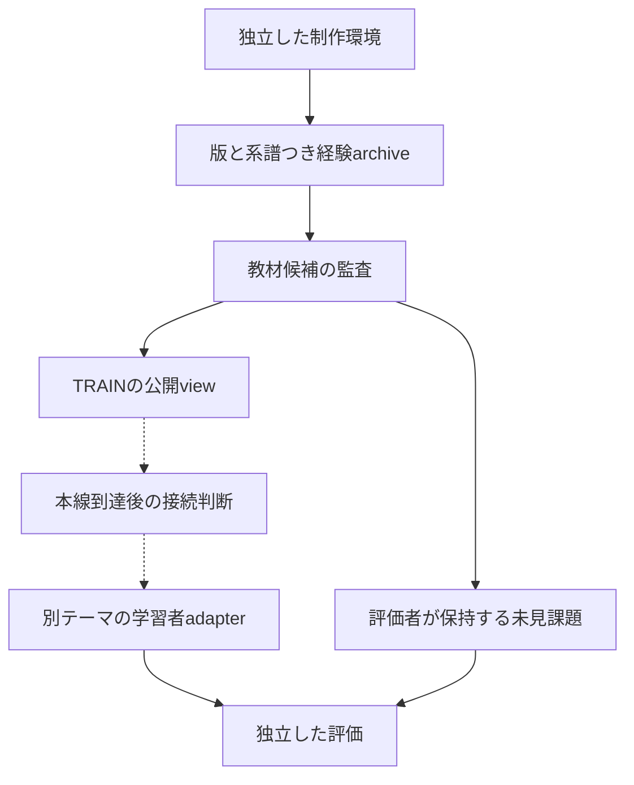

# R-20261115-06 — 3Dモデリング環境と経験データの目標・段階設計

id: R-20261115-06
status: proposed
updated: 2026-11-16
tags: research, 3d, modeling, episodes, roadmap, design-only

回答者: Research Lead。追跡: [Issue #220](https://github.com/ryonakayama234/DekaSugi/issues/220)。
本票: [Q-20261115-06（提出時点の固定参照）](https://github.com/ryonakayama234/DekaSugi/blob/d6ebcf50eb2864624a9ff9a6dfdb856be07ffda8/docs/research/Q-20261115-06-3d-modeling-roadmap.md)、[質問票PR #221](https://github.com/ryonakayama234/DekaSugi/pull/221)。

## 0. 結論・回答の境界

推奨する親目標は、**「Ownerが言葉と見た形への訂正で小さな3Dモデルを作れ、その制作過程を、後から再生・比較できる経験として残す環境を持つ」**である。最初は断面ロフトを扱う。共通化するのは操作と来歴の契約であり、三企画の物理モデルを一つに統合する決定はしない。

成功を二段に分ける。先に「制作に使え、訂正と再生が残る」を判定し、後に別の研究として「蓄積した経験が未見課題で役立つ」を判定する。制作環境が便利でも学習効果は未証明であり、学習実験が不成立でも制作道具として残す出口がある。

- 本書はQB1〜QB7への**計画案**である。仕様凍結・Goals登録・実装・実験・制作・既存企画への組込み・mergeの許可を含まない。数値は、明記した場合も将来の判定案であり、実測や到達保証ではない。
- DekaSugiの本線は文と訂正の経験のまま。現行ループへの3D追加、既存の状態型・探索器・採点器の変更を提案しない。将来の入力adapterは別段である。
- Maccho／Morphoacoustics／hapticsの現行フェーズは不変更。ここでいう接続は、各企画が将来受け取れる独立した成果物の候補である。
- Ownerに造形、頂点編集、コード編集、長い注釈を求めない。担当は目標の言語化・比較画像の選択・一言の訂正。操作列の作成と記録整合はAI／環境側の責務である。
- Q §0のVM制約と「numpyでロフト→STLが0.6秒」の記載は**監督者報告**として扱う。本回答では再測定しておらず、HTMLの応答、Blender処理、Owner端末の性能の証明に転用しない。

## 1. QB1 — 大目標の候補

| 案 | 大目標の1文 | Ownerが見て触れる具体物 | 利点と代償 | 推奨 |
|---|---|---|---|---|
| A: 訂正できる制作環境 | 言葉による指示と形への訂正から小さな3Dモデルを作り、再生可能な制作経験を自動で残す。 | 1画面で形・断面・前後比較を見て、訂正を採用／却下し、モデルと履歴を持ち出せる。 | 制作の有用性とデータの健全性を分けて判定できる。汎用モデラーや学習成功を達成条件に含めないため、範囲を制御できる。 | **親目標に採用候補** |
| B: 三企画の共有身体工房 | 一つの編集可能な身体記述から、見る・聴く・触る各用途のモデルを作る。 | 同じ部位を編集すると外観・音響入力・接触入力の対応が見える。 | 長期像に近いが、各ソルバの要求・有効性が異なる。現状で合否を一つにすると、三企画の同時完成が必要になり判定不能に陥る。 | 点線の長期仮説として保持 |
| C: 断面形状の制作・記録道具 | 断面から作る管状形状を訂正・保存・再生できる軽量道具を持つ。 | 断面半径を変えると形と面積表が変わり、JSONとSTLを再読込できる。 | 最も小さく判定しやすい。これだけを親目標にすると声道専用に閉じ、部品組立などへの接続を失いやすい。 | Aの最初の到達点 |

Aの具体的な達成像は「前回作った形を開き、『中央だけもう少し細く、端は変えない』と伝え、提案された前後を見て選び、その理由と操作を失わずに保存できる」である。初期の自然言語処理は既存の対話でAIが型付き変更データを用意し、Ownerがファイルを読み込んで確認する形でよい。HTML内に常駐AIや新たな有料APIを必須化しない。ファイルの受け渡しすら頻繁で負担なら、その実測をもとに後で連携を小さくする。

## 2. QB2 — マイルストーンと出口

以下は**独立に選べる到達点の提案**であり、作業開始の指示でも直列の全件履修でもない。Sは段階ID、末尾のMはOwner判断IDとする。

| ID・タイトル | 達成を見せるデモ／成果物 | 認定条件案 | 依存 | 可能になる出口 |
|---|---|---|---|---|
| S0 対象と再生契約を絞る | 対象例・対象外例、座標／単位／型、1回の訂正と保存の紙上例を並べた小仕様 | 「何を作れるか」「記録から何を再現できるか」を別の読者が説明でき、物理妥当性を未認定と識別できる | 本回答へのOwner判断 | 小仕様の公開・実装判断。まだ制作・教材は存在しない |
| S1 断面ロフトを見て直す | 1枚のHTMLで断面、管の三面図、面積列、変更前後を確認 | Ownerが頂点／コード編集をせず意図した部分を直せる。再読込で変更を失わず、端末能力不足時も断面表と2D図が使える | S0 | 単体の形状スケッチ道具、画面例の共有 |
| S2 制作経験を失わず再生する | 指示→提案→却下／採用→保存→別起動で再生する履歴付き1件 | 採用／失敗／却下／中断を区別。正本JSONと操作列が一致し、再生時の版・誤差・欠測が見える。少なくとも失敗からの復帰も保存対象 | S1、記録の最小部分はS1から組込む | **最初に実用と呼べる出口**。制作物＋可搬な経験bundle |
| S3 用途を明示して書き出す | 内腔境界と印刷用壁を選び分けたJSON＋STL、後段でGLBと部位表 | 単位変換・開口／閉包・部位対応が読み戻しで確認できる。未対応な書き出しは明示的に拒否 | S2 | 閲覧用モデル、別ツールへの持込み。3Dプリントは壁・尺度・スライサ確認後の任意出口で、購入／実印刷を完了条件にしない |
| S4 一つの企画に受渡し契約を作る | 最初はMorpho向け候補の断面積列と境界種別をadapter案として提示 | 受け手が要求する単位・座標・適用範囲を別途確認。受渡しの一致と音響の妥当性を別判定 | S2、必要なS3項目、受け手側の個別判断 | 将来の音響入力候補。現行のBODYMAP／逆路線等の契約は書換えない |
| S5 別形状でも使えるかを判定する | 部品組立の低ポリゴン形、又は部位物性を持つ形を**一方だけ**選ぶ | 新用途に必要な変更が共通契約の小拡張で済むかを記録。用途別ソルバを内蔵しなくても、部位と形の受渡しを確認できる | S2、用途に応じS3。S4との順序入替可 | Macchoの3D候補又はhapticsの形状素材。共通化が高価なら専用道具で止める |
| S6 教材として渡せるかを監査する | 再生可能な制作群、失敗群、近接変更対、系譜単位の分割manifest、学習者用view | 同一祖先の変種が分割をまたがない。評価専用の目標・正解・未来訂正を学習者用viewに含めない。未知／欠測を成功にしない | S2、少量の実利用経験。三企画の完成は不要 | 将来の教材パッケージ。まだDekaSugiへの入力・学習はしない |
| S7 DekaSugiへの遅い接続を判断する | 本線の到達条件を確認後、限定adapterと記憶／未見比較の別計画 | 現行本線を完了扱いにせず、別のOwner判断・比較法固定・独立審査を先に行う。制作用AIの出力を学習者自身の技能と数えない | S6＋DekaSugi側の接続準備。S4/S5を待つ必然はない | 別テーマでの学習研究。一般知能・三企画統合の認定は含まない |

優先経路はS0→S1→S2。その後S3/S4、S5、S6を必要に応じて選ぶ。S7は長期の条件付き出口であり、現行本線と並行して開始する学習課題ではない。新基盤の同時作業は1枝を上限案とし、既存企画の受入条件を満たすための新しい必須依存にはしない。最初から全段の事前登録機械や共通プラットフォームを作る必要はない。

## 3. QB3 — 小さな言語と実行系

### 3.1 原子の最小集合と導入順

提案は「世界が提供する型付き演算」と「環境でプログラムを編集する操作」を分けること。cubeやloftの内部には多数の計算があるため、原子とは物理的に最小という意味ではなく、**世界側から与えた1呼出し**という意味である。特にloftを与えた結果から『ロフト技能を学んだ』とは主張できない。

| 層 | 演算案 | 役割と制限 | 導入 |
|---|---|---|---|
| 形の低い基礎 | `indexed_mesh(vertices, faces)` | 小さな頂点・面の構築。サイズ制限、面の範囲／有限数／向き検査。自由なファイルやPython実行の入口にしない | 言語の基礎として予約。最初のOwner画面では編集させない |
| 基本形 | `box`, `ellipsoid`, `cylinder` | 寸法が明示された基本形。分割数を実行設定に固定し、暗黙の人体部位を作らない | 部品組立を選ぶS5で導入候補 |
| 断面の基礎 | `ellipse_section`, `section_set` | sectionは位置と正の2半径。setは軸位置が単調な有限列。初期は直線軸・同一平面方向に限定 | S1で使用 |
| 断面から形へ | `loft` | 断面間補間、円周頂点順、端の扱いを固定。内腔境界／表示用閉包を型・属性で区別 | S1で使用 |
| 空間操作 | `translate`, `rotate`, `scale`, `mirror` | 明示した原点・軸・順序で作用。通常scaleは正、反転はmirrorに限定し面の向きも処理 | S5等で必要なもののみ |
| 構成 | `group`, `instance`, `bounded_repeat` | groupは複数部品を束ねるだけで体積unionではない。参照は非循環、repeatは固定整数上限・展開後費用を計上 | S5等で必要なもののみ |
| 意味の付与 | `label_part`, `assign_property` | 安定した部位IDと、型・単位・出典つき属性。物性の値を付けても校正・生体妥当性は得られない | labelはS1、物性は後段 |

計16演算の**候補集合**である。15〜25という数に合わせるために全てを先に実装しない。S1の利用subsetは`ellipse_section / section_set / loft / label_part`の4演算で十分で、半径変更は下記の編集操作で表す。寸法・投影・断面積・検査・exportは観測／I/O機能に置き、形状の原子数を水増ししない。

編集操作は`add_node / replace_param / reconnect / remove_node / set_output`とし、undoは過去の状態を指す新しい履歴イベントにする。ビュー回転・表示切替・Ownerの採否は別イベントである。これにより「1行動＝どの対象へ何をしたか」が再生可能になる。複数箇所の変更はtransactionで原子編集へ展開し、採用は一括、費用は展開後も数える。

union/subtractは初版から外す。groupをunionと呼ばず、booleanをプレビューで偽装しない。必要なら後のcapabilityとして正規バックエンドと前提を限定する。Blenderの公式説明もソルバと非manifold入力の条件・費用の違いを示しており、どんなメッシュでも同じ結果になる演算とは扱えない［E4］。スカルプト、リメッシュ、UV、リグも必要性が出たときに拡張又は外部ツールへ委ねる。

### 3.2 与える原子と、獲得を期待する構成

| 与えるもの | 経験から獲得させる候補 | 主張の境界 |
|---|---|---|
| 頂点・面・基本形・変換・投影・測定の意味 | どの順で部品を置くか、どの観測を見て直すか、局所修正で他の寸法を保つ方法 | 基本演算の存在は学習成果ではない |
| 有限repeat、型検査、明示的部位ID | 対称な組立、寸法に応じた再利用可能な操作列、訂正条件と操作の対応 | mirrorを呼んだだけで対称性概念の発見とは数えない |
| 初期実装者が用意したloftや基本形のconstructor | 「中央だけ狭め端を保つ」「長さを変えても接続部を保つ」等の道具プログラム | 手で書いた便利macroは`supplied`、学習で提案されたものは`candidate`として来歴を分離 |

構成文法を与えない、は構文規則を一切与えない意味ではない。実行に必要な型とAST文法は実装者が与える。**課題を解く部品配置・訂正方針・再利用の規則を正解として先に埋め込まない**、という線引きである。`make_vocal_tract`や`make_character`一命令を世界原子にして後で構成学習を測る案は避ける。

制作時にAIが作った操作列は有用な教師候補だが、AIの既存知識で解けたこととDekaSugiの経験学習を分離する。後段の評価では、提供macro一覧と生成者、学習者が何を再利用できるかを固定する。言語を変えずにプログラムが短くなったのか、表現可能な関数が増えたのかも別指標にする。

### 3.3 正本・版・2層実行

正本はJSONの型付きDAGとパラメータで、メッシュは派生物。単位は初期案としてmm、右手系、zを断面の進行軸、各断面の局所xy平面を明記する。mm→mの変換は受け手adapterで宣言する。角度、変換の合成順、許容誤差、補間、端面、ゼロ・非有限数の扱いも意味論であり、ライブラリ既定に任せない。

`language_version / semantics_digest / geometry_profile_version / runtime_build / tessellation_profile / evaluator_version / episode_schema_version`を別に記録する。名称だけの版一致を信頼しない。意味が変わる変更は新semantics版、旧版をその場で上書きしない。移行は元プログラムを保持して親子関係を作り、移行前後の評価を混ぜない。未知版・未知演算は拒否する。

| 層 | 責務 | 避けること |
|---|---|---|
| HTML＋軽量JS | 指示・変更データの読込、型検査、限定subsetの幾何、三面図／断面図、採否、履歴、JSON保存。Three.jsは使える端末での3D表示に利用 | 任意JSのeval、Blender全APIのコピー、毎フレームの重い処理 |
| 参照幾何実行器（小さなPython等） | 同じ意味論の断面・メッシュを再構成し、評価と書出しの照合基準を持つ | Browserとの同一性をスクリーンショットだけで証明すること |
| 将来のBlenderヘッドレスadapter | 検証済みデータを固定された自前スクリプトで読み、必要な高品質処理・書出しを担う | 受け取ったPythonを実行すること、HTMLからbpyが直接動くとの前提 |

ブラウザのHTML一枚で完結する部分と、OS上のBlenderを動かす部分は別である。最初はJSONの手渡し／読込でつなぐ。常時サーバや認証・同期機構は作らない。BlenderのbackgroundとPython実行のCLI機能は公式資料で確認できるが［E3］、本環境の導入・稼働は未確認である。

Three.jsの現行WebGLRendererはWebGL2を要する［E1］。「専用GPUなし」だけで可否は決まらないためOwner端末で能力確認を将来行い、使えなければCanvas2Dの固定三面図＋断面表を初期の出口にする。Three.jsとaddonの版を揃え、外部CDNへ毎回依存しない配布bundleを候補とする。オフラインの単一HTMLを選ぶなら必要コードとライセンス表記を同梱する。最初から全端末での滑らかな3D表示は約束しない。

同一入力からの再現性には二つの水準がある。正規化プログラムとイベントはバイト一致、幾何は固定分割時の接続・部位対応と寸法許容差で照合する。浮動小数、ライブラリ更新、面の列挙順でexportのバイトが変わり得るので、異なる実行系のSTLハッシュ一致を必須にせず、出力ハッシュと幾何比較を両方残す。ロフトsubsetでは断面位置・半径を基準とし、断面積や端点・AABBの誤差条件をS0で決める。比較不能／未対応は明示し、Browserの近似booleanを参照結果として採用しない。

### 3.4 2Dの筆との対応と破れ

ベジェ1筆と同様に、操作前→対象→操作→操作後を1行動単位にできる。一方、3Dは画面上で改善しても隠面や内腔が壊れる。回転・scale・mirrorは既存面の向きや全体寸法を変え、groupの重なりも一つの連続体を保証しない。

したがって、投影画像の得点、幾何の健全性、用途ごとの成立、Ownerの好みを別々に保存する。操作数の節約は展開後操作・生成面数・CPU／wall・保存量・Owner訂正回数と一緒に見る。強力な1操作で処理を隠して「筆数が減った」と評価しない。多視点シルエットが一致しても内部・立体が一意に決まったとは言わない。

## 4. QB4 — 経験データ形式

### 4.1 叩き台への追加・削減

| 扱い | 項目 | 理由 |
|---|---|---|
| 維持 | 指示、初期／最終プログラム、操作、訂正、失敗、Owner可否 | 完成品だけでは修正と失敗を教材にできない |
| 追加 | 言語／実行系／評価の版、単位・座標・分割、参照素材の出典と利用条件、生成者 | 同じプログラム名でも違う意味になること、外部AIの知識混入を追跡する |
| 追加 | `parent_episode / lineage / task_revision`、イベント親、観測したビュー、提示候補と採否 | 同じ完成形への複数経路、undo、近縁データの分割漏洩を扱う |
| 追加 | 実行状態、失敗理由、欠測、予算、保存完了状態 | 失敗＝不正解、未実行＝ゼロとする誤集計を防ぐ |
| 追加 | 学習者に見せる情報のviewと、評価者が保持する目標・分割の別manifest | 全履歴にある未来の訂正や正解を入力へ漏らさない |
| 削減 | 毎フレーム画像、全ポインタイベント、毎操作の重複メッシュ、常時動画 | 大半は再生から再生成可能で、ストレージとOwner負担を増やす |
| 分離 | 自動評価、人間評価、意図の改訂、見た目と物理 | 単一スコアにすると、何が改善・悪化したのか失われる |

指示の一文だけでは成功条件が不足し得る。環境側が「端は保つ／中央を細く」のような短い制約候補を示し、Ownerは合否と一言で直せるようにする。曖昧なままの好みは`preference`、目標自体が変わった訂正は`goal_revision`として残し、固定目標への失敗と区別する。理由は任意・短文とし、無回答をAIがOwnerの真意として補完しない。

### 4.2 bundleの具体案

**形式案**は、小さなmanifest JSON＋append-only events JSONL＋内容hashで共有するprogram JSON。派生画像・exportは任意のassetsに分ける。データが小さい初期は全てを1つの可搬JSONにまとめる実装でもよく、DB製品は不要。どちらも同じ論理形式を持つ。

manifestのフィールド例（設計例であり実装schemaではない）:

```json
{
  "schema_version": "model-episode/0-proposed",
  "episode_id": "opaque-id",
  "task_revision": "goal-v1",
  "program_initial": "sha256:initial-program",
  "program_final": "sha256:final-program",
  "language": {"version": "model-dsl/0", "semantics_digest": "sha256:semantics"},
  "geometry": {"unit": "mm", "frame": "right-handed-z-axis", "profile": "straight-ellipse-loft/0", "tessellation": "rings32/0"},
  "instruction": {"text": "中央を細くし、両端を保つ", "author": "owner"},
  "creator": {"kind": "assistant", "model_or_tool_version": "record-at-use"},
  "events_ref": "events.jsonl",
  "terminal_status": "accepted",
  "retention_status": "complete",
  "assets": [],
  "evaluation_refs": [],
  "human_judgment": {"verdict": "accept", "reason": "端の形が残っている"}
}
```

1イベントには、`seq / event_id / parent_event / actor / event_type / program_before / typed_patch / program_after / execution_status / observation_refs / cpu_wall / retained_bytes`を持たせる。自然言語指示、AIの提案、実行、Owner訂正・採否は別イベント。単なるview変更も、Ownerが何を見たかを再現できる区切りで記録する。中間ドラッグは間引いても確定値・旧値・新値・対象IDは残し、間引き規則の版を持つ。

`accepted / rejected / abandoned`はOwner／制作の終端状態、`valid / invalid / unsupported / resource_stop / not_run`は実行状態として別軸に置く。閉じていない形を意図して作った場合に`invalid`としない。評価項目も`measured / not_applicable / not_observed`と値を分ける。保存失敗やログ欠落は`retention_incomplete`とし、再生可能な教材には昇格しない。

系譜、教材split、予約課題、評価専用目標は別manifestに置く。制作archiveには指示や理由があり得るが、後段の学習者viewは**その時点までの公開履歴だけ**から作り、未来の訂正・最終プログラム・採否・評価目標・split/family・生成seedを自動的に全て渡さない。教師として渡すTRAIN部分と推論時入力を区別する。

### 4.3 1か所だけ違う対・失敗・訂正

最初の対は、同じ祖先DAGの同じsectionの`radius_x`だけを変える等、**AST上の1パラメータの変更**とする。`base_program_hash / target_node / field / old / new / delta_rule_version`を残し、他の入力・観測カメラ・分割数を固定する。形の変化は複数断面やメッシュ全体に波及し得るため「結果も1か所だけ変わる」や「因果的な一般法則の証明」とは呼ばない。

同じ場面で、変更すべき箇所と保つ箇所、改善と過剰修正、受理と入力不正を比較できる対を少量作る。AIによる大量変種は`synthetic_variant`でありOwnerが訂正した経験と混ぜて件数を水増ししない。生成規則・生成費用・採否者を残す。対が同じ目標を共有しない場合、失敗→成功の訂正対として扱わない。

失敗後に別案へ進む場合は元のprogramと失敗イベントを残して分岐する。却下案を消して最終案だけ保存しない。undoで履歴を巻き戻して削除する設計も避ける。後段の模倣用には受理経路、診断用には却下分岐を含むviewを作れるが、同じ経験を別の独立サンプルとして数えない。

### 4.4 未見の予約と、記憶／汎化を分ける形式

予約は次の二水準に分ける。今行うべき設計は**将来の非使用領域を予約できる形式を作ること**であり、本回答で保留データを生成・開封しない。

1. 蓄積段で、課題の元設計／親program／変種規則の系譜を付ける。未使用の寸法域・組合せ・訂正型を予約manifestに記し、その課題の制作やAIによる例示をしない。訓練と完全同型の形を別IDにしただけの予約にはしない。
2. 学習実験を選ぶ段で、独立担当がTRAIN／開発／保留を系譜単位で固定し、評価目標と正解を学習者から分離する。予約した領域を開発で使ったらその予約を消費済みにし、変更履歴を残して別の保留を選ぶ。単なるhashはアクセス隔離・未閲覧の証明ではない。

| 測る対象 | 将来の評価セット案 | 必要な記録と対照 |
|---|---|---|
| 記憶による節約 | 見た課題の同一状態・同一目標で再実行 | 完全一致lookup、同じ保持容量、操作／CPU／保存量。速くなっても汎化と呼ばない |
| 近接した未見への対応 | 同じ組立様式の未見寸法・局所訂正 | 親系譜、差分、範囲を固定。近傍検索・固定template対照を含む |
| 構成への汎化 | 学習で個別に出た部品や操作の未見の組合せ | 組合せ系譜の分離、提供macro表、学習なし対照、同一の展開操作予算 |
| 転移 | 別形状族・別企画で同じ契約が使えるか | 変換adapterと提供知識を固定。近接汎化と別報告し、全企画の転移を一括認定しない |

正解は「受理されたプログラムとの完全一致」にしない。同じ目標を満たす複数の構成を許し、公開制約と評価専用のチェックで見る。表面シルエット、寸法、部位の接続、幾何の健全性、Owner好みを別々に報告する。成功率だけでなく未実行／失敗／棄権の分母を残す。形式が整っていても学習機会が十分あるとは限らない。

### 4.5 副産物として残す環境

Ownerが明示するのは「作りたいこと」「採用／却下／保留」「任意の一言」。環境は変更前後program、提案差分、実行結果、見たビュー、評価版、資源、保存成否を自動で記録する。部位IDは部品生成・label操作から機械的に付け、Ownerに全頂点のラベルを求めない。

確定編集ごとに小さなjournalを保存し、終了時にbundleをエクスポートする。ブラウザ内保存だけでは永続性を保証できないので、保存済み表示は持出し／再読込の確認と区別する。大きい派生物は要求時のみ、画像は初期・主要訂正・最終の少数に限定する。定量学習のために毎回追加annotationを求める状況になったら、副産物という条件を満たしていない。

## 5. QB5 — 三企画への接続と順序

### 5.1 共通土台と専用拡張

共通土台は**program＋部位ID＋単位付きパラメータ＋再生可能な観測**である。メッシュ・ラベル・多視点画像・exportはその派生物。メッシュを共通に持てても、音響や接触の計算に十分とは限らない。

| 接続 | 共通土台で賄う部分 | 企画固有の拡張 | 先に可能な小さな受渡し／主張の上限 |
|---|---|---|---|
| Morphoacoustics: 声道等 | 断面列、軸・単位、loft、境界の部位、断面積の再生 | 中心線と弧長、断面／境界の定義、分岐、時間変化、音響側への変換と有効性確認 | **最初の候補**は直線軸の面積列＋幾何JSON。声道の解剖・共鳴・発声の再現をこの段で主張しない |
| haptics: 触れる身体 | 部位つき表面、接触対象の位置・寸法、単位／出典つき属性の容器 | 厚みと層、体積離散化、材料則、境界条件、接触・摩擦・潤滑の状態と時間発展 | 部位物性の受渡し候補。見た目の閉メッシュや摩擦係数一つでは触感／力学の妥当性は得られない |
| Maccho: 3Dキャラ | 基本形の組立、安定部位ID、変換、多視点シルエット | キャラの比率、関節階層／pose、表面の連続性、必要ならrig・skin・見え隠れ評価 | 低ポリゴン部品人形と投影比較から。既存2DのF1や次筆能力を3D完成能力に読み替えない |

順序の推奨は**断面ロフトの単体道具 → Morpho向けの幾何受渡し候補 → hapticsの部位属性又はMacchoの部品組立の一方 → 必要なら残り**。最初の選択根拠は、断面と寸法の対応を直接観測でき、Qに小さな幾何生成の報告があること。これは音響で成功しやすいとの証拠ではない。

二番手は固定しない。共通ラベルの試験ならhapticsの静的属性表示、形の構成・対称・多視点の試験ならMacchoが適する。Ownerの制作目的と、受け手が次に必要とする入力が一致した方を選ぶ。両者を同時に作らず、二用途で共通化の利益が出なければ専用道具のまま保持する。

### 5.2 内腔・壁・表示メッシュの区別

最初のloftで表すのは断面から掃引した**内腔の境界**を基本候補とする。開口を持つ境界を、watertightでないという理由だけで失敗扱いにしない。体積算出用の仮想端面を付ける場合は`analysis_closure`と明示し、音響境界の実際の閉塞に変換しない。

印刷出口では、別の`print_wall`派生物として内外の表面と端の環状面を持つ壁を作り、開口を保つかを明示する。最初の直線・同心断面では厚みを限定できても、曲がった任意形状の一定肉厚offsetを解決したとは扱わない。壁厚・最小寸法・自己交差・尺度を確認するまで`print_ready`にしない。

STLは形状のみで単位や通常の属性を保持しない［E2］ため、**STL単独を経験や物性の正本にしない**。GLBは閲覧に有用だが［E5］、部位ラベルや独自物性が任意のviewerで保たれる保証にはしない。どちらにもprogram／部位表／単位・変換・用途・hashのJSONを伴わせる。頂点／面番号は再メッシュで変わるので、ラベルは生成ノードと安定部位IDへ結び、書出し時の対応表を残す。

各企画への導入は「共通基盤の独立成果物を受け取れるか」という将来の個別レビューに置く。既存の凍結入力・物理契約・現行実装へ自動的に差し込まない。見える身体／聴こえる身体／触れる身体の合流は、適用範囲が揃って初めて検討する点線の仮説である。

## 6. QB6 — 最初の試作の選択

### 6.1 候補と最小構成

監督者案の声道ロフトに**条件付き賛成**する。初期名は「断面ロフト工房」とし、声道の物理・解剖を認定していないことを画面とexport用途で明示する。専門形状の正確さを最初の合否にせず、訂正→再生→持出しを見せる。

| 候補 | 長所 | 費用・弱点 | 選択案 |
|---|---|---|---|
| A 直線断面ロフト | 形と面積の関係を見やすい。限定幾何で再生と書出しを試せる | パラメータ合わせだけになり、構成技能の教材として弱い可能性 | **初回推奨**。S5で別構成に届くかを後で判定 |
| B 基本形の部品人形 | 対称・構成・多視点の経験が豊富でMacchoに近い | 重なり、選択、pose等のUIが増え、Ownerの造形判断も難しくなりやすい | ロフトが狭すぎる場合の第二候補 |
| C 既存Blenderへの薄い操作記録adapter | 汎用造形の再実装を減らせる | 小言語の意味と全APIの差、版依存、編集観測の回収が必要 | 大規模な編集機能が必要になった際の転換先 |

含めるものは、4〜8断面程度の直線ロフト、正の二半径、固定三面図と断面積列、変更前後、1回の訂正の採否、undoを含むjournal、JSON持出し／再読込、用途明示したbinary STL候補である。操作列は既存の対話でAIが変更ファイルを用意できる。Owner用は大きな操作入口と比較表示に絞る。試作時から記録を入れ、後付けで過去の訂正を創作しない。

含めないものは、Blender導入の必須化、boolean、曲がる中心線・分岐、人物全身、rig、スカルプト、触感・音響の計算、学習器接続、常駐AIサーバ、クラウド同期、Kaggle実行、動画記録である。GLBはS3へ繰越可。複雑な網羅的言語より、S1で使う小subsetを先に判定する。

### 6.2 将来の試作判定案

ここで挙げるのは後の実装判断で使う**予定チェック**であり、本回答では形を生成していない。

| 観点 | 判定を見せる題材案 | 合否の扱い |
|---|---|---|
| Ownerが使える | 「中央を細く、端はそのまま」という指示に対し前後から採否し、一言訂正する | コード／頂点編集を要求せず1往復を終えられる。意図が曖昧なら保留を許す。可愛い／本物らしいは別評価 |
| 幾何と観測 | 一様断面、中央だけ狭い断面列、楕円断面列 | 入力から解析できる面積とmesh近似の差を報告。面積πabと多角形近似の差をバグと混同せず分割設定に対応した条件で検査 |
| 訂正の保持 | 1採用、1却下、1undo又は中断後復帰 | 元案と分岐が残り、保存・再読込後も同じ確定programとなる |
| 失敗 | ゼロ／負半径、軸順序逆転、未知版、ログ／asset不足 | 黙って修復せず理由付き拒否又は未完了として残す。過去の有効状態を失わない |
| export用途 | 開口の内腔境界と厚みのある壁を区別 | 用途・単位が一致。閉包は用途ごとに判定し、STLの存在だけで印刷可能としない |
| 資源と持続性 | Owner端末と共有VMで別々に計測、短い操作と保存を反復 | 応答・CPU／wall・保持量・中断復旧を報告。下記予算案を超えたら段を縮小し、学習データを量産しない |

数値の初期目安案は、確定編集への反応1秒程度、保存／再読込10秒以内、円周32分割・軸8断面を標準表示とし、必要時の上限を2万三角形程度、1episodeの小データ／代表画像を合わせ2MiB程度、pilot総保存256MiB程度とする。性能実測前の仮置きであり、S0／実装計画でOwner端末を基準に調整する。Blenderの起動・高品質処理は対話応答目標に混ぜず別枠で測る。開発工数やCPU予算を無制限に与える値ではない。

毎編集の再メッシュを同時並行に積まず、最新の確定編集を優先し重いexportは要求時に一つだけ動かす。保存上限に達したら新しい試行を止め、既存の失敗／却下履歴を黙って捨てない。縮小は画像数・分割数・対象機能から行う。Ownerの空き容量が不明な段でVMの空き142GBを保存予算として割り当てない。

合格ならS2までを小道具として使い続ける判断ができる。不合格の場合、WebGLだけが障害なら2D表示へ、Blenderだけが障害なら小Python／ブラウザ書出しへ、訂正自体が困難ならUIと対象範囲へ戻る。幾何生成が速いだけではS2を合格としない。

## 7. QB7 — サブ目標候補・遅い学習接続・転換条件

### 7.1 Goalsへ登録できる候補（8件）

全件`proposed`であり、下の「現在地」は本票時点の状態。親は「3Dモデリング環境と経験データ」。既存の探索用サブ目標の完了候補は、本回答をOwnerが選択・裁定した時点であり、提出だけで完了扱いにしない。

| 候補・タイトル | 1行の現在地 | 説明（登録文案） | 完了の定義 |
|---|---|---|---|
| G1 訂正できる3D制作の到達点を選ぶ | 広い構想と質問票があり、親目標の具体的な達成像は未裁定。 | Ownerが言葉と比較表示で小さな形を作り、制作経験を残す到達点を選ぶ。三企画統合や学習成功と切り離し、最初に作らないものも決める。 | 本書の親目標案、S0〜S2、初回対象／対象外、Owner判断点の採否が記録されている。実装完了を条件にしない。 |
| G2 小さなモデリング言語と再生契約を決める | 演算候補はあるが、型・意味・単位・版の最小契約は未確定。 | 断面・loft・部位ラベルから始める小subsetと、形の原子／編集イベントの違いを定義する。与えた演算と後で獲得を測る構成を区別する。 | 正例／拒否例、座標／単位、補間／端、観測、版移行、資源上限が小仕様になり、独立の読者が同じ再生条件を説明できる。 |
| G3 言葉と比較で断面ロフトを直せるようにする | numpyの最小幾何生成は監督者報告のみで、Owner用環境は未制作。 | Ownerがコードや頂点を触らず、断面と形の前後を見て修正を選べる最小画面を作る。3D表示が難しい端末でも三面図と面積列で使える出口を持つ。 | 後日の個別GO後に、指示→提案→採否の往復と再読込をOwner端末で確認し、未対応範囲・応答・費用を記録してS1を判定している。 |
| G4 失敗と訂正を含む制作経験を自動で残す | エピソードの叩き台があり、実利用からの記録はまだない。 | 指示・変更・採否・失敗・分岐を制作の副産物として保存する。Ownerには一言の訂正以上のannotationを必須にしない。 | 後日の個別GO後に、採用／却下／失敗／中断復帰を含むbundleを別起動で再生し、版・資源・欠測・保持成否を区別できる。S2の判定が残る。 |
| G5 用途を失わない3D書出しを持つ | JSON／STL／GLBは候補で、用途別の受渡しは未検証。 | 正本programから閲覧・内腔境界・印刷壁の派生物を区別して出す。単位と部位表を伴わせ、見た目の完成と物理／印刷の成立を混ぜない。 | 後日の個別GO後に、選んだ用途の書出しと読み戻しを確認し、単位・開口／閉包・部位対応・未対応を明記する。実印刷や有料機材は不要。 |
| G6 最初の企画への幾何受渡しを選び検証する | 三企画との接点は構想段階で、現行フェーズへの組込みは未決定。 | まずMorpho向けの断面積列等、一つの小さな受渡しを選ぶ。次に別用途が必要なら部位属性又は部品組立を一方ずつ試し、共通化の利益を判断する。 | 受け手側の別判断のもとで、一用途の入力契約・変換・照合・適用限界を記録し、採用／専用化／保留を裁定している。音響・触覚・3Dキャラの完成は要件にしない。 |
| G7 再利用できる経験と未見領域を保全する | 教材の系譜・分割・view・予約方式が未確定で、学習用取込みは未実施。 | 少量の実制作から再生可能な経験を選び、近接変更対と失敗を残す。同じ祖先の変種が分割をまたがない形式を整え、使わない領域を予約する。 | 後日の準備GO後に、実在bundleの復元確認、生成者と出典、系譜manifest、非使用領域、学習者viewと評価者viewの分離を監査し、欠落の扱いを明記している。件数の多さを完了条件にしない。 |
| G8 DekaSugiへの将来接続を判断する | 現行本線は文と訂正であり、3D学習接続は未許可。 | 本線の到達状態を確認した後、限定した3D経験を別テーマとして渡す可否を判断する。記憶・近接汎化・構成汎化を分け、経験なし／検索／固定道具との比較を先に設計する。 | 接続前提、入力adapter、比較・予算・分割、Ownerの開始／保留／中止判断が記録される。学習効果の実証や本番評価は別の後続目標にする。 |

登録の推奨はまずG1/G2を選ぶこと。制作への個別GOが出るならG3/G4を一組として進め、G5以降は出口が必要な時に選ぶ。G8を今すぐ実行課題として登録する必然はなく、条件付きbacklogに置ける。Goalの説明と完了条件を分け、設計完了を実装／評価完了と呼ばない。

### 7.2 DekaSugiへ渡す前提と、渡した後の問い

「ある程度機能した」を印象で判断せず、接続時に少なくとも次を確認する: 本線で公開経験と訂正に基づく更新・保存・再生が独立に確認されていること、未見の評価情報を入力から隔離できること、比較対照と費用を同じ条件で扱えること。これらがあっても本線の研究成功・汎化成立を自動認定せず、Ownerが3Dを次テーマとして選ぶ判断を別に置く。

渡し方はarchive全件を学習器へ流す方法ではない。少数の許可subsetから`公開の目標／制約＋初期program＋その時点までの観測＋型付き訂正`というTask/Episode viewを作り、適合しない項目はadapterで拒否する。既存テキスト状態の型へ3D情報を無理に埋め込まない。TRAINでは教師操作や結果を教材として許す範囲を固定し、評価時は未見目標に対する未来の操作・最終正解・Owner採否を遮断する。



この図は将来案であり、既存ARCH-001/002の実装図を変更しない。実装を選ぶ段で専用契約と図を同期する。

将来は経験なしの同じ学習器、完全一致／近傍検索、同じ提供macroを持つ固定方策を対照にする。必要なら訂正を使わない条件も置くが、4方式等の数を今ここで事前登録しない。保持bytes、展開後操作、候補数、CPU／wall、失敗率、Owner訂正回数を記録し、無制限の外部AI支援や裏側の巨大templateを片群だけに与えない。提供側が作った技能と学習者の更新を別来歴にする。

測れる問いは「見た課題の再実行を節約したか」「未見の寸法／訂正に対応したか」「既知部品の新しい構成に対応したか」「同じ型の訂正方針が別形状族へ届くか」である。検索で同じ改善が得られれば、知識獲得の強い主張は不要。学習変化がなくてもarchiveの再利用性や道具の有用性は別に評価できる。

### 7.3 失敗・縮小・転換のサイン

| 問題 | 観測できるサイン | 次の判断案 |
|---|---|---|
| 言語が小さすぎる | 必要な形が、許可演算では表せないという具体的反例が繰り返される | 表現不能と予算内に見つからないことを区別。最小演算を一つ足すか対象を狭め、版を分ける。汎用Python開放には飛ばない |
| 言語が大きすぎる | 1課題のために多数の未使用演算が入り、同じ意味の候補だけ増える | 利用subsetを縮小。高級演算は提供macroへ分離し、学習対象を明示 |
| 初回が声道専用に閉じる | 新用途のたびに型・ログ・部位契約を全面書換えする | 共通化を撤回し断面道具として残す。共通化のためだけに三企画を再設計しない |
| 記録が教材にならない | 旧版が再生不能、訂正前や却下案が欠落、系譜が辿れない | 新規蓄積を止め、保存／復元を先に直す。失われた履歴をAIで補作しない |
| 教師が構成を解き尽くす | `make_body`等の一命令／固定template選択だけで全課題が解ける | 制作道具としては許容可。学習では提供知識の強さを開示し、構成獲得という問いを下げるか対象を選び直す |
| Blenderの再発明になる | UV、sculpt、rig等を揃えないと使えず、制作よりUI保守が主になる | Blenderへの薄いadapter／操作記録へ転換。小言語は交換・記録の層として残す |
| 物理への過大な期待 | 見た目は良いが受け手の境界・材料・解像度を満たさない | viewer素材と計算入力を分け、専用adapterの可否へ戻す。物理成功と呼ばない |
| 資源超過 | 編集がたびたび止まる、export待ちが制作を遮る、上限に近い保存量 | 分割数・画像・対象を削減し、重い処理を要求時に限定。GPU購入や無料枠の継続利用を前提にしない |
| Ownerの負担増 | 指示以外にコード／頂点編集、長文annotationを毎回要求する | 制作課題とUIを縮小。副産物の条件を満たすまで大量蓄積しない |
| 経験が増えても未見で伸びない | 同条件の検索／固定道具を超えず、seenの節約だけが改善する | 記憶の効果として報告。保留課題に合わせた言語改変をせず、別計画で改訂か制作専用へ |
| 範囲爆発・現行への割込み | 三企画の同時接続や本線改修が先行条件になり、S2の出口が消える | WIPを1枝へ戻しS2で止める。共通基盤を現行フェーズの新必須依存にしない |

## 8. 参照と確認範囲

内部根拠の中心は質問票§0〜§1である。[現行のシステム責務](../architecture/system.md)と[型・評価分離の契約](../architecture/contracts.md)を確認し、そこへの実装変更をこの回答に含めない。現行の文と訂正の準備が別作業であることは[PR #222の公開説明](https://github.com/ryonakayama234/DekaSugi/pull/222)とも整合する。本回答はその準備内容の再審査ではない。

外部資料の確認日: 2026-11-16。以下は製品機能と形式の確認であり、本計画の学習効果・人体物理・性能の実証ではない。

| ID | 原典と確認範囲 | 本回答で支える範囲 |
|---|---|---|
| E1 | [Three.js WebGLRenderer公式文書](https://threejs.org/docs/pages/WebGLRenderer.html)、該当本文確認 | WebGL2要件。端末実機の対応・速度は未確認 |
| E2 | [Three.js STLExporter公式文書](https://threejs.org/docs/pages/STLExporter.html)、該当本文確認 | STLは表面形状で単位・通常属性を持たないため、JSON併用を提案 |
| E3 | [Blender 4.5 LTS Command Line公式文書](https://docs.blender.org/manual/ar/4.5/advanced/command_line/arguments.html)、検索サービス取得の公式記述を確認。英語版本文の直接取得は失敗 | background運用とPython script実行の機能。インストール・CLI実行はしていない |
| E4 | [Blender Boolean Modifier公式文書](https://docs.blender.org/manual/en/5.0/modeling/modifiers/generate/booleans.html)、公式検索結果の該当説明のみ確認、本文直接取得は失敗 | 非manifold処理・solver・計算費用に条件があるとの注意。特定版・入力の動作保証はしない |
| E5 | [Three.js GLTFExporter公式文書](https://threejs.org/docs/pages/GLTFExporter.html)、該当本文確認 | GLB/glTFの書出し機能。独自ラベルの往復保証は未確認 |

## 9. Owner判断点 M1〜M10

以下は採否を選ぶための判断表である。推奨を示すが未採用であり、選択してもその先の実装・制作・実験が自動開始されることはない。

| 判断 | 選択肢 | Research Leadの推奨 | 選択の意味／後続の境界 |
|---|---|---|---|
| M1 親目標 | A 訂正できる制作環境／B 三企画の共有身体工房／C 断面道具に限定 | Aを親、Cを初回到達点、Bは点線 | まずS2で独立した有用性を判定する |
| M2 最初の対象 | 直線断面ロフト／基本形の部品人形／Blender記録adapter | 断面ロフト | 内腔境界と印刷壁を分け、声道の妥当性を初回の成功条件にしない |
| M3 言語の導入範囲 | 小subsetから／16候補全てを先に仕様・実装／汎用API | 小subsetから | 4演算＋型付き編集を初回候補とし、残りは必要時の候補。構成の学習を原子提供と区別 |
| M4 初期実行・操作方式 | HTML単体＋変更JSON読込／常駐ローカル連携／HTML内AI必須 | HTML単体と既存対話での変更ファイル | Blender・新規有料APIを必須依存にせず、往復負担を後で判断 |
| M5 exportの正本 | program JSON正本＋用途別派生／メッシュ単独正本 | JSON正本 | STL／GLBを単位・部位表・用途と併用。物性や内腔意味の消失を避ける |
| M6 共通化の順番 | Morpho先行／Maccho先行／haptics先行／単体で止める | 単体S2後にMorphoの幾何受渡し候補 | 各企画の現行フェーズへ割込まない。二番手は別途一方を選ぶ |
| M7 記録と予約 | S1から最小journal／完成後に記録／教材大量生成を先行 | S1から記録、S2で復元確認 | Ownerは指示と採否に集中し、系譜を保存。保留領域を消費しない形式だけ先に設計 |
| M8 初期の資源方針 | 小さな表示・保存上限つき／高精細・大量記録を先行 | §6.2の目安を実装計画で再確認 | GPU購入・Kaggle継続枠を前提にせず、Owner端末の負担を基準に縮小する |
| M9 Goalsの登録 | G1/G2のみ／G1〜G4／8件全てを条件つきbacklog | まずG1/G2、制作GO時にG3/G4を対で選ぶ | 本回答でGoalsを編集しない。G8は本線到達後の別判断 |
| M10 次のラウンド | S0の小仕様化／追加の比較検討／構想保留 | 採用範囲が決まればS0小仕様化 | 次の許可範囲を明記して依頼する。ここでは実装・実験・制作・mergeを行わない |
