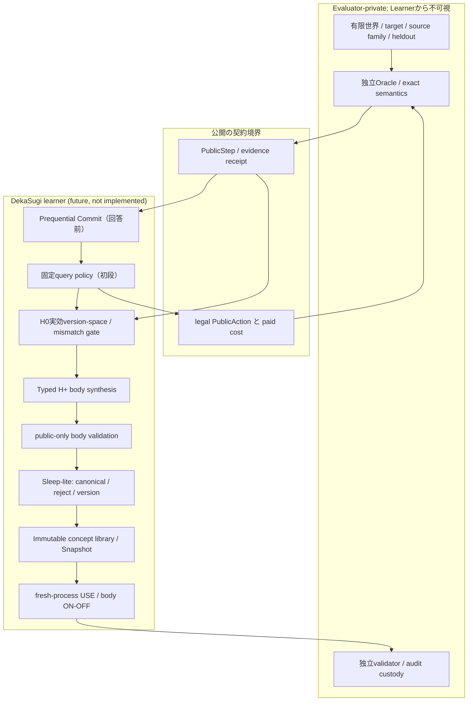

# R0-D-20261104 — 因果識別先行の概念獲得アーキテクチャ精密化（紙上・未承認）

id: GATE-R0-D-20261104-CAUSAL-ARCHITECTURE
status: proposed_for_muse_review / paper_only / no_go / no_execution
updated: 2026-11-04
tags: gate-r0, architecture, causal-attribution, effective-closure, prequential, wake-sleep, research-method

**性格:** [DV1〜DV10正式回答](R-20261104-03-development-direction.md)の追加技術説明。[#168](https://github.com/ryonakayama234/DekaSugi/issues/168) R0-B〜Eに従属し、単一の正式方法文書が査読・凍結されたことを意味しない。研究系列を増やす提案ではなく、実装禁止のまま**証明すべき主張の境界を狭める**もの。[Muse精査](R-20261104-02-muse-review.md)の条件を反映する。

## 1. 機構M・新規性N・実用U・転移Tを別々に判定する

| ラベル | 最低限必要な証拠 | これだけでは主張できないこと |
|---|---|---|
| **M / acquisition mechanism** | 公開反例に時系列でアクセス→人手でtargetを書かずにtyped bodyを構成→検証とimmutable保存→freshプロセスで実行→**同一公開履歴・同一policyでbody ON/OFFの予測差** | 新しい意味論、計算の正味節約、独立family転移 |
| **N / semantic novelty** | 学習bodyと**初期に利用可能な全実効macro・lookup・dispatcher表現**との意味同値性を、指定有限領域で判定。人手で与えたH+構成子も明記 | 構成子そのものをAIが発明したという主張 |
| **U / bounded utility** | 同等H+、公開情報、学習+USE費用、容量、照会予算を許すSTATIC/episodic/fixed-macro等に対する前登録済み独立fresh差 | 無制限最適計画器超え、一般知能 |
| **T / cross-family transfer** | 生成器上流機構が異なる独立familyの未見分布、前登録のgroup split、role renameを独立familyに数えない | 同型リネームやseedの増加のみでの転移 |

Mは**出来事を特定する機構証明**、Nは既知演算の再発見との峻別、Uは**本来のVISION-001の性能目標**、Tは拡張目標。Mだけで「DekaSugi完成」「概念の意味的革命」と言わない。[Muse MQ5](R-20261104-02-muse-review.md)に従い、**M成立かつN=NULLかつU=NULL**は矛盾のない結果として残す。

重要な追加反証：body OFFで成績が落ちても、単に**そのbodyに依存するよう実装した**ことの証拠である可能性がある。したがってMの操作的成立は認めても、U・Nには十分でない。介入ログには替わりに使えた候補・探索費用・abstainを併記し、「身体を壊してベースラインに勝った」という因果錯覚を避ける。

## 2. H0の「言語不足」と「システム全体の能力不足」の厳密な差

**定義（紙上提案）:**

- `H0_object`: 初期の型付きDSLで直接表現できる純粋関数集合。
- `H0_effective(B)`: 初期primitiveとmacroに加え、**Kernelの状態条件分岐、候補選択、履歴記憶、lookup、反復計算、実行予算B** を含めたシステム全体が実現できる予測方策集合。
- `Hplus_effective(B)`: 同等の周辺Kernelと許可済みメタ構成子を持つ方策集合。
- `G_object = min_{h∈H0_object} L(h) - min_{h∈Hplus_object} L(h)`。
- `G_effective(B) = min_{h∈H0_effective(B)} L(h) - min_{h∈Hplus_effective(B)} L(h)`。

**判断規則:** `G_object>0`だけで「実効表現修復が必要」と結論しない。たとえば初期DSLが単項のみでも、Kernelが `(x,z)` を見て候補 `0/1` を選択できるならXORは実行可能。さらに任意の有限真理値表を記録・参照できる場合、有限2bit世界に対する実効**意味**不足は消え得る。このとき新しいbodyの利益は**表現圧縮や計算効率U**であって、非表現可能性M0の証明ではない。

`B`を制限して差が生まれた場合は **resource-bounded gap** と呼び、純粋な意味的非表現可能性と区別。公平性には (a) 機構のON/OFFで同じ情報と予算、(b) 弱いH0だけに条件分岐を禁じない、(c) STATIC-H+が持つ構成子を学習者だけでなく対照も使える、が必要。これを満たさないRは**有限診断器のthought-test**以上の証拠にならない。

**重要な訂正可能性:** この文書のR toyは初めから**限定H0のdiagnostic witness**に留める。実効H0を公平に強くすると `G_effective=0` になり得ることは成功条件に隠さない。独立family向けの難しい新世界を追加して見かけの陽性を作ることはR0の仕事ではない。

## 3. N / S / R / E：4つの紙上結果を混同しない

| ケース | 明示する真実 | 公開情報・探索 | 正しいゲート診断 | 誤判定 |
|---|---|---|---|---|
| **N 情報なし** | `fA=x`, `fB=x AND !z` | 合法照会 `(0,0),(0,1),(1,0)` で両者は同じ | `UNIDENTIFIABLE`。新しいbodyを採用しない | 「もっと訓練すれば発見できる」 |
| **S H0十分** | `f=x` | H0中に `x` がある | `SUFFICIENT_H0` | H+で式を作っただけで概念修復 |
| **R 限定表現不足** | `f=XOR(x,z)`; `OR`も比較 | 公開 `(1,1)` が両者を識別可能。全4点の有限表 | `MISMATCH_CANDIDATE` → H+でpublic構成・検証 | 対照能力を狭めたまま「実効H0不足」と宣言 |
| **E 探索未完** | `f=x` がH0に存在 | 確認予算が尽き `x` に到達前で停止 | `SEARCH_INCOMPLETE` | `MISMATCH`や `REPAIRABLE` と誤診 |

**診断優先:** `INVALID`（漏洩・不正契約）最優先 → `UNIDENTIFIABLE` → `SEARCH_INCOMPLETE` → `SUFFICIENT_H0` or `MISMATCH_CANDIDATE` → `REPAIR_VALIDATED` → `NOT_CERTIFIED`（必要証明の欠落）。形式的に排他的にできない境界は`UNKNOWN`で留める。これは実装済みステータスではなく、将来の状態遷移契約案。

**独立性:** 4行はテスト用に人間が選んだ**意図的な負・正対照**であって陽性率の母集団推定ではない。役割置換や異なるソースindexの件数を独立family数にしない。

## 4. 役割分離：提案する最小アーキテクチャ

**モジュール構想:** `protocol`はversion付きimmutable record、`evaluation`はprivate sourceとpublic accessの唯一の仲介、`representation_repair`（将来の新隔離モジュール候補）は不一致診断と型付き候補生成、`runtime`は純粋ASTのみ、`library`はdigest付き保存、`learning`はSleep-lite、`kernel`は当面の固定query/dispatch、`metrology`は費用と時間順証拠の監査。**既存mainのファイルを変える指示ではない。** [ARCH-001](../architecture/system.md)・[ARCH-002](../architecture/contracts.md)・[AGENTS](../../AGENTS.md)の既存責務を基本とする。

| Record案 | 不可欠なデータ | 禁止する流入 |
|---|---|---|
| `PublicStep/v1` | version、episode/seq、legal-action、選択action、paid cost、時刻、observed input/output、公開前提digest | target law ID、hidden seed、family private label、heldout答え |
| `HypothesisCertificate/v1` | H0閉包仕様hash、enumeration completeness、適合候補集合、counterexample、budget、`SUFFICIENT/UNKNOWN/MISMATCH` | 実行していない探索を完了扱い |
| `ConceptBody/v1` | typed AST、構成子版、公開由来trace、依存、検証receipt、semantic equivalence label | evaluator-provided target program、未検証Python callback |
| `Snapshot/v1` | 親digest、canonical body digest、registry version、承認/保留状態、生成手続・時系列 | 後からの上書きによる学習履歴消去 |
| `UseTrace/v1` | 同一world/公開履歴/方策条件、fresh process ID、body ON/OFF、実dispatch、予測、abstain、CPU/primitive | 初回USEからscoreを見て候補を改訂 |
| `ScoreReceipt/v1` | source/split、family単位、比較arm、事前指定estimand、完全費用、digest chain、独立原本 | 学習者によるprivateラベル読取り |

## 5. 最初に固定する費用・因果比較

**費用:** `C_total(n)=C_train + C_sleep + C_storage + n*(C_inquiry + C_use + C_verification)` をlearner・比較器で同じ単位（paid action、原始演算展開数、wall、CPU、RSS等）に記録。予測精度/abstentionと費用の複数軸を**勝手に混ぜた単一スコアへ後付けしない**。重みづけは科学評価より前に決める。nを大きくすれば必ず回収できるとは限らない。

| 対照arm | 固定するもの | 何の説明を退けるか |
|---|---|---|
| body ON / body OFF, rank固定 | 同一Snapshotと公開履歴、許可された代替操作、資源制限 | 実bodyが呼ばれたか（Mの最低条件） |
| policy/rank-only | body/library同一、検索優先度のみ学習 | 成績差がbodyではなく選択癖ではないか |
| episodic retrieval | 同じ観測・情報量と記憶/計算費 | 実体は事例の丸暗記ではないか |
| fixed macro / STATIC-H+ | 同等H+演算・型・サイズ・探索計算・アクセス | 言語能力の不公平な追加ではないか |
| evaluator-only upper bound | 事前固定の理想情報を明記し分離 | 物理・情報的な不可能性や理想天井との差 |

無制限最適STATIC-H+は**上限参照**。同じ情報と方策空間を網羅的に最適化するものに学習器が勝つような成功基準は設定しない。[既存ドシエ§2](GATE-R0-20261104-design-precision.md)。Mは機構、Uは有限資源での実利として分ける。

## 6. Wake/Sleepを独立した知的行為として主張する条件

初段に存在するのは「睡眠に似せた正式なフェーズ名」ではなく、**未認証候補を破棄・正規化してimmutable snapshotへ移す行政的整理**。これを自律的Sleep学習と呼ばない。後続でSleepが (i) 複数エピソード横断で共通サブプログラムを新たな抽象へ統合、(ii) 固定されたMDLコード長を下げ、(iii) Sleep-OFF同容量対照よりfresh課題で予測・費用を改善、の少なくとも(iii)を含む識別可能な差をもたらして初めて**Sleepによる獲得/改善**を追加主張する。MDLのコード長表は試験前に固定し、自己生成DREAMを外部の新証拠として数えない。

Active Learningについても、初回の公開照会は固定/非学習policyでよいが、これを「適応質問方策を学んだ」と記載しない。`G_expr>0`、公開識別可能性、`G_inq>0`は別の意味。[#166](https://github.com/ryonakayama234/DekaSugi/issues/166)の後に選択的にworldを都合よく調整して#166のSTOPを書き換えない。

## 7. R0の成果物を増殖させないための境界

R0で必要なのは、(1) 実効H0閉包の定義と誤判定反例、(2) N/S/R/Eの有限な紙上証拠、(3) source→public→learner→validator境界、(4) M/N/U/Tと比較arm、(5) Ownerの決定文書の**五項目を1つの査読対象方法書に転記すること**だけ。このドシエやDV回答を積み重ねたこと自体はR0完了の証拠にしない。R0-E GO→別Owner承認→隔離された**工学診断実装**、さらに別承認→fresh M評価、別承認→正式U評価、という権限境界を維持。

**最も強い失敗条件:** H0の全システム能力を公平に数えるとRの表現差が無い、あるいは同一情報で構成できる固定H+に比較可能なU仮説が無い場合。弱いH0を作り直して見かけの「新知能」を演出するのではなく、**表現修復→有限資源での抽象圧縮・汎化**へ研究問いを変更するか、当該系列をSTOPする。

## 8. 先行研究との対応（DekaSugiでの証拠ではない）

- [DreamCoder (Ellis et al., PLDI 2021)](https://doi.org/10.1145/3453483.3454080): ライブラリ抽象化と探索方針の共同学習が有効な先行例。ただし我々の初段でNNや二方向Sleepを必要条件にはしない。
- [Learning Higher-Order Programs through Predicate Invention (Cropper et al., AAAI 2020)](https://doi.org/10.1609/aaai.v34i09.7113): 発明された述語も人間のメタ規則・仮説空間に制約される。新しい名前と新しい物理的演算原理を混同しない。
- [General Identifiability and Achievability for Causal Representation Learning (Varici et al., AISTATS 2024)](https://research.google/pubs/general-identifiability-and-achievability-for-causal-representation-learning/): 介入と識別条件が重要であることを示す別設定の理論。DekaSugiのtoy識別可能性を自動保証しない。
- [The Prequential Approach (Dawid, JRSS A, 1984)](https://doi.org/10.2307/2981683): 結果を観測する**前の**予測と、観測後の逐次評価を区別する原則。
- [Stochastic Complexity (Rissanen, JRSS B, 1987)](https://doi.org/10.1111/j.2517-6161.1987.tb01694.x): モデル符号長/複雑度を用いる整理の理論背景。コード長の最小化だけで未知課題Uは保証されない。

**査読対象の未決論点:** H0_effectiveの公平な境界／toyのM証拠上限／最初のSleepの名義／MからUへ進むOwner基準。回答者の新規案であり、Muse・Ownerの合意は未了。再査読先：[追加質問票](Q-20261104-04-to-Muse-development.md)。

## 9. 本企画固有の長期仮説との接続（いずれもR0の実装項目ではない）

この段階の**世界モデル・概念body・利用方策**の分離は、Ownerがこれまで検討してきた次の設計メモに接続する。ただし以下は**ユーザー提供の研究構想**を整理したもので、GitHubの正式実験結果ではない。

| 長期仮説 | Dルートに保存する共通インターフェース | 初段で主張しないこと／将来の反証 |
|---|---|---|
| **知的行為の共通化**（ギター/三味線、選択・反復・比較の例） | 各技能を**目的（intent）・前提・型・効果・不変条件・実装body**に分ける余地を持つ | 共通名で呼んだだけでは転移でない。異なる独立の環境familyで学んだ関係の再利用を後日確認する |
| **ON/OFF技能活動の自己組織化** | `UseTrace`の`available/selected/executed/completed`を別記し、時刻・cost・結果の由来を付ける | 共起・次のON/OFFの予測だけでは改善や因果関係でない。方策の模倣と意図的body/dispatch介入を比較する |
| **予測失敗からの新概念形成** | `MismatchCertificate`を`UNIDENTIFIABLE/SEARCH_INCOMPLETE/H0_MISMATCH`に分け、原因に応じて情報取得・探索・表現修復を切替可能にする | 新しい構文の導入だけでは意味的原理の自律発明でない。公開反例とfresh予測改善が必要 |
| **多様な世界への適応**（ゲーム・アプリ・言語を行為環境とみなす） | 将来`observe/legal_actions/step`の抽象的境界へ接続できるが、内部表現の同一化は強制しない | GUI・自由文章生成の正しさは2bit世界から導かれない。現段階の正解判定器を移植できると仮定しない |

従って「**世界で予測する→足りない表現を診断する→型付きの概念bodyを構成・検証する→外部化し再利用する**」を研究の**背骨**とする。一方「行為の共通化」「技能活動学習」「自律的学び方の獲得」は**新しい研究系列を今起動する許可ではない**。DによるM/N/Uの帰属が確立し、Ownerが別途判断した後の拡張候補として保存する。
