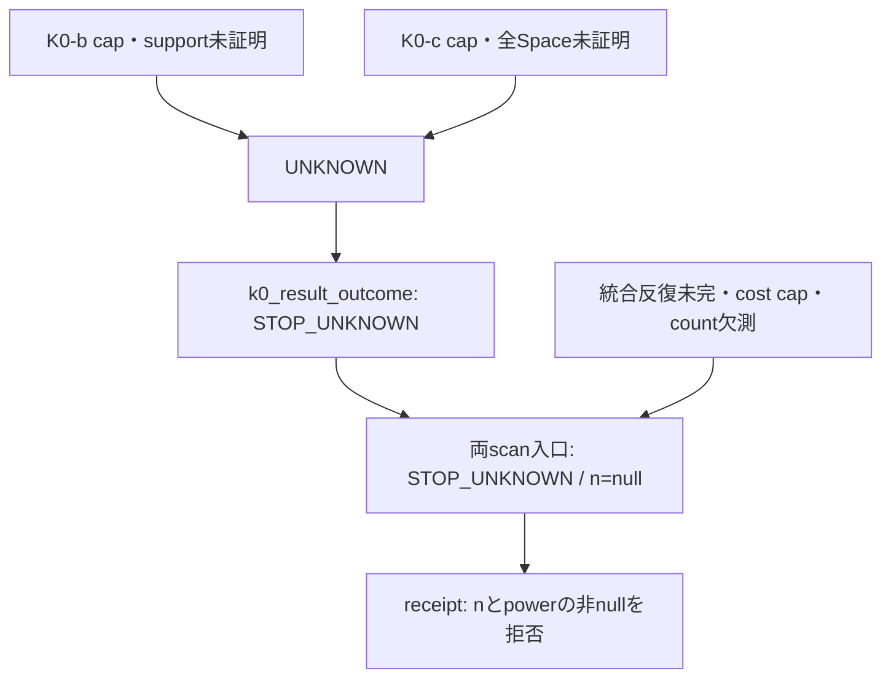

# WORLD CAL PR #206 — 最終監査依頼と fail-closed 証跡

id: WORLD-CAL-FINAL-AUDIT-REQUEST-20261112-01
status: FINAL_AUDIT_REQUESTED / K0_UNKNOWN / CPU_STOP_UNKNOWN / NOT_CAL_AUTHORIZED
updated: 2026-11-12
tags: world-cal, final-audit, negative-tests, sound-incomplete, stop-unknown

## 1. 正本と依頼する判断

正本は[監督者進捗監査3・コメント6820712792](https://github.com/ryonakayama234/DekaSugi/pull/206#issuecomment-6820712792)。既存の実装GO内の継続であり、本提出は「全探索が完走すること」ではなく「未完了を確定結果へ変換しないこと」の最終監査を依頼する。過去の[coverage audit](WORLD-CAL-IMPLEMENTATION-COVERAGE-AUDIT-20261111-03.md) §5 の「完全探索の証明まで最終監査依頼不可」という条件は、監査3の基準で更新される。ID-only の合成再現性は監督者が独立にPASS済みで、本提出で実CALについての主張へ拡張しない。

K0とCPUは**健全・不完全・STOP_UNKNOWN前提**として審査を依頼する。全ソースの科学的正しさを有限テストだけで証明したという意味ではない。確認範囲は下記の閉じたAPI経路とソースmanifestであり、最終PASSは監督者の判断を待つ。`algorithm_digest=null`、`CAL_AUTHORIZED=false`。CPU feasibilityはSTOP_UNKNOWNのまま。wall予算は将来のCAL_AUTHORIZED記録で扱う運用規則であり、この提出では設定・実装・再計測しない。

## 2. 完全と主張する範囲／主張しない範囲

| 対象 | 完全と主張する範囲と根拠 | 未証明／UNKNOWNになる範囲 |
|---|---|---|
| K0-b source index | 固定384法則行の正準異法則対はC(384,2)=73,536。登録された長さ・24置換・8パターンのindexと有理数質量1。前回の監督者検算と既存の機械テスト。 | indexの完全性はdemo・trial・historyの同時support完全性ではない。実際の全履歴探索は未実施。 |
| K0-b pair DP | **明示的に渡した有限仮説対だけ**について、同じ公開履歴では同じactionを選ぶAND/OR再帰。TRAIN/EVAL分離。小さい人工例における完結PASSと、その直前capでのUNKNOWNを照合。 | これは登録全法則・全instanceのPASSではない。node cap、再帰・メモリ不足、意味処理の不完備はUNKNOWN。有限入力に対する一般的な正しさの独立確認も最終監査の対象。 |
| K0-b 全source scan | 現headは**確定PASS/FAILを発行しない**。名目73,536行・呼出側の辞書receiptだけではjoint supportを認証できないため、全数に見えてもUNKNOWN。 | 認証済みjoint demo/TRAIN/EVAL/history完全列挙の検証器は未実装。将来この防御を解除するには実装変更・独立監査が必要。実行時間を増やすだけでは解除されない。 |
| K0-c shortest path / L90 helper | 与えた人工cellの有限BFS。完結した距離だけを使用し、UNKNOWN・到達不能を捨ててL90を再計算しない。 | helper入力のreceiptは外部supportを認証しない。実CAL代表選択や登録全supportのL90認定はしていない。 |
| K0-c 全Space curve | 登録Spaceに含まれるSEQ/ATOM部分集合だけでも14^63構文という下界。cap<=2,000,000では全列挙不可なのでUNKNOWN。cap水増しも拒否。 | 同値縮約、完全な型付きSpace検証、最良oracle曲線・全7対照曲線の独立完全証明はない。現headの公開curve APIはCOMPLETE・飽和・機会gapを認定しない。 |
| 統合scan / route | K0の継続可能結果がない場合は開始せずSTOP_UNKNOWN。途中失敗・非bool結果・count欠測・小さいnの欠落は確定routeにしない。下記のmockテストで制御経路を検証。 | 真の10,000反復、power、n_required、CPU feasibilityの実測は未実施。mock陽性対照のSTATISTICALは実際のCAL認定ではない。 |

## 3. 今回塞いだ過大確定の余地

1. `k0_outcome`は閉じたstatus集合と**exact bool**の飽和値だけを扱う。UNKNOWN・STOP_UNKNOWN・未実行・欠測はFAILや飽和より優先する。新しい`k0_result_outcome`はCの`status=COMPLETE`を確認するまで`saturated`を読まない。部分curveに`saturated=False`を添えても継続しない。
2. `scan_k0b_pairs`は呼出側の「complete」辞書や名目件数を完全性証明へ昇格しない。iterator例外・cap・部分FAILをUNKNOWNとして扱い、確定failed_pairsを外へ出さない。
3. `exhaustive_k0c_curve`は登録上限超のcapを拒否する。巨大cap＋1programの偽receiptによるCOMPLETE回避路を塞ぐ。iterator・資源例外もUNKNOWNとなる。現在は本来のSpace下界による停止が常に先行する。
4. `scan_authorized`と`route_from_completed_scan`に省略時停止の`k0_status`入力を設けた。前者は不完備反復の例外をSTOP_UNKNOWN結果へ揃え、`and`や全10成分の非bool・矛盾を成功として計数しない。後者は不完備countやboolをMC回数として認めない。MC_R=10,000、999 bootstrap、3シナリオ、整数昇順n、閾値、cost capの規則は不変。

これらは純粋な結果reducerと計算部の契約であり、呼出側辞書・文字列や`CALAuthorization`オブジェクトを外部のOwner承認・OS隔離・出典認証の代用にはしない。任意Pythonの書換えが可能な同一プロセスに対するセキュリティ証明ではない。実CALの起動・署名・秘密管理の認証は別の権限境界に残る。

## 4. UNKNOWNが通過する全下流経路



`complete_l90`は不明距離を`OracleUnknown(STOP_UNKNOWN)`として拒否する。K0-b/cの部分結果を直接数値閾値へ投入する呼出箇所は、この`world_cal`閉包内にはない。scanの確定返却はK0 gateを通った**完全な**最小nの3シナリオ計数に限る。`FINITE_DESCRIPTIVE`へのfallbackはどちらのscanも実装しておらず、不完了からそのrouteを返す経路もない。schema validatorはSTOP_UNKNOWN receiptに非nullのn/powerを認めない。人がstatusを無視して新しい呼出側を書くことまで検査済みとは主張しない。

## 5. 再実行可能なnegative testと証跡

新規[19テスト](../../tests/test_world_cal_fail_closed.py)と[監査runner](../../scripts/audit_world_cal_fail_closed.py)。[生JSON証跡](WORLD-CAL-FAIL-CLOSED-EVIDENCE-20261112-01.json)にcase別返値・対象8ファイルのraw SHA-256・実行環境を保存。tests自身の合否は19/19 PASS、既存36件と合計55/55 PASS。ローカル環境はPython 3.12.14、NumPy 2.3.5、cryptography 50.0.0であり、登録CI環境との差は隠さない。CIは既存pinのPython 3.12.16／Ubuntu 24.04／requirements.lockで同じrunnerを再実行し、exact head付きJSONとverbose logをartifactに保存する。CI完了・run URLはPRコメントに記載する。

| 停止対象 | 強制条件 | 必須結果 |
|---|---|---|
| K0-b TRAIN/EVAL | 実pair DPにcap=1、または完結陽性に必要なnodesより1小さいcap | UNKNOWN、陽性への変換なし |
| K0-b 全scan | 途中終了／iteratorメモリ例外／偽の完全receiptと全数のmock行 | UNKNOWN。mock PASS/FAIL/UNKNOWNのいずれでも確定認定しない |
| K0-c 距離→L90 | 実BFSにcap=1 | UNKNOWN／length=null、L90はSTOP_UNKNOWN例外 |
| K0-c 全Space | cap=1・登録2M・上限超の巨大cap | UNKNOWN、curve・saturatedなし |
| K0-c 内部列挙 | **テスト内だけ**下界を1に差替え、内部cap・欠落・例外を発火 | 部分curveは破棄。productionの下界・上限は変更しない |
| 統合scan途中 | 5件のmock成功後、6件目でPowerUnknown等の停止 | STOP_UNKNOWN、n=null、power=null、後続nなし |
| 統合scan cost cap | 反復をmockし、実際のcost比較の入力だけ20,000,001へ差替え | STOP_UNKNOWN、n=null。wall timeoutを検証したという意味ではない |
| 下流route | K0 UNKNOWN、部分curve、真に見える文字列、欠測count、小さいnの欠落 | 確定route・n_requiredへ変換しない |
| 陽性対照 | 小さい完結DPと、30,000個の一定mock boolによるscan制御 | guardが常に停止するだけのテストでないことを確認。実powerではない |

再現コマンド:

```sh
python -m unittest discover -s tests -p 'test_world_cal*.py' -v
PYTHONPATH=. python scripts/audit_world_cal_fail_closed.py --output world-cal-fail-closed.json
python scripts/check_docs.py
WORLD_CAL_SOURCE_HEAD=<submitted-head-sha> python scripts/build_world_cal_source_manifest.py --output exact-head-manifest.json
```

scanテストでは**全ての呼出しの前に**`run_one_repetition`をmockする。authorizationはダミー構造、key=None。乱数・正式CAL seed・split・実simulationを生成しない。K0のテストは明示した小さい人工世界とmock列挙のみであり、登録法則のK0本実行ではない。

## 6. 提出headとmanifest

[candidate manifest](WORLD-CAL-ALGORITHM-SOURCE-MANIFEST-20261111-01-candidate.json)は55ファイルを閉包とし、今回の実装・テスト・runner・生証跡・本書・索引・ARCH-001/002・AGENTS・workflowを含めてraw byte SHA-256とsizeを更新する。manifest自身は自己参照を避けて除外。commitは自身のSHAを埋め込めないため、tracked manifestのhead binding markerは維持し、**CIはPRのhead SHAそのものをcheckout**して全55行を再生成・全件一致を検証する。exact SHAを持つmanifestはCI artifactに保存し、そのSHAを最終監査依頼コメントで指定する。

`algorithm_digest`, `split_digest`, `seed`はnull。監督者の最終PASS後にだけalgorithm_digest固定可否を扱う。本提出によるdigest固定、CAL_AUTHORIZED、CAL・K0本実行・power simulation、sealed split・seed生成、FROZEN、実験GO、merge／ready化はない。
