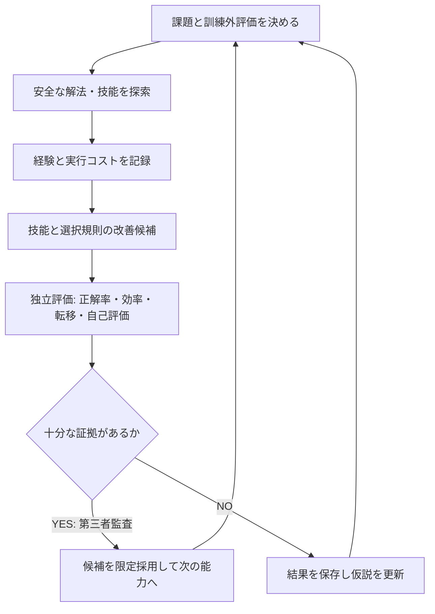

# DekaSugi — 能力成長ロードマップ

id: ROADMAP
status: agreed direction; experimental stages subject to evidence
updated: 2026-10-24
tags: milestones, roadmap, capability-growth, verification

本ロードマップは[長期ビジョン](vision/mission.md)から「何の能力を増やすか」で逆算する。日程・性能達成・汎用化は約束しない。**コードの完了と能力の実証は区別する。**

| Phase | 研究能力 | 成立条件 | 状態 |
|---|---|---|---|
| 0 | 研究基盤・追跡 | AGENTS/INDEX、Mermaid、データ契約、実験とPRが対応 | 既存基盤あり |
| 1 — EXP-0001 | 解法探索 | 決定的DSL・検証・測定が再現可能 | baseline実装・技術的検証済み |
| 2 — EXP-0002 | 技能候補の自動発見 | 実行安全性・探索上限・再利用性の独立監査 | PR #6、独立レビュー待ち |
| 3 — EXP-0002B | 技能価値の学習 | 事前固定した未知課題でAlways-ON/OFFと比較、正確性/費用を測定 | 設計段階。PR #8→#10（旧v1履歴）→#12（現行v2事前登録）、#13（監査のDraft）。Kernel未実装 |
| 4 — EXP-0003 | Wake–Sleep / Dream | 練習課題・技能候補を生成し、未使用課題で改善を再現 | 将来の研究構想 |
| 5 | 能力の地図と学習対象の選択 | 限界・不確実性・学習効果の予測を独立評価 | 将来の研究構想 |
| 6 | CSV/JSON等への転移と実用化 | 正確性・安全な権限・来歴・総実行費用が許容できる | 将来の研究構想 |

## 成長指標と進行ゲート

**次に優先すること:** [PR #6](https://github.com/ryonakayama234/DekaSugi/pull/6)のP1安全性再レビューと、[PR #9](https://github.com/ryonakayama234/DekaSugi/pull/9)の計測系の同期を先行。EXP-0002Bのseed重複・旧主指標の問題は新しい[事前登録v2（PR #12）](https://github.com/ryonakayama234/DekaSugi/pull/12)で**実装前に改訂済み**。旧v1は履歴として保存。文書の競合・実装境界は[監査PR #13](https://github.com/ryonakayama234/DekaSugi/pull/13)で整理する。Kernel実装・独立FINAL結果は現時点で存在しない。

[合意したビジョン](vision/mission.md) / [全体構成](architecture/system.md) / [データ契約](architecture/contracts.md) / [文書索引](INDEX.md)。
