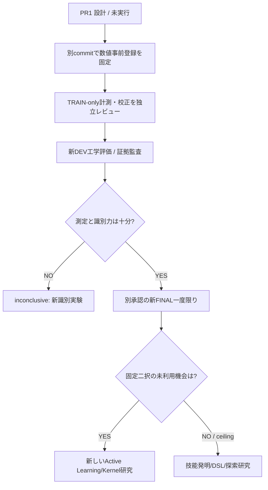
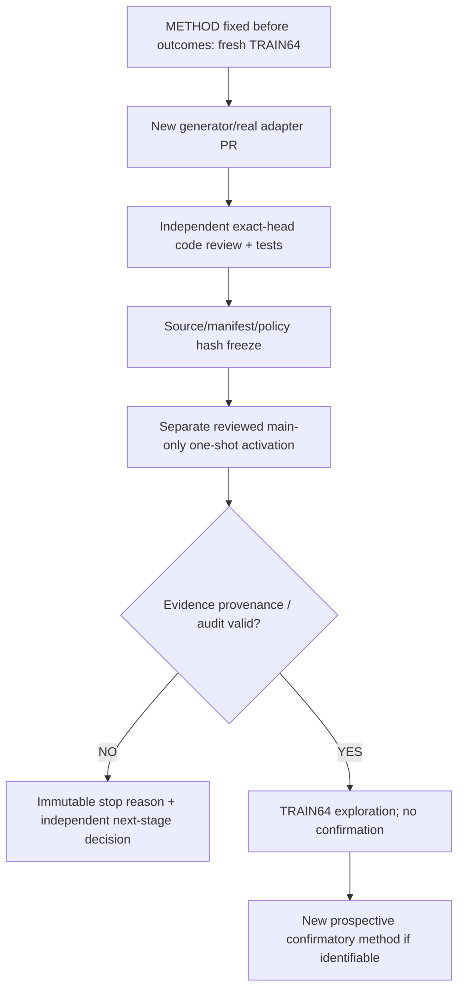

# Research roadmap

id: ROADMAP
status: proposed
updated: 2026-10-28
tags: milestones, roadmap, planning

| Phase | 課題 | 成立条件 | 状態 |
|---|---|---|---|
| 0 | AGENTS / 図 / データ契約 / 実験記録の基盤 | 目録・計画・検査・PRの導線が存在 | completed (CI verified) |
| 1 | EXP-0001: 型付き小規模DSLの合成器 | 同じ設定で候補探索・検証・計測を再現 | completed — technical acceptance PASS |
| 2 | EXP-0002: 部分プログラムを技能候補化 | 候補抽出が決定的で、探索の変化を比較可能 | evaluated — functional PASS; candidate not promoted |
| 3 | EXP-0003: Wake–Sleep + Dream | 合成問題と独立評価で非学習baselineと比較 | candidate |
| 4 | 現実のCSV/JSON資料・記憶と接続 | 出典・権限・再実行可能性を守る | candidate |
| 5 | 小型学習型Kernel・領域間転移 | 保留課題で再現可能な利益を確認 | research idea |

次の機能を作る前に、[研究目的](vision/mission.md)と[EXP-0001仕様](specs/EXP-0001.md)を確認。
日付や性能達成の見込みは確定しない。

## EXP-0002B preregistration integration checkpoint (2026-10-25)
- SEC-004とMEASURE-0001はmainに統合済み。[PR #18](https://github.com/ryonakayama234/DekaSugi/pull/18)のcanonical primitive meterを学習に使う。
- [事前登録v2](../experiments/EXP-0002B/plan-v2.md)を実装前の唯一の方法正本として統合。v1は歴史資料、採用ゲートとseedはv2で凍結、結果を見て再調整しない。
- 次段階：別PRでgenerator・8次元特徴・TRAIN-only KNN・PolicySnapshotを実装し、凍結とレビューを経てFINALを開く。
- 目的は限定された文字列family上の技能の使い分けの検証であり、広範な領域転移・自律学習の実証ではない。

## EXP-0002B TRAIN-only実装 (2026-10-25)
- 計画v2を不変更で使い、別PRでsplit generator、8D features、TRAIN 144 paired comparison、conservative 5NN policy and hash snapshotを実装する。
- 後続のDEV/FINAL研究評価は独立レビューとfreezeの後。今回の実装・テストだけで改善・汎化成功を主張しない。[監査記録](../experiments/EXP-0002B/reviews/20261025-train-only-kernel.md)。

## EXP-0002B 評価器の実装ゲート (2026-10-25)
- 凍結したTRAIN方策でのみDEV smokeとFINALを評価。PRのCIはTRAIN-fixtureだけ、main pushではDEVだけを実行。
- FINAL112問の実行トリガーは評価コードの独立レビューとDEV証拠取得の後に別PRで開く。学習方法のretune、性能の過大主張は禁止。[評価監査](../experiments/EXP-0002B/reviews/20261025-evaluator-gate.md)。

## 2026-10-25 マイルストーン：EXP-0002B DEV工程
- [PR #26](https://github.com/ryonakayama234/DekaSugi/pull/26)が競合解消・PR CI success・最新head Codexレビュー後にmain `f81b656`へ統合。
- [DEV48のrun](../experiments/EXP-0002B/runs/20261025-dev-smoke.md)の工学的検査は完了（全arm40/48監査正解、誤成功0）。方策はDEVから再学習していない。
- 次の研究ゲートはFINAL112の独立activationレビュー。**現時点では起動禁止**。採用判定、Wake-Sleep、領域転移の結果は未取得。

## 2026-10-25 次の品質ゲート：EXP-0002B FINAL112 の1回限りの起動（PR #28）
- 人間が最終監査からFINAL112まで承認。凍結9ソースのGit blob hash照合に成功、DEV48は工学的成功、方法v2を変更せず独立PRで起動ゲートのみ追加。
- PR #28はCIと**最新headのCodex独立レビュー**が通るまでmainへ統合しない。前節の「現在地」はDEV実施時点の履歴である。
- 成功したレビュー後に指定squash-merge subjectと初回main pushでFINALを一度だけ評価、全結果の監査と学習・推論CPU償却を別記。失敗条件があればFINAL開始前に停止し、成功・失敗を同じ採否基準で報告する。[起動ゲート](../experiments/EXP-0002B/reviews/20261025-final-activation.md)。
- EXP-0003/Wake–Sleepや技能の自動昇格は引き続き未着手。FINAL評価後の別提案・合意が必要。

## 2026-10-25 研究上のマイルストーン：EXP-0002B FINAL112完了
- [PR #28](https://github.com/ryonakayama234/DekaSugi/pull/28)：最初のCodex P1を文書同期で修正、最新head `a4ee859`に対する独立レビューは指摘なし、CI #40176002565成功、PR上FINALをスキップ。
- main `37b3075`で[CI #40176125696](https://github.com/ryonakayama234/DekaSugi/actions/runs/40176125696)が一度だけFINAL112を実施。独立に再集計し、正確性・OFF比削減・ON比削減・OOD・尾部悪化の五つの数値基準すべてPASS。結論 `metrics_pass_not_promoted`（技能正式昇格なし）。
- 学習費用11,904 primitive calls、推論CPU約29.68msを含む総費用利益は示されず、7 family/bootstrapの区間は0を含む。正解が80/112にとどまるのはreverse/replace_first未解決のため。[実測FINAL](../experiments/EXP-0002B/runs/20261025-final112.md)。
- 本docs-only PRで限定FINAL起動トリガーを削除。次のEXP-0003（Wake–Sleep / Dream）へ進む前に、未知の能力を新たに構成する方法と独立保留評価を**別途提案して合意**する。

## EXP-0003A: 設計と事前登録 (2026-10-25; proposal in Issue #30)
- [plan-v1](../experiments/EXP-0003A/plan.md) / [spec](specs/EXP-0003A.md) / [ARCH-001](architecture/system.md) / [ARCH-002](architecture/contracts.md) / [UI map](architecture/ui-panels.md)を実装前に揃える。PR1はdocs-only、EXP-0003Aの実測は存在しない。
- 4arm (B0 primitive only, B1 WAKE+SLEEP, B2 random Dream, B3 counterfactual Dream) を同じ原始演算・評価制約・新FINALで比較する。Dream2条件はfamilyと件数を揃える。
- PR2 WAKE/SkillProposal、PR3 Dream/Policy、PR4凍結・独立評価の順。各ゲートで図/契約/実験記録/UI責務を同期し、重大な方法変更・FINAL起動は人間と別合意。正式技能昇格なし。
- EXP-0002B元Artifactは2027-01-23期限。元ZIP・JSONをSHA一致で長期保存する別運用作業が必要（PR1では実データ保存しない）。

## 2026-10-26 EXP-0003A PR2：TRAIN限定WAKE/SLEEP実装
- [Issue #32](https://github.com/ryonakayama234/DekaSugi/issues/32)の境界で8 family×20問の固定TRAIN生成器、ID-v1、監査付きWakeEpisodeと成功Episodeの部分ASTに基づくSkillProposal候補を実装。PR2はDream/DEV/FINAL/標準Registry採用を起動しない。
- 学習の意味論は、監査合格した実際のWAKEプログラムのみを根拠にする。既存`discover_skills(tasks)`での再探索を実施しない。候補0件や不一致は研究方法を勝手に変更せず報告する。
- 現在の実装状況は[run index](../experiments/EXP-0003A/runs/README.md)が正本。CI、独立`@codex review`で監査してからmain統合する。

- PR2 CodexレビューP1×2/P2×1に対し、学習器からの監査元情報隔離を維持しつつ、独立WakeReceiptと監査元データ・工数計測の証拠修正を行う。ユーザー承認済みだが、独立レビューを再通過するまでmain統合しない。

## 2026-10-26 EXP-0003A PR4：評価前ソース/データ/方策凍結（Issue #36）
- TRAIN/DREAMのPR3工学結果を安定hashで固定するため、4splitの生成元レコード・重複/seed・ソースGit blob・トップ技能・B1/B2/B3方策・B2/B3選別順序をhash-only preflightし、独立レビュー後にimmutable `freeze-v1.json`をピン留めする。
- DEV64/FINAL128の参照例はデータハッシュを作るためにだけ生成し、方策選択・DSL探索・検証・正答結果は一切実行しない。DEVは凍結後に別の工学評価工程で、FINALは新たな人間承認付き一度限りのPRでのみ採点可能にする。

## METRO-0001 (2026-10-27): 測定科学の横断研究基盤
- Issue #38のもとで、達成能力・効率・可塑性・保持・転移・能動的適応を操作的に区別する。測定器のデータ品質を能力スコアに混合しない。[METRO ontology](metrology/ontology.md)。
- PR1: docs-onlyでMetricSpec・EvidenceEnvelope・科学的妥当性・ARCH-001/002・UI・CAL-01の事前登録を固定する。[CAL-01](../experiments/METRO-0001/plan.md)。
- PR2: 初回実装はstdlib-onlyのread-only metrology reducer/fixture校正。旧FINALを新仮説の確認試験には再利用せず、EXP-0003A DEV64/FINAL128を起動しない。
- 校正PASSは計量器の工学的品質の証拠であり、技能の有効性や汎用知能の実証ではない。

## METRO-0001 CAL-01 PR2 synthetic calibration (2026-10-27)
- [run](../experiments/METRO-0001/runs/20261027-cal01-synthetic.md): F01–F08 8/8工学校正PASS、GitHub CI #40457141475、unittest82件PASS。人工fixtureの集計検査であり知能能力の改善ではない。
- Source/metrics/受入済みpreregistrationは変更せず、PR2のレビュー終了まで正式完了としない。

## METRO-0001 CAL-01 fixture manifest / metrology run checkpoint
- [original-byte audit](../experiments/METRO-0001/runs/20261027-cal01-provenance-verified.md) records CI #40458100322 / source `0a01cdb` / F01–F08 8/8 / 86 tests PASS / artifact ZIP and raw fixture/report hashes / CPU+wall sampling. Calibration only; independent final head review/merge gate remains.

## METRO-0001 scoped completion — 2026-10-27
- [独立校正採用決定](../experiments/METRO-0001/reviews/20261027-cal01-adoption.md)に従い、PR #39/#41 merged、post-merge CI #40460951680成功。M1–M4はsynthetic CAL-01でengineering calibration PASS。
- メトロロジー一般化、実際のTRAIN証拠接続、可塑性・保持・転移の研究は後続候補であり、**未検証の知能能力の採用ではない**。EXP-0003AのFINALは独立承認まで封印。

## EXP-0003A PR5 (2026-10-27): independent DEV evaluator
[Issue #44](https://github.com/ryonakayama234/DekaSugi/issues/44).
The frozen source/data/policy baseline is in main. New work lives in
`packages/exp0003a_dev` to preserve the frozen 14 blobs and separate
learner/evaluator roles. First gate: fixture/TRAIN-only tests, exact-head
CI and independent review; no DEV in PR. Second gate: separately reviewed
main-push engineering DEV64. FINAL128 remains sealed and requires a
distinct explicit approval. [spec](specs/EXP-0003A-DEV-EVALUATOR.md).

## EXP-0003A DEV64 independent engineering readout (Issue #46; trigger PR)
- Integrate one reviewed `push/main` first-attempt-only activation gate, not
  ongoing CI scoring. Source freeze and snapshot method remain immutable.
- Archive all B0/B1/B2/B3 trial evidence, independent raw-artifact checksum
  audit and costs. Mark failures/inconclusive rather than rerun to optimize.
- Research step concludes only after scored main run + original hashes +
  independent derived metrics are recorded. No inference about FINAL128.

## EXP-0003A DEV64 measured outcome and audit-only recovery (Issue #48)
- DEV64 already scored once on main `26eaf3b4`; original job auditor failed
  exact binary64 clock comparison after all 256 trials. Do not rescore DEV.
- Audit-only review/CI, immutable original SHA prechecks and a distinct derived
  report remain before calling full evidence certified. Preserve public
  metrics in Git and private raw originals in restricted durable storage.
- B3−B2 DEV calls/accuracy/candidates are zero; this is not H3 confirmation.
  FINAL128 remains sealed; no method retuning from DEV.

## 2026-10-28 — OPPORTUNITY-001: 次の研究方向を決める能力機会診断（design-only）

[Issue #56](https://github.com/ryonakayama234/DekaSugi/issues/56) / [仕様](specs/OPPORTUNITY-001.md) / [事前登録案](../experiments/OPPORTUNITY-001/plan.md) / [未実行run台帳](../experiments/OPPORTUNITY-001/runs/README.md)。

既存POLICY-DIAG-001はB2/B3の情報差と行動・費用の収束を**事後的**に示したが、学習余地自体が不足しているのか、Kernelが利用できないのかは未識別。OPPORTUNITY-001は固定SkillCandidateの独立paired OFF/ONと凍結方策を比較する、新規データに基づく次段研究**設計**。既存の旧DEVとFINAL128には触れない。

将来の各ゲートでMERMAID構成図/ARCH-002契約/新規run記録を同じPRに同期し、結果は確証・探索・工学校正を分ける。学習器を拡張するかどうかは研究結果が出てから判断。数値分岐閾値・fresh split/seed・primary estimandは結果を開く前の独立レビューで固定する。PR1自体は新しい測定値や科学的採用を主張しない。

## OPPORTUNITY-001-PILOT-V1 — approved research-method sequence (TRAIN only)

Pilot method: [pilot-v1](../experiments/OPPORTUNITY-001/pilot-v1.md). Implementation/data source lock/results are **pending**, no actual measurements yet. A research result from historical EXP-0003A DEV64 or FINAL128 must not be substituted.

## OPPORTUNITY-001 PR4 — actual pilot implementation path
The new `evaluation.opportunity_pilot` generator and hash-only preflight are implemented without running actual paired outcomes. Next order: independent code review -> source/manifest SHA lock -> independent real-evidence adapter -> one-shot TRAIN-only activation -> evidence decision. Source generation alone is no claim of opportunity or generalization. [Frozen method](../experiments/OPPORTUNITY-001/pilot-v1.md) / [run ledger](../experiments/OPPORTUNITY-001/runs/README.md).
