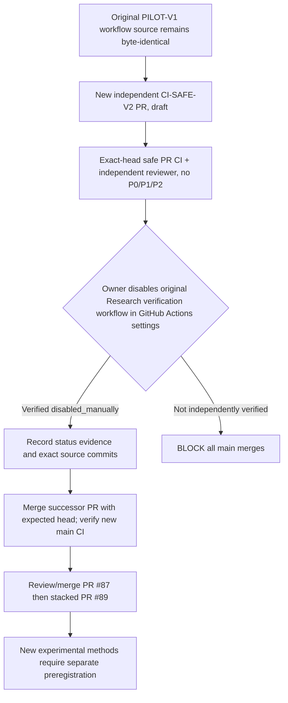

# CI-SAFE-V2 — research verification successor without historic holdout scoring

id: CI-SAFE-V2-SPEC
status: proposed; unmerged; owner_disablement_required; no_scoring
updated: 2026-10-29
tags: ci, security, immutability, evaluation, source-lock

## Intent and non-negotiable boundary
[Issue #88](https://github.com/ryonakayama234/DekaSugi/issues/88) addresses an unsafe inherited **main-push-only** EXP-0002B historical DEV scorer and evidence upload in `.github/workflows/docs-check.yml`. That exact workflow file is a source-locked member of OPPORTUNITY-001 PILOT-V1 (`1a3ce868010a320216642abf56093dc3a89d8e91`). PR #84 failed when changing it, correctly preserving the immutable historical source method. Therefore never edit, rename, delete, rehash, or auto-migrate the historical file, source lock, or its verification code.

## New separate CI surface
- [Successor workflow](../../.github/workflows/research-verification-v2.yml): `pull_request` and `push: main`, read-only GitHub contents permission. No `workflow_dispatch`, real scoring environment, secret, evaluation upload, arbitrary command, DEV/FINAL runner, or code execution from untrusted pull requests beyond Python tests in the checkout (this remains a CI trust surface under standard PR protections).
- [Source-first static verifier](../../scripts/check_research_ci_v2.py): exact full-workflow byte allowlist; pinned historical workflow Git blob check; original PILOT-V1 **nine-file** source check via `validate_source_blobs`; original EXP-0003A **14-file** source-only check via `verify_legacy_source_bytes`. It never calls `verify_generator_lock()`, freezes, generates any partition, imports production scoring packages, or validates a new real study.
- [Test allowlist runner](../../scripts/run_research_ci_v2_tests.py): explicitly selected **synthetic-only** tests for CI static gate, documentation links, METRO CAL-01, OPPORTUNITY-001 invented classifier fixtures and private-copy invented negative cases; when present, independently reviewed OPPORTUNITY-002 synthetic grammar tests. Never use general `unittest discover` over all tests in this successor: inherited historic tests can execute phase-sensitive routines. A missing optional test is not evidence it passed.
- This **intentionally narrows** broad historical PR/main CI. It preserves safe documentation, source-byte and synthetic-engineering coverage; it does not claim parity with full original experiment workflows. Any future checks need explicit source and independent review before expanding the successor allowlist. Synthetic fixture output is not a real `EvidenceEnvelope` or a new score.

## Migration DAG and mandatory explicit owner gate

**Owner action not performed by this PR:** Repository `Actions` → workflow **Research verification** (the old workflow backed by `docs-check.yml`, not v2) → `...` → **Disable workflow**. Independently confirm GitHub now reports `disabled_manually` for the **old workflow ID** using UI or authenticated owner `gh api repos/ryonakayama234/DekaSugi/actions/workflows/docs-check.yml --jq '.state'` from WSL2. Store a time-stamped sanitized status/actor/old workflow ID attestation (not credentials). Avoid confusing the presence of a v2 green PR job with actual old-workflow disablement. Do not disable `opportunity-pretrial.yml` by mistake.

**No merger** is authorized solely by user delegation, green CI, synthetic tests, source SHA checks, or a draft Codex review. The owner disablement and its verified state are external control-plane facts, not asserted by the repository code. GitHub Actions state may be re-enabled later; explicitly establish review/accountability to prevent unintended re-enablement and rerun of historic DEV.

## PR acceptance / negative tests
- G01 the nine frozen PILOT-V1 blobs, including old workflow, remain byte-exact and original lock unchanged.
- G02 original EXP-0003A 14-source bytes unchanged; no old DEV/FINAL *generation* or scoring by v2.
- G03 exact new YAML byte allowlist, read-only permissions, no arbitrary shell/hidden upload/triggers. Injected old `eval_cli --phase dev`, final upload or extra command must fail.
- G04 only named synthetic tests execute, no whole-suite discovery; incomplete/optional coverage reported, not silently replaced.
- G05 v2 executes under PR using exact-head GitHub Actions and latest exact-head independent review; no P0/P1/P2.
- G06 old workflow **confirmed disabled_manually BEFORE** any main merge; main push v2-only CI is observed without old DEV/FINAL events; source original still preserved.
- G07 evidence ledger distinguishes preparation/CI from owner settings change and actual main operation. No private third audits, old source examples, credentials, experiment raw rows in GitHub.
- G08 main merge of pending OPPORTUNITY-002 PRs separately gated; code review alone is not a formal research proof.

[Run ledger](../process/ci-safe-v2-ledger.md) / [ADR](../architecture/decisions/ADR-0004-ci-safe-successor.md) / [Issue #88](https://github.com/ryonakayama234/DekaSugi/issues/88).
