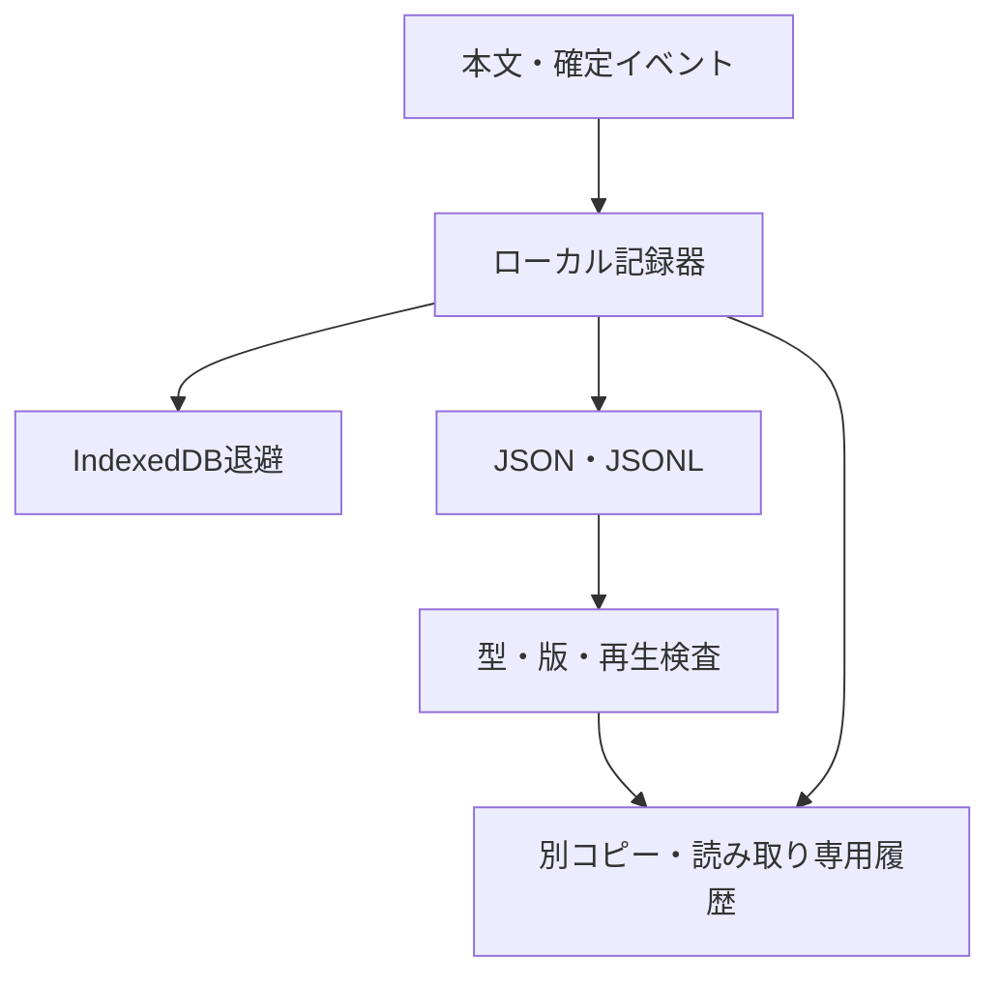

# E1 — 下書きの記録・再生・保存契約 v1

id: E1-DRAFT-EDITOR
status: implemented_pending_independent_and_device_checks
updated: 2026-11-17
tags: editor, contract, ime, privacy, local

許可：[Owner最終確認](https://github.com/ryonakayama234/DekaSugi/issues/227#issuecomment-6935058538)。実施方針：[E1-WORK-ORDER-20261117-01](https://github.com/ryonakayama234/DekaSugi/issues/227#issuecomment-6935001381)。採用済み設計：[R / PR #229](https://github.com/ryonakayama234/DekaSugi/pull/229)。制作は一つのDraft PR。E1は記録器で、学習器・補完・自動訂正・SNS投稿・3D・汎用基盤は含まない。

## 成果物・責務

[配布HTML](../../packages/draft_editor/editor.html)はCSS・core・UIを内包する。通常textareaでnative IME/undoを使い、記録のために入力欄を毎回再生成しない。coreは差分・再生検査・品質の純粋処理、UIはイベント観測・ローカル保存・表示を担当する。既存のPython研究モジュールには接続しない。

## 形式 `draft-episode/1`

JSONは一episode。JSONLは一行一episode、最大200行。未知版・未知キー・不正型・範囲外・不連続seq/version・削除対象不一致・最終状態不一致・品質集計偽装は読込み全体を拒否し、部分的な読込みをしない。HTMLとしての解釈やコード実行はない。フィールド順に意味はない。

| フィールド | 意味 |
|---|---|
| schema_version / editor_version | `draft-episode/1` / `e1/0.1.0`。異版の自動移行は初版に含めない |
| episode_id / draft_id | episodeと下書きの安定ID。importは元のIDを保持し、別のローカル保管IDを発行 |
| revision / parent_episode_id | 区切り版（1から）と親episode。編集中の本文versionとは別 |
| origin | `owner_real / owner_probe / assistant_generated / unknown`。新規作成前に種別を選択。貼付け内容の著者を自動判定しない |
| title / purpose | 最新の任意タイトル・目的。purposeはtextとsource（owner/unknown） |
| initial | 本文・選択・タイトル・目的の初期値 |
| events | 確定編集・選択・metadata・無変化のcomposition終了・session境界・capture_gap |
| final | 本文・選択・status（editing/saved/interrupted/abandoned）。UIはediting/savedを使用し、中断復旧はgapを追記 |
| automatic | 再生整合・観測品質・イベント数・gap数。文章の意味評価はunrated |
| privacy | scope=local_only、share_allowed=false。読込み時も共有許可に昇格させない |

各eventはseq（1から連続）、t_ms（単調非減少の相対時刻）、session_id、segment、kind、versionを持つ。session再開時は相対時計を継ぐ。精密な壁時計・アカウント・キー列・clipboard全体は記録しない。

確定編集は `before_version` と一置換の `patch={start_utf16,end_utf16,remove,insert}`、前後選択、input_type、range_source=derived、quality（observed/limited）、composition（none/ended）を持つ。範囲は変更前textarea.valueのUTF-16半開区間、改行はLF。removeが一致しなければ再生を拒否。差分境界でサロゲートペアを切らない。選択はstart/end/direction（forward/backward/none）またはnull。見た目の文字数は別で、UIのカウントはコードポイント数と明記する。

反復文字等では一置換の範囲は本人が意図した範囲と一意に対応しない。range_source=derivedを保持し、選択技能の正解と扱わない。目的・タイトル変更も変更時点のmetadata eventとして保存する。

## IME・品質

- composition開始前の確定本文を基準にする。変換中の文字・候補はメモリだけで、途中のinputや選択を永続化しない。
- compositionendと周辺inputをpending取引へ集め、次のイベントループで確定本文を照合する。後続の通常beforeinputが来たときも先の取引を閉じる。同じ本文の重複通知を編集へ二重計上しない。これは有限な順序変種への実装であり、全IMEの保証ではない。
- 本文無変化はcomposition_end（outcome=`unknown/no_text_change`）。空dataだけで中止と断定しない。未終了のcomposition中は区切り保存・書出し・draft移動を拒否し、確定を案内する。
- beforeinputなしでも連続した本文差分とinputが観測できれば記録するが、前選択・inputType等はunknown/limited。undo/redoは差分追記で、過去eventを消さない。取り消した編集への因果リンクを推測しない。
- inputなしの本文変化はblur・export/save・非変換中800msごとの照合で検出する。開始不明のcomposition、nested composition、本文不一致、open sessionの再起動ではcapture_gapを立てる。
- gapは理由・last_consistent_seq・新segment・新version・回復snapshotを持つ。snapshotから回復した表示を、差分だけの完全再生と呼ばない。未観測の末尾そのものは回収できない。

| 品質軸 | 値と意味 |
|---|---|
| replay_integrity | exact（初期値＋差分等で一致）／snapshot_recovered（gapのsnapshotを使用） |
| capture_quality | observed／limited（付随観測の欠測あり）／gap（取引境界等が不明） |
| 学習対象 | E1は学習可フラグを発行しない。gap区間は操作列・訂正因果の学習対象外。後段が整合segmentの品質・来歴を確認する。exactだけでは取りこぼしゼロを証明しない |

## 保存・競合・復元

DB名 `dekasugi-e1`、DB version=1、object store=drafts（keyPath=id）。ローカル保管レコードはid、generation、draft_id、確定episodes、active、openSession、exportRequestedを持つ。episode内の索引（ID/revision/segment/seq）以外の検索索引は作らない。保存は小規模下書き向けにレコード全体を原子的にputする。大規模コーパス用のappend専用DBではない。

確定編集から150msのdebounceで直列保存する。通常のイベントループ負荷の下で速やかに退避する設計で、停止中・重負荷中の500ms以内保証はしない。完了表示はtransaction.completeの後。異なる世代の同じ保管IDへの更新は同一transaction内のCASで拒否し、編集内容を新しい保管IDへ別コピーとして保全する。保存エラー時の本文は画面とメモリに残し、再試行・JSONを案内する。

「保存して区切る」で再生検査後のepisodeを確定し、入力欄を読み取り専用にする。「続きを書く」で新episode ID、revision+1、親参照、前版最終状態を初期状態として編集する。既存episodeは変更しない。アプリ内draft切替では退避を試しopenSessionを閉じる。再起動でopenSession=trueなら最後に退避できた確定状態を回復し、末尾不明をgapとして明記する。終了時イベントだけに保存を依存させない。

読込みは全件を検査してから別コピーを作る。編集中statusのJSONも読込み原記録として固定し、続きは新revisionを作る。手動JSON移動は同期ではなくコピー。同じ元episodeが複数保管コピーに存在し得る。実入力件数はdraft/episodeの元IDで重複排除が必要。

削除は選んだ保管コピーのepisodes・active・索引を1レコードごと削除する。古い世代からの削除は拒否。他のコピー・書出しファイルを削除したとは表示しない。DBが使えず永続原本を削除できない場合は成功表示しない。

読込・書出しは32MiB、eventsは一episode 20,000、全体書出し／一回読込みは200件まで。UIは19,900eventで入力を停止し、区切り・新revisionを案内する。古い履歴の自動削除は行わない。JSONファイルのサイズ上限はブラウザ総容量の保証ではない。容量超過は実際のDBエラーとして処理する。

## 配布・プライバシー

初手はfile起動の単一HTML。IndexedDBの書込・読出・削除probeを行い、対象端末で再起動確認する。失敗時はJSON代替。Windowsで必要なら `python -m http.server 8765 --bind 127.0.0.1` でHTMLのあるフォルダだけ配信し、同じURLを使う（Owner実機での採否は別途確認）。LAN bindや公開ホスティングは既定にしない。Androidでfile導線が成立しない場合は起動方式の再判断を返し、自動でサーバアプリやサービスを追加しない。

外部フォント・CDN・解析・API・ネットワークコードを持たず、CSPはconnect-src、frame、worker、form-action等を禁止する。スクリプトは自己完結のインラインのみで任意コード読込みなし。textarea/pre/textContentで表示し、import本文をHTML化しない。OSのIME、ブラウザ自身の送信や端末バックアップは検査範囲外。実入力・削除履歴・派生物はGitHub/ChatGPT/Museへ自動送信しない。

## 受入・限界

[端末確認カード](../process/e1-editor-checklist.md)と[工学run](../../experiments/E1/runs/20261117-editor-engineering.md)を用いる。ChatGPTの人工検査、Museの独立確認、Ownerの実IME確認を混同しない。別日の実用下書き3件程度・JSON復元・負担確認でE1を完了判断し、学習獲得は含めない。E2は反復訂正・品質・来歴・本人の使用希望を確認して別GO。日々の入力ノルマは置かない。
