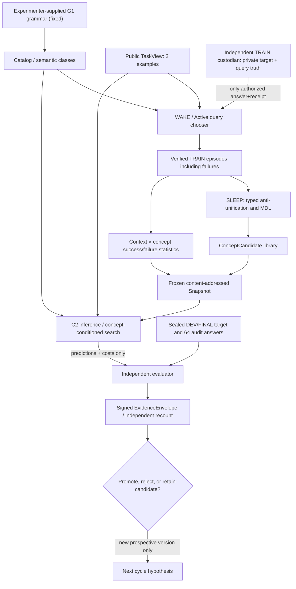
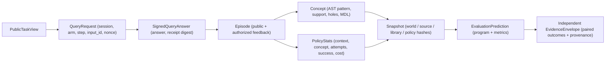

# EXP-COEV-001 — Research decision v1 / integrated design dossier

id: EXP-COEV-001-DECISION-V1
status: decision_proposal; NOT_FROZEN; NOT_SCORED; NO_ACTIVATION
updated: 2026-11-01
tags: research-decision, active-learning, wake-sleep, concept-induction, causal-ablation, statistics, architecture

## 読者向け要約：今回決めること

**研究対象：課題間の持続的学習（L3）。** DekaSugiが、経験から獲得した抽象概念と選択方策によって、訓練に使っていない意味クラスの課題を改善できるかを、未学習条件との対比較で検証します。G1の原始演算は人間が与えるため、今回の成果を「原始演算の自律的発明」や「汎用知能」とは呼びません。

**設計上の中心変更：** 既存の「成功したプログラムIDを覚える」方策を、そのまま汎化能力の根拠にしません。型付き構文木から抽象化した概念を外部ライブラリに記録し、公開課題の特徴ごとに概念の試行回数・成功・失敗・費用を学習します。概念だけ、方策だけ、同数の無情報概念、非学習という対照条件を置いて、何が効いたのかを区別します。

**研究プログラムの進行：** G0は人工環境で学習・採点・異常系まで通す工学的な一気通貫検証。G1は独立した秘密管理者、標本分布、推定方法、計算資源、コードと評価器の事前凍結。G2は新しい正式TRAINとSnapshot固定・独立DEV。G3は**別途明示された許可後に限る**一度限りのFINALと独立再集計。G4は採否判断と次期参照版への昇格です。研究単位は大きくまとめますが、過去のFINALを再採点しません。

**現在の状態：提案済み・未凍結・正式採点なし。** 詳細な定義・図・入出力・統計条件・失敗条件は以下の技術本文を正本とします。

> This is an **engineering and scientific-method design decision proposal**, not an independently approved preregistration, source lock, authorized formal TRAIN, DEV or FINAL run. It must pass F0-C/F0-D/F0-E before any formal observations. Parent [#106](https://github.com/ryonakayama234/DekaSugi/issues/106), [#110](https://github.com/ryonakayama234/DekaSugi/issues/110), [#115](https://github.com/ryonakayama234/DekaSugi/issues/115), [#116](https://github.com/ryonakayama234/DekaSugi/issues/116), [#117](https://github.com/ryonakayama234/DekaSugi/issues/117); source PR #107/#108/#109 and design preflight #118.

## 1. Operational research object and claims
Measure **L3 persistent cross-task adaptation**: can experience-acquired **typed structural concepts and transferable selection statistics**, under a fixed experimenter-supplied G1 grammar, increase exact-match accuracy on fresh tasks drawn from a TRAIN-class-disjoint sealed heldout pool? This is **not L0 autonomous primitive semantics**, **not L4 cross-domain transfer**, and not a general-intelligence claim. L2 query benefits, L1 search/computation, and L3 frozen-snapshot effects must be separately attributed. A negative/zero outcome is admissible and publishable.

G1 contains 3,741 syntactic programs and 895 distinguishable finite-domain behaviors on 156 strings, as **public synthetic structural** evidence. All G1 semantics are experimenter supplied. TRAIN256 local public fixture 231/256 active vs 105/256 random is evidence of *in-task question choice* on a disclosed simulator, not heldout L3. Historical EXP-0003A, OPPORTUNITY-001, ACTIVE-001 source/evidence and main workflow remain untouched.

## 2. Falsifiable mechanism hypotheses
- H1 (primary, frozen learned effect): class-disjoint FINAL task-level mean audit64 exact-match C2 minus C0 is >= +0.10 **and** strict positive lower endpoint of predeclared 95% bounded-IID interval, with all provenance and cost gates passing. This targets the conditional future heldout-class-pool task distribution; it does not imply arbitrary new grammar generalization.
- M1 (representation of reusable concepts): anti-unified **parameterized typed AST templates** transfer structural ranking preference to unseen program IDs. If a same-size uninformed concept library performs equally, concept-induction attribution fails.
- M2 (transferable policy): learning `(public context, concept id) -> attempts, successes, costs` transfers more plausibly than `(context, exact training program id)`; a target-class-disjoint program-ID policy can at best bias toward seen IDs, not directly recognize an unseen correct ID.
- M3 (information acquisition): active TRAIN querying improves the *quality of evidence* relative to randomly chosen TRAIN questions, controlled by same tasks, query budget and feedback. This is secondary H2 C2-C1, **not H1 by itself**.
- M4 (separate in-task adaptation): C4-C3 tests test-time active versus random queries using the **same frozen C2 snapshot**; no claim of learning from inference-time questions.
- Falsifiers: no H1 effect; learned-vs-uninformed-control parity; zero transferable concept support on new class IDs; significant search/CPU regressions; provenance/source violations (NOT_ESTIMABLE), not quietly discarded samples.

## 3. Identification and experimental unit
**Primary unit is a task**, not 64 audit-input predictions or five random-query repeats. One task consists of one target semantic class drawn with replacement from the independently sealed FINAL class pool, one independently drawn distinct two-input public pair from 28 public input IDs, and a fixed 64-input audit vector owned by a separate evaluator. All arms share the task. The task generator is independent across draws conditional on a frozen pool and frozen learned snapshots. Repeated target classes are expected and must be reported; conditional-on-pool IID is the limited inferential target, NOT superpopulation/unseen-grammar inference. Class-level and family-level clustered sensitivity must be reported, with no attempt to claim unconditional class generalization.

**Preliminary capacity design (not source freeze):** 895 semantic classes allocated without overlap into 358 TRAIN / 179 DEV / 358 FINAL class IDs (the preview 40/20/40). Maintain representative plain/conditional family proportions, approximately 29/866 in the entire catalog, through a documented deterministic stratification algorithm *driven by fresh independent confidential entropy after approval*. Within a fixed pool, draw classes **uniformly** then public pairs uniformly without replacement. No posthoc 'positive-opportunity' conditioning; include indistinguishable/hard cases. A locked alternative family mixture needs a new pre-outcome version, not a discretionary change. Input partition: 28 public candidate IDs, 64 query IDs, 64 audit IDs; exact disjoint split and digest frozen. A known finite grammar permits enumerating *possible* classes: holdout novelty here is lack of TRAIN exposure and hidden target identity, not previously impossible function semantics.

**Schedule candidate:** 256 formal TRAIN tasks, 128 DEV diagnostic tasks, 2,048 FINAL tasks. These are **pre-freeze design values** requiring power, CPU, source and independent-custody gate; no sample-size optional stopping. All arm-level labels, seeds, task IDs and answer transcripts remain behind role-specific interfaces.

## 4. Programs, learning, and counterfactual controls
Retain the stable pre-existing C0-C4 definitions:
- C0: G1 fixed search, no TRAIN, no test-time queries.
- C1: identical 256 TRAIN tasks, up to two uniform-random TRAIN queries, learned library/policy, no test queries.
- C2: identical TRAIN tasks and <=2 max-disagreement TRAIN queries, learned library/policy, no test queries. **Primary treatment.**
- C3: frozen C2, up to two random test queries; five within-task replicates, averaged *within task*.
- C4: frozen C2, up to two max-disagreement test queries.
Add three **pre-registered mechanistic, non-primary controls**:
- A1 (concept only): exact same C2 TRAIN-derived concept library, **fixed/nonlearned** concept-selection ordering.
- A2 (policy only): same C2 verified TRAIN observations but no concept-match contribution; transferable policy features only. If this collapses to exact-ID memorization under disjoint target classes, record it honestly as nontransferable.
- A3 (capacity-matched uninformative library): number, AST shape/holes, candidate coverage and expansion budget matched to C2, but concept definitions sampled independently of TRAIN outcomes, with sealed independent random stream. Use no heldout truth in matching.
Potential episode-retrieval-only control is **exploratory unless separately frozen**; do not silently add it after outcomes.

All no-test-query arms observe identical two public outputs and choose from the same canonical finite G1 candidate set under the same candidate cap **64**, same max expanded primitive invocations (to be hard-coded/benchmarked before freeze), same type/verifier checks, same actual CPU reporting. Precomputation/catalog expense, learning expense, per-query Oracle expense, search CPU and total amortized expense are separate. Compute budgets are not interchangeable with statistical sample size.

### New learner architecture decision
Keep `packages/concept_world` as independent immutable typed semantics and `packages/concept_learning` as the primary change. **Do not add a learned primitive callable or mutate DEFAULT_REGISTRY.** Use:
1. WAKE: public TaskView + <=2 authenticated TRAIN answers -> canonical version space -> bounded candidate program -> verifier-only TRAIN feedback and immutable Episode, including failures.
2. SLEEP: deterministic typed pairwise anti-unification of verified successful TRAIN programs, <=2 holes, >=3 distinct supporting tasks, positive approximate MDL, max 8 candidates. MDL is a *compression hypothesis*, not CPU speed or correctness.
3. TRANSFERABLE POLICY: store for each `(publicly observable context signature, concept id)` a bounded `attempts/successes/expanded_cost` statistic; include negative evidence. Context bins must be semantically defined using only public examples, with a small fixed number (proposed 8) to avoid 64-bucket sparsity on TRAIN256. Use predetermined Laplace-Beta(1,1) smoothing and deterministic fallback; tie breaks by stable canonical ID. Do not select the context scheme or smoothing constants by viewing true DEV/FINAL outcomes.
4. INFERENCE: validate entire frozen snapshot and public evidence; rank **only public-consistent** candidate programs via concept applicability and smoothed contextual support, enforce <=64 program-evaluation candidates and same primitive budget, use fixed canonical fallback. Training-target program-ID priors must not be misrepresented as cross-class generalization. Keep per-candidate ConceptTrace explaining score, applicability, cost and failure reason.
5. DREAM: excluded from confirmatory H1 treatment; optional predeclared prospective ablation, TRAIN-only, source/seed/provenance separated from future reserved pools.
Algorithm constants, context encoding, tie breaks, budgets and exact source are **not yet frozen** and require independent F0 review.

## 5. Statistics, power and decision
Per task `a_i(m)= (1/64) sum_{x in audit64} 1[model m prediction(x)==target(x)]`, `D_i=a_i(C2)-a_i(C0)` in [-1,1]. Report `mean(D_i)`, paired counts and distribution, C0 and C2 full coverage, accuracy and score failure states. For conditionally independent tasks from the fixed sealed pool with the frozen learner and per-task independent randomness, prospective conservative two-sided Hoeffding interval:
`[max(-1,Dbar-r), min(1,Dbar+r)]`, `r=sqrt(2 ln(2/alpha)/N)`, `alpha=0.05`, `N=2048`, `r~=0.0600`. Acceptance requires **Dbar>=0.10 and Dbar-r>0 strictly**. No endpoint is rounded before comparison; test equality edge including variance-zero. If IID conditional on the fixed pool is violated, return NOT_ESTIMABLE or use a separately pre-approved design; do not substitute a posthoc class-robust CI.

**Important fix to the old P2 power approximation:** the actual `D_i` is a 64-audit-input fractional accuracy difference, not necessarily `{-1,0,+1}`; a toy discordance model can only be named *hypothetical*. Simulate full bounded task-level differences under synthetic assumptions, with variance, family/class repetition and zero-opportunity sensitivity. At true effect exactly +.10, the non-strict observed +.10 cutoff has ~50% nominal probability to pass; justify power for meaningful alternatives >.10 (e.g. +.12/+ .15) and hard CPU ceilings **before freeze**. Data-dependent power revisions are prohibited. Sensitivities: unique-class weighting (descriptive), stratified plain/conditional, clustering/repeated-class influence, failure inclusion, false-certification tests. H2/H3/ablation p-values are exploratory unless multiplicity and hierarchy are prospectively fixed; no cherry-picked 'best arm'.

Validity and failure: execution exhaustion counts as a valid unfavorable task under the predeclared score rule; forged/missing source, question replay, private-label contamination, broken custodian or source hashes are integrity errors and stop official study with NOT_ESTIMABLE. Never remove difficult tasks based on observed score. Recount 100% paired tasks from immutable original envelopes.

## 6. Architecture and trust boundary

**Custody:** PUBLIC JSONL <=1024 bytes strict single-line UTF-8; exact primitive types; no unknown/duplicate fields, no target/class/family/seed/audit truth in learner. Session/arm/phase-bound nonces; at most two distinct query IDs; signed or independently authenticated append-only receipt chain; no cross-arm/phase/replay; scorer-only full audit. Toy HMAC/child-process/same-owner GPG examples in PR #114/#119/#120/#121 are engineering rehearsals, **not independent authority**. A separate trusted principal/environment holds source and signature keys, produces high-entropy sealed roots, controls FINAL and signs manifests. Developer OS user with sudo/root access to custodian is not independent; if unavailable, report engineering-only and BLOCK confirmed H1. Existing Drive archive is historical: do not read its private plaintext, keys or re-score past sealed sets. Exact-head review, safe CI, source locks and owner-confirmed disabled legacy workflow are mandatory.

## 7. Data contracts

Contract invariants: immutable source/version, deterministic canonical ordering, exact type validation, strict budget caps, source-origin proofs, irreversible sealed sample source, and no audit-to-learner feedback.

## 8. Large-workflow execution, not fragmented chats
**One integrated research program; a small number of hard gates, not one chat per file.**
- G0: independently review this proposal against actual PR #109/#118 code; correct any estimator/controller inconsistencies; fix exact technical constants and matched controls; source-first synthetic structural capacity/positive-opportunity, calibration, bounded full mock end-to-end including *toy* learning+scoring and failure tests. May work in Draft PRs. Every task updates AGENTS, docs/INDEX, ARCH-001, ARCH-002 and one run receipt. No real labels.
- G1/F0: separately approved custodian, class/task distribution, source+method+analysis+code/test hash, secrets commitments, numerical power/cost hard bounds, reproducible independent review. **Before any formal TRAIN**. On failure BLOCK, retain only prototype/engineering evidence.
- G2: new, independently sourced *formal* TRAIN256 with authenticated episodes -> frozen content-addressed learner snapshot; then separate DEV128 under fixed method with no FINAL label read, immutable original receipts, no post-DEV hypothesis redefinition.
- G3: **deliberate distinct approval** to activate one-shot FINAL2048, independent scoring, complete independent recount, favorable/zero/negative outcomes and total-CPU accounting. Main merge never counts as scientific activation.
- G4: decision ADR and reference-baseline candidate **only if** scientific gate and independent performance/rollback review pass; L4 cross-representation transfer requires a new prospective experiment.

## 9. Outcome and promotion state machine
`PROPOSED -> ENGINEERING_VERIFIED -> METHOD_AND_CUSTODY_FROZEN -> TRAINED_SNAPSHOT_FROZEN -> DEV_AUDITED -> FINAL_SCORED -> ACCEPTED / NEGATIVE / NOT_ESTIMABLE`.
Technical baseline EXP-0001 remains separate. Current EXP-COEV-001 is **engineering-only** on stacked draft branches; user review of this decision document does not by itself freeze methodology, create an independent custodian, authorize formal score, merge branches or re-enable historic workflows.
