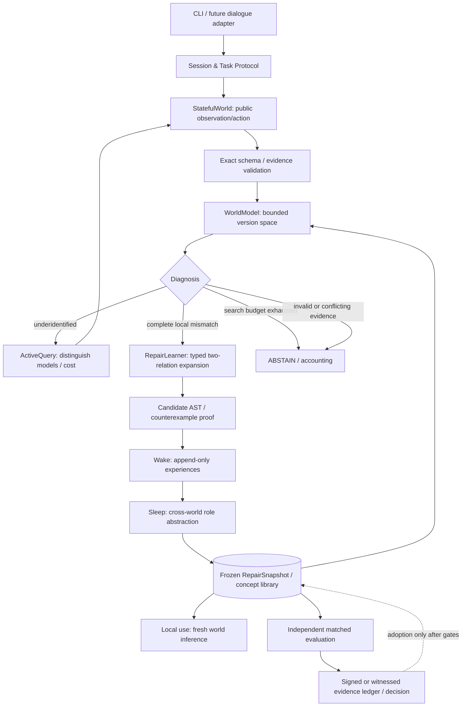
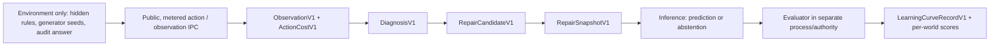

# EXP-REP-001 G1-D — Integrated Research System Design v1
id: EXP-REP-001-G1D-DESIGN
status: ENGINEERING_IMPLEMENTED; DISCLOSED_TOY_ONLY; NO_FORMAL_SCORE
updated: 2026-11-01
tags: representation, counterexample, active-learning, wake-sleep, architecture, local-use
parent_issue: https://github.com/ryonakayama234/DekaSugi/issues/128
base: G1-C Draft PR #127 (e790ef7); do not merge this stacked proposal ahead of its parents

## Research purpose, not claims
The goal is a reproducible *learning and use* loop: observe/intervene -> diagnose limitations -> construct bounded typed representation repairs -> Wake experience -> Sleep transferable templates -> freeze snapshot -> use on genuinely new worlds -> independently evaluate. The target is an operational form of intelligence as adaptive, revisable *process*, not autonomous general intelligence. All experiments start within a fixed human-provided meta-grammar; they cannot demonstrate creation of semantics outside that grammar. Distinguish memory (episodes), policy (ordering), representation (executable new body), active acquisition (which information), transfer (new world). Do not import any previously sealed dataset.

## Verified current starting point
G1-C `world_model.candidates` enumerates empty or **one** direct/gated Relation, not a two-edge learner. `representation.induce_train_snapshot` counts relation families across distinct, uniquely solved toy TRAIN worlds (>=3 supports); the R3 snapshot mostly changes candidate ranking. Synthetic R2P=R3=8/8 in hand-favorable toy worlds; not scientific evidence. `InventedWorld.probe(before,action)` accepts arbitrary before states and currently does not account for reset/setup; one-process host is not trusted isolation. G1-C at PR #127 is Draft, parent PRs #124/#125 also Draft.

## Key design decisions
1. **Separate recognition, repair, transfer.** No single score can certify all three. Model-class mismatch requires exhaustive/complete *within the declared bounded hypothesis class* and validated, mutually consistent evidence. A single prediction failure is insufficient.
2. **Constrained representation repair, not unbounded grammar search.** Keep the safe public one-edge model; add an optional typed `RepairGrammar v1` with at most two relation atoms, typed roles, context gate, parity composition and explicit canonical cost. Expand it *only* after a certified local model-class mismatch. No arbitrary Python/executable callbacks.
3. **Stateful, metered world interface.** On a real learner-facing episode, the agent can only observe its current state, `set_state`, `pulse`, and explicitly priced `reset`; it cannot supply arbitrary `before` to the oracle. Existing arbitrary-state `probe` remains for disclosed calibration/audit only. Charge every state-setup action, resets and queries; record wall/CPU separately. Evaluation audit queries are evaluator-owned and never exposed to learner.
4. **Two pathways for gains.** `RepairLearner` creates candidate relation ASTs to explain contradictory evidence; `Sleep` canonicalizes learned role patterns over independent worlds and produces executable parameterized bodies. `RankOnly` may learn the same family-count prior but *not executable bodies*; it is an imperfect mechanism control, since family frequencies are abstractions too. Strong fixed-expressive search is the mandatory comparator.
5. **No invented epoch story.** Each distinct TRAIN world is new experience. Replaying identical episodes for 1/2/5/10 passes is an idempotence check for this count/structural learner; it is not gradient training. Track the distinct-world curve independently from replay passes.
6. **Interpretability before neuralization.** CPython 3.12+, stdlib, immutable dataclasses, canonical versioned JSON, SHA-256, append-only JSONL evidence, bounded pure interpreter; optimize candidate signature computations using bitsets/caching only if verified equivalent. No GPU or third-party model needed. Optional SQLite index later; JSONL+hashes are the canonical research evidence.
7. **Release is separate from research promotion.** Disclosed-engineering toy pilot can train, score and operate interactively on new synthetic worlds after engineering checks. Independent formal G2/F0 custody, one-shot FINAL and promotion require explicit separate gate. A demo does not make an intelligence product.

## Architecture


## Boundaries and contracts


- `ObservationV1`: (episode_id, world_alias, object_ids, before, action, after, sequence, public receipt), built-in types and exact state/action validation.
- `ActionCostV1`: (action_kind, primitive_units, setup_units, reset_units, cpu_ns, wall_ns), no free state initialization after episode start; distinct measurement definitions.
- `DiagnosisV1`: (evidence_digest, model_class_version, candidates_examined, search_complete, surviving_count, status, witness_ids). Status: IDENTIFIED, UNDERIDENTIFIED, INVALID_EVIDENCE, INCONSISTENT_REPLAYS, SEARCH_EXHAUSTED, MODEL_CLASS_MISMATCH, OUT_OF_SCOPE. On incomplete search, never assert mismatch.
- `RepairCandidateV1`: (typed_relation_AST, role_vars, evidence_hashes, counterexample_ids, complexity_cost, fit_status). Two-atom maximum; typed roles/gates/parity. Canonicalize before hash.
- `RepairSnapshotV1`: (schema, interpreter_version, grammar_version, training_receipt, train_world_ids_digest, templates with executable canonical bodies, family_rank_counts, immutable digest, resource_profile). Digest is integrity check, NOT signature/authentication.
- `LearningCurveRecordV1`: (source_sha, world_count_unique, passes, wake_sleep_round, snapshot_digest, concept_body_hashes, paired_world_accuracy, abstention_rate, interventions, setup_cost, resets, evaluated_candidates, total_cpu_ns, wall_ns, peak_rss, validity_status).
- `EvalReportV1`: per-world paired outcome + family stratum, independent auditor source and hashes, interval method, cost results and verdict. The unit of statistical independence is **world/graph generation unit**, not its 32 hidden audit transitions.

## Formal logic — diagnosis and repair
Given evidence E, let V_1(E)={h in H_1: h is consistent with every valid observation}. If E invalid or repeat-inconsistent: refuse/flag. If bounded enumeration not complete: SEARCH_EXHAUSTED, NOT mismatch. If |V_1|>1, ask a discriminating query. If |V_1|=1, use it and keep testing. If |V_1|=0 and enumeration complete, record local CLASS_MISMATCH (does not identify which larger representation is sufficient). Then `RepairGrammar v1` proposes minimal typed models h in H_2 consistent with E. If none, ABSTAIN / OUT_OF_SCOPE; if multiple, request more information or abstain. Only after independent heldout checks and repeated-world support does Sleep persist a reusable template. No hidden graph inspection.

Representation selection candidate = lexicographic (satisfies all TRAIN evidence, then minimum canonical description length, then independent-world support, then runtime complexity, then stable digest tie-break). Never optimize against DEV/FINAL. Exploration policy maximizes distinct predicted outcome partitions per charged setup/query cost, under reachable states; predictive entropy requires an explicit frozen prior and is a secondary method, not assumed optimal.

## Risks and falsification
- Same-process public object hides `_rules` only by convention: formal score requires separate custody/IPC and independent witness.
- Noiseless finite world can still be underidentified; cap query / budget and measure abstention.
- A two-edge fixed expressive solver could match all repaired predictions. Under enough resources, equal accuracy is EXPECTED; conditional-repair benefits must be measured at matched budgets (or documented cost savings), not claimed as newly invented semantics.
- Rank-only baseline already carries abstraction: R3>R2P and body-specific ablation are necessary but not by themselves sufficient for strong L3 causality; compare strong retrieval and fixed expressive solver.
- 8 objects yield 728 single direct/gated atoms and approximately 264,628 unordered atom pairs before rejecting invalid/redundant pairs: preflight must bound search and record CPU/RSS, not silently widen budgets.
- Graph-isomorphism disjointness and object-renaming invariance must be tested. Explicitly label IID-renaming, topology-heldout, and new-composition test strata, not collapse them into one kind of transfer.

## Delivery/acceptance
- Phase E: full, disclosed, reproducible end-to-end engineering pilot (TRAIN -> snapshot -> use -> toy evaluation and learning curves). This **does** include actual learning, toy scoring, CLI use; no sealed assessment.
- Phase F0: independent method/source/power/custody/resource review and immutable freeze; propose formal counts TRAIN256 / DEV64 / FINAL1024, cap 12 charged interventions, 32 audits per world inherited as *unfrozen candidate values* pending feasibility.
- Phase G2: run frozen actual TRAIN and diagnostic DEV; keep source/snapshot byte hashes; if methodological changes after DEV, new experiment/holdout.
- Phase G3: only with separate explicit owner authorization and independent custodian signoff, one-shot FINAL with untouched frozen protocol; report all negatives, missingness and total costs.
- Phase G4: independent recount and promotion decision, then local reference release. If no benefit, preserve engineering reference and branch alternative research.
- Every implementation PR must update `AGENTS.md`, `docs/INDEX.md`, ARCH-001 Mermaid, ARCH-002 contracts and data flow, plan and immutable dated run ledger *with* code and tests. Existing old datasets/workflows are not touched.

See [method](../../experiments/EXP-REP-001/g1d-method-v1.md), [design-only receipt](../../experiments/EXP-REP-001/runs/20261101-g1d-design-only.md), and parent [EXP-REP-001](EXP-REP-001.md).

## Engineering implementation result (2026-11-01, disclosed toy only)
The architecture described above has a working engineering prototype in `packages/rep_lab`, CLI `python -m packages.rep_lab`, explicit synthetic tests `tests/test_rep001_g1d_engineering.py`, and an immutable dated pilot record at `experiments/EXP-REP-001/runs/20261101-g1d-engineering-pilot.md`. **No formal F0/DEV/FINAL was executed.** The original design text above is retained as historical intent.

The implementation uses complete validated one-edge diagnosis and typed two-edge parity synthesis using XOR signatures with a maximum of 300,000 candidate pairs, retaining up to 128 candidates; overlarge ambiguity and incomplete search are not treated as proof of class mismatch. The learned body is a canonical role-based two-relation string used as a model preference, not an invented primitive semantic. `ToySession` charges state setup, pulse and reset and is a same-process host, NOT a trusted independent evaluation boundary. B1/B2/B3/B3x use identical passive evidence; B5 uses separately chosen metered evidence and cannot be compared as a concept-body causal contrast.

TRAIN pilot uses 32 renamed versions of a direct-fork structure (not graph-disjoint), and six disclosed toy evaluation worlds, four same-family plus two gated-mixture. B3 learned one reusable structural body after three distinct named TRAIN worlds but its 368/384 correct predictions matched B1 fixed expressive, B2 rank-only, B3x ablated exactly. **No body-specific accuracy gain** is shown. B5, with at most four charged actions, reached 384/384 against passive 368/384; this is a disclosed toy *active-information* effect, not independent generalization or a concept-body effect. 140 whitelisted tests passed on the pilot commit in CI. See dated run ledger for hashes, costs, abstentions and limitations.

Operational toy CLI (not formal evaluator):
```bash
python -m packages.rep_lab train --worlds 8 --snapshot .run/rep-g1d/snapshot.json
python -m packages.rep_lab inspect --snapshot .run/rep-g1d/snapshot.json
python -m packages.rep_lab use --snapshot .run/rep-g1d/snapshot.json
python -m packages.rep_lab evaluate-toy
```
