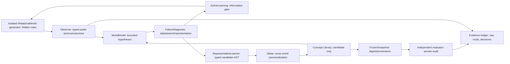

# EXP-REP-001 — Counterexample-Driven Representation Discovery
id: EXP-REP-001
status: design_approved; preregistration_not_frozen; implementation_not_verified; no_formal_score
updated: 2026-11-01
parent_issue: https://github.com/ryonakayama234/DekaSugi/issues/123

## Purpose and precise nonclaims
Determine whether *cross-world persistence of acquired typed relational concepts*, not mere instance retrieval or test-time question selection, improves exact next-state prediction in **structurally disjoint, unseen relational worlds**. L0 representability / L1 search / L2 active experiments / L3 frozen cross-world learning / L4 graph-family transfer are distinct constructs. This study cannot prove arbitrary novel primitive semantics, natural-language understanding, or cross-modality transfer. The experimenter provides types and generic composition operators.

## V1 world contract — proposed
- 4–8 named objects with fully observable Boolean state (observations only, never the ground-truth graph).
- Deterministic synchronous transition; intervention types `set_state(object,value)` and `pulse(object)`, validated through a fixed allowlist. Pulse can cause toggles in context-dependent targets; the environment owns ground-truth directed edges and context roles.
- Candidate generative families: unary direct influence; context-gated influence; composition of <=2 independent influences; no nondeterminism in the primary study. Cycles, ambiguous simultaneous toggle semantics, and identity mapping must have explicit fixed rules *before* freezing the generator.
- Learner receives typed action/observation streams. No rule ID, hidden adjacency, canonical graph, family label, target output vector or final answer from the world generator.
- Independent evaluator owns heldout worlds and audit transitions; only public initial states and permitted query replies cross the boundary.
- Canonicalization quotients object renaming; disjoint structural graph classes across TRAIN/DEV/FINAL. Exact stratification, family counts, difficulty and independent seed roots need preregistration.

## Mechanism hypotheses / falsification
**H1 primary:** Train-acquired relation concepts in frozen Snapshot (R3) outperform matched episode-retrieval control (R2) on unseen worlds when both see *identical observations/actions at evaluation*. Pre-freeze candidate success: paired mean world-level accuracy >= +0.10 and predeclared two-sided 95% CI lower endpoint > 0, together with provenance and resource gates. Success thresholds and N remain candidates until F0 power/cost and custody gates pass.
**M1:** R3 concepts align relation roles beyond raw object IDs and support 3+ independent TRAIN worlds, and improve predictions on class-disjoint FINAL structural families.
**M2:** Ablating/replacing those concepts while preserving other resources erases material benefit. Concept count alone is not evidence.
**M3:** R4 (same snapshot, actively selected queries) has better sample efficiency than R3 (same snapshot, externally matched passive queries) for otherwise equivalent test tasks. R4−R3 does not prove L3.
**Falsifiers:** R3≈R2; R3≈untrained expressive R1; ablation neutral; capability depends on leaked graph IDs; total resource regression; structural overlap; missing independent custody. Invalid custody -> NOT_ESTIMABLE, not failure of H1.

## Experimental arms — identity, data and intervention matching
| Arm | Training | Transfer state | New-world observation policy |
|---|---|---|---|
| R0 | none | limited direct-only representation | fixed passive actions; expressivity floor only |
| R1 | none | powerful **fixed** typed meta-language and rule search | matched passive actions |
| R2 | same TRAIN episodes as R3 | bounded episodic retrieval, no abstractions | exactly the same passive actions as R3 |
| R3 | TRAIN episodes + Sleep concept induction | frozen typed ConceptLibrary + search policy | exactly the same passive actions as R2 |
| R4 | identical frozen R3 snapshot | same as R3 | active max-disagreement/intervention information gain, same 12 action cap |
| R3-ablated | none after R3 freeze | shuffled/disabled concept bodies with matched search envelope | same passive actions as R3 |

All arms have identical interpreter semantics, primitive operations, verifier, per-world action limit, candidate evaluation and primitive-execution ceilings; record total TRAIN+inference CPU and peak RSS separately. R0's restricted expressivity is a *diagnostic*, never a fair main performance competitor. If passive actions depend on target answers, query-policy leakage invalidates the R2−R3 comparison.

## Learning algorithm candidate (not yet implemented)
1. Observer collects `(state_before, intervention, state_after)` and current hypothesis predictions as append-only Episode.
2. Diagnoser tests in order: inconsistent/noisy observation, insufficient distinguishing observations, bounded search exhausted, hypothesis-family contradiction. One prediction mistake does not imply representation failure.
3. For a verified contradiction, `RepresentationLearner` enumerates typed refinements of existing relation roles/conditions up to a strict AST and complexity cap; no unreviewed executable Python.
4. Score candidates on **TRAIN only**, using consistent next-state prediction, minimal-description-length penalty, counterexample count and support across independently renamed worlds; reject contradictions and non-identifiable expressions.
5. Wake persists attempts; Sleep canonicalizes roles under object renaming, induces parameterized relation templates with >=3 independent world supports, retains negative evidence and provenance.
6. A content-addressed ConceptSnapshot stores exact concept AST, training receipt hash, interpreter/catalog versions, cost budgets, provenance and learned ranking policy. Eval refuses mutable or tampered snapshots.
7. Information-gain policy picks interventions maximizing expected partition reduction over current hypotheses, within same action count, using only currently observed data.
8. Dream is an **isolated engineering capability**; exclude it from H1 official training unless a separate preregistered ablation is created.

## Architecture / trust

Exactly one party owns hidden ground truth: world generator/evaluator. The learning process never imports it. SEC-004 no untrusted callbacks, no generated-code execution. A digest is an integrity checksum, not an independent signature. Frozen source/seed/evaluator and separated custody are required for a formal score.

## Required tests
- State-transition determinism and synchronized edge semantics; no graph leak in public objects; invalid type/action rejected before execution.
- Id-renaming invariance of canonical graphs; structural class-disjoint TRAIN/DEV/FINAL; train/test source collision rejection.
- Contradiction versus missing-evidence versus budget-exhaustion correctly distinguished.
- R2/R3 identical query transcript and non-omniscient access; R4 max 12 queries, no uncharged oracle requests.
- Concept candidate AST safe allowlist, bounded search, support/provenance exact; negative counterexamples; tampering and hash mismatch fail closed.
- Ablation and matched resource meters; deterministic reproducibility; verifier isolated from trainer; no automatic FINAL trigger.

## Execution and research status
G0 spec/methodology review -> G1 invented-only engineering prototype, tests, total-cost preflight -> F0 independent power, source/seed/custodian and snapshot freeze -> G2 actual TRAIN and diagnostic DEV -> **separately explicitly approved** one-time independent FINAL -> recount/ablation/adoption decision. See [plan](../../experiments/EXP-REP-001/plan.md). No official training or scoring authorized by this document.
