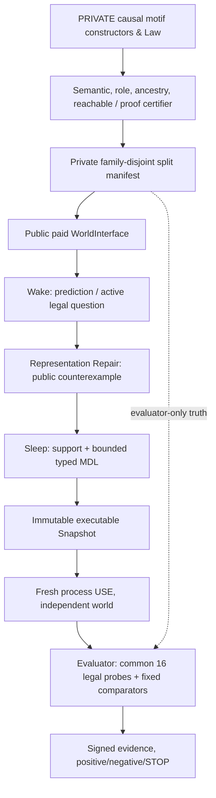

# EXP-REP-005 G0b-B — Integrated Decision V4: Construct → Wake → Sleep → USE → Evaluate

id: EXP-REP-005-G0B-B-INTEGRATED-DECISION-V4
status: decision_ready_for_owner_review_not_frozen_no_execution
updated: 2026-11-03
tags: research, active-learning, causal-world, representation, wake-sleep, architecture, evaluation

## 0. Decision and scope

**Research decision candidate, not an executed experiment or a blanket authorization to score.** The intended large work package covers constructive world creation, actual paid public TRAIN/Wake, concept invention/Sleep, executable persisted Snapshot, fresh-world USE and independently scored comparisons. It has explicit fail-closed stage gates. Source/isolated-custody failure blocks scientific scoring; a NULL question-switch mechanism blocks only **H-QUERY** scoring, not an independently eligible **L3 predictive-transfer** study. Parent [Issue #152](https://github.com/ryonakayama234/DekaSugi/issues/152); [Draft #153](https://github.com/ryonakayama234/DekaSugi/pull/153).

Primary module to design/implement: packages/rep005_g0b, as separately versioned constructive source and independent certifier; future isolated integration: packages/rep005_study; supporting packages/representation_repair (selective port from [Draft #151](https://github.com/ryonakayama234/DekaSugi/pull/151)), packages/active_learning, verification, Snapshot, independent evaluator. No wholesale merge of old Drafts. Existing source engine [#149](https://github.com/ryonakayama234/DekaSugi/pull/149) remains an unchanged V3.1 source-only historical reference.

### What intelligence means *operationally in this experiment*

Not a claim about universal human intelligence. Measure the *changing process*: acquire public evidence -> select informative actions -> infer and externalize an executable representation -> reuse it in unseen environments -> improve predictive decisions under a fixed legal information/compute budget. Source construction and verified concept execution alone do not establish improved general intelligence.

Evidence levels are distinct: L0R semantic representability; L1I paid observable identifiability; L2Q legal-question choice effect and utility; L3C learning-derived concept transfer on independent new families; L4M cross-domain/open-ended learning-to-learn (outside this study). The four domains game, app, language and dialogue are future adapters and **not** current demonstrated transfer.

## 1. Falsifiable hypotheses and logic mechanisms

| Hypothesis | Predicted causal mechanism | Evidence that rejects/limits the claim |
|---|---|---|
| H-FAMILY | Constructed typed motifs contain distinct full semantics, object-role orbits, source genealogy and reachable interventions | Aliases, shared source roots, unreachable-only differences or too few independently clusterable families -> G0_STOP |
| H-OBS | A prediction failure can result from too little *paid* observation, not missing language | Strong same-capacity static model identifies with an alternative legal question; no proof of new representation required |
| H-REP | A deterministic single-world public trace contradicts every memoryless predictor f(x,a) | Same visible state and action with different successors under legal distinct public histories, or no verified witness |
| H-ACQUIRE | Public-only errors select a typed new executable ConceptBody not preinstalled as a ready-made macro | Body is a label/lookup, model used hidden truth, multiple contradictory histories unresolved, or no fresh use |
| H-QUERY | Learned ConceptBody actually changes an available paid question and improves later utility | No body-off query change (REP004R-type NULL), illegal action, or action switch without downstream benefit; this **does not automatically nullify a separate predictive-transfer hypothesis** |
| H-XFER | Persisted training-derived representation/prior improves independent unseen-family USE relative to equally expressive strong fixed policies and retrieval controls | NULL/NEGATIVE, static-Hplus parity, source overlap, role-only relabel gains, or unreliable underpowered estimates |
| H-SAFE | Out-of-grammar M2, stochastic/nonstationary M3, forged traces and exhausted proofs abstain or STOP | False ID, fabricated confident prediction, leakage, or inferred family status from incomplete enumeration |

Important: learned prior effects are not new primitive invention; a typed predicate composed from provided meta-operators is **representational selection/construction**, not invention of time, causality, or arbitrary new operation semantics. A true Bayes-optimal Hplus with correct distribution might not be beatable, and must be reported as a diagnostic upper bound rather than an intentionally weak comparator.

## 2. Technical design: versioned Constructive-C1 (candidate)

Use Python 3.12+ stdlib, typed immutable dataclasses/AST, allowlisted pure interpreter (NO eval/exec), canonical JSONL and SHA-256, source-independent reference implementation, CPU/RSS resource receipts, isolated source/evaluator process, no GPU or neural policy initially. The absence of parameter/optimizer epochs in the G2 24-candidate deterministic learner is deliberate; neural model capacity is not added before falsifiable source and baseline tests.

Version V4-C1 proposal (separate from prior G0b-A V3.1):
- Five visible Boolean objects x in {0,1}^5, shared initial 00000; legal action set A has 15 actions: set(i,0), set(i,1), pulse(i), each paid cost=1; no free action or in-episode reset. History records the latest 0..2 typed actions. Paid per-episode inquiry horizon B=8.
- Deterministic typed transition: base set writes its target bit, base pulse does nothing. Every triggered Edge adds a target XOR, guards read **pre-action** x and h, effects commit simultaneously with parity cancellation, then h appends current action and truncates to 2. No same-step causal cascade; distinguish sequential multi-action effects from single-step chain topology.
- Constructive source motifs: NULL, direct pulse, lag1, lag2, current-bit gated (including 0 or 1), previous-action gated, two-literal AND, two-edge chain, fan-out, convergent XOR/parity cancellation, inhibitory conditional. Every constructor must compile into the reviewed <=2 Edge grammar; if an intended motif requires a new operator, reject the constructor instead of silently enriching expressive capacity.
- Source DAG created **before** variable identifiers, role permutations and seeds. Parent mechanism/root IDs are shared across derivative laws. The independently sampled statistical unit is ancestry/causal-skeleton cluster, not a different name, seed, object permutation or correlated child.
- For this exact V4-C1 typed domain, exhaustive *per-law* signature has 2^5 × (1+15+15²) × 15 = **115,680** transition entries. Compute authoritative full-state/history/action semantics and exact canonical orbit equality under all 120 simultaneous object permutations. Byte-equivalence, not hashes alone, determines equality; keep separate reachable-public signature for prefixes reachable from 00000 within B=8.
- Hplus_C = exact independently verified finite *closed catalog* of at most 64 meaning-distinct candidates **per identification proof**, not a claim of a complete 100,090,027-syntax Hplus_G universe. H0_C = memoryless-semantics catalog subset of Hplus_C. This is a *within-catalog* expressivity/identification claim only. H0_all = every possible deterministic visible-only f(x,a); actual same-state/action public contradictions falsify H0_all without grammar enumeration. No assertion that all H0_all is in Hplus_C.
- Predeclared proposed stop bounds per proof: <=64 catalog candidates, <=250,000 memo nodes, <=120 s elapsed, <=2 GiB peak RSS; source generator batch <=200,000 raw candidates; <=8 charged actions per episode. These are instrumented cooperative limits, not verified kernel hard isolation. Exhaustion -> NOT_CERTIFIED with reason/checked candidates/resources; never false UNID or an inferred full-grammar census.
- H0_C/Hplus_C membership, role equivalence and eventual distinguishability are not synonymous. For a fixed closed C and common initial state, certify exhaustive adaptive ID/UNID over every truthful legal response with correct memo keys (remaining model identities, public state, typed history, per-candidate hidden state if any, budget), or NOT_CERTIFIED. Separately certify *feasible* positive inquiry opportunity by giving an executable legal policy tree whose expected terminal utility strictly exceeds a matched fixed comparator at identical prior/history/budget. An unattained upper bound never proves opportunity.
- All old sources, 8 fixtures, old scores and previous sealed holdouts are **development evidence**, never recycled as fresh confirmatory evaluation.

### Critical uncertainty and independence
V4-C1 5-object/2-edge grammar **may fail** to produce a diverse or actionably identifiable universe. Do not choose 80 families by inflating source roots. A future 6-object grammar or richer effect semantics requires separately reviewed V5, new source/proof bounds and a new independent evaluation cohort. For transfer, source-instance and full semantic role orbits must be disjoint; shared abstract motif vocabulary permits *within-grammar compositional transfer*, not claims of never-seen primitive discovery. Strict held-out-motif OOD is a separately reported stress cohort, not quietly equated with ordinary transfer.

## 3. Proposed source generation and certificate algorithm

1. Enumerate type-valid motif skeletons in declared canonical order with frozen constructor rules and seed. Record ancestry DAG and the source root(s) before any object IDs.
2. Filter illegal source-target/guard combinations; reject duplicate syntax and structurally isomorphic obvious copies as a cheap filter only.
3. Execute all 115,680 typed cells per candidate under the reference semantics, check independent interpreter equality for fixtures, canonicalize exact full semantic bytes across 120 role permutations, reject duplicate semantic orbits and hash collisions through byte comparison.
4. Enumerate legal reachable public histories from common reset to B=8, identify observational aliases and witnesses; do not use unreachable-state differences as a learning opportunity.
5. Define *closed* C and declared prior; proof of worst-case adaptive identification or UNID or NOT_CERTIFIED, with a finite policy tree and proof budget. Separately measure positive/zero/unknown legal feasible-query opportunity relative to a predeclared repeated-action or nonadaptive fixed comparator (F1 strong-active remains a later scientific baseline, and need not be beaten merely to prove *opportunity exists*).
6. Audit source ancestry, semantically equal roles, train/dev/eval group segregation, inactive edges, M2/M3 and poisoned manifests. The independent generator/evaluator retains full Law and source provenance; the learner receives only paid public observation records.
7. Emit complete achieved counts, failures and costs (not only success samples), a versioned source-manifest hash, catalog hash and source-only engineering receipt. If source diversity, legal opportunity or exact verification fails => G0_STOP and science is NOT_RUN.

## 4. TRAIN → Wake → Sleep → Snapshot → Fresh USE

Environment observable input: world_session_id (opaque, non-semantic grouping only), before_bits, last <=2 public actions, chosen_action, after_bits, paid_cost. NEVER expose Law, causal-graph template, true source ancestor, world split, hidden label or future evaluation truth.

**Wake:** before each charged step predict next state or abstain; select a legal action from a budgeted version space/posterior and estimate expected information gain or terminal decision value from *current public* beliefs; execute it, receive one paid PublicStep and compare prediction with result. Distinguish lack of observations, bounded search failure and a genuine **same stationary world** memoryless contradiction. A conflict across different world sessions is NOT a valid H0_all witness.

**Representation repair:** try existing model with additional legal questions first; on actual conflict search bounded typed meta-grammar: previous public action equality lag1/2, current-bit equality and NOT/AND of at most two typed tests with roles inferred from public evidence, <=6 AST nodes and <=4,096 candidate AST trials per repair. Preserve all fitting candidates/ambiguity; no valid body -> NOT_CERTIFIED, not confident guessing. This meta-grammar was designed by humans; learned novelty is which executable predicate/body and role bindings are selected, not an unprovided base primitive.

**Sleep:** from observed TRAIN public records only, select/support canonical candidate bodies using two-part minimum-description-length (typed AST encoding + public residual/error encoding, precise codec fixed before execution), require supports across >=2 different training world sessions and separate public validation episodes; retain counterexamples and negative uncertainty. A code-length gain alone cannot prove predictive transfer. DREAM/replay may explore model-derived histories, explicitly labeled *simulated* not new paid external experiences.

**Snapshot:** immutable canonical JSON version, typed executable body, role-binding procedure, public evidence hashes, ambiguity, support counts, training exposure and paid cost, status and abstention, digest; no source Law or private label. Reload in a separate Python process, execute actual body dispatch and verify mutation/disabled-body changes predictions.

**Fresh USE:** freeze library/policy after TRAIN; on a genuinely new source-disjoint world, permit same B<=8 paid actions as fixed arms; record chosen action **before** oracle answer, prediction/abstention, actual body dispatch and compute receipts; score on independent evaluator probes. Primary transfer condition is frozen cross-world USE, not online retraining on test families. Separate optional online adapt-vs-frozen comparison.

**Epoch question:** G2 is a deterministic exhaustive 24-candidate selector, not SGD. Repeating the exact same records for 1/5/20/100 passes adds no independent knowledge; treat as replay/CPU cost, not an observed learning curve. This design varies the quantity of *independent paid world experience*, while reporting number of optimization passes separately if a future trainable policy exists.

## 5. Comparators and what each isolates

| Arm | Capability | Purpose |
|---|---|---|
| M0 | visible-state-only deterministic predictor, abstains on contradiction | H0 capacity diagnostic |
| F0 | **STATIC-Hplus**: same exact meta-grammar / AST capacity, fixed policy/prior, no cross-world TRAIN | principal fair fixed comparator |
| F1 | strong fixed active inquiry with same candidate domain, public observations and inference budget | strong query baseline |
| L0 | learned question policy, ConceptBody blocked | policy-only effect |
| L1 | learned prior/public-episode retrieval, body blocked | frequency/memory effect |
| L2 | public TRAIN Wake→Sleep→executable learned Snapshot→fresh USE | treatment |
| L2-OFF | exact same frozen L2 except body dispatch disabled | mechanistic body ablation |
| ORACLE | independently knows private true law | diagnostic ceiling only, not fair comparator |

Same candidate expressive capacity, paid question budget B=8, task inputs, and explicit primitive/CPU ceilings for F0/F1/L2. Strong static Hplus with true Bayes-optimal prior is a theoretical reference; failing to outperform it need not falsify an acquired representation, but inability to beat realistic cost-matched fixed F0/F1 invalidates the claimed practical improvement. A new question *only* counts as concept-conditioned inquiry when a same-prefix legal action differs under L2 vs L2-OFF and body dispatch is instrumented; a switch with no future gain is a NULL benefit.

## 6. Full staged work and stop/continue criteria

### G0: source engineering; before any paid TRAIN or scoring
Construct versioned sources and signed split/proof certificates; independent reference tests and negative cases. Engineering go requires actual verified single-world H0_all public contradiction and one valid typed repair witness, legal feasible positive question opportunity, negative controls, zero unauthorized source leaks and at least an ancestry-disjoint feasible train/dev/eval design. Source numbers and statistical power may be insufficient; publish G0_STOP rather than fabricate quotas.

### G1: integration and isolation; no scientific score
Selectively port reviewed G0b-A and G2 concepts to isolated packages/rep005_study. New 5-object PublicStep and executable typed-body interpreter with independent source/evaluator boundary (a Python object projection alone is insufficient security). Adversarial type/history/candidate-cap, role permutation, source-overlap, tampered Snapshot, private import, forbidden oracle access, M2/M3 and wrong-history negative tests. New tests, ARCH-001/002, AGENTS, INDEX and NOT_RUN ledger within same PR. Independent methods/security exact-head review and CI required.

### G2: real paid TRAIN / Sleep / USE and **disclosed engineering score**
New **disclosed** nonhistorical worlds, all lawful paid observation trajectories and training logs. Training exposure axis proposed: 0 / 4 / 8 / 16 / 32 *independent world sessions* (not epochs), each at most four separately reset episodes of eight paid actions; report actual rather than nominal total paid actions. Fit a frozen Snapshot on TRAIN only and fresh process reload. Compare all nonoracle arms on newly generated **development** USE worlds, report per-session raw signed utilities, coverage, query switch, cost and all NULL/NEGATIVE; do not call this confirmatory science.

G2 engineering USE/prediction scoring may run and be reported whether or not question activation occurs, once G0/G1 and legal source/cost controls pass. The *inquiry-specific* mechanism gate requires a measured body-dependent executable prediction **and** at least one actually reachable legal question switch in L2 vs L2-OFF before any claim of H-QUERY benefit. If absent, label H_QUERY_NULL_GATE_STOP, retain prediction-only results and prohibit confirmatory H-QUERY scoring; a separate L3 prediction-transfer evaluation may still be considered if its own independent prerequisites and power pass. If methods change after G2, explicitly version V5 and use fresh cohort/source hashes.

### G3: prospective independent confirmatory EVAL; **conditional separate review/approval**
After actual G0/G1/G2 evidence, frozen source taxonomy/splits, implementation SHA, comparator choice, policy Snapshot and analysis plan, conduct prospective family-cluster power/precision sensitivity; source family counts are observed, not fixed at 80/160 by wishful quota. New independently custodied **unseen** cohort (not any archived FINAL or G2 DEV) and no adaptive peeking. One reviewed final scoring activation only if adequate power and no leakage. If underpowered, return UNDERPOWERED_STOP; never claim absence of effect from an uninterpretable test.

## 7. Measurement and predeclared prospective utility

Independent primary sample unit is **family ancestry/structural cluster**; a world instance, source seed, renaming and 16 probe cells inside one family are correlated. Every world/arm has equal maximum B=8 paid inquiry actions and its own legal adaptive trajectory; forcing identical questions would erase the policy effect.

Evaluator creates a fixed **K=16** precommitted set of legal *reachable public prefix + action* prediction probes for each use world, inaccessible as labels during TRAIN/USE, identical across arms regardless of their independently chosen question trajectories. Report accidental overlap with paid arm observations without reselecting probes after seeing outcomes. Prediction utility per world is

U(w,arm) = (N_correct - N_wrong) / 16; abstention gives 0.

Always report separate coverage, accuracy conditional on prediction, Brier/calibration when probabilities are meaningful, correct/wrong/abstained counts, paid interventions, interpreter primitive dispatch, number of searched ASTs, CPU/wall/RSS, train cost and amortization. A fixed budget is not proof of net lifetime compute benefit.

Per independent family f:
D_f = mean_world_in_family[U(w,L2) − U(w,F*)],
where F* is the **single best eligible** practical fixed comparator F0/F1 chosen using only DEV data *before* confirmatory EVAL. Aggregate paired family differences, family-cluster uncertainty interval and all family-level results; never treat 16 probes or action repeats as N=16 independent families.

**Proposed substantive positive criterion** (not a promise of attainability): average D_f >= +0.05, two-sided family-cluster 95% uncertainty interval lower bound >0, and no preregistered material loss of safety/abstention; multiple confirmatory endpoints/contrasts require precommitted multiplicity handling. This pragmatic margin must be checked by power sensitivity before final freeze; independent universe/variance may make it infeasible. Also require actual body-dependent legal query switch plus downstream utility to claim H-QUERY, not merely predictive gain.

Separate outcome labels: G0_ENGINEERING_PASS, G0_STOP, L1_ID, L1_UNID, NOT_CERTIFIED, L2_QUERY_SWITCH, H_QUERY_NULL_GATE_STOP, L3_UTILITY_POSITIVE, L3_UTILITY_NULL_OR_NEGATIVE, UNDERPOWERED_STOP, LEAKAGE_STOP, M2_OUTSIDE_GRAMMAR, M3_STOCHASTIC_OR_INVALID. Full grammar Hplus_G always NOT_CERTIFIED absent separate proof.

## 8. Typed records and process trust flow

| Record | Owner | Required fields | Accessible to learner? |
|---|---|---|---|
| ConstructiveSourceCandidate v4 | private source | grammar version; motif AST; parents/root DAG; source ID; role binding; law digest | NO |
| FamilyCertificate v4 | independent verifier | exact full signature evidence; 120-renaming orbit; ancestry group; reachable digest; proof status/resources | NO |
| InquiryOpportunity v4 | source proof engine | closed C; prior; legal public prefix; feasible decision tree; baseline; utility gap; status | NO (diagnostic only) |
| PublicStep v4 | WorldInterface | opaque session; 5-bit state; public lag actions; selected action; result; paid cost=1 | YES |
| ConceptSnapshot v4 | learner Sleep | typed body; role-binding method; public evidence commitments; support/ambiguity; MDL; abstention; hash | YES |
| UseTrial v4 | trial recorder | arm; session; pre-answer action/prediction; body dispatch; observed result; paid and compute receipts | learner sees own public portion only |
| StudyFreeze v4 | independent custodian | method/source/cohort/Snapshot/comparator/analysis SHA and predeclared budgets | evaluation-only |
| EvaluationReport v4 | independent scorer | signed family paired utility; intervals; coverage; action/CPU cost; stops; provenance | reported post-score |

**Security:** strictly separate source-custodian and learner processes/filesystem permissions, typed message schema allowlist, cap messages/time/memory, reject forged PublicStep, immutable SHA receipts and no private truth imports. Source SHA/digest demonstrates local integrity, NOT independently authenticated causal truth or operating-system isolation by itself.

**Git/quality:** 1 Issue per gate, 1 reviewable Draft PR per gate, same-PR synchronization AGENTS/INDEX/ARCH-001/002, experiment plan and append-only run, source/head hashes, independent exact-head review, safe CI, no main direct push or bulk Draft merging, no activation of historical protected workflows. If methods or thresholds change after disclosed results, create a new version and fresh prospective holdout.

## 9. Final decision boundary

Ready for **owner + independent methods/security review** as an integrated, conditional program. It does **not** freeze an impossible independent family count, certify Hplus_G, promise significant scientific benefit, approve sealed scoring, or declare initial model usable. A successful cycle will deliver source engine + real paid TRAIN traces + executable Snapshot used in a fresh process/new worlds + independent signed score with fair fixed baselines; a negative/stopped cycle will deliver exact reasons and reproducible evidence. The next implementation package, after explicit design agreement, is G0 source-only constructive certification plus G1 isolated interface; G2/G3 are contingent but already specified here.

Related: [proposed full experiment plan](../../experiments/EXP-REP-005-G0B-B/plan-v4.md), [existing proposal](EXP-REP-005-G0B-B-CONSTRUCTIVE.md), [ARCH-001](../architecture/system.md), [ARCH-002](../architecture/contracts.md).

## 10. Normative executable-logic refinement (proposed)
The [V4 executable source/effect/body/active-query logic contract](EXP-REP-005-G0B-B-V4-EXECUTABLE-LOGIC.md) refines section 4: G2's prior HistoryEquals feature + observed prediction lookup table is not sufficient for strong transfer. V4 must synthesize an executable **typed transition-effect AST**, infer public role bindings and validate at least one previously unobserved legal transition, with a body-off mutation. Generic typed grammar is equally available to F0 and L2; private source-catalog membership is NOT available to either learner. The exact MDL codec is committed before G2 rather than invented post-score. Treat this appendix as a prospective design contract, not proof that those capabilities already exist.
