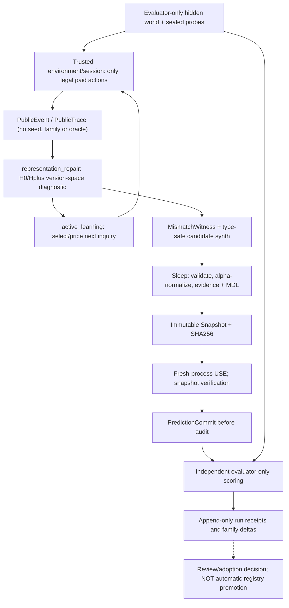

# EXP-REP-005 — Integrated end-to-end research decision candidate v1

id: EXP-REP-005-INTEGRATED-DECISION-V1
status: proposed_for_owner_agreement_not_frozen_not_run
updated: 2026-11-02
tags: design, hypothesis, architecture, active-learning, representation, wake-sleep, evaluation
issue: https://github.com/ryonakayama234/DekaSugi/issues/142
depends: https://github.com/ryonakayama234/DekaSugi/pull/143, https://github.com/ryonakayama234/DekaSugi/pull/144

> **Decision candidate, NOT implementation authorization.** This document proposes a complete G0→G6 work package, including real TRAIN / SLEEP / persistent Snapshot / fresh-process USE / disclosed engineering scoring IF AND ONLY IF prerequisite gates pass. No scored runs, implemented learner, formal holdout opening, performance claims, release, or merge follows from this document. The owner and independent methods reviewer must accept the preregistration before G1 implementation or G5 scoring. Never alter archived EXP-REP-004/004R data.

## 0. Why this task, and what would constitute scientific progress?

EXP-REP-004R corrected role invariance and the independent static comparator. In 108 disclosed adaptive paths LQ and LA never chose different inquiries; the learned TRAIN64 seven-body prior on 1,735 semantic candidates was IDENTICAL to preinstalled STATIC-MACRO (weights 1/4/13); the 11,520 proposed corrected score rows are NOT_RUN. This is not a negative accuracy result. Hypotheses "need a better policy" and "need a better representation" remain confounded.

**Chosen primary module:** new `packages/representation_repair` (NOT IMPLEMENTED). Supporting modules: `packages/active_learning`, typed interpreter/protocol, Snapshot loader, independent evaluator and receipts. Never patch historical `packages/rep004` to erase the failure.

Primary research question: Can public, priced evidence induce an agent to distinguish ordinary uncertainty from a falsified hypothesis class, autonomously construct an executable *context distinction* using a small generic typed metalanguage, validate and persist it, and reuse it on distinct semantic families at better lifetime utility than equal-capacity installed or policy-only baselines?

**Scope of novelty:** a learned predicate or abstraction *relative to H0 and the installed library*, NOT an entirely new primitive beyond the human-provided metalanguage, and NOT general causal identification, AGI, language intelligence or unrestricted program synthesis.

## 1. Competing hypotheses, with falsification paths

- H-OBS: available paid observations are insufficient; `V0(O_t) ≠ ∅` and several predictions remain viable. More lawful inquiry may help without a representation change. A failure to improve on such worlds disfavors the specific inquiry strategy, not all active learning.
- H-POL: H0 is sufficient for target phenomenon, but fixed P0 inquiry wastes information. A history/context-conditioned Pctx with H0 should improve paired-world predictive utility or same-accuracy cost. Equal questions chosen independently are valid data, never removed.
- H-REP: a deterministic visible-state-only H0 is *observationally falsified*: `V0(O_t) = ∅` while bounded typed Hplus fits, as witnessed by actual public charged events. New grammar expressibility alone is an **upper bound**, not learned invention.
- H-INVENT: learner synthesizes, validates and uses a typed predicate/feature from generic operators, rather than receiving the exact `previous_action_is` solution as an installed macro. Its causal removal or replacement changes a legal public-history prediction and possibly a paid decision; the same-capacity static Hplus comparator isolates any learned-search benefit.
- H-XFER: learned predicates and their applicability conditions improve independent-family new-world adaptation after Snapshot save/load, with positive incremental benefit when training and inference costs are amortized over future uses. If fixed Hplus matches learned Hplus, report no learned advantage.
- H-SAFE: when H0 and Hplus both fail, or legal actions cannot identify the difference within horizon, system correctly abstains/diagnoses unsupported rather than forcing invention.

Alternatives NOT preselected as preferred outcome: increasing training exposure; context-only policy; bounded predicate invention; Wake–Sleep abstraction; neural guidance. Neural networks are not required for first identification experiment because finite exact semantics provides an auditable causal attribution test.

## 2. Measurands: what we observe rather than assert

A. **L0 expressibility/diagnosis:** number of genuine public witnesses with `V0=∅, Vplus≠∅`, exact finite-proof signature / counterexample length, witness validity after all 24 object-role permutations, false positive and abstention rates on negative controls.
B. **L1 bounded search:** candidate AST nodes and canonical distinct semantic programs examined, actual primitive interpreter dispatches, time/CPU/RSS (if instrumented), timeouts and budget-exhausted as separate outcomes.
C. **L2 Active Learning:** paid action sequence, unique diagnostic questions, information reduction `Δ log2|V|` when applicable, exact post-inquiry predictions, coverage/abstention. A changed query alone is a *mechanism signal*, not outcome improvement.
D. **L3 Learning/transfer:** novel validated typed concept bodies, provenance, support/counterexamples, body-off/swap intervention effect, independent-family paired prediction utility and cost, Snapshot reproducibility in a clean process.
E. **Lifetime economics:** total training paid actions, generator/dream/repair/interpreter/validation/Snapshot loading CPU, per-use inference + paid question costs, amortization at planned N=1/10/100 uses. Never confuse cached logical calls with physical dispatches, or epochs with newly acquired worlds.

**Per-world primary engineering utility (proposed design weights, freeze BEFORE any score):**
- precommitted independent evaluation probes: each prediction scores +1 if exact, -1 if wrong, -0.25 if explicit abstention; score averaged across 12 independently held challenge probes;
- subtract 0.02 per paid learner action (budget 8); report exact prediction accuracy, coverage, false-solved, OOD false assertion, and paid/physical/CPU cost **separately**, without reducing ability to a single number;
- family-level paired difference in U is the comparison unit, averaged across world instances within each semantic family. Show negative outcomes, ties and whole distributions. Include sensitivity analysis of abstention penalty and action price but no posthoc threshold adjustment.
- The 12 heldout challenge **inputs** are pre-generated by an independent evaluator and are withheld **during the arm's 0–8 paid inquiries**; after the inquiry budget ends, their inputs alone are shown to the prediction interface without feedback or new world interactions. Correct outcomes remain evaluator-only. The predictor commits all answers/abstentions and a digest **before** scoring. Evaluation harness reset/clone is not a free agent action.

The chosen utility weights are *normative pilot choices*, not calibrated general-intelligence metrics. A measured gain in this pilot cannot establish intelligence in unrestricted domains.

## 3. Exact capability/identifiability model

H0: finite, canonical, role-invariant deterministic function `f(visible_4bit_state, legal_action) -> visible_4bit_state` of the old public-state current-action representation. The H0 candidate catalogue is fixed before testing; do not prove only failure of a weak search budget when claiming an L0 expressibility failure. Any two **within-one-world** legally observed records with the same visible state and same action but different next-state contradict the entire deterministic memoryless superclass, not merely the small H0 catalogue.

Hplus: H0 plus a bounded, typed *generic meta-expression* over PUBLIC event history, with `Lag(k, ActionFeature)` for k in {1,2}, `RoleEq(source/target/guard)`, `Eq(value)`, `And/Not`, `Guard(effect)`, and the existing validated edge-effect semantics. Bound AST depth, number of guards, lag window and canonical role/alpha-renaming before scoring. The learner cannot execute untrusted Python/shell, inspect hidden world truth, or receive `previous_action_is(set,role=source,value=0)` as an already certified learned concept. The human-specified one-lag relation is a **diagnostic ceiling**, not an acquired discovery. Installed Hplus STATIC has **identical expressible candidate semantics** and equal interpreter/selection budget to learned Hplus.

Canonical witness candidate (ALL four events priced 1): `set(source,0)` -> `pulse(source)` -> `set(target,0)` -> `pulse(source)`. On an appropriate history-dependent world both pulses share visible state zero and action `pulse(source)`, but have different successors. G2 must independently machine-check this proposal, legality, exact state trajectory, full finite semantic proof, all 24 relabelings and negative controls; before this it is ONLY a mathematical illustrative candidate.

**Diagnostics:**
- (V_0(O_t)\neq\varnothing): not publicly falsified (not proof that H0 represents the true hidden law).
- `V0(O_t)=∅, Vplus(O_t)≠∅`: mismatch relative to deterministic checked grammars; attempt contextual feature invention.
- `V0(O_t)=Vplus(O_t)=∅`: OUTSIDE_HPLUS/INVALID/possible stochasticity; abstain and inspect noise.
- indistinguishable alternatives under all *legal available priced actions within remaining horizon*: UNIDENTIFIABLE; do not hallucinate a witness.
- Compare against alternative *public-state augmentation* and stochastic/latent-state explanations, never equate representational mismatch with globally proven causality.

Negative controls: H0-sufficient state-conditional worlds, same visible state/action but identical outcomes, shorter horizon without reachable witness, lag>2 mechanisms outside Hplus, stochastic or contradictory observations, adversarial forged/unpaid events, object-ID-only shortcuts, misleading correlations and role permutations. If source contract cannot prevent oracle/peer leakage, STOP.

## 4. Algorithmic decision logic

```text
observe lawful public event; append canonical immutable event with cost/ordinal
build/check V0(public_events) using bounded exact semantic signatures
if V0 nonempty: select information-seeking legal query or predict/abstain
if V0 empty: compute Vplus(public_events)
  if Vplus empty: classify OUTSIDE_HPLUS/INVALID and abstain
  if Vplus nonempty:
    isolate minimal contradictory pair / distinguishing public suffix
    synthesize typed feature candidates using generic history/role DSL
    eliminate candidates contradicted by public evidence
    rank by fit + predeclared structural description length (MDL) + cost
    seek new legal public counterexample under remaining paid budget
    if consistent and validated: record CANDIDATE, never auto-promote
Sleep: canonicalize/alpha-normalize, deduplicate by executable semantics
       retain support/counterexamples, applicability/negative evidence
       serialize content-addressed immutable Snapshot
Fresh USE: load verified snapshot only from fresh process, optionally disable/swap
            learned body for attribution; commit predictions before scoring
Evaluator: separate private task/world/probe custody; compute family paired receipts
```

P0: strong fixed-budget query policy with exact legal candidate lookahead/partitions (rather than a weak random baseline). Pctx: history/state-conditioned active query policy using bounded version-space partition information gain, deterministic tie-breaking and explicit query cost. The policy learns its context ranking ONLY on public TRAIN experience; a policy-only arm shares this training budget without representation repair. A fixed Hplus may use the same full meta grammar as the learner, with the same primitive/compute budget.

A minimal-history feature is justified **only if it resolves an observed collision and survives new tests**; simply assigning a new name or favoring longer history does not count. Sleep's library is an executable typed abstraction with context-of-applicability, not frequency labels. Dream may generate strictly *synthetic public-compatible* rehearsal tasks from TRAIN-derived models; dreamed pseudo-labels cannot be independently counted as new world evidence and must be separately costed.

## 5. Architecture and trust boundaries



Two *different* studies must not be confused:
1. `same_public_prefix_diagnostic`: same lawful public transcript to both grammar instances, measure H0/Hplus logical consistency and a fixed semantic intervention. This is NOT an adaptive inquiry utility estimate.
2. `paired_world_independent_policy`: same hidden world instance/starting public information/available legal actions/cost+compute budget, but entirely **independent arm-local adaptive question paths and observations**. Paths naturally coinciding must be RETAINED; neither force equality nor force difference. Never transfer answer from one arm to another.

## 6. Machine data contracts (proposed v1; exact serializers to freeze)

- `PublicEvent`: schema_version, session_public_id (unrelated to hidden family), ordinal, state_before, action typed tuple, state_after, paid_cost=1, public_prefix_hash. Only actual authorized environment outcomes, no free resets, no source-world label.
- `VersionSpaceReceipt`: grammar_id, grammar_digest, public_prefix_hash, candidate_semantic_count, canonical_signature_hash, status {consistent, inconsistent, unidentified, unsupported}, logical/physical meter.
- `MismatchWitness`: two valid paid event ordinal references, identical (visible_state, action), conflicting successors, raw public evidence hashes, scope {deterministic-memoryless}, all role-permutation proof receipt.
- `ConceptCandidate`: typed_ast, meta_grammar_digest, normalized role-variable AST, canonical semantic hash, MDL nodes, support_hashes, negative_evidence_hashes, applicability predicate, status=candidate, source TRAIN-only.
- `Snapshot`: schema_version, source_sha, train_public_log_hash, candidate_digest(s), policy_digest, independent structural-family count (evaluator-only aggregate separate), cost summary, content SHA256, versioned interpreter ID; no generator truth or private score.
- `PredictionCommit`: arm_id, snapshot_digest or fixed_baseline_digest, trace_digest, pre-audit predictions/abstentions, public challenge input digest (inputs disclosed only after inquiry; outcomes stay evaluator-only), clock/cost/meter, self-test checksum.
- `ScoreReceipt`: evaluator-only opaque paired-world and semantic-family identifiers, arm, completed status, utility components, accuracy, abstention, legality, costs, challenge/source/checksum digests, failure/missingness reason.
- `RunProvenance`: git SHA, OS/Python, source/dataset/grammar/policy hashes, seed custody, independent reviewer, evidence artifact SHA, no overwrite. Keep evaluation-private manifest separate from learner-facing JSON.

## 7. Proposed complete exposure/score plan — NOT A RUN

Prerequisites: G0 independently confirms **at least 80 distinct canonical semantic families** can be generated without semantic/role-alias overlap, with 20 for each of P/R/U/N; otherwise STOP **before training/scoring** and register a new protocol, not a post-score substitution. Canonical semantic identity is based on exhaustive behavior under the defined state/action/history universe, not names/positions. Stochastic cases use separate labels and probabilistic validity checks; deterministic proof claims never cover them.

- P: H0-sufficient; R: H0-inexpressible but Hplus-expressible with legal ≤8-action witness; U: true difference not identifiable within budget 8; N: outside Hplus/contradictory/noisy. For N distinguish outside deterministic model vs genuine noise in reports.
- TRAIN: 32 semantic families (8 from each stratum), 2 distinct worlds/family = 64 paid world encounters; maximum 8 paid actions each, total ≤512; nested exposure curve 0/8/16/32/64 distinct world encounters, with counts of distinct structural families recorded. Do not call this SGD epochs. The fixed training order and all selection rules are committed prior to scoring.
- DEV: 16 disjoint semantic families (4/stratum), 2 instances each =32 worlds; disclosed engineering diagnostic for defects, may lead to a NEW method version and NEW future holdout; no retuning of later scored suite after viewing it.
- Disclosed engineering EVAL: 32 disjoint semantic families (8/stratum), 2 instances each =64 worlds; 12 evaluator-only challenge probes/world precommitted by independent scoring harness. Agent ≤8 paid actions/world. All 8 arms use same world instance and initial public info; 64 ×8 arms ×8 charged actions = **maximum 4096 inquiry actions** (excluding TRAIN/DEV), plus evaluator-only probes (not learner data). Actual compute runs bounded by predeclared per-arm physical interpreter dispatch ceiling, proposed 50,000/world/arm, and source checks; exceeded budget is reported as budget-exhausted, not silently omitted.
- Arms: H0+P0, H0+Pctx, HplusSTATIC+P0, HplusSTATIC+Pctx, HplusLEARNED+Pctx, H0+policy-only learner, Hplus+episodic-only lookup, Hplus+BODY-OFF. Fixed-static Hplus has equal semantic expressibility, lookahead and compute ceiling. All arms retain naturally identical question paths.
- N=1/10/100 repeated USE economics calculated from measured train and USE receipts without claiming that evaluating 100 future novel worlds actually happened. If future N fresh uses are performed, mark these as distinct measured evidence.

**Pilot engineering decision (not confirmatory science):** G1/G2/G3 mechanism gates are exact Boolean pass/fail. Report all 64 worlds and family-level paired deltas, source provenance and uncertainty intervals, even if null/negative. No fixed utility gain threshold automatically promotes a model; *scientific* gain requires a NEW independently custodied split and preregistered sample-size/power plan with review. Do not use disclosed DEV/EVAL for repeated confirmatory claims.

## 8. Gate sequence: one authorized work package, conditional execution

| Gate | Deliverable | Strict stop condition |
|---|---|---|
| G0: methods | independently reviewed frozen grammar, semantic families, controls, utility weights, source/split hashes, measurements | unresolved P0/P1 or disagreement, ambiguous capacity, non-identifiable trial design |
| G1: instrumentation | real charged public event typed runtime, source and leakage adversarial tests, 24 permutations | unauthorized data/reset/peer answer can enter learner |
| G2: expressibility | complete finite proof and independently reproduced lawful ≥2-history contradiction; positive & negative controls | no valid priced witness, Hplus not expressible, flawed proof |
| G3: actual learning | actual 0/8/16/32/64 TRAIN; counterexample-directed candidate; Sleep; persisted Snapshot; FRESH child process USE and body-off/swap tests | learned candidate cannot change an eligible legal predictive decision or fails integrity/reload |
| G4: comparator audit | all matched arms and physical paid/compute accounting; independently review exact source head | any equal-capacity, provenance, budget or history contradiction |
| G5: disclosed pilot score | after review, new 64-world paired engineering score only, all raw negative/null evidence and auditable hashes | any source/split drift; no sealed historical FINAL or backfilling |
| G6: research decision | report representation vs inquiry attribution, family-level gains/null, cost amortization, abstention and revision/stop recommendation | never auto-promote: owner+independent scientific review required |

**Scope of delegation requested:** owner may authorize the entire G0→G6 conditional pipeline in one explicit agreement; authorizing all gates is NOT waiving any gate. It permits only **disclosed synthetic engineering** runs, not old sealed F0/FINAL, promotion to main, external-network actions or autonomous app operation.

## 9. Model artifacts and terminology

`engineering_reference`: existing verified baseline source and method can be pinned for reproducibility but is not a successful learning model.
`research_snapshot`: a trained experimental state saved with SHA and restart test; can be locally loaded and used on bounded synthetic tasks with explicit warnings.
`release_candidate`: source/policy/snapshot sealed, acceptance methods passed, new independent families with demonstrated gain; none currently exists for REP005.
`stable_initial_model`: user-approved, reviewed, documented local model with a supported use contract and regression criteria. Do NOT label REP005 as stable merely because train/Snapshot/use works.

Optional later neuronal path: only after the exact finite mechanism is understood, replace the ranking component (NOT oracle/representation proof) with lightweight MLP/linear encoder and log actual gradient steps/epochs separately from distinct worlds. Compare against matched CPU/label/compute costs and keep same frozen evaluator.

## 10. Documentation/repository governance

Same implementation PR must update: AGENTS.md, docs/INDEX.md, docs/architecture/system.md Mermaid, docs/architecture/contracts.md, docs/specs/EXP-REP-005-DIAG.md, experiments/EXP-REP-005/plan-diag-v0.md or a new frozen plan, experiments/EXP-REP-005/runs/README.md, modules/tests, and exact source/Snapshot/artifact hashes. Tests and `python scripts/check_docs.py` are required; independent exact-head reviewer must be separate from author. GitHub remains Draft until review. Never merge a design-proposal PR simply for CI green. Existing #141 role-fix failure remains historical; this new isolated module should not depend on unmerged flawed scoring paths.

References/analogies (not inherited guarantees):
- Angluin, *Learning regular sets from queries and counterexamples* (1987), https://doi.org/10.1016/0890-5401(87)90052-6 — active identification; original model relies on stronger teacher/equivalence queries NOT provided here.
- Clarke et al., *Counterexample-guided Abstraction Refinement* (2000), https://web.stanford.edu/class/cs357/cegar.pdf — iterative representation correction, but our public-world counterexample is a different object than model checking's spurious trace.
- Ellis et al., *DreamCoder: Bootstrapping Inductive Program Synthesis with Wake-Sleep Library Learning* (2021), https://doi.org/10.1145/3453483.3454080 — library/search co-improvement; not proof of this project's learned-unique causal concept.

## 11. Current receipt

2026-11-02: **DESIGN ONLY / NOT_RUN**. Candidate method is written for owner agreement. G0 independent review not yet accepted. No code for representation_repair, paid experiment, learned artifact, scored data, scientific claim, merge or model release originated from this decision document.


## G0 capacity caveat — 2026-11-02 pilot source audit (NOT a frozen protocol)
The executable `PrivateFixture` generator in [G0 witness](../../experiments/EXP-REP-005/g0_witness.py) has **at most 14 role-renaming orbits** (12 guarded and one each always/never), not 80 independently structural semantic families. This is a generous *upper bound*, not 14 validated families. Its P/R mechanisms alone cannot fill the proposed 20-per-stratum design. The richer typed Hplus metagrammar and independent P/R/U/N family generator are **not implemented or certified**. Therefore the 80-family prerequisite above is **FAILED for the current pilot generator / OPEN for a future expanded generator**; G0 remains blocked. Do not change the planned counts or run G1/G2 certification, TRAIN, Sleep, Snapshot, fresh USE or EVAL. A new prospective generator and exact semantic/role-canonical verification, split manifest, independent methods approval and source review must precede any gate transition. [Detailed bound](../research/EXP-REP-005-G0-witness-feasibility-20261102.md#additional-g0-capacity-audit--pilot-fixture-cannot-support-the-proposed-80-family-split).
