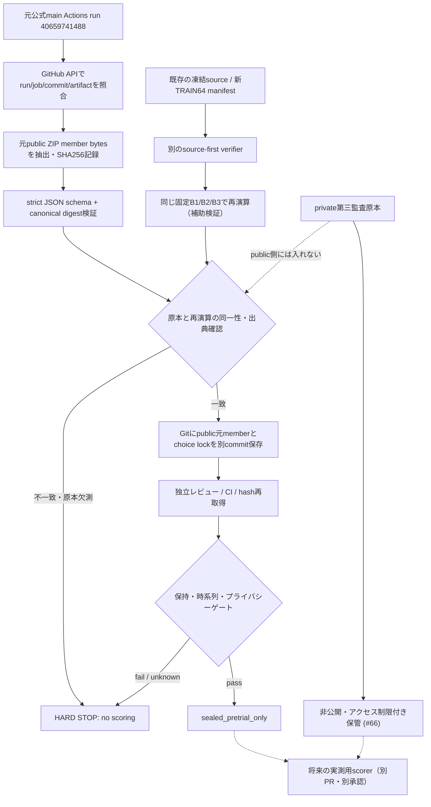
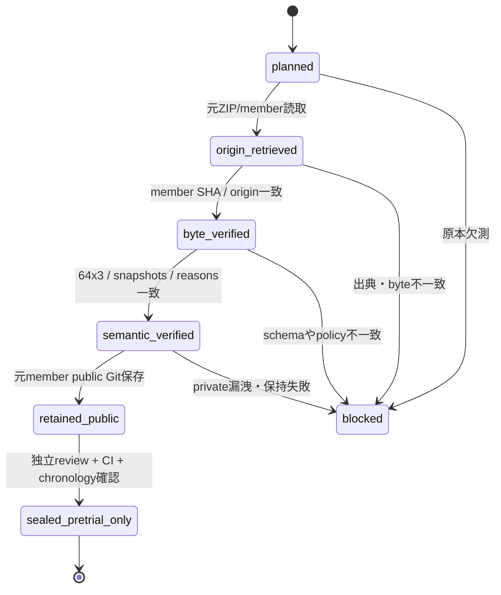

# OPPORTUNITY-001 PR9 — 事前判断 Evidence Capsule 設計契約

id: OPPORTUNITY-001-CHOICE-CUSTODY-DESIGN-V1
status: proposed_design_only; not_implemented; not_scored
updated: 2026-10-28
tags: opportunity, pretrial, evidence, custody, chronology, provenance, no-scoring

> **対象と非対象**: この文書が設計するのは、採点前の固定済みB1/B2/B3の**公開方策判断192件**の同一性・時系列・保持の工学的検証である。新たな知的能力、学習効果、機会率、正答率を測るものではない。採点、実験起動、学習、private第三監査原本へのアクセスは一切許可しない。
>
> 設計の親Issueは [#68](https://github.com/ryonakayama234/DekaSugi/issues/68)。新規TRAIN64の方法正本 [pilot-v1](../../experiments/OPPORTUNITY-001/pilot-v1.md) と [source lock](../../experiments/OPPORTUNITY-001/pilot-generator-lock-v1.json) は変更しない。

## 1. なぜこの設計が必要か：研究上の識別問題

本研究の将来的な推定対象は、固定された課題と予算における、(i) ON/OFFの監査付き正解差、(ii) 両正解時のcanonical primitive call差、(iii) **結果を見る前**に固定Kernelが選んだarmの機会損失である。このうち(iii)は「事後に最適だった方策」と「本当に事前に選択した方策」が別物であることを前提とする。

- 今回の測定対象（engineering measurand）：事前選択の**証拠品質**。単位は1つの事前判断イベントとその64 task × 3 policy = 192 action/reason記録。
- 今回の非測定対象：learnerの知能、on/off利得、古いDEV64/FINAL128、第三監査原本の真正性、学習による因果効果。
- 次段の科学的測定対象（現在 not_observed）：個々のtaskに対する監査付きpaired outcomeと、封印された事前決定に依拠するpolicy regret。別の評価器と独立レビューが必要。
- **同じpayload SHAが出ても証拠源が同じとは限らない。** 初期PR7は旧DEV/FINALの参照課題を再生成する禁止経路を通った（採点はしていない）。訂正後の公式main Actions runのみを原本候補とし、古いrunを権威ある事前証拠へ昇格させない。

## 2. 検証可能な仮説（工学的であり性能仮説ではない）

| ID | 仮説／反証可能な主張 | 対象観測 | 失敗条件 |
|---|---|---|---|
| C-H1 原本同一性 | 特定main Actionsの**元のpublic JSON member bytes**を保持し、raw SHA-256・canonical payload SHA-256を独立して検査できる | 元のZIP/member、固定JSON、SHA | 原本不在、byte hash不一致、曖昧なmember |
| C-H2 意味同一性 | 64件の唯一のTaskSpec IDにB1/B2/B3各1件のaction+reasonがあり、固定source/skill/policy/public manifestと矛盾しない | 再読込したJSON、凍結manifest、固定方策 | duplicate、欠損、余分な行、policy drift、理由不一致 |
| C-H3 採点前性 | 正式runに対応する事前判断原本・固定済みcommitが、後続のscoringより前に存在し、scorerが事後修正可能な値を参照しない | Git SHA・Actions run/job・artifact metadata・未来のscoring参照 | 出典を跨ぐ差替え、時系列不能、後出しcommit |
| C-H4 境界と保持 | public capsuleにprivate audit/family/seed/source_record_id/scoreを含めず、90日後も再取得可能な公開原本コピーが固定される | strict schema、public Git、保存記録 | private漏洩、TTLのみ、保存元不明 |
| C-H5 独立性の表記 | bytes/構文検査と、**同じchooser実装**による再演算を別の証拠レベルとして報告できる | read-only検証器の依存と監査ログ | 同じコードでのreplayを独立実装による予測証明と記述 |

H1–H5は真偽を点検するengineering gateであり統計的有意差検定ではない。**総合スコアや単一「真正性%」に丸めない**。各検査を `pass / fail / not_observed` として残し、ひとつでもfailまたは必要なnot_observedがあれば`sealed`へ遷移させない。

## 3. 凍結済みの識別子（新たな採用・測定ではない）

- 元の正式事前判断生成コミット：`c6b01c2a856a989e9b642fbe211cfd195f0e57e3`（PR #65統合）。
- 公式main Actions run: `40659741488`、job: `122719482732`、public-only artifact: `12803053107`。この出典**全体**を識別し、単独のpayload hashでは代用しない。
- 固定 `decision_payload_sha256`: `8a8625ed86e66b27bef8d09a023172d2adbc9ad0d42c155ab7f137097e2dccb2`。
- 公開64件TaskSpec manifest SHA256: `bc950ef3187fc34851eef5cff6df194ce27186b3a03b5399f2209e9905f04a85`。
- B1 snapshot SHA256: `3b4fc00f8ad0fe2f1cc0978886d7bc7a6285ed002c842ceeb0106fd51ee5afd4`。
- B2 snapshot SHA256: `01d5595e1b4c32d200e2734630f38a848e77a64f356741445e011865834f5af7`。
- B3 snapshot SHA256: `a6d46ab5dd697e8e90789693fdd3bd67bbca445ec07bc8b119401e1c0cf1e210`。
- 上位技能ID `skill_8fe1361cb5014f85`、body SHA256 `8fe1361cb5014f8503e4a57392e45f4fc7607e788fdd598f66668fbc11338eff`。原source lockの9 Git blobと古い14-source gateは従来どおり。
- 元ArtifactのGitHub表示期限は2027-01-26（変更・早期削除の可能性を含む）。これを長期保全とみなさない。
- `paired_trials_executed=0`、`dev_or_final_evaluated=false`、scoring permissionはfalseのまま。

## 4. 独立させるべき3種類のハッシュと2つの証拠

1. **物理原本**: 元Actions artifact ZIP全体のraw SHA256（補助的）、かつZIP内の正確なpublic JSON memberのraw byte SHA256（必須）。ZIP metadataや圧縮形式の差でJSON意味が同じでもZIP hashは変わる。ZIP member名を事前に固定し、余分なmember・重複名・symlink・path traversal・不正なcompression・サイズ超過を拒否。
2. **論理payload**: 元memberをstrict JSON parse（重複キー、NaN/Infinity、余分なkeyを拒否）したオブジェクトのSHA256。`json.dumps(payload,sort_keys=True,separators=(',', ':'),ensure_ascii=False,allow_nan=False).encode('utf-8')`を契約とし、既存`prepare_opportunity_decisions.digest`と一致させる。**pretty-printed JSONファイルのraw hashと混同しない**。
3. **参照先**: `source_manifest_sha256`はTaskSpec集合、`policy_snapshot_sha256`は方策状態、`skill_body_sha256`は技能本体に対する独立の識別子。decision payloadを置き換えない。

証拠A = **出典のある原本**（正式runから取得した未加工のJSON bytes、run/job/artifact/commit provenance）。証拠B = **独立して読める保存コピー**（公開Gitへ追加した原本JSONとlock）。Bのbyte hashがAと一致するときだけ「原本のコピー」と言える。後でchooserを再実行して生成した一致JSONは、Bの代用にならない。

> Git commitは検証可能な改変検出の足場だが、branch保護のないpublic GitやSHAだけで絶対的な不変性・永続性が保証されるわけではない。外部ミラーや期限のない第二の保持場所は望ましい。private原本はpublic Gitへ絶対に入れない。

## 5. 提案データ境界（PR9の実装時に初めて作るファイル）

`experiments/OPPORTUNITY-001/evidence/pilot-choices-public-v1.json`
: 元のpublic-only member bytesを**改変せず**保存する。以下のschema以外拒否。独立検証器が動作するまでは`not_verified`。

`experiments/OPPORTUNITY-001/pilot-choice-lock-v1.json`
: 元原本取得イベントの出典、元member raw SHA256、canonical payload SHA256、source/policy/skillの識別子、copiesの所在・digest、段階ごとの検証結果を明示する。ロックの外部metadataをpayloadの中へ混ぜず循環hashを避ける。原本ファイルのSHAは実際に取得したbytesからのみ採取する。

固定payload正本は`opportunity-pretrial-public-decisions-v1`:
- Top-level exact keys: `schema_version`, `method`, `phase`, `source_manifest_sha256`, `skill_body_sha256`, `policy_snapshot_sha256`, `decisions`, `paired_trials_executed`, `dev_or_final_evaluated`。
- `method=OPPORTUNITY-001-PILOT-V1`, `phase=FRESH_TRAIN_ONLY`。決定64行の順序まで含めてcanonical hashへコミットし、ID集合は唯一、各行`{task_id,choices:{B1,B2,B3}}`。各choice`{action,reason}`、actionは`ON/OFF`のみ、reasonは非空の定義済み方策出力と一致。
- Public IDは`t-`+小文字16進64桁。exactな64 IDと順序は**凍結済みの新TRAIN64生成器をsource-first検証した後だけ**照合する。旧DEV/FINAL生成関数を利用しない。
- `paired_trials_executed`は整数0（bool不可）、`dev_or_final_evaluated`はbool false。想定外のトップレベル・nested keyはすべて拒否。private、family、seed、source_record_id、third audit、ON/OFF outcome、score、選択後のtimingを混入させない。

ロック正本の具体的なschema名とkey群は実装前のレビューで凍結する。設計段階の例：
```json
{
  "schema_version": "pilot-choice-lock-v1",
  "status": "pending_original_byte_verification",
  "origin": {
    "main_commit": "c6b01c2a856a989e9b642fbe211cfd195f0e57e3",
    "workflow_run_id": 40659741488,
    "job_id": 122719482732,
    "artifact_id": 12803053107
  },
  "payload": {
    "schema_version": "opportunity-pretrial-public-decisions-v1",
    "decision_count": 192,
    "canonical_sha256": "8a8625ed86e66b27bef8d09a023172d2adbc9ad0d42c155ab7f137097e2dccb2"
  },
  "original_public_member_raw_sha256": null,
  "copied_public_member_raw_sha256": null,
  "new_train_pilot_scoring_permitted": false
}
```

`null`はここでは**未測定の設計例**であり、実装時の正式ロックでは原本hash未確認を合格扱いしない。

## 6. Source-first、時系列、独立性を分けるアーキテクチャ



- **PR9の設計・実装・CIは一切scoringを呼ばない**。最初のbytes検査はstdlib/read-onlyで行い、project importより先にsource identityを検証する。
- 元の同一実装でのreplayはdeterministic parityの診断であって、実装の独立性を証明しない。原本bytes検証と別にレポートする。
- 採点の時間的先後を人間の時計表示1つで断定しない。公式run+commit+artifactの観測と、将来のscoring用別commit・参照lockの**前後関係**を照合。GitHub metadataも信頼前提/限界を明記し、既存Git履歴を改変して補正しない。
- private auditのhashだけでは**private raw custody**を証明しない。#66の外部アクセス制限付き原本保全、独立actual scorer、once-only activation、exact-head reviewは全て独立の将来ゲート。

## 7. 証拠品質の状態機械



`blocked`を新しいartifactや再演算で黙って成功に書き換えない。明示した原因・commit/runとともにfailure recordとして残す。`sealed_pretrial_only`は「学習機会の検証完了」でも「実測許可」でもない。

## 8. 品質ゲートと実装順序

**Gate 0（今回）**: docs-onlyでH1–H5、対象、raw/canonical hash区別、保存計画、Mermaid、stop conditions、negative test matrixを独立レビュー。実測0件。

**Gate 1（後続PR9実装）**: 元Actions artifactを期間内に取得・厳格抽出し、原本public JSONを改変せず保全する。元member SHAとcanonical hashを照合し、公式run/job/commit/artifactを固定。失敗した初期runを参照しても採用しない。

**Gate 2（同じ実装PRでの校正）**: source-first identity、64x3完全性、policy snapshots、chooser理由一致、秘密情報の非混入、期限付きartifactを消してもGit上の保存コピーが照合可能なことを人工改変fixtureで検査。CIと独立exact-headレビュー/P0/P1解消。

**Gate 3（別工程）**: private第三監査**元bytes**のアクセス制限付きGitHub外保全、source-first actual evaluator、時間順序を保証するone-shot activationをそれぞれ独立にレビュー。いずれか欠けたらscoringは禁止。

実装する新しい検証器は本研究の結果を改善しない。性能差、一般化、Active Learning有効性、DSLの表現限界は本ゲートでは主張できない。関連: [ARCH-001](../architecture/system.md)、[ARCH-002](../architecture/contracts.md)、[engineering preregistration](../../experiments/OPPORTUNITY-001/choice-custody-preregistration.md)、[run ledger](../../experiments/OPPORTUNITY-001/runs/README.md)。
