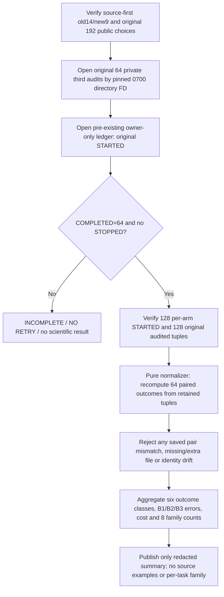

# OPPORTUNITY-001 — independent read-only recount after scored one-shot

id: OPPORTUNITY-001-INDEPENDENT-RECOUNT-V1
status: ENGINEERING_POSTRUN_NOT_EXECUTED
updated: 2026-10-29
tags: opportunity, evidence, readonly, independent, no-rescore, postrun

## Purpose and evidence boundary

The owner has not yet run the real 64-pair OFF/ON pilot. This module is
post-run engineering only, with synthetic test evidence. When a future
single irreversible owner-only one-shot completes, it reopens the locked
private original audit and scorer ledger **READ ONLY**, recalculates all
64 redacted pairs from the stored original nine-element audited tuples and
fixed original public B1/B2/B3 choices, then aggregates only permissible
statistics. It never invokes a scorer, changes a trial, creates a new
original, restarts interrupted work or uploads private files to GitHub.

## Workflow

Every ledger file is bounded, strict-JSON, owner-owned 0600 regular with
no symlinks/hardlinks, read using a pinned directory and nofollow descriptor.
Recount checks the source original and recorded scoring commit independently,
not just a JSON number labeled 64. The immutable single score reservation and
per-arm original trial tuples are retained outside the public repository.

An incomplete run must NOT be called a negative result, resumed or rescored.
No statistical significance/p-value or confirmatory improvement is claimed
from the exploratory TRAIN-only pilot. Per-family counts may be published
only in aggregate; individual task to family/seed/source relationships and
private audit examples stay on the trusted owner host.

Do not merge this branch to main until the owner has finished the already
pinned, non-scoring read-only source/original preflight at commit
d34f367a36311934975662bb611687fc8cbe0e98. That preflight requires
HEAD == canonical origin/main. A future recount commit is different from
the exact main commit on which real one-shot scoring was performed; record
both identities separately.

References: [pilot method](../../experiments/OPPORTUNITY-001/pilot-v1.md),
[reviewed runner](../../scripts/opportunity_one_shot_runner.py),
[read-only preflight](../../scripts/opportunity_readonly_preflight.py),
[issue #82](https://github.com/ryonakayama234/DekaSugi/issues/82).
