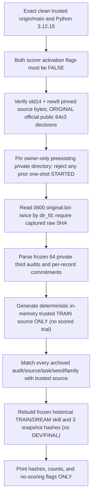

# OPPORTUNITY-001 — genuine owner-private READ-ONLY readiness check

id: OPPORTUNITY-001-LIVE-READONLY-PREFLIGHT-V1
status: ENGINEERING_IMPLEMENTED_NOT_SCORED
updated: 2026-10-29
tags: opportunity, train64, owner-private, source-first, readonly, one-shot, no-scoring

## Why this exists

The reviewed one-shot runner [PR #78](https://github.com/ryonakayama234/DekaSugi/pull/78)
and scoped activation [PR #80](https://github.com/ryonakayama234/DekaSugi/pull/80)
are now merged to main, but no genuine fresh TRAIN64 paired trial has yet been
performed. Both CI suites were **synthetic-only**. A genuine run is
irreversible once STARTED is created. To avoid wasting the only scientifically
meaningful run on Python path/schema/source mismatch, this separate
`scripts/opportunity_readonly_preflight.py` applies the same source and
original identity guards **without creating an irreversible run directory
or calling any new TRAIN64 OFF/ON scorer**.

## What is checked (after independent exact-head review and merge)



The trusted generator's in-memory deterministic audit reference is *not* a new
original archival capture. The existing, already stored `original.bin` is
never overwritten or re-created. The preflight may reuse the frozen historical
TRAIN/DREAM policy reconstruction in memory but NEVER score new TRAIN64 pairs,
touch DEV/FINAL, create STARTED, call _audited_trial on a new pilot case,
or use GitHub Actions for real originals.

## Later owner command (NOT until PR reviewed and merged)

From a clean checkout of the **exact then-current reviewed main commit**,
using Python 3.12.15, with the private dir kept outside the repository:

```bash
uv run --no-project --python 3.12.15 python \
  -m scripts.opportunity_readonly_preflight \
  --private-dir "$HOME/dekasugi-train64-private" \
  --original-sha256 "<PREVIOUSLY_RECORDED_PUBLIC_RAW_SHA256>" \
  --approved-main-commit "<EXACT_REVIEWED_MAIN_SHA>"
```

The owner should not blindly paste this example: these placeholders must be
replaced with the previously recorded 64-record original SHA and the newly
verified main merge commit. Do not include private data or passphrases in
GitHub, scripts or command logs. A failure prints only a generic
STOP message; no attempt is made to repair or regenerate the original.

After `status=all_frozen_pretrial_and_private_original_checks_pass_no_score`
with 64 originals, 192 prespecified public decisions, both flags false and
no ledger, an independently reviewed one-shot private owner activation may
be considered separately. Preflight success **does not itself** prove
whole-file deletion-proof cloud retention, authorize scoring, or report
any scientific performance result.

Refs: [frozen experiment method](../../experiments/OPPORTUNITY-001/pilot-v1.md),
[one-shot runner](../../scripts/opportunity_one_shot_runner.py),
[activation](../../scripts/opportunity_approved_activation.py),
[Issue #79](https://github.com/ryonakayama234/DekaSugi/issues/79).
