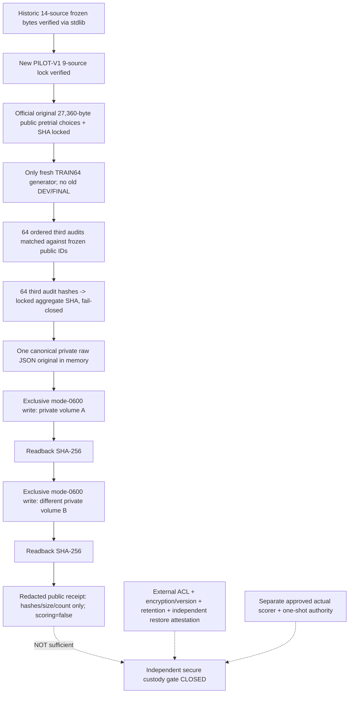

# OPPORTUNITY-001: source-first private-original capture BEFORE any scored trial

id: OPPORTUNITY-001-PRIVATE-CAPTURE-V1
status: PR_implementation_synthetic_only; genuine_capture_not_run; durable_custody_not_verified
updated: 2026-10-28
tags: opportunity, private-origin, custody, source-first, audit, no-scoring

## Purpose and exact implementation boundary

[Issue #74](https://github.com/ryonakayama234/DekaSugi/issues/74) adds a **manual private-host capture CLI**, not a scorer or activated GitHub Actions workflow. It cannot open old EXP-0003A DEV/FINAL or EXP-0002B FINAL, update a learner/policy, or compare OFF/ON. PR CI only runs invented synthetic adversarial fixtures. As of this document, **genuine new TRAIN64 third-audit records captured = 0; paired scored results = 0**. Do not confuse with the already backed-up historical EXP-0003A DEV64 ZIP.

### Fixed, ordered dataflow



The full source-first entrypoint `scripts/capture_opportunity_private_original.py` verifies the old 14 frozen source blobs before project imports; the new 9-source lock, independent third audit commitment, official pretrial original raw SHA and logical choice SHA; and exact 64 public task IDs in the preserved official order. It never changes the 192 B1/B2/B3 choices. Fresh generator results are produced only after all source and choice checks; untrusted data never enters a Kernel chooser.

The private JSON contains 64 evaluator-only `{task_id, third_audit: {input, output}, source_record_id, family, seeds}` records and immutable public hashes. This is **private**, not a public export schema. Actual private text, family labels, source records and seed values may not appear in GitHub logs, PRs, Git files or normal Actions artifacts. The user-supplied historical DEV64 raw ZIP is not an input.

### Output requirements and limits

- The intended operator is on a trusted Linux/WSL2 host with exactly **Python 3.12.15**; pinned generator source preflight rejects any mismatched patch-version. Run only after the exact-head capture implementation is independently reviewed/merged.
- Two distinct absolute **output file** paths are required; their preexisting parent directories must be real owner-only (`0700`) Linux directories **outside this public Git tree**, without symlink parent aliases. They must be on different mounted filesystems; this is a minimal physical-independence heuristic, not proof of different devices or providers.
- File creation is exclusive (`O_CREAT | O_EXCL | O_NOFOLLOW`) with owner-only mode `0600`, flush/fsync and SHA-256 readback. The CLI refuses replacement of existing files. The *same private raw bytes* are copied to both locations. The format is raw JSON; **not encrypted** by the CLI, and the locations must be protected outside this tool.
- A failure during the second write deliberately leaves the first original intact for an independent custody investigation; neither failure nor partial capture authorizes a retry or scoring. A different path on a later invocation is not blocked globally by this local helper; the **external independent one-shot capture log** must separately enforce no re-generation.
- A success receipt contains raw SHA256, size, task count, fixed public choice and third-commitment digests, and zero-score/false-authority flags. It contains **no private examples, seeds, source IDs, filenames or absolute local paths**. The CLI prints a fixed redacted error on any rejected path or source mismatch.
- The tests use only synthetic fixtures. **No legitimate original private bytes have been produced or stored by this PR**, and CI must not execute this script's `main()` with valid private destinations.

Manual invocation on an appropriate private operator machine **after** code review (never in public GitHub Actions):

```bash
python3.12 -m scripts.capture_opportunity_private_original \
  --capture-before-scoring \
  --primary "/absolute/private-volume-a/original.bin" \
  --secondary "/absolute/private-volume-b/original.bin"
```

The operator must also preserve a private external independent record of first write, second write, byte digest, access controls, storage object version, retention and successful readback. Avoid pasting private paths in public issues. Do not interpret a local two-copy receipt as independent archiving proof.

## Separate blocking gates

**NOT VERIFIED**: (a) independently trustworthy permanent off-public-GitHub storage with strict ACL, encryption or equivalent security, independently retrievable object version and retention; (b) proof of independent archive restores; (c) true one-time chronological external custody; (d) separately reviewed live source-first paired OFF/ON scorer and activation. Passing code, synthetic tests, 2 local hashes or this documentation cannot close them. The actual [Issue #66](https://github.com/ryonakayama234/DekaSugi/issues/66) one-shot **TRAIN64 score remains not_run** until all are independently demonstrated.

Method: [immutable PILOT-V1](../../experiments/OPPORTUNITY-001/pilot-v1.md); existing public origin [Issue #68](https://github.com/ryonakayama234/DekaSugi/issues/68); local SHA helper [Issue #72](https://github.com/ryonakayama234/DekaSugi/issues/72); run ledger [here](../../experiments/OPPORTUNITY-001/runs/README.md).

## Private owner operator runbook
[WSL2 local raw first-capture and encrypted Google Drive restore procedure](OPPORTUNITY-001-PRIVATE-OPERATOR.md) gives concrete commands and distinguishes ephemeral second-volume integrity check from durable independent offsite custody. It must not be followed until exact-head independent review and merge; no real capture or score has been run by this PR.

## 2026-10-29 independent Codex security remediation (before real capture)
- P1: the original absolute private pathname is **never used for final write/readback**. The revised CLI opens every ancestor with O_DIRECTORY|O_NOFOLLOW from the root, rejects writable non-root-sticky ancestors, compares the final descriptor's device/inode/mode/owner to the preflight, and pins it with dir_fd for exclusive creation, fsync and SHA readback. A synthetic ancestor symlink swap fails without writing to a fake public tree. A root-owned sticky /dev/shm for ephemeral second checks is permitted, but does not constitute durable external custody.
- P2: the documented invocation uses Python module syntax (-m), and direct script execution now resolves the repository scripts package without importing project packages before old14/new9 source checks. Synthetic subprocess tests assert this without generating any real TRAIN64 original.
- These fixes are code hardening only. Independent exact-head review/CI must pass before merging; actual third-audit capture and scoring both remain NOT_RUN.
