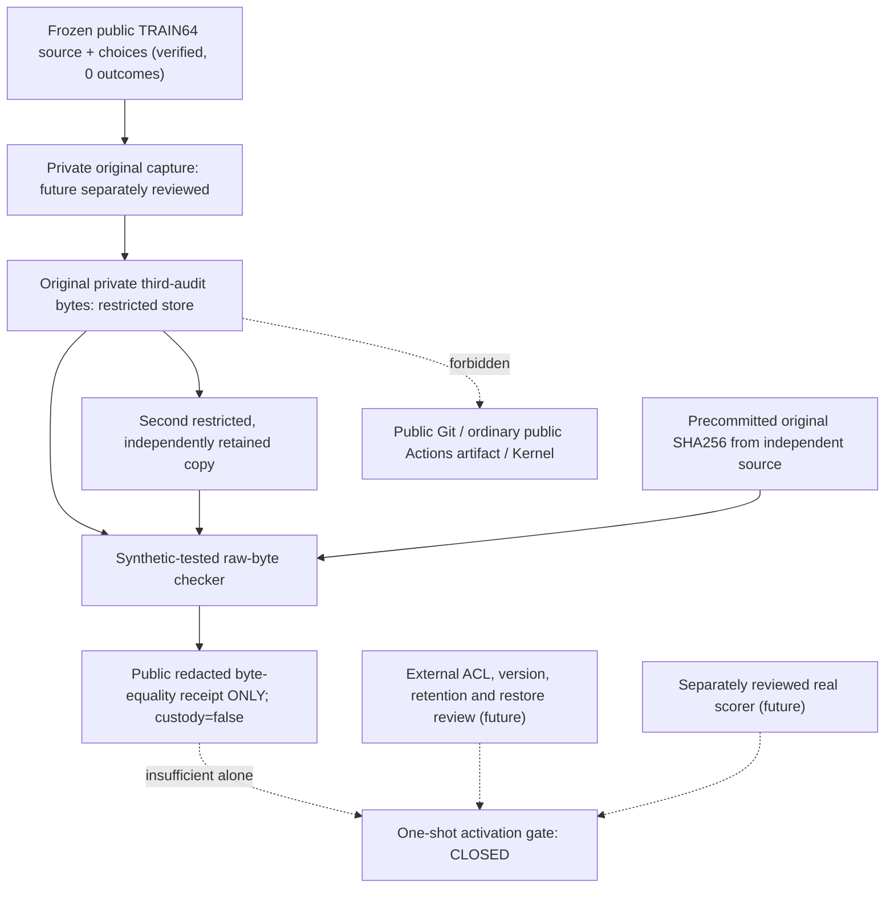

# OPPORTUNITY-001 — private-original custody readiness (before scoring)

id: OPPORTUNITY-001-PRIVATE-CUSTODY-READINESS-V1
status: byte_copy_helper_implemented_synthetic_only; full_custody_not_verified; scoring_not_run
updated: 2026-10-28
tags: opportunity, security, provenance, private-audit, pretrial, no-scoring

## One-minute status for the project owner

The **old DEV64 ZIP** is the backup of a different, already-scored historical experiment. There is **no missing pre-existing OPPORTUNITY-001 TRAIN64 result ZIP to find**. The new fresh TRAIN64 experiment currently has 64 *public* tasks and 192 sealed *before-trial* B1/B2/B3 choices. Fresh ON/OFF paired observations: **0**. Its evaluator-only third-audit originals must be generated and securely retained **for the new study**, outside public Git and outside learner inputs, **before** ON/OFF scoring.

The helper below checks *only that two pre-existing local files reproduce a separately captured raw SHA256*. It does not create originals, upload them, encrypt them, start an experiment, check GitHub secrets, authenticate audit provenance, or grant scoring permission.

## Necessary later source-first custody sequence (NOT implemented)

1. Independently review the source-first real scorer and a **distinct** before-scoring original-capture mechanism; verify all frozen old 14-source and new 9-source blobs before importing study code. Do not generate old DEV/FINAL. Validate the original public 64 TaskSpecs and retained public 192 B1/B2/B3 choices against their raw/canonical digests; do not overwrite or recompute the official original.
2. In a trusted private runner, create exactly 64 evaluator-only third audit original records **before any scoring**, without passing originals to Kernel/chooser. Keep the raw bytes in a restricted folder or encrypted store that is **not within the public repository or ordinary public Actions artifacts**. Pin an immutable raw SHA256, size, method/code/source identity and original capture chronology. Never print family, source_record_id, seeds, private example text or local private paths.
3. Copy the exact encrypted-or-restricted original artifact to a separate independently protected long-term target. Verify copied raw byte digest against the original. Separately verify storage ACL/encryption, object version/immutable retention, object ID and independent readback; the verifier below does **not** perform those external checks.
4. Independently review the private capture receipt and second-storage checks. Only then can a separate one-shot scoring PR request activation of the frozen TRAIN64 evaluator; no activation based solely on this helper. All OFF/ON trials must be performed once, with fresh registries/meters and independent third-audit checks. Store redacted public evidence; restricted raw originals must remain retrievable for audit.
5. A failed or incomplete source gate, private preservation, audit correctness, independent review or provenance check means **STOP**. Preserve diagnostic evidence, do not silently regenerate or rerun.

## Read-only local raw-copy integrity tool (implemented; synthetic unit tests only)

`scripts/verify_opportunity_private_copy.py` hashes two **already existing**, distinct local files at absolute paths, checks a separately pinned raw SHA256, rejects symlinks, hardlinks to the same file, missing/empty/oversized files, public repository paths and byte mismatches. A successful redacted JSON report contains **only** raw digest, size, copy count and non-authoritative flags; it discloses no file paths or audit contents.

Only after authorized private originals actually exist, run this locally under WSL2/Linux (replace placeholders; do not paste private paths into public GitHub comments):

```bash
python3 scripts/verify_opportunity_private_copy.py \
  --primary "/absolute/private/location/original.bin" \
  --secondary "/absolute/separate/location/copy.bin" \
  --expected-sha256 "<original raw 64-hex SHA256>"
```

The program is a comparison utility, **not an encryption or backup service**. It does not inspect ZIP members, decrypt data, validate source identities, attest second-provider access controls, or guarantee physical independence even when filesystems differ. A successful report intentionally says `independent_private_raw_custody_verified=false`, `scoring_authorized=false`.

A reviewer with storage access must separately confirm privacy, verified version/retention and independent retrieval, and record a public **redacted** attestation. The user's historical unencrypted DEV64 ZIP can **never** satisfy this new TRAIN64 requirement.

## Data boundary



## Frozen/unchanged facts

- [Pilot method](../../experiments/OPPORTUNITY-001/pilot-v1.md) and [source lock](../../experiments/OPPORTUNITY-001/pilot-generator-lock-v1.json) unchanged; `new_train_pilot_scoring_permitted=false`.
- [Official public decision original](../../experiments/OPPORTUNITY-001/evidence/pilot-choices-public-v1.json) and [choice lock](../../experiments/OPPORTUNITY-001/pilot-choice-lock-v1.json) unchanged; 64 tasks, 192 pretrial choices, zero paired outcomes.
- [Issue #66](https://github.com/ryonakayama234/DekaSugi/issues/66) controls the real-scoring/custody gate, [Issue #72](https://github.com/ryonakayama234/DekaSugi/issues/72) the local checker and future custody preparation. [DEV64 historical backup](../../experiments/EXP-0003A/runs/20261027-dev64.md) is a different experiment.
