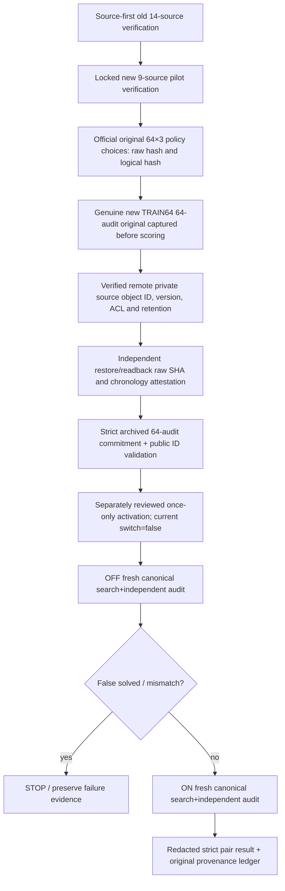

# OPPORTUNITY-001 — reviewed real-pair engine boundary, NOT an activated experiment

id: OPPORTUNITY-001-REAL-PAIR-ENGINE-V1
status: implementation_in_pr; synthetic_only_ci; one_shot_not_activated
updated: 2026-10-29
tags: opportunity, actual-evaluator, canonical-audit, strict-gate, no-scored-trials

## What is implemented and what is not

`scripts/opportunity_real_pair_engine.py` now wires **actual canonical** OFF and ON arm execution to the fixed trusted synthesis/audit components (`packages.exp0003a.pr3._audited_trial`) and the independently reviewed **pure** PR #67 normalizer. It creates distinct fresh trusted primitive Registries, registers the identical pinned top skill in ON only, independently audits the third example, and halts immediately if OFF returns `false_solved`. The ON tuple is audited and normalized with the same safety rules, with no oracle or mutable chooser. It also rejects substituted private audit input by comparing the precommitted SHA-256 before executing any search. These are real code paths, but **no live engine has been authorized, enabled, or run**.

There is no scored CLI, workflow dispatch, or automatic activation: `SCORING_ACTIVATED=False` and `_unactivated_real_pair` refuses execution. `main()` reports `paired_trials_executed=0` only. All CI tests exercise **invented fixture tuples and injected functions**; they never run actual fresh TRAIN64, old DEV/FINAL, or third-audit source generation.

## Evidence sequence required before activation

- `source_first_preflight()` checks the exact original old14 and new9 locked bytes **before** project imports and confirms the exact officially retained original 192 policy choices. It is a preflight, not a scoring authorization.
- `validate_private_archive()` strictly checks raw SHA-256 against an *independently recorded* original digest, original canonical schema and exactly 64 public task IDs/order, distinct source ids/seeds, a zero-trial timestamp field, and the preregistered full third-audit commitment. It is **not proof** of remote custody authority or storage access rights.
- `assemble_audited_pair()` independently validates the audit digest and frozen skill/budget/three policy actions, then uses a fresh canonical registry for each OFF and ON arm. No learner receives audit text/family/seed. Any `false_solved` stops promotion; no partial row is fabricated.
- `_unactivated_real_pair()` requires a **separate** reviewed activation switch and independent per-run source, origin capture, custody and first-run gates. The pure engine itself does not load private originals from Google Drive or attest owner permissions.
- No private audit examples, private original ZIP/JSON, source labels, seeds, passwords, tokens, personal Drive folder IDs or owner email addresses may be published to GitHub/CI.

## External restricted archive, currently partial

A **dedicated non-shared Google Drive folder** has been created and its permissions show only the owner; its identifying URL is shared **privately with the owner**, not in public repository docs. This resolves the folder-provisioning step but does *not* establish original archival custody: the folder is empty, the first original is not captured, Google Drive object ID/version/retention and independently restored bytes are not verified. The storage destination is outside public GitHub, but an ordinary Google Drive folder is not proven immutable/WORM.

The two-copy local helper (PR #73), source-first capture helper (PR #75), and this engine each have distinct responsibilities. None independently authorizes the 64 paired trials. The user's old EXP-0003A DEV64 ZIP belongs to a different historical run.

## Next required steps and stop conditions

1. Finish latest-head independent reviews and CI for PR #73, #75 and this engine; fix every P0/P1. Merge sequentially, rebasing documentation without changing frozen source/method hashes.
2. Establish a concrete external custody operator path: capture only after the capture helper is reviewed; place the unaltered private original in **independently retrievable restricted storage**, verify ACL, raw digest, immutable original object ID/version and retention plus a second readback/restore, record chronology and original captured bytes outside public Git. Do not silently regenerate if a first partial write exists.
3. Separately implement and review an exact-head, one-shot main-only activation with source-locked real scorer identity, fail-closed external custody certificate verification, interruption/failure ledger, and public redacted result. No old DEV/FINAL use.
4. Only then run the 64 TRAIN pilot once. If the archive cannot be independently verified, **STOP** and record `NOT_RUN`, not zero opportunity or a negative scientific result.

Related: [Issue #66](https://github.com/ryonakayama234/DekaSugi/issues/66), [Issue #74](https://github.com/ryonakayama234/DekaSugi/issues/74), [Issue #76](https://github.com/ryonakayama234/DekaSugi/issues/76), [PILOT method](../../experiments/OPPORTUNITY-001/pilot-v1.md), [run index](../../experiments/OPPORTUNITY-001/runs/README.md).
