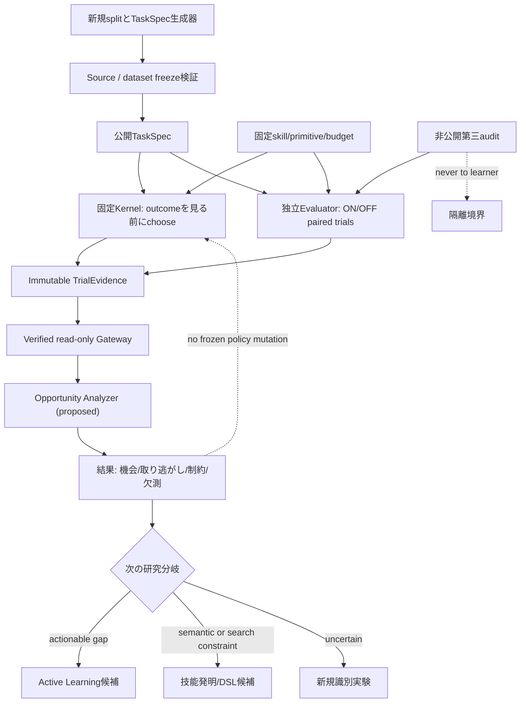

# OPPORTUNITY-001 — 学習機会・能力上限の識別仕様

id: OPPORTUNITY-001-SPEC
status: proposed_design_only; not_implemented; not_evaluated
updated: 2026-10-28
tags: opportunity, actionability, evaluation, decision-regret, expressibility, research

## Problem / なぜ必要か

[POLICY-DIAG-001](../../experiments/POLICY-DIAG-001/runs/20261028-archive-public-diagnosis.md)ではB2/B3のDream選別は24/96件しか共通せず、DEV64で5NN近傍集合は61/64件で異なった。しかし支持票と平均節約量は63/64件、行動は63/64件、原始演算費用は64/64件で一致した。これは過去DEVの**事後記述**であり、方策改善の因果効果も、特徴の有害な圧縮も証明しない。元DEVの公開TaskSpecは保存されておらず、8D特徴・距離の独立再生は不可。

研究目的は、**経験を追加すると改善できる対象が現行の行為体系に存在するのか**を新しい課題で診断し、後続研究を「方策学習」「技能/表現の拡張」「識別不能の解消」から根拠に基づいて選ぶこと。人工的な単一スカラー知能値の創設ではない。

**主責務: evaluation**。将来の候補実装は `packages/evaluation/opportunity.py` （現在は存在しない）。既存の `packages/exp0003a/pr3.py`、`packages/kernel`、SEC-004、MEASURE-0001は変更しない。CAL-01の`packages/metrology`は**人工fixture限定**であるため、本実験を既に検証済みと扱わない。

## Research questions / 測定対象と操作的定義

- **RQ1 Action sensitivity**: 同一公開TaskSpec・同一canonical primitive / skill body・予算 / verifierで、技能OFFとONの独立trialを実行した場合、監査付き正解や原始演算費用に差があるか。
- **RQ2 Missed opportunity**: ON/OFFの両結果を評価器が観測した後に初めて得られる「この二択の良い方」と、事前に固定したKernelの選択との差はどこにあるか。
- **RQ3 Mechanism**: 差が乏しいとき、課題の両arm同値・両arm未解決・現予算内の探索限界・一般的な意味での表現限界をどの証拠で区別できるか。
- **RQ4 Economics**: 学習データ取得と方策推論の費用を含めたとき、改善の可能性が残るか（次期比較実験の設計用。今回の設計PRでは実測しない）。
- **RQ5 Representational sufficiency（探索的）**: 公開8D特徴が一致または近接する課題で、評価器のみが知る二択の利得が矛盾するか。衝突＝有害と直結させない。

観測単位は `fresh task_id × locked candidate skill × fixed budget × paired OFF/ON`。統計上の推論単位は事前に定義する生成family / 独立seed clusterとし、同じTaskSpecの2armを独立標本扱いしない。

## Hypothesis / 競合仮説と反証可能な予測

- **O-H0（帰無・優先）**: 新しい母集団では、固定技能のON/OFF間に実質的な差が乏しいか、Kernelがほぼ全機会を捉えている。方策改善を最初に実装すべき根拠はない。機会率の推定区間も提示し、単なる有意差なしをH0の証明とはしない。
- **O-H1（行動感応性）**: 監査付き同一正解条件でON/OFFのprimitive cost差、または一方のみ正解する課題が一定数ある。反証は、固定した母集団で差が未観測で、その上限も研究判断用閾値未満となる場合。
- **O-H2（方策の取り逃がし）**: 正解を優先した最良の二択と固定Kernel選択がずれる課題があり、その差は評価可能。反証は有効paired課題で取り逃がしがほぼなく、信頼区間の上限も小さい場合。
- **O-H3（特徴識別力不足の候補）**: 同じ8D特徴群に、後知恵の最適二択が異なる有効課題がある。衝突がないことは表現の十分性の証明ではない。距離近接のみで悪影響を断言しない。
- **O-H4（表現・探索制約）**: 両armで未解決の相当部分は技能ON/OFF選択だけでは解決せず、探索予算またはDSL意味論の変更という別介入を要する。ただし「不正解」のみで表現不能とは推定しない。
- **O-H5（獲得費用の影響）**: 原始演算節約の潜在利益があっても、TRAIN/DREAMのデータ生成・独立paired評価・推論CPUを償却すると実運用利益が消える可能性。計測境界を固定して別指標として検査。

H1–H5は併存しうる。いずれも事前登録後の**新規**データでのみ確証の候補となる。過去DEV64から事前登録の成功を宣言しない。

## Classifier / 先に正確性、次に費用

両armの第三例監査が揃い、同じ予算・primitive版・対象課題で比較可能なときだけ分類する。

| status | 判定条件 | regret/差の扱い |
|---|---|---|
| `both_correct_on_cheaper` | ON/OFFとも監査正解、ON calls < OFF calls | OFFを選んだときだけ正のexcess calls |
| `both_correct_off_cheaper` | ON/OFFとも正解、OFF calls < ON calls | ONを選んだときだけ正のexcess calls |
| `both_correct_tie` | ON/OFFとも正解、calls等値 | calls gap=0。ただしCPUは別 |
| `on_only_correct` | ONのみ監査正解 | OFF選択を`missed_success`として1件、費用regret=null |
| `off_only_correct` | OFFのみ監査正解 | ON選択を`lost_success`として1件、費用regret=null |
| `neither_correct` | 両方未解決/不正解 | 改善可能性は不明。成功機会0やregret=0と補完しない |
| `not_observed` | 片arm/監査欠測 | 分母から除外、欠測数・理由を別途記録 |
| `non_comparable` | それぞれ合法だが予算/意味/評価条件不一致 | 効果量禁止 |
| `invalid` | hash/重複/漏洩/不正値/安全性違反 | fail-closed |

正確性が同じときに限りcallsを比較する辞書式優先順位を採用。両arm正解・同callsの場合、実用方策ではOFFを同点優先（余計な技能を使わない）とすることを**提案**し、確定は数値事前登録前に行う。異なる監査結果を呼出数という単一損失へ換算しない。

## Metric registry / 単位・分母・尺度

- `paired_valid_count` [tasks]: 両armの正解/費用/監査/予算が比較可能。常に総数・欠測・invalid併記。
- `choice_sensitivity_rate` [tasks/tasks]: valid全件中、正解が異なる、または両正解でcallsが異なる割合。母集団は新規生成分布で固定。
- `policy_missed_success_count` [tasks] / `policy_lost_success_count` [tasks]: 片側だけ正解で固定方策が誤armを選択した件数。対象は片側正解のvalid subset。
- `policy_excess_calls` [calls]: 両正解のvalid subsetのみ、`max(0, selected_calls - min(off_calls,on_calls))`のtask別値と合計。同点を0、両不正解をnullにする。
- `policy_decision_error_rate` [tasks/tasks]: 有利なarmが一意のvalid課題のうち、Kernelがそれを選ばなかった割合（正解優先）。同点は分母から除外。
- `best_of_two_success_coverage` [tasks/tasks]: 両armの一方以上が正解した割合。**事後診断上の二択集合の上包絡**であり、実際の学習済みOracle、DSL全体の能力上限、未知分布の性能ではない。
- `feature_collision_utility_disagreement` [groups]: public 8D完全一致集合内で最良armが異なる件数。あくまで探索的な表現診断。
- `acquisition_cost` [canonical calls, CPU ns, wall ns]: 訓練用paired trials・Dream生成・特徴計算・選別・学習の費用を相互に区別。推論/独立auditと二重計上しない。
- `expressibility_evidence_coverage` [tasks]: formal-proof、bounded-enumeration、unknownの各件数。「未発見」を証明に昇格しない。

区間推定、family別層化・効果量・負の結果を記録。8 familyだけのbootstrapの一般化限界を明示。仮説検定の主対象、閾値、分母・欠測方針はデータ生成・評価**前**の別凍結ゲートで数値確定する。

## Expressibility / 証拠階層（重要）

1. `formal_invariant_proof`: 対象の**意味仕様**と許容原始演算に対し、全入力を通じた不可能性/可能性の演繹的根拠（前提・適用ASCII範囲・proof_id・独立レビュー）。例: trim/lower/upperのみでは非回文の文字順反転を一般操作として実現できない。生成器のfamily名だけでは証明しない。
2. `exhaustive_within_budget`: 固定registry・列挙器・候補/展開AST限界を検証し、完全走査で与えられた例に一致する解法が**見つからない**。これは特定の例集合と探索予算の結果で、全入力での不可能性ではない。
3. `found_verified_program`: ASTが独立auditで正解。観測された例に対する正答であり全入力の意味的正しさの保証ではない。
4. `unknown_or_censored`: 制限・停止・欠測・未証明。安全なデフォルト。

上記を二値の「表現できる/できない」に畳み込まない。reference transformationやfamilyの正解ラベルはevaluator-only。

## Architecture / 将来実装の責務



- Learner/Kernelは新規TRAINでの合法な公開特徴と、TRAINの監査済み教師観測のみを取得。DEV/FINALのpaired outcomeは事後の評価器・報告だけに保持。
- Gatewayは実行権限を持たない。source-first SHA/Git blob・schema・重複・分割・費用scope検証。METRO-0001 CAL-01 reducerを直接利用しない。将来の実データadapterは別テスト/レビュー。
- Public報告はプライベート監査実体とgenerator-private IDを出さない。FINALを後続学習に再利用しない。
- シミュレーションや追加armは別実験。現行のON/OFF効果と「新技能獲得」を混同しない。

## Proposed OpportunityRecord/0.1（未実装・架空の形）

```yaml
schema_version: opportunity-record/0.1
phase: TRAIN                    # DEV/FINAL output is evaluator-only
task_id: t-<public TaskSpec digest>
source:
  dataset_sha256: "<digest>"
  primitive_blob_sha: "<digest>"
  skill_body_hash: "<digest>"
  policy_sha256: "<digest>"
  verifier_version: "<version>"
  meter_version: runtime-canonical-v1
  budget_id: fixed-budget-01
policy:
  chosen_before_trials: OFF
  decision_hash: "<digest>"
trials:
  OFF: {audited_correct: true, primitive_calls: 20, candidates: 8}
  ON: {audited_correct: true, primitive_calls: 8, candidates: 7}
classification: both_correct_on_cheaper
cost_regret_calls: 12             # only both-correct cases
success_regret: null             # applicable only one-correct cases
expressibility:
  evidence_level: unknown_or_censored
  proof_ref: null
quality:
  comparison_status: observed
  missing_reason: null
  evidence_ref: "<sha256>"
```

上記数値は説明用で未観測。run/phase/arm各recordに一意IDと原本hash、MetricSpec版を持たせる。監査用raw答/seed/familyは別の非公開manifest。誤ったschema/元ファイル不一致を推測補完しない。

## Acceptance / design-only gates

1. 仮説と操作的定義、競合原因、statistical unitが決まり、確認と探索を明確に区別。
2. 両正解/片正解/両不正解/欠測/非比較の分類が定義され、損失の不正な混同がない。
3. 表現証明・予算内網羅探索・不明が分離。監査漏洩を断つ契約がある。
4. docs/INDEX・ARCH-001/002・plan/run目録・AGENTS/roadmapが同じPRで更新。
5. PR CI文書/回帰検査、最新head独立レビュー。P0/P1不解消なら未統合。
6. **PR1は実装・TRAIN/DEV/FINAL実行0件、採用判断なし**。研究方法の最終数値凍結は、レビュー済みの後続実装前に別commitで実施。

## Tests / 次期実装で必要な反例

synthetic: 同じcallsでON/OFF判断だけ違う、異なるcallsで両正解、片側正解、両方未解決、同点OFF、false-solved、truncated enumeration、budget/primitive drift、duplicate task、源hash不一致、監査欠測、非公開field混入、順序シャッフル、meter ON/OFF非干渉、CPU負値/NaN、private manifest accidental publish。すべて新規TRAINまたは人工fixtureで検査。旧DEV/FINALを再生成しない。

Related: [Issue #56](https://github.com/ryonakayama234/DekaSugi/issues/56) / [plan](../../experiments/OPPORTUNITY-001/plan.md) / [ARCH-001](../architecture/system.md) / [ARCH-002](../architecture/contracts.md) / [METRO validity](../metrology/validity.md)。

## PR2 engineering fixture reducer (implemented, synthetic-only; not real evidence)
- `packages/evaluation/opportunity.py`: `classify_fixture` and `summarize_fixtures`. Input **only** `schema_version=opportunity-fixture-v1`, `phase=SYNTHETIC`, `task_id=fx-...`. Real `opportunity-record/0.1` adapter still **unimplemented**.
- Exact row fields: `schema_version, phase, task_id, source_lock, policy_choice, policy_decision_before_trials, trials`. Lock fields: `dataset_sha256,skill_sha256,policy_sha256,primitive_sha256,source_commit,meter_version,budget_id`. Each OFF/ON trial: `audit_status,audited_correct,search_status,primitive_calls,tested_candidates,false_solved,budget_id`; unknown/private fields rejected.
- Source-lock equality checks caller-pinned synthetic identity, **not source-file SHA verification**. Pretrial flag is an assertion, **not an independent chronology attestation**. A future separately reviewed adapter must verify real evidence.
- `both_correct` permits excess calls; `on_only`/`off_only` record missed/lost success with null cost regret; `neither_correct` records null regret; `not_observed` for missing audit, `non_comparable` for differing arm budgets. Invalid counts, false-solved, private fields, and duplicates stop aggregation.
- Aggregate-only fixture summary includes classified counts, accurate denominators, miss/lost success and both-correct excess calls; no individual TaskSpec or raw private answer. Uncertainty not estimated for synthetic fixtures.
- Tests: [fixture tests](../../tests/test_opportunity_fixture.py), [run ledger](../../experiments/OPPORTUNITY-001/runs/README.md), [Issue #58](https://github.com/ryonakayama234/DekaSugi/issues/58). No scientific claim.

## Pilot-v1 implementation contract — frozen method, not yet a run
- [OPPORTUNITY-001-PILOT-V1](../../experiments/OPPORTUNITY-001/pilot-v1.md) preregisters fresh TRAIN64 case generation, distinct seed namespace/characters, 2 public + 1 evaluator-only audit, unchanged 4/100 budget, EXP-0003A frozen skill and independent pretrial B1/B2/B3 selectors.
- A different real-evidence adapter, source/manifest lock, independent review and main-only one-shot activation are required before measuring paired effects. The synthetic-only `opportunity-fixture-v1` reducer cannot accept real records. Pilot descriptive allocation heuristics must never be promoted to scientific p-values or inference over unrelated domains.

## PR4 implemented TRAIN-only source (hash-only, no scoring)
- `packages/evaluation/opportunity_pilot.py` generates exactly 64 new `TrainCase` instances under [immutable PILOT-V1 method](../../experiments/OPPORTUNITY-001/pilot-v1.md), using completely new seeds and input alphabet, two public examples and an evaluator-only distinct third audit. `public_manifest`, `canonical_public_digest`, `public_preflight` and CLI `--mode hash-only` contain **public source identity only**, not outcomes.
- `tests/test_opportunity_pilot.py` covers exact deterministic population/transform/seed, duplicate and malformed manifest, old TRAIN IDs without old holdout generation, no third audit leakage and no evaluator imports.
- The CLI/public preflight does NOT attest original implementation bytes, freeze policy snapshots, or independent audits, and cannot score. Pre-scoring reviewed source/manifest freeze and real-evidence adapter remain pending. Synthetic fixture reducer remains separate and unmodified.

## PR5 independent source-only verifier (no scorer)
- [independent auditor](../../scripts/audit_opportunity_pilot_public.py) re-implements immutable PILOT-V1 using only standard library; does not import project generator or evaluator, verifies fixed public manifest SHA, outputs one SHA-only commitment to 64 third audits without exposing bytes. [tests](../../tests/test_opportunity_pilot_independent.py) include modified alphabet negative control and corrupted-token rejection.
- Source-only independent hash agreement is **not independent outcome auditing** or restricted private original artifact preservation. A later source/manifest/policy lock must pin the exact auditor blob, generator blob, code commit/Python, skill/policy and complete public/private commitments. Trial count remains zero.

## PR6 implemented source-first freeze (pre-scoring only)
- [pilot-generator-lock-v1.json](../../experiments/OPPORTUNITY-001/pilot-generator-lock-v1.json) pins original main source commit, 9 Git blob byte identities (including verifier itself), Python 3.12.15, public 64-task digest, third-audit commitment, EXP-0003A original freeze payload, unchanged top skill and B1/B2/B3 snapshots, and independently reviewed PR63 CI provenance.
- [verify_opportunity_generator_lock.py](../../scripts/verify_opportunity_generator_lock.py) validates all local bytes before importing project generator, then independently checks public/audit commitments. [tests](../../tests/test_opportunity_generator_lock.py) exercise fail-closed source edits, unauthorized scoring flags, policy/identity/schema tamper and missing file.
- Explicit frozen permission flags: **both new pilot scoring and old DEV/FINAL scoring false**. A separate real adapter, before-trial decision seal, original private evidence retention, reviewed one-shot activation and independent recount are prerequisites for any outcome claim. Source freeze is a necessary, not sufficient, research evidence condition.
