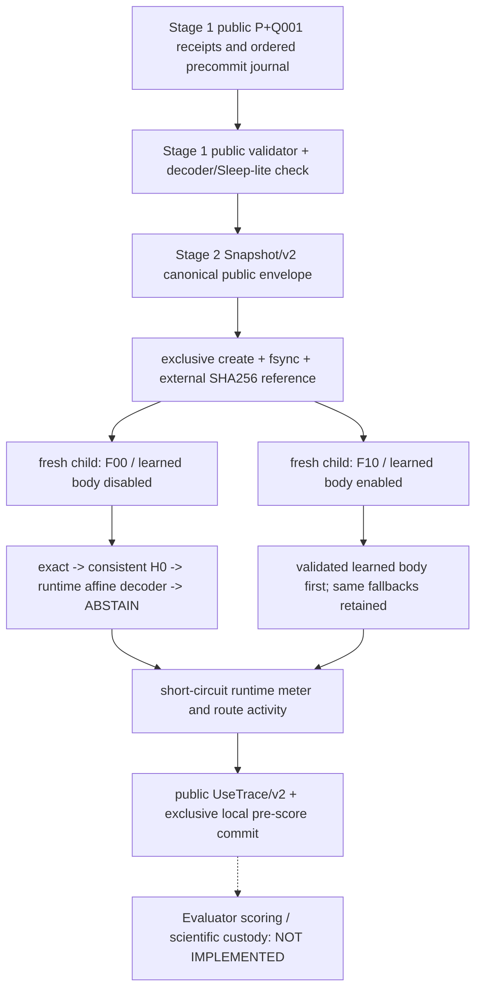

# R2-M-ENG Stage 2 — immutable Snapshot / fixed dispatch / meter

id: R2-M-ENG-STAGE2-20261105
status: implemented_in_draft / pending_ci_and_independent_review / engineering_only / no_scientific_scoring
updated: 2026-11-05
tags: r2-m-eng, stage2, snapshot, fixed-dispatch, meter, synthetic-only

## Authorization and non-goals

Authorized by [Owner conditions A-D](https://github.com/ryonakayama234/DekaSugi/pull/175#issuecomment-6633458178), with Stage 1 accepted and merged on main in [PR #176](https://github.com/ryonakayama234/DekaSugi/pull/176). Main baseline: `650a042432c0af76aaa439742cd766907dda1115`. This PR implements **Stage 2 only**, under [R2-M-ENG scope](R2-M-ENG-SCOPE.md) and adopted R2-M method v2. Stage 3 controls / closure implementation / integrated runner / scientific fixtures are not created here.

This is **engineering with human-supplied artificial F_aff laws only**. No genuine private USE scoring, independently sealed source, learned policy, N_rep/U/T evaluation, closure COMPLETE, M_gap/M_use certification or scientific inference. F01/F11 remain NOT_EVALUATED and ORACLE-REF remains evaluator-only. The publicly known parity example is not used as independent evidence. Frozen R1, v1, historic results, existing heldout/sealed data, and the adopted method text remain unchanged.

## Flow (ARCH-001 / ARCH-002 implementation delta)



Both children receive **the same canonical absolute Snapshot path and external expected bytes SHA256**. No relative-path resolution in a child, public/private labels never enter Snapshot, dispatcher, meter or public UseTrace. The separate `source_gateway` is test-only evaluator-side input generation, not imported by the learner-side modules. ENG module boundaries do **not** secure against a malicious same-process attacker or provide external custody.

## Implementation and contracts

| Module / API | Input, output, stop and invariant |
|---|---|
| `snapshot.write_snapshot(path, history, journal, body, expires_at=..., parent_digest=None)` | Public 4 ordered observations, initial×3/precommit/answer public journal, typed validated deterministic decoder/Sleep-lite body. Resolve path at creation; exclusive `O_EXCL` and fsync; `SnapshotRef(path,sha256,size_bytes)`. Recompute legal-Q digest from the public deadline, remaining budget and allowed Q001; refuse duplicate path, forged legal digest, missing precommit, expired/changed event times, public mismatch and invalid body. |
| `snapshot.load_snapshot(absolute_path, expected_sha256=...)` | **Mandatory out-of-band expected bytes SHA**; canonical absolute path; read and revalidate full canonical bytes, role/schema, envelope digest, public and journal receipts, policy/closure/body/compiler/validator provenance. Refuse tampered or unknown content. Local SHA is not independent storage or trusted timestamp. |
| Snapshot/v2 payload | Parent digest (if supplied), public evidence/journal digests and public query expiry, full Sleep-lite receipt, fixed H0/policy/route/arm/closure manifests, typed tree body and digest, independent public validator receipt; closure UNKNOWN / M_gap UNKNOWN / M_use NOT_CERTIFIED. No private law or USE label. |
| `dispatch.predict_fixed(path, expected_sha256, point, arm)` | F00 / F10 only. Restores the Snapshot afresh, fixed rank and resource limits. ON selects the validated body; OFF disables **only** this body, retaining exact episodic, 8-H0-consistency and available nonpersistent runtime F_aff decoder. Never manufacture OFF ABSTAIN by removing decoder. Outputs public-only UseTrace/v2; no target answer/score input. |
| `python -m packages.r2_m_eng.dispatch` | One fresh process per arm, with `--snapshot` absolute path, `--sha256`, `--point`, `--arm`, `--trace-output` exclusive local JSON receipt. Stage 3 runner orchestration **not** supplied. |
| `meter.measure_ast(body, point)` | Independently counts `ast_nodes_static`, actual short-circuit `node_visits_runtime`, and executed NOT/AND/OR `primitive_ops_runtime`. Leaves count as visits, never primitive operations. |
| `meter.cost_ledger(...)` | Explicit discrete dimensions: paid Q, public observations, decoder calls, actual candidates vs budget=16, validator calls, H0 scans, static/visited/primitive, restore/store bytes, process CPU seconds, monotonic wall seconds, **process** peak RSS bytes. No retrospective unit-weighted scalar. Restore-time decoder rederivation (1) and public validator calls (3) are explicitly charged in a `restore/use` breakdown, separate from dispatch-time calls. Restoring a pre-existing Snapshot does not store it again (`stored_bytes=0` per USE). |

### Explicit fixed-branch inventory and scientific limit

The isolated Stage-1 R2-M-ENG package has the public decoder, H0 scan and episodic receipts. Stage 2 binds the latter as three fixed nonbody fallback routes in this version:

```text
F10: persisted validated learned body
F00: persisted learned body disabled (artifact still available)
both: episodic_exact -> h0_consistent -> runtime_affine_decoder -> ABSTAIN
```

The runtime decoder is legally available for F00. The same publicly known family, method and candidate budget apply, and runtime decoder calls are charged where actually executed. Therefore synthetic F00/F10 predictions may be identical; a route difference alone is **not** an M_use result. Future Stage 3 must audit additional legal routes before any claim about complete `H0_effective(B)`. This is **not** a closure COMPLETE proof. The snapshot rejects modifications to the fixed route manifest; new controls require a separately reviewed manifest version, not silent removal of OFF routes.

### Test plan (all artificial, no scientific data)

`python -m unittest discover -s tests -p 'test_r2_m_eng_*.py' -v` covers: 16 known affine fixture coefficients; canonical write/restore and duplicate refusal; mandatory external SHA and changed-bytes refusal; attempts to forge manifest, journal, receipt, body or private fields even with rehashed bytes; missing/late/illegal precommit and fabricated legal digest; fixed ON/OFF snapshot parity and all nonbody fallback routes; dynamic short-circuit counters vs the independent Stage-1 interpreter; distinct-cwd independent subprocesses with pinned same path/bytes and exclusive trace commits; F01/F11 nonactivation. Run on the existing path-limited synthetic-only PR workflow.

## Current gate

The code is **submitted for CI and independent reviewer verification**, not yet Owner-accepted. To advance, confirm exact-head CI, repeat negative tests independently, audit source import boundary, compare route list against any other legitimately wired route, and review three independent meter units. Stage 3 is blocked until this Stage 2 review is accepted. Merge needs separate Owner approval.

No engineering pass implies M_use=certified or M_gap=complete. Scientific scoring is separately gated.
