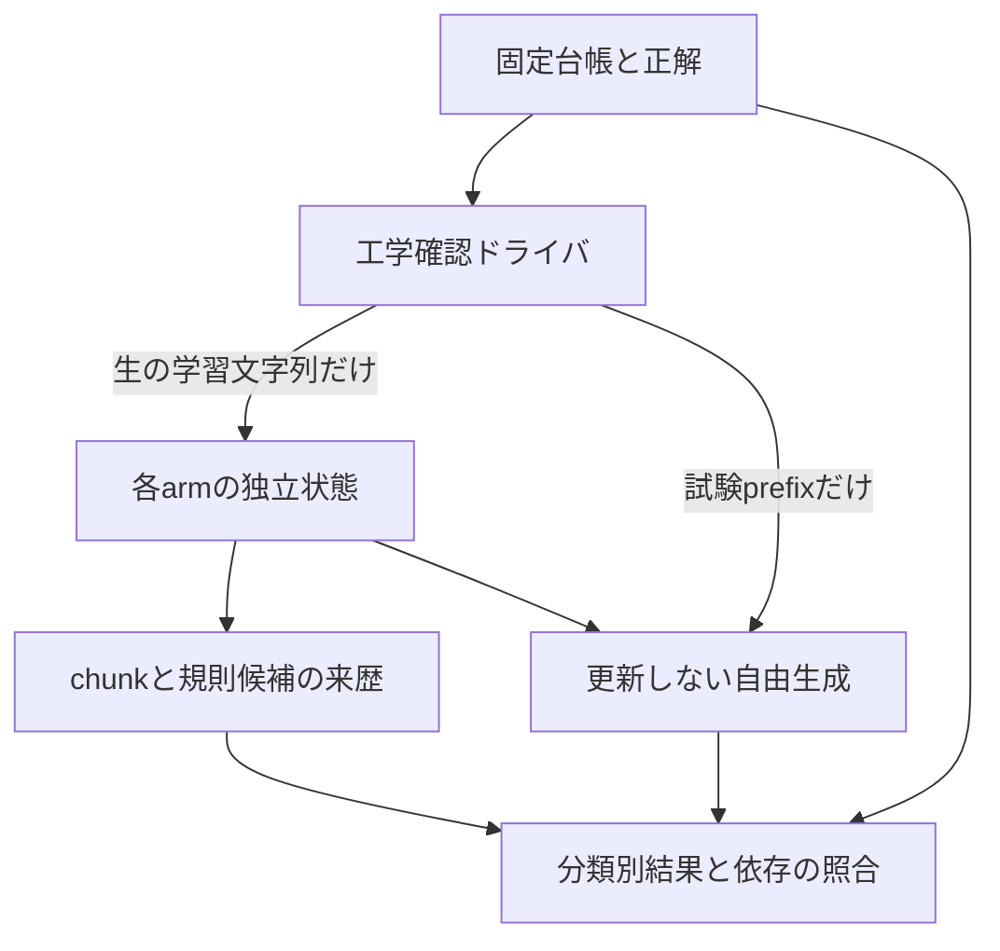

# SYMBOL-BOOTSTRAP-1 — 文字経験からの最小学習器

id: SYMBOL-BOOTSTRAP-1-SPEC
status: implemented_engineering_only_pending_muse
updated: 2026-11-17
tags: bootstrap, candidate, cpu, artificial

[実行前固定](../../experiments/SYMBOL-BOOTSTRAP-1/plan.md) / [数値・順序・台帳](../../experiments/SYMBOL-BOOTSTRAP-1/lock.json) / [結果・独立確認手順](../../experiments/SYMBOL-BOOTSTRAP-1/runs/README.md)。Owner GO: Issue #227 コメント6949870568。E1記録エディタとは独立したstdlib/CPUの試作。

## 仮説と代替説明

経験で得た部分文字列を名前付き候補にし、その名前で後の入力を分割すると、後続のまとまり・規則候補の形成と未見の続き予測に寄与するか。反復記憶だけ、または与えた文字レベルのコピー文法だけで十分、という代替説明を4armで区別する。成功を要求して上限や例を変えない。

## 学習機構と与えたバイアス

`packages/symbol_bootstrap/__init__.py` は語一覧・正解分割・生成規則を知らず、`observe(episode_id, raw_text)` のみを受ける。全ての文字位置を候補のprefix/suffix境界にして、過去の異なる行との位置対応の差分を変数にし、コピーとliteralの連結を列挙する。これは実装者が与えた候補文法で、規則自体を発見するために必要な帰納バイアスである。文字列全体が同じ反復は新しいunique支持ではない。

FULLは、2つ以上の異なる元文字列に現れた長さ2〜8の断片をC-IDで保持する。後のepisodeの候補形成時に既存C-IDを最長一致で用いる。C-IDを使って形成した新chunkのpartsと、symbol経路から得た規則R-IDの依存を作成時に記録する。同一ASTが先に文字経路で形成済みなら、その形成時来歴を後からsymbol経路へ塗り替えない。保持上限到達時の刈込み・頻度による黙った候補削除はしない。

NO-CHUNKは最初から別状態で同じ54本を処理し、chunk表・symbol経路を持たない。文字経路と原始処理、展開文字範囲、保持/探索の上限は共通。FULLに追加経路があるため実際の候補数・操作数は同じとは限らず、併記する。MEMORYは全prefixの残り全文対応とngram、NO-LEARNは空状態。両者の将来文法を先に与えない。

## 契約

|値|契約|
|---|---|
|raw_text|境界を持つ1 episodeの文字列。英小文字と4記号、最大32文字。prefix位置、語の区切り、正解を伴わない|
|pattern/output|`["L", character]` または `["V", index]` の有限列。Vはinputで一度だけ束縛し、outputでコピー。任意コード・eval・callbackはない|
|Chunk|C-ID、文字展開、作成episode、partsの文字位置・参照C-ID。支持の全位置はfragments表から辿る|
|Rule|R-ID、pattern/output、created/updated、route、依存C-ID、形成元2 episodeとsplit/variable_spans、全支持/反例episode|
|Evidence|反復episode件数と異なるraw_text件数を別計数。新候補も全過去行を検査し、反例でconfidenceが下がる|
|Prediction|7文字自由生成。選択AST・束縛・全適用候補・fallback逐字記録。試験prefixから状態を更新しない|
|Report|固定14件×4armの56行。分類・期待・実予測・完全一致・状態digest、a/b1/b2/b/c別分母と勝敗/同点/棄権|
|Missing/stop|固定分母の欠損/重複を拒否。上限超過はRESOURCE_STOP、比較は未完了。保存欠損を不正解件数や0点へ混ぜない|

## データの境界

現在prefixは文脈で、頻度更新の材料にしない。生成途中に正解文字を与えない。各試験の前後で科学状態のcanonical digestを照合する。操作カウンタと純粋な照合cacheは増えるが予測状態は変わらない。試験を逆順にしても各予測は不変であることをunit testで確認。

## リソースと失敗

正本の `lock.json` の上限を使い、CLIに上限/seed/例/方式を選ぶフラグを設けない。FULL/NO-CHUNKの候補形成は1 episode 16,384試行、規則と断片の保持各4,096、総操作2,000万、CPU/wall各120秒、成果物50,000,000 bytes。細部は固定JSON。有限ループ内の協調チェックでCPU/wallを検出する設計で、OS/cgroupの強制隔離を実装したものではない。CPU/wallは全処理の実測、arm別は操作数を記録し、arm別CPU時間は未計測。出力は新規directoryへ保存し、既存runを上書きしない。

## 確認の射程

この人工例は候補文法との相性が強い。cは未知内容文字でも汎用コピー規則が適用可能であり、c成功を学習済みの語彙の存在証明としない。aだけ改善なら反復記憶効果。bでNO-CHUNKと並んでもchunkの寄与は未確認。依存があっても不正解なら有効な再利用ではない。独立標本を前提にした検定・有意差・日本語能力・意味理解・実目的への有用性を主張しない。
