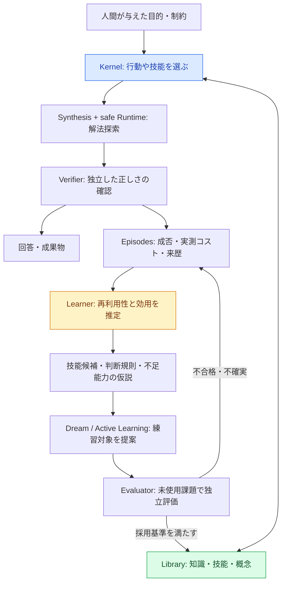
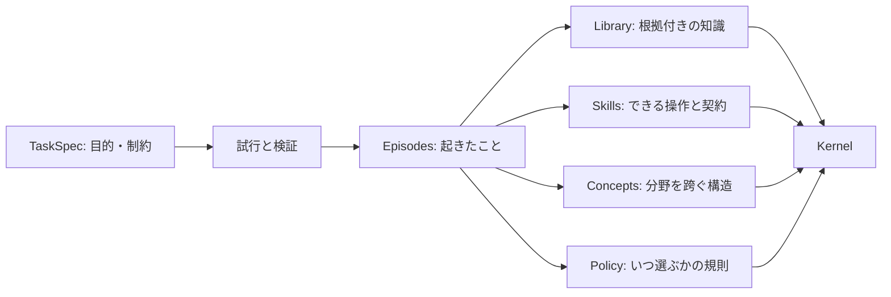

# VISION-001 — DekaSugiの長期ビジョン

id: VISION-001
status: agreed direction; research hypotheses remain unverified
updated: 2026-10-24
tags: vision, capability-growth, self-directed-learning, evaluation, governance

## 合意した目的

**DekaSugiは、経験を通して自分の知的操作体系を組み立て直し、未知課題に対する実際の能力を成長させるAIの研究プロジェクトである。**

解答数や保存した知識の量を単独の目標にはしない。小さなKernelが、外部化された**知識・技能・概念・経験**を利用し、新しい操作を発見し、いつ使うと有効かを判断し、不足能力と学習対象を特定できる仕組みを段階的に研究する。

このビジョンは**方向性への合意**であり、学習成功・汎用知能の実証や研究段階の承認を意味しない。個別の研究仮説は事前登録・独立評価・安全確認を通してのみ採否を決める。

## 目指す５つの能力

1. **解法探索** — 原始操作を型・制約・予算の下で構成して初見課題を解く。
2. **技能発明** — 反復利用できる操作を抽出して、型・依存・出典付きの候補にする。
3. **技能の価値判断** — 課題の文脈と過去の実測を使い、技能の使用有無を選択する。不確実な場合は安全な既定操作に戻す。
4. **自己の限界の推定** — 知識不足・操作不足・探索不足・判断材料不足を区別する仮説を立て、後から検証する。
5. **学習対象の選択** — 将来課題の改善見込み、費用、不確実性、権限を考慮して練習課題や技能候補を選び、独立評価で確認する。

目標は自律性の最大化ではなく、**能力向上と制御可能性の両立**。破壊的操作・外部アクセス・技能の昇格には別途権限と検証ゲートが必要。

## 長期的な知能成長の循環（将来像）

**図は目標アーキテクチャ。** 実装済み・提案中の境界は[全体構成](../architecture/system.md)と各実験runで管理する。

## 成長の指標：４つを混同しない

| 測定対象 | 評価の意味 |
|---|---|
| 能力の拡張 | 同じ権限・探索条件で、以前は解けなかった課題を解ける |
| 効率の改善 | 正確性を維持して、実行コスト・候補数・その他の実コストを減らす |
| 汎化・転移 | 訓練とは異なる問題・テンプレート・領域でも改善する |
| 自己評価の精度 | 自分の成功可能性・不足・学習利益についての予測が実測と一致する |

ライブラリ項目数・成功例数・本人の自己申告は直接の成長指標ではない。**評価に使った答えを学習や設計に流用しない**。失敗実験は保存し、都合のよい結果だけを選ばない。学習・推論・安全検査を含む費用と部分的な指標を区別する。

## 知識の外部化：保存する対象

事実、実行可能な操作、抽象構造、実際の経験、行動選択の方策を区別する。**観測事実は追記して保存し、学習した解釈・方策はバージョン付きで別管理する**。出典、データ版、技能依存、前提条件、有効範囲、検証結果、未知領域への適用の不確実性を検索できる状態にする。

## 到達までの研究順序と現在地

- EXP-0001：型付きDSLと探索・検証の技術基盤 — 実装・baseline検証済み。
- EXP-0002：技能候補発見 — PR #6に実装・回帰テスト。独立レビューおよび本流への統合待ち。
- EXP-0002B：技能価値の学習 — 設計・計測・実験計画のPRがあり、実際の方策学習は未実施。事前登録v1の欠陥を修正する**v2を別版で準備**する。
- EXP-0003以降：Wake–Sleep / Dream、能力の地図、能動的学習と領域間転移 — 研究目標であり未実装。新しい技能の数ではなく、独立課題での適応を重視する。
- 将来的な用途：CSV/JSON等の現実のデータ加工を、許された安全な実行環境と検証を備えた操作として扱う。現在は将来の利用例であり、既存の製品機能ではない。

## 研究運営の合意

- **人間が合意すること:** 目的・制約・成功の定義・自律性の範囲・危険な権限付与。
- **開発エージェントに委ねること:** 局所の技術選定、設計、実装、テスト、GitHubのブランチ・Issue・PR管理。
- **独立して監査すること:** 方法の公正性、安全性、事前登録の遵守、結果の主張、重大な設計変更。
- **毎作業の必須コンテキスト:** `AGENTS.md`、`docs/INDEX.md`、Mermaidシステム図、データ契約・データフロー、実験計画と不変run記録を同期。未実装・未実証は明記。
- **実験手順:** 課題 → 仮説 → 事前の方法・評価基準 → 実装 → 実験 → 独立レビュー → 採否 → 検索可能な記録。評価後の仕様変更は別バージョンと新しい評価データを必要とする。

## 非目標・限界

初期から汎用LLMを再現する、AIに無制限の権限を与える、性能向上を事前に約束する、技能の数を最大化することは目標にしない。現時点の記号操作DSLから高度な意味理解や広範な領域転移が自動的に得られるとは仮定しない。実用性、費用対効果、再現性を優先してローカルCPU/WSL2から開始する。

関連：[全体設計](../architecture/system.md) / [データ契約](../architecture/contracts.md) / [ロードマップ](../roadmap.md) / [研究プロセス](../process/workflow.md)。
