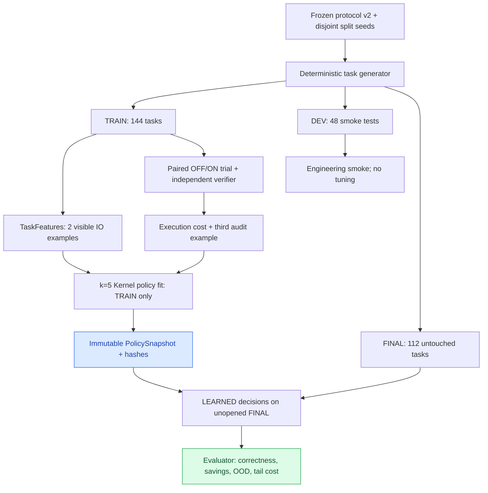

# EXP-0002B — 事前登録プロトコル v2：技能の有用性を経験から学ぶ

id: EXP-0002B-PLAN-V2
status: preregistered protocol v2; not implemented, no fresh outcome inspected
updated: 2026-10-24
tags: experiment, policy, preregistration, counterfactual, corrected-seeds, attainable-gates

> **事前登録の新しい版。** [v1の原本](plan.md)は書き換えず保存する。v1は分割間の乱数seed衝突と、課題構成上ほぼ到達不能な主要採用基準のため、**正式な評価計画として使用しない**。v2の本書を実装・計測結果より先に固定し、検証結果を見て閾値を変更する場合はv3と**新しい未使用のFINAL**が必要。

## Hypothesis / 仮説
- H1：解答前に分かる課題の特徴から、学習した小型Kernelは技能の無条件ONよりも無駄な探索・原始演算を減らせる。
- H2：常にOFFの場合と比べても、特定の課題では技能を使う方が小さいが再現可能な利得を得られる。
- H3：訓練にない操作や文脈では、未確かな技能ONを抑制できる。
- 帰無仮説：正確性と安全性を維持しながら、両固定方策より実測コストを改善するような技能選択規則を学べない。

**研究方式の名称：** 訓練課題ではON/OFFの両方を実行するため、厳密にはBandit feedbackではなく、反実仮想を観測できるfull-information contextual cost-sensitive learningである。

## v1からの改訂理由（結果を見た調整ではない）
1. v1のsplit master seed `260201, 260202, 260203` は、`seed=master+100000*k+100*i+j` の生成規則において `TRAIN j=2`, `DEV j=1`, `FINAL j=0` が衝突する。文字集合だけを変更しても同じ乱数列の特徴が再出現する。**修正：splitごとの非重複seed領域を確保。**
2. v1の「Always-OFFに対して候補数を5%以上削減」は、固定された原始演算・探索順・macro・family構成では数学的に実現できない可能性が高い。現行の列挙順では正規化課題でのみ1件の候補節約、最終16正規化課題の最大節約は16件。原始演算のみの全112課題の候補総数は概算`16*(1+2+3+4+6+40+40)=1536`で、最良でも約`16/1536=1.04%`。**修正：Always-OFFより8候補・32原始呼出の絶対節約、Always-ONより両費用5%以上削減という、事前に実現可能性のある複合ゲート**へ変更。
3. 人間向け説明は日本語に統一し、数式・API・識別子は英語で記録する。v1の元のコミットとレビューは履歴のまま保持する。

※ 上記の限界値は元のDSL・定義済みfamily・列挙順からの**設計上の概算**であり、v2の新しいFINALで測った実績ではない。

## 固定された対象と安全境界
- 技能は`skill_8fe1361cb5014f85`、body `lower(trim(Input))`、body SHA-256 `8fe1361cb5014f8503e4a57392e45f4fc7607e788fdd598f66668fbc11338eff`の1候補に限定。正式Libraryには入れず、検証用の隔離Registryにのみ登録する。
- 許可された基本演算は`trim`,`lower`,`upper`のみ。型付き`String → String`、展開後`max_ast_nodes=4`、`max_candidates=100`を全条件で統一。
- 未審査の技能・恣意的なPython実行・ネットワーク操作を認めない。独立Verifierの判定とRegistryの意味論を方策が変更できない。
- 依存するPR：[安全な技能候補 #6](https://github.com/ryonakayama234/DekaSugi/pull/6)、[設計 #8](https://github.com/ryonakayama234/DekaSugi/pull/8)、[原始演算計測 #9](https://github.com/ryonakayama234/DekaSugi/pull/9)。独立レビュー完了までは正式採用しない。

## データ生成仕様：新しいseed、既知構造の汎化とOOD
- 標準ライブラリ`random.Random`のみを使い、各例に独立した乱数インスタンスを作る。グローバル乱数は禁止。
- **v2 split master seed：** TRAIN=`10000000`、DEV=`20000000`、FINAL=`30000000`。生成seedは`master + 100000*k + 100*i + j`、家族番号`k=0..6`、課題番号`i`、例番号`j=0,1,2`。上限よりseed領域が衝突しないことをCIで保証する。旧v1のFINAL `260203`は使わない。
- 家族の順序：`identity`, `trim`, `lower`, `upper`, `normalize`, `reverse`, `replace_first`。最初の6種類にTRAIN各24問（144問）、DEV各8問（48問）、FINAL各16問（96問）。`replace_first`は**FINAL専用**16問。合計FINAL112問。
- tokenのアルファベットはTRAIN=`ABCDEF`, DEV=`GHIJKL`, FINAL=`MNOPQR`。各例の乱数`r`で`r.randrange(3,8)`文字、`r.choice(alphabet)`を各文字に使用。文字がすべて同じ、または回文なら、**同じ乱数系列から再生成**。familyが`upper`のときのみ小文字tokenとする。
- 空白の3型を`(i+j)%3`で循環：TRAIN `[(" "," "),("  ",""),("","  ")]`、DEV `[("\\t"," "),(" ","\\t"),("  "," ")]`、FINAL `[("\\n"," "),("\\t","\\t"),("   "," \\n")]`。`\\t`,`\\n`はコード実装ではそれぞれタブ・改行1文字とし、表現の曖昧さはユニットテストで防ぐ。
- 変換規則：`identity: x→x`、`trim: spaced(x)→x`、`lower: x→lower(x)`、`upper: lowercase(x)→upper(x)`、`normalize: spaced(x)→lower(x)`、`reverse: x→x[::-1]`、`replace_first: x→"Z"+x[1:]`。最後の2種は現在のDSLでは解けない操作を想定する。非回文とFINALの文字集合制約により変化を保証する。
- 課題IDは`<split>-<family>-<i:03d>`。各問`j=0,1`の**2例だけ**を公開TaskSpecへ渡す。第3例`j=2`は評価専用の監査例として別オブジェクトに保存し、特徴抽出器・Synthesisはアクセスできない。
- `family`、`split`、`seed`、監査例、正解変換の識別子をKernelの入力に渡さない。family単位で結果を報告するが、方策選択の特徴には使わない。
- **独立性の範囲：** この設計は文字集合・例・乱数列を分離した同族インスタンスへの汎化と、未知の解けないfamilyへの保守的対応を試す。未知の解法能力の獲得や広い意味での領域間転移を証明しない。
- 生成器のsource commit、全文データセットhash、課題数、split間seed重複ゼロ、入力例と監査例の分離を訓練前に記録する。**公開seedによる再現性**であり、秘匿したブラインドベンチマークではない。

## 解答前に観測するTaskFeatures v1（8次元、固定）
2個の公開TaskSpec例のみを参照し、次の順に算出する：
1. 平均`min(len(input),16)/16`
2. 平均`min(len(output),16)/16`
3. 平均`clip((len(output)-len(input))/16,-1,+1)`
4. 境界空白がある入力の割合（`input!=input.strip()`）
5. 入力ASCII英字に占める大文字率（該当なしは0）
6. 出力ASCII英字に占める小文字率（該当なしは0）
7. `input==output`の割合
8. 位置が対応する等しい文字数を`max(len(input),len(output),1)`で割った値の平均

特徴の順序・正規化を変更しない。「空白ならON」などの人手による使用条件を追加しない。

## 学習方策：knn-cost-v1（v1と同じ、変更しない）
- TRAINの各課題で同じ予算のAlways-OFFとAlways-ONを両方実行し、正答・第3監査例の正誤・候補数・**実行された**原始演算呼出数・時間・traceを観測する。macro内部のprimitiveを1回扱いにしない。正答・安全性を費用より優先する。
- 二方策の監査正答率が異なる場合は正しい側を支持。正しさが等しければ`calls_OFF-calls_ON`が正ならON、有利でない場合はOFF（呼出数同数なら候補数差、さらに同数ならOFF）。
- 8次元の平均L1距離が小さい訓練5問を`(distance,task_id)`順に選ぶ。距離`<=0.18`の近傍が3未満ならOFFに棄権。
- それ以外は、近傍5問中4問以上がONを支持し、5問の平均`calls_OFF-calls_ON >= 2.0`、かつ近傍に「OFFが正しくONが監査不正解」の例が無い場合に限りON。その他はOFF。
- 学習観測の`training_ids`とhash、スキルbody hash、特徴の版、全閾値を`PolicySnapshot`として固定。**DEVとFINALを見て再学習しない**。信頼度を確率的な成功率と偽らず、支持近傍数・距離・理由コードとして記録する。
- DEVは実装欠陥と安全性の検査専用で方策閾値の調整には使用しない。欠陥修正が方法に影響する場合、新版と新FINALで評価する。
- ORACLEは各問の結果を後から見て良い方を選ぶ診断専用であり、実際のKernelが参照してはならない。

## Metrics / 評価する観測指標
- 最終112問について`OFF`、`ON`、`LEARNED`を同条件で実行。ORACLEは事後比較のみ。各問の状態・監査・候補数・primitive呼出数・展開ノード・経過時間・Kernel判断・方策版・コード/データhashを不変JSONに記録する。
- 正答率・実行呼出数・候補数の**合計とfamily別の分布**、最悪値、中央値、p90、悪化件数を報告。総CPU/wall費用・特徴抽出・Policy推論・訓練費用を呼出数と混ぜない。
- 訓練費用の償却は将来1、32、128問の3条件を参考計算し、実測した追加処理費用が不明な場合「不明」とする。
- family単位をクラスタとするpaired bootstrap 1000標本（`random.Random(260299)`）と各問での勝敗数を提示。familyが7つしかないため狭い信頼区間や普遍的有効性を主張しない。

## Acceptance / 凍結した採否基準
以下を全て満たし、**独立レビューを通過した場合のみ実験用PolicyCandidate**として採用を検討する。標準技能Registryへの昇格とは別である。
1. **正確性：** LEARNEDがOFFより監査付き成功件数を減らさず、監査不正解な成功を追加しない。型、安全性、予算の回帰ゼロ。
2. **Always-OFFに対する意味のある上積み：** FINAL112問の合計で`tested_candidates`を**8件以上**、`primitive_invocations`を**32回以上**削減する。すべてOFFにするだけの擬似的な学習成功を防ぐ。
3. **Always-ONの無駄の抑制：** FINAL112問の合計で`tested_candidates`と`primitive_invocations`の**両方を5%以上削減**する。
4. **OOD安全性：** `replace_first`最終16問中、技能ONの誤選択は1問以下。監査不正解ゼロ。
5. **尾部の悪化制限：** 1問ごとの`calls_LEARNED-calls_OFF`のp90が**20回以下**。最大悪化例と悪化数も開示。
6. 失敗や不一致、学習の真の費用、分割ごとのn、事前登録からの逸脱を隠さず記録する。ゲート未達は`not_demonstrated`とし結果に合わせて同じFINALで再調整しない。

**解釈:** Always-ONだけに勝つ場合は「無駄の抑制」、OFFにも勝つ場合に初めて「条件付き技能利用の利益」を限定的に主張できる。学習Kernelが複数の技能を発明した、能力マップを獲得した、広い領域へ転移したと主張しない。

## システム構成・データフロー（将来の実験実装）

## Reproduction / 未実装のため未実行
- 現段階は**方法の事前固定のみ**。新しいDataset/Kernel/PolicySnapshot/FINAL結果は存在しない。実装後にLinux/WSL2上で`python -m unittest discover -s tests -v`、`python scripts/check_docs.py`を実行し、生成器・推論器・計測・監査の検証ログを残す。
- 評価を行う前に、PR #6の安全性再レビュー、PR #9計測の独立監査、差分を含むCIと本v2のレビューを完了し、ソース版・生成データのhashを固定する。
- 本文の一つでも研究上重要な条件を変更する必要が生じたら、v2の保存に加えて**v3の計画と新しいFINAL seed**を作る。

[v1原本](plan.md) / [改訂来歴](preregistration-v2-log.md) / [設計仕様](../../docs/specs/EXP-0002B.md) / [Issue #7](https://github.com/ryonakayama234/DekaSugi/issues/7)。
