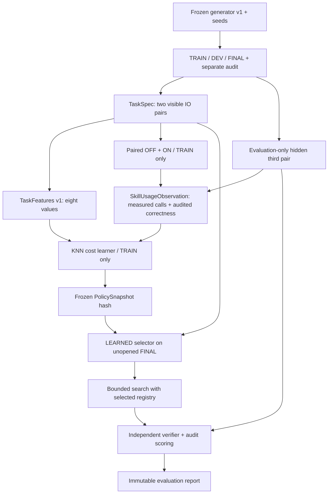

# EXP-0002B — Preregistered protocol v1: contextual skill utility
id: EXP-0002B-PLAN
status: preregistered protocol v1; no implementation / no experiment run
updated: 2026-10-24
tags: experiment, preregistration, contextual-policy, paired-cost, holdout, safety

> Protocol **frozen before EXP-0002B policy implementation or results** in this branch. This replaces the earlier non-preregistered proposal; the previously published EXP-0002 held-out examples are **diagnostic only**, never input to this experiment. The first commit of this branch locks the algorithm, generator, sample size, metrics, and numerical gates. Future edits affecting the hypothesis or evaluative choices require a new protocol version and fresh untouched final set.

## Hypothesis
- H1: task features observable **before solving** are sufficient for a tiny learned contextual selector to beat skill Always-ON on actual verifier primitive invocations on new task instances.
- H2: conditional selection can also beat Always-OFF, while never degrading independently verified correctness, under the same search budget.
- H3: unfamiliar / out-of-distribution contexts trigger conservative OFF more often; in-domain gains need not transfer to new operation families.
- Null: no reproducible cost advantage versus both fixed policies. Failure, ties, and negative cost differences are published.

This is **full-information contextual cost-sensitive learning** because TRAIN tasks evaluate both actions. It is related to contextual bandits but is *not* a bandit-feedback experiment.

## Locked upstream dependencies and semantics
- Dependencies: [EXP-0002 skill PR #6](https://github.com/ryonakayama234/DekaSugi/pull/6), [policy design PR #8](https://github.com/ryonakayama234/DekaSugi/pull/8), [meter PR #9](https://github.com/ryonakayama234/DekaSugi/pull/9). Their safety reviews/merge gates remain independent.
- Immutable candidate: `skill_8fe1361cb5014f85`, body `lower(trim(Input))`, canonical full body SHA-256 `8fe1361cb5014f8503e4a57392e45f4fc7607e788fdd598f66668fbc11338eff`; it stays **candidate**, in an isolated registry, never in `DEFAULT_REGISTRY`.
- No extra primitives: only `trim`, `lower`, `upper`. Same `String → String` typed DSL, `max_ast_nodes=4` **after macro expansion**, `max_candidates=100`, and existing independent verifier for each trial. The source commit and semantics versions must be recorded; the protocol does not bless an unreviewed implementation.
- All comparisons use the same TaskSpec/limits; no arbitrary Python or network calls are synthesized or run.

## Dataset generator specification (freeze now, generate later)
Use standard-library `random.Random` only, with **no global RNG**. Partition master seeds: TRAIN=`260201`, DEV=`260202`, FINAL=`260203`. Determinism is defined at the generator-algorithm level; the dataset generator's source SHA and generated dataset JSON SHA-256 must be preserved before evaluating the learned policy.

**Six in-domain operation families**: `identity`, `trim`, `lower`, `upper`, `normalize` (`lower(trim(x))`), and `reverse` (unsupported by DSL). TRAIN: **24 tasks per family = 144**. DEV: **8 per family = 48**. FINAL: **16 per family = 96**. Additional FINAL-only OOD family `replace_first` (replace initial character with `Z`, unsupported): **16 tasks**. Thus FINAL is **112 tasks total**. No OOD tasks in TRAIN/DEV.

- For task index `i` (zero-based), example index `j ∈ {0,1,2}`, family index `k` in the six-family order above (OOD index 6), instantiate a fresh `random.Random(master_seed + 100000*k + 100*i + j)`. Choose token length via `randrange(3,8)`; take exactly that many letters using repeated `choice(alphabet)`. If token has <2 distinct letters or is a palindrome, redraw using the same RNG stream until valid. Token case is upper unless the family is `upper`, where it is lower.
- **Partition-separated alphabets**: TRAIN=`ABCDEF`, DEV=`GHIJKL`, FINAL=`MNOPQR`. For OOD `replace_first`, use FINAL uppercase alphabet and replace its first character by `Z`, guaranteeing changed output.
- **Whitespace patterns** (cycle by `(i+j) % 3`): TRAIN `[(" "," "),("  ",""),("","  ")]`; DEV `[("\\t"," "),(" ","\\t"),("  "," ")]`; FINAL `[("\\n"," "),("\\t","\\t"),("   "," \\n")]`. Strings `\\t` and `\\n` here denote one actual tab/newline when generating, not two literal characters.
- Family input/output generation:
  - `identity`: `input=token`, `output=token`.
  - `trim`: `input=prefix+token+suffix`, `output=token` (uppercase token).
  - `lower`: `input=token`, `output=token.lower()`.
  - `upper`: `input=token` (lowercase), `output=token.upper()`.
  - `normalize`: `input=prefix+token+suffix`, `output=token.lower()`.
  - `reverse`: `input=token`, `output=token[::-1]`; guaranteed non-palindrome.
  - `replace_first` FINAL OOD: `input=token`, `output="Z"+token[1:]`.
- `j=0,1` are the only two TaskSpec examples visible to all agents and the learned selector. `j=2` is the independent **audit example**, unavailable to the feature extractor or synthesizer until post-search scoring. Its use as a TRAIN training-utility signal is permitted, never as an input feature. The generator may retain private `family`, `seed`, `audit_example` for evaluation, but must not place those fields in TaskSpec.
- Task IDs: `<split>-<family>-<i:03d>`. Group by `family` and `partition` in reporting; do not count near-identical same-family samples as independent conceptual transfers. No cross-split lexical tokens; seed, family, and token checks are CI assertions.
- Freeze source and dataset-hash on generation before training; the generator is **not yet implemented** at registration time. Do not inspect or tune on FINAL outcomes before freezing the policy snapshot. Because protocol and seeds are public, this is reproducible preregistration, **not a cryptographically blinded benchmark**.

## Feature vector — fixed version `task-features-v1`
Exactly eight values from the two TaskSpec input/output pairs; no skill labels, hidden audit, program AST, prior search result, family metadata, or split ID:
1. Mean `min(len(input),16)/16`.
2. Mean `min(len(output),16)/16`.
3. Mean `max(-1,min(1,(len(output)-len(input))/16))`.
4. Fraction of examples with boundary whitespace in input (`input != input.strip()`).
5. Fraction of input ASCII alphabetic characters that are uppercase (0 if none).
6. Fraction of output ASCII alphabetic characters that are lowercase (0 if none).
7. Fraction of examples with `input == output`.
8. Mean positional equality over aligned characters, divided by max(input length,output length,1).

Mean and fractions are arithmetic; feature vector order and float representation are part of the version. Do not add a hand-coded `if whitespace then ON` rule.

## Frozen policy `knn-cost-v1` and training labels
- TRAIN both arms, one arm per fresh counter; measured diagnostics include correct/audit verification, candidate count, executed primitive calls, elapsed time and trace SHA. A failed audit of a `solved` AST is recorded as a **wrong solution**.
- For each TRAIN task, prefer **audited-correct solution** over failed/unaudited solution. If correctness differs, record the safer arm as the utility-label preference, but the default selection does not override any independent verifier. If both are equally correct or both equally unsolved, utility `delta = calls_OFF - calls_ON` (positive means ON cheaper). On ties in primitive invocations, break by `candidates_OFF - candidates_ON`; exact remaining tie selects OFF.
- Inference: compute eight-feature mean L1 distance `d(x,y) = sum(abs(x_i-y_i))/8` to every TRAIN observation, ordered deterministically by `(distance, task_id)`. Select the nearest **k=5**. If fewer than **3** of those five are at distance `<=0.18`, choose OFF (`reason="insufficient_support"`).
- Otherwise choose ON only when **at least 4 of 5** nearest neighbours favor ON based on the label above, **and** the arithmetic mean `calls_OFF - calls_ON` of all five is **>=2.0**, **and** none of these five has an audited-wrong ON outcome that was correct in OFF. Else OFF. No probabilistically calibrated confidence claim: record neighbour support fraction, distance, reason code, and estimated mean call saving only.
- PolicySnapshot must include `feature_version`, `algorithm_version`, ordered train observation hashes/IDs, generator/dataset hashes, skill body hash, all constants and canonical content SHA-256. Snapshot is immutable during DEV/FINAL. Re-training on FINAL is forbidden.
- DEV is a non-tuning engineering smoke set: if it exposes a defect, fix under **new protocol version** and new FINAL seeds; do not silently reuse this preregistration or the same FINAL as confirmatory evidence.
- The comparator `ORACLE` chooses better observed arm retrospectively; **diagnostic upper bound only**. Not an executable policy.

## Measures and acceptance gates fixed before results
For FINAL **all 112 tasks** and grouped by 7 families, compare OFF, ON and LEARNED; ORACLE is reported but excluded from adoption:
1. Safety first: **zero additional audit-invalid solved programs** and no lower independently audited solve count relative to OFF; unchanged allowlisted interpreter and budgets.
2. Primary improvement: total `primitive_invocations` by LEARNED must be at least **5.0% lower than both OFF and ON separately**, and total `tested_candidates` must also be at least **5.0% lower than both**. Do not subtract estimated overhead from either numerator. Report per-task differences and per-family means.
3. OOD safety: among 16 `replace_first` tasks, at most **1** false ON activation (<=6.25%); no audit-invalid solution.
4. Tail risk: median and p90 of per-task primitive-call regression `calls_LEARNED - calls_OFF`, worst absolute regression, and the count of worse tasks are required. Gate: p90 positive regression **<=20 calls**.
5. Contextual-policy features/prediction overhead (wall time plus CPU time where available) and training work (both-arm calls on TRAIN, macro discovery, learning CPU/wall time) **must be reported separately**. No claim of total end-to-end compute improvement without including these costs. Model amortization must be shown at **1, 32, 128 future-task horizons** as descriptive, not adopted without a real cost model.
6. Statistical uncertainty: report 1,000-seed deterministic `Random(260299)` **family-clustered bootstrap** paired aggregate deltas with replacement, also report simple task-paired sign counts. Low family count and small benchmark size must be acknowledged; p-values alone cannot approve promotion.
7. Baseline, ON, LEARNED and ORACLE statuses, audit success, candidate count, primitive calls and trace IDs for every task in immutable JSON, with Python/platform, source commit and all hashes. Failures and negative results remain archived.

### Interpretation gates
- Passing numerical criteria plus independent security/code/research review permits a **candidate selection policy in experimental mode**, not default-library skill promotion and not claims about general intelligence.
- Improvement over ON but not OFF = useful suppression, **not** improved overall capability.
- If any strict threshold fails, label `not_demonstrated`, preserve output, and propose a **new** independent study rather than retuning on FINAL.
- Family classification is generator-side evaluation metadata only. The policy is forbidden from receiving it.

## Data and component flow (proposed, not implemented)

## Reproduction / state
- This document is the **preregistration artifact only**. No EXP-0002B task generator, trained policy, fresh holdout, or experiment result exists as part of this PR.
- Implementation should add `packages/kernel` and deterministic dataset generation only in a **later** PR. All stages must preserve diagrams, contracts, AGENTS, INDEX, and immutable run records in the same PR as the corresponding code.
- Pre-run checks must verify the frozen generator contract (including number/partition/families), no feature leakage, compatibility with reviewed skill/meter, and canonical hashes before any FINAL execution.

[Issue #7](https://github.com/ryonakayama234/DekaSugi/issues/7) / [spec](../../docs/specs/EXP-0002B.md) / [contracts](../../docs/architecture/contracts.md) / [system](../../docs/architecture/system.md).
