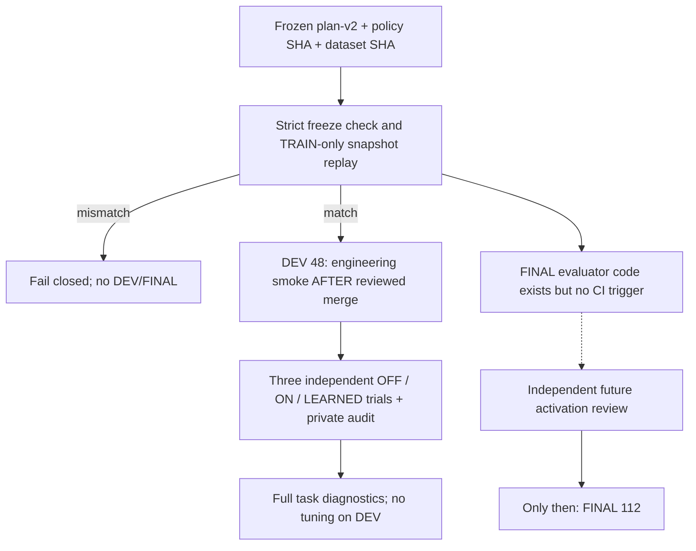

# EXP-0002B — DEV engineering smoke / FINAL独立評価ゲート

id: EXP-0002B-EVAL-GATE
status: evaluator reviewed and merged; DEV smoke complete; FINAL activation pending
updated: 2026-10-25
tags: evaluator, preregistration, dev-smoke, final-gate, integrity, exp0002b

## 目的
TRAIN-only学習を固定した[PolicySnapshot](../freeze-v2.md)を、学習時には使わなかった課題で検証するための**別の評価器**を構成する。ただし評価PR内ではDEV/FINALを実行しない。PR品質ゲートの通過後、mainに統合された時にDEV48問の**engineering smokeのみ**を実行し、その結果を見て方法を最適化しない。FINAL112問はさらに別の承認されたactivation PRまで停止する。

## システムとデータの流れ

## Methods preserved from preregistration v2
- [v2](../plan-v2.md)の課題、seed、8D特徴、固定5NNしきい値、OFF/ON/LEARNED/ORACLE定義、正確性、8候補/32 calls、ON比5%、OOD誤ON<=1、p90<=20、7 family-cluster bootstrap 1000再標本、償却horizon 1/32/128を変更しない。
- `run_evaluation`は最初に`load_and_check_freeze`で現行snapshot/源コード/全data hashを凍結済みJSONと突合。一致しなければ探索前に拒否する。
- Kernelの`choose(task.task, policy)`は他方策の結果計測**前**に実行し、監査例、family、split seedを渡さない。OFF/ON/LEARNEDは独立の`bounded_synthesize`＋新しいcanonical `PrimitiveCallMeter`で測り、同一armの結果一致を確認。ORACLEは後から診断用に選択するだけ。
- 1問ごとのSearchResult（AST/status/candidate数/trace/elapsed）、audit結果、primitive呼出数、技能選択と理由、family別、paired clustered bootstrapを記録する。統計区間は7 clusterのみで過大解釈しない。
- TRAIN学習費用と推論時間を総primitive呼出数と混ぜず別報告。horizonの償却試算はprimitiveのみ、総CPUの利益は未証明。
- **評価PRでのユニットテストはTRAIN fixtureだけ**。CI `pull_request`ではDEV/FINALを実行しない。後にレビュー済みmainへの`push`時のみDEV48問を実行する。FINAL CIステップは追加しない。

## 成立条件・停止条件
1. [freeze-v2.json](../freeze-v2.json)がsource/dataset/policy/training観測hashと一致。
2. 以前のEXP-0001、EXP-0002、MEASURE-0001の回帰を維持し、PRの`@codex review`最新HEADで重大指摘なし、CI成功。
3. DEVの正確性・監査・予算に工学的な異常がある場合は原因を記録。v2の方法変更が必要なら勝手に修正せず**v3+新FINALの事前登録と人間合意**を先行する。
4. DEV成功後もFINALは閉じたまま。別PRでFINAL実行トリガーを追加し、改めてCodexレビュー後のmain pushでのみ評価を実行する。
5. 成功・失敗の統計を恣意的に省略しない。FINALのいずれかの数値採用ゲートを下回れば`not_demonstrated`として記録し、デフォルト技能・Kernelに自動採用しない。

[Issue #25](https://github.com/ryonakayama234/DekaSugi/issues/25) / [v2方法](../plan-v2.md) / [freeze](../freeze-v2.md) / [ARCH-001](../../../docs/architecture/system.md) / [ARCH-002](../../../docs/architecture/contracts.md)。

## Codex指摘への修正（第2回）
- **P1:** 方策／dataset hashだけではruntime・Verifier・meterの変更が検出できない。TRAIN元main commit `2cd159af1815690d46105bc785c7d31cd88919fd`の**9つの実行ソースGit blob hash**を凍結し、評価を開く前にファイル内容から照合。基準commitとmanifestの一致も必須、欠落・改変ならfail closed。評価器ソースは別PRの独立レビューを要求。
- **P2:** 各armの探索～独立auditを含むCPU時間（process_time）・wall時間（perf_counter）、全評価のCPU/wall、およびKernel推論CPUをprimitive callsと区別してレポートへ追加。数値ゲート・アルゴリズム・generator・採否は変更しない。

## 統合後の実測確認（2026-10-25）
- [PR #26](https://github.com/ryonakayama234/DekaSugi/pull/26)の競合をmain凍結記録と整合。PR CI [#40162639945](https://github.com/ryonakayama234/DekaSugi/actions/runs/40162639945)はsuccess、PR上DEV/FINALはskipped。Codexによる修正後最新head `1a96bfb` の独立レビューは重大指摘なし。
- main統合 `f81b656` の[Actions #40162804951](https://github.com/ryonakayama234/DekaSugi/actions/runs/40162804951)はsuccess、main限定DEV48ステップとArtifact upload成功。
- 機械用ハッシュ・48件の3arm結果・実行環境・統計・費用・監査は[DEV evidence record](../runs/20261025-dev-smoke.md)へ集約し、歴史的事前登録は書き換えない。
- FINAL実行トリガー未追加、FINAL結果未取得。

## 後続のFINAL専用activation PR #28（実行前・別PR）
この文書の「FINALトリガー未追加」はPR #26 / DEV工程完了時の履歴を表す。2026-10-25に人間の承認を受けた[PR #28](https://github.com/ryonakayama234/DekaSugi/pull/28)で、指定subjectのsquash-mergeによるmain push初回attemptだけFINAL112を許可するステップを提案。PR CIと独立Codexレビュー完了までは統合・起動しない。詳細は[一度限りの起動ゲート](20261025-final-activation.md)と[run index](../runs/README.md)。

## FINAL112の完了記録（2026-10-25）
独立した後続[PR #28](https://github.com/ryonakayama234/DekaSugi/pull/28)の品質ゲートを通過し、main `37b3075`の[Actions #40176125696](https://github.com/ryonakayama234/DekaSugi/actions/runs/40176125696)でFINAL112を一度実行。原始演算・候補・独立監査の112件再集計と5数値条件はすべて一致し、科学的結論 `metrics_pass_not_promoted`。詳細[FINAL実測run](../runs/20261025-final112.md)。当初の「FINAL未実行」は評価器作成時の履歴として維持するが、現時点の正本は実測run。実行トリガーは結果同期PRで削除。
