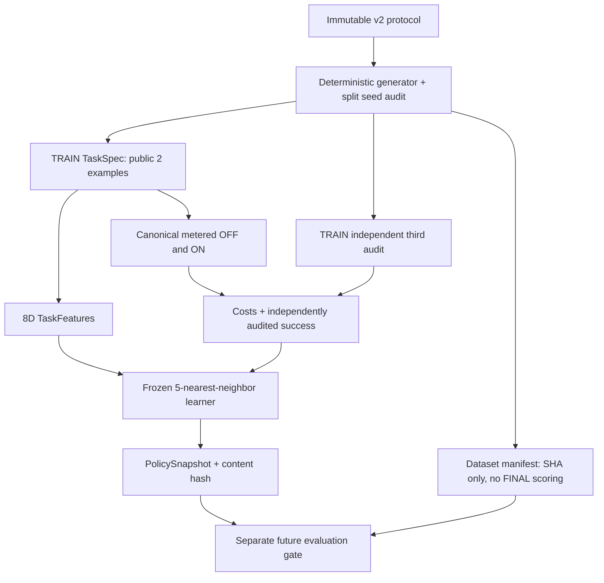

# EXP-0002B-AUDIT-002 — TRAIN-only Kernel engineering record

id: EXP-0002B-AUDIT-002
status: experimental implementation PR; CI/review and snapshot archive pending
updated: 2026-10-25
tags: experimental-kernel, train-only, preregistration, audit, measurement, no-final-results

## 目的と凍結した方法
- 唯一の方法正本：[preregistered plan-v2](../plan-v2.md)、[改訂理由](../preregistration-v2-log.md)。古いv1原本は不変。
- TRAIN144 / DEV48 / FINAL112の生成規則、seed master 10M/20M/30M、7 family、公開2例・独立audit1例、8特徴量、5近傍・距離0.18・3支持・4票・平均2呼出節約等のv2方法値を変更しない。
- このPRは生成器・特徴・TRAIN-onlyの学習とハッシュ付きsnapshot・再現可能なCI観測のみ。**DEV試行とFINAL成績は実行しない**。

## Trust/data flow

## Engineering conditions
- `packages.kernel.generate_partition`は実験データと専用auditを分離する。Kernelの`features(TaskSpec)`、`choose(TaskSpec, PolicySnapshot)`に、generator側のfamily/seed/split/auditを渡さない。TaskSpec IDも特徴には使わない。
- 学習時だけ両条件を探索し、正確性は第3TRAIN監査例と独立Verifierで評価する。false-solvedをコスト改善として扱わず、全回数はMEASURE-0001 canonical meterで計る。
- `dataset_manifest`は全splitの入力データと非公開auditを内容ハッシュ化するが、FINALの**正解率・検索・Kernel判断・費用**を計算しない。公開seedなのでブラインド評価ではない。
- `PolicySnapshot`は8D feature vector、TRAIN 144個の観測とhash、技能body hash、generator hash、方法版と固定閾値を保持し、改変検出する。スナップショットの採用・技能昇格は未承認。
- `python -m packages.kernel --mode preflight --output .run/EXP-0002B-preflight.json` はhashのみ、`--mode train --output .run/EXP-0002B-train-only.json` はTRAIN教師とsnapshotのみ。**FINALを実行するCLIは意図的に実装しない。**

## Validation status
- 新規generator/feature/knn/snapshot/holdout隔離のユニットテスト、既存EXP-0001/0002、資料検査、CIのTRAIN-only artifact upload、`@codex review`を統合条件とする。
- 実験の最終成績とDEVの結果：**未実行**。統合後、独立してsnapshotを固定し、DEV smokeを行った後に別PRでFINAL評価を検証する。
- 科学的方法を変える必要が出た場合は実装を止め、計画v2を改変せずv3/新FINALを再登録する。失敗/不合格は隠さない。

[計画v2](../plan-v2.md) / [EXP-0002B specification](../../../docs/specs/EXP-0002B.md) / [計測契約](../../../docs/architecture/measurement.md) / [Issue #21](https://github.com/ryonakayama234/DekaSugi/issues/21)。
